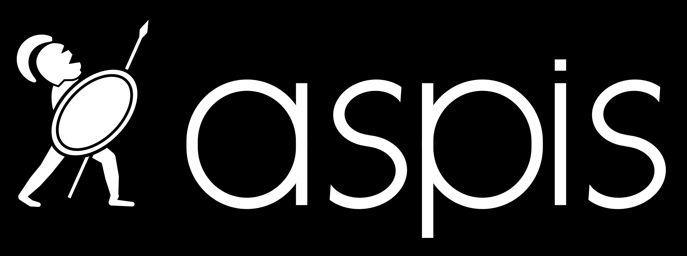

<!-- SPDX-FileCopyrightText: 2026 Nicole Roy -->
<!-- SPDX-License-Identifier: CC-BY-4.0 -->

# ASPIS

> In Greek myth the *aegis* was the shield of the gods: Zeus's, carried by Athena and, in the *Iliad*, by Apollo. The *aspis* was the shield of mortals, the round shield each hoplite carried in the phalanx to cover both themselves and the soldier beside them. Apollo's AEGIS was one company's operating system; ASPIS is the open one that anyone can carry.

ASPIS is an open-source operating system: a capability microkernel written in Rust for ARM64, booted by GRUB as a UEFI image ([0006](docs/decisions/0006-uefi-boot-image.md)). It is modeled on Apollo AEGIS / Domain/OS, and keeps its single-level store, its typed objects, its network-wide namespace and its display manager ([research notes](docs/research/aegis-domain-os.md)).

What sets it apart is what it changes and adds. Every object is named by an ID with no clock in it ([0001](docs/decisions/0001-object-identifiers.md)), and reached through versioned interfaces that work the same on a local or a remote object ([0004](docs/decisions/0004-network-transparency-and-failure.md), [0014](docs/decisions/0014-versioned-object-apis.md)). RPC is secured with hybrid post-quantum cryptography, and each realm is its own certificate authority ([0003](docs/decisions/0003-hybrid-post-quantum-cryptography.md), [0020](docs/decisions/0020-realm-certificate-authority.md)). Permissions live in a signed authorization tree that revokes by branch, with Cedar policies and AuthZEN decisions ([0016](docs/decisions/0016-authorization-sparse-merkle-tree.md), [0018](docs/decisions/0018-cedar-policy-language.md), [0019](docs/decisions/0019-authzen-decision-protocol.md)). And a realm, the nodes that run ASPIS together with the realm's own services, acts as a virtual cloud provider for twelve-factor apps ([0026](docs/decisions/0026-realm-as-cloud-provider.md)).

*A mockup, not a design.* In dm every window is an SVG surface, and a pad's transcript mixes a program's text with the graphics it draws ([0010](docs/decisions/0010-svg-core-primitive.md), [0011](docs/decisions/0011-dm-window-system.md)). In `pad_0001`, an operator follows a release rolling out across four nodes, then reads rows from a database that an app added to the realm, mounted at a system name ([0026](docs/decisions/0026-realm-as-cloud-provider.md), [0027](docs/decisions/0027-applications-extend-the-system.md)). A second pad, `pad_0002`, tails the deploy's log, and the catalog browser finds the database's interfaces ([0028](docs/decisions/0028-discovery-and-realm-catalog.md)). Here each pad has its own color, its charts use that color, and amber marks warnings. Text in the charts is real text, so it can be selected, copied and searched. The commands, pad names and colors are placeholders: ASPIS's command interpreter, and dm's commands and look, are still to be designed ([design backlog](docs/design/design-backlog.md#m6-a-console-you-can-log-in-to), D102 and D103).

## Status

ASPIS is in its design phase, and its first code is starting. This repository holds research notes, architecture decision records (ADRs), design documents, and the code for the first milestone, M1 "First light": a UEFI boot stub and a kernel that boots on QEMU and prints to its text-as-graphics console.

- **Process.** Research and discussion come first, then a design session, then code. The design session is under way, and M1's decisions are settled, so M1's code has begun ([build plan](docs/design/build-plan.md#m1-first-light)).
- **Building.** `cargo xtask build` builds `aspis.efi` and `initfs.img`; `cargo xtask run` boots them on QEMU through GRUB; `cargo xtask test` runs the host tests and the QEMU tests. It needs Rust (the version in `rust-toolchain.toml`), QEMU, mtools, and Docker to build GRUB. CI runs the same commands on every change, and the full QEMU matrix nightly.
- **Decisions.** ADRs 0001 to 0046 are settled. [0033](docs/decisions/0033-contributions-docs-license-and-notice-years.md) to [0042](docs/decisions/0042-log-ring-and-panic-path.md) settle the licensing questions and what the first milestone needs to build and boot, and [0046](docs/decisions/0046-fallback-fonts-for-wgl4-symbols.md) adds what building it showed. Four records are superseded: [0030](docs/decisions/0030-bind-tokens-sessions-and-group-memberships.md), [0043](docs/decisions/0043-qemu-boots-with-acpi-off.md), [0044](docs/decisions/0044-stub-undoes-grubs-command-line.md) and [0045](docs/decisions/0045-linking-the-kernel-and-stub-on-stable-rust.md). Their rules are now part of the records they changed. ADRs 0047 to 0061, for the kernel, and 0062 to 0068, for the call language, are proposed and not yet settled. The [decision index](docs/decisions/README.md) gives each record's status.
- **Design.** Zooming in from the system context, the design session has drawn views of a realm, a node and the kernel, and ten key flows.
- **Still open.** The ADRs leave many details to the design session, such as the ID format specification, the cryptography library, the coherence protocol for shared remote objects and the kernel specification. Each record says what it leaves open.
- **Targets.** QEMU `virt` with EDK2 firmware comes first, for development and CI. The Raspberry Pi 4 is the first real hardware ([0007](docs/decisions/0007-initial-hardware-targets.md)).
- **Scope.** The architecture assumes many realms federated across the internet. The first implementation is a single realm on one LAN ([0004](docs/decisions/0004-network-transparency-and-failure.md)).

## Key ideas

- **Objects, IDs and capabilities.** Files, processes and every other OS fixture programs touch are objects. Their 256-bit IDs carry the minting node's UUID and a per-node sequence number. Unlike AEGIS's UIDs, they hold no clock. An ID is only a name: access comes from kernel capabilities, with seL4 as the reference model ([0001](docs/decisions/0001-object-identifiers.md), [0002](docs/decisions/0002-capability-security-model.md)).
- **Network transparency, with visible failure.** Naming and invocation are the same for local and remote objects. Every call that may cross the network has a deadline, and its outcome tells success, an application error, *unreachable* and *indeterminate* apart ([0004](docs/decisions/0004-network-transparency-and-failure.md)).
- **Single-level store.** Mapping an object into an address space is the main way to reach its data. Pagers run in user space and serve page faults from local storage or from remote nodes ([0005](docs/decisions/0005-single-level-store.md)).
- **Hybrid post-quantum cryptography.** Key exchange pairs X25519 with ML-KEM-768, and signatures pair Ed25519 with ML-DSA-65. Each realm runs its own certificate authority with hybrid certificates, and RPC runs over TLS 1.3 on QUIC ([0003](docs/decisions/0003-hybrid-post-quantum-cryptography.md), [0020](docs/decisions/0020-realm-certificate-authority.md)).
- **Versioned interfaces, IDL and ABNF.** Every interaction with an object goes through one of its interfaces, versioned major.minor under DCE RPC's rule. Interfaces are written in the ASPIS IDL. The IDL compiler generates each interface's ABNF, which is normative for every RPC and IPC call on the wire ([0013](docs/decisions/0013-abnf-for-protocols-and-calls.md), [0014](docs/decisions/0014-versioned-object-apis.md)).
- **Tokens and OpenID Connect identity.** A client presents a JWT when it binds to an interface. The manager checks it once and returns a kernel capability or a session; the kernel never parses tokens. Each realm runs an OpenID Provider for its users and workloads ([0015](docs/decisions/0015-jwt-tokens-and-oidc-identity.md)).
- **The authorization tree, Cedar and AuthZEN.** Every grant lives in the realm's authorization tree, a sparse Merkle tree whose roots the realm signs and every node replicates. Revoking a branch revokes everything under it. Policies are written in Cedar and kept in the tree, and object managers ask a decision point on their own node through AuthZEN ([0016](docs/decisions/0016-authorization-sparse-merkle-tree.md), [0018](docs/decisions/0018-cedar-policy-language.md), [0019](docs/decisions/0019-authzen-decision-protocol.md)).
- **Federation and workload identity.** A realm can join one or more OpenID Federation topologies, and accepts and issues user and workload identities through them. Workload identities conform to SPIFFE and WIMSE ([0017](docs/decisions/0017-openid-federation-membership.md), [0022](docs/decisions/0022-spiffe-and-wimse-workload-identity.md)).
- **Entropy before keys.** A node serves no randomness until its generator is seeded with at least 384 bits of credited min-entropy. Requests wait rather than get weaker output. Long-lived keys also need a physical source, and creating a realm is an explicit ceremony ([0021](docs/decisions/0021-entropy-before-keys.md)).
- **Text as graphics, SVG and dm.** The console is text drawn as graphics from the kernel's first message. SVG documents are first-class objects. Display SVG, a display server on the native SVG layer, puts them on screen, and the `dm` window system is built on it, with pads that mix text and graphics ([0009](docs/decisions/0009-text-as-graphics-console.md), [0010](docs/decisions/0010-svg-core-primitive.md), [0011](docs/decisions/0011-dm-window-system.md)).
- **A POSIX personality.** POSIX runs in user space on the ASPIS APIs, aiming at source compatibility with POSIX.1-2024. The kernel gains no POSIX-specific features ([0012](docs/decisions/0012-posix-compatibility-layer.md)).
- **Twelve-factor apps, with the realm as cloud provider.** Each part of the twelve-factor contract is a native interface, with a portable POSIX form. A realm pools its nodes and acts as a virtual cloud provider for these apps, with its own builder, scheduler, router and service broker ([0025](docs/decisions/0025-twelve-factor-app-contract.md), [0026](docs/decisions/0026-realm-as-cloud-provider.md)).
- **Applications extend the system.** A native application offers its functionality as objects with versioned interfaces, to the same standard as ASPIS's own. An application such as a relational database service can then look like a core OS function, although it was added later ([0027](docs/decisions/0027-applications-extend-the-system.md)).
- **Discovery and the realm catalog.** Every object describes its own interfaces, and every manager can enumerate its objects. The realm runs a catalog of interfaces, types and published objects, updated in real time ([0028](docs/decisions/0028-discovery-and-realm-catalog.md)).

## Documentation

Everything is in `docs/`, in three folders. Every diagram is Mermaid, and context diagrams use the C4 model ([0024](docs/decisions/0024-diagrams-mermaid-and-c4.md)). To start, read [ASPIS in context](docs/design/system-context.md), then the [founding requirements](docs/decisions/README.md#founding-requirements), then what ASPIS [keeps and changes from AEGIS](docs/research/aegis-domain-os.md#5-implications-for-aspis).

### Research

[Apollo AEGIS / Domain/OS: research notes](docs/research/aegis-domain-os.md) covers AEGIS's history, architecture and failures, platform facts for ASPIS, and what ASPIS keeps or changes.

### Decisions

[The decision index](docs/decisions/README.md) lists the founding requirements and every ADR, with its status. Records are never renumbered. During the build phase, a record is edited in place, so it always says what is in force, and git history records each change. A record that no longer applies keeps its file, with its status changed to "Superseded".

### Design

[ASPIS in context](docs/design/system-context.md) is the C4 system context: a realm, the people who use it and the systems around it. Four views zoom in from there:

- [Inside a realm](docs/design/realm-containers.md): the realm's services, as C4 container views;
- [Inside a node](docs/design/node-components.md): the components on each node, as C4 component views;
- [Inside the kernel](docs/design/kernel-components.md): what the decisions put in the kernel, and what its specification must settle;
- [Key flows](docs/design/key-flows.md): ten sequence diagrams, from boot to discovery.

The [build plan](docs/design/build-plan.md) divides the build into chunks and milestones, from the first boot on QEMU to a federated realm that hosts apps. The [design backlog](docs/design/design-backlog.md) lists the open design decisions, filed under the milestone each must be settled before.

Ten design notes came before the decisions. Each led to the records beside it:

| Design note | Decisions |
|---|---|
| [POSIX compatibility on ASPIS](docs/design/posix-compatibility.md) | [0012](docs/decisions/0012-posix-compatibility-layer.md) |
| [Security tokens and identity on ASPIS](docs/design/security-tokens.md) | [0015](docs/decisions/0015-jwt-tokens-and-oidc-identity.md) |
| [Authorization tree](docs/design/authorization-tree.md) | [0016](docs/decisions/0016-authorization-sparse-merkle-tree.md) |
| [Joining OpenID Federation topologies](docs/design/openid-federation.md) | [0017](docs/decisions/0017-openid-federation-membership.md) |
| [Policy and decisions: Cedar and AuthZEN](docs/design/policy-and-decisions.md) | [0018](docs/decisions/0018-cedar-policy-language.md), [0019](docs/decisions/0019-authzen-decision-protocol.md) |
| [The realm as its own certificate authority](docs/design/realm-certificate-authority.md) | [0020](docs/decisions/0020-realm-certificate-authority.md) |
| [Entropy and the first keys](docs/design/entropy-and-first-keys.md) | [0021](docs/decisions/0021-entropy-before-keys.md) |
| [Workload identity: SPIFFE and WIMSE](docs/design/workload-identity.md) | [0022](docs/decisions/0022-spiffe-and-wimse-workload-identity.md) |
| [Twelve-factor apps, and the realm as their cloud](docs/design/twelve-factor-apps.md) | [0025](docs/decisions/0025-twelve-factor-app-contract.md), [0026](docs/decisions/0026-realm-as-cloud-provider.md) |
| [Applications that extend the system, and the catalog that finds them](docs/design/extensibility-and-discovery.md) | [0027](docs/decisions/0027-applications-extend-the-system.md), [0028](docs/decisions/0028-discovery-and-realm-catalog.md) |

## License

- ASPIS code (the kernel, servers, libraries and tools) is licensed under the Mozilla Public License 2.0. The text is in [LICENSE](LICENSE) ([0008](docs/decisions/0008-mpl-2.0-license.md)).
- ASPIS's documents are licensed under Creative Commons Attribution 4.0 International (CC BY 4.0): the research, the decision records, the design notes, this README and the other Markdown, with the diagrams they contain ([0033](docs/decisions/0033-contributions-docs-license-and-notice-years.md), rule 2). Anyone may copy and adapt them, with attribution.
- The license texts are in [LICENSES/](LICENSES), following REUSE ([0033](docs/decisions/0033-contributions-docs-license-and-notice-years.md), rule 3).
- Dependencies must be MPL-2.0 or permissively licensed (MIT, Apache-2.0, BSD). The kernel and core servers use no GPL-only dependencies ([0008](docs/decisions/0008-mpl-2.0-license.md), rule 4). Fonts may also be under the SIL Open Font License 1.1: the console uses Noto Sans Mono, with Noto Sans Math and Noto Sans Symbols for a few symbols it lacks, and the SVG layer uses Noto Sans Mono and Noto Sans ([0034](docs/decisions/0034-noto-fonts-under-ofl.md), [0046](docs/decisions/0046-fallback-fonts-for-wgl4-symbols.md)).
- ASPIS's own files carry two SPDX tags at the top, in the REUSE format ([0023](docs/decisions/0023-copyright-notices.md), [0033](docs/decisions/0033-contributions-docs-license-and-notice-years.md)). Source files carry `SPDX-FileCopyrightText: 2026 Nicole Roy` and `SPDX-License-Identifier: MPL-2.0`. Markdown documents carry the same copyright tag and `SPDX-License-Identifier: CC-BY-4.0`. The one exception is [CODE_OF_CONDUCT.md](CODE_OF_CONDUCT.md), adapted from the Contributor Covenant 3.0, which keeps that work's license, CC BY-SA 4.0.
- A notice names its years as a range, from the year the holder first published the file to the latest year that holder changed it, such as `2026-2027 Nicole Roy` ([0033](docs/decisions/0033-contributions-docs-license-and-notice-years.md), rule 4).
- Third-party material keeps its own notices.

## Contributing

Contributions come under the Developer Certificate of Origin 1.1 ([0033](docs/decisions/0033-contributions-docs-license-and-notice-years.md), rule 1). Each commit carries a `Signed-off-by:` line with the contributor's name, and anonymous contributions aren't accepted. A contribution is licensed under the license of the files it changes or adds: MPL-2.0 for code, CC BY 4.0 for documents. Contributors keep their copyright. A contributor adds their own `SPDX-FileCopyrightText` line to a file when their change to it is copyrightable, and a file a contributor creates names them. ASPIS asks for no CLA and no assignment.

ASPIS accepts outside contributions. [CONTRIBUTING.md](CONTRIBUTING.md) says how the project works, how to build and test it, and what a pull request needs, and quotes the DCO; CI checks every commit in a pull request for a sign-off. Everyone who takes part follows the [code of conduct](CODE_OF_CONDUCT.md), the Contributor Covenant 3.0. Report security vulnerabilities privately, as [SECURITY.md](SECURITY.md) describes.

Copyright 2026 Nicole Roy.
