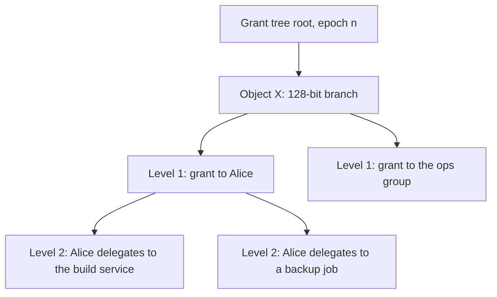

<!-- SPDX-FileCopyrightText: 2026 Nicole Roy -->

# Authorization tree: permissions and revocation with a sparse Merkle tree

*2026-11-24. Input to the design session. The decisions it led to are recorded in [ADR 0016](../decisions/0016-authorization-sparse-merkle-tree.md).*

1. [The tenet](#1-the-tenet)
2. [Sparse Merkle trees in brief](#2-sparse-merkle-trees-in-brief)
3. [Strawman key layout](#3-strawman-key-layout)
4. [Roots, epochs and replication](#4-roots-epochs-and-replication)
5. [How it fits the rest of ASPIS](#5-how-it-fits-the-rest-of-aspis)
6. [Open questions](#6-open-questions)

## 1. The tenet

Permissions (authorization) across the network-transparent environment are stored in a sparse Merkle tree. Revoking permissions means marking the relevant branch as revoked.

## 2. Sparse Merkle trees in brief

**What it is.** A sparse Merkle tree is a binary Merkle tree with one leaf for every possible key. With 256-bit keys that is 2^256 leaves, almost all empty.

- An empty subtree always hashes to the same value at a given depth, so only non-empty paths are ever stored.
- One root hash commits to the whole map.
- A proof that a key is present, or absent, lists the sibling hashes along its path.

**Proof size.** Compressed proofs drop the predictable empty siblings. With *n* grants in the tree, a proof carries about log2(*n*) hashes plus a bitmap. For a million grants that is around 20 × 32 bytes ≈ 640 bytes, plus 32 bytes of bitmap.

**Prior art.**

- Laurie and Kasper proposed sparse Merkle trees for certificate revocation ("Revocation Transparency", 2012), using absence proofs. [DRL], [TRILLIAN]
- Google's Trillian verifiable map is equivalent to that tree. [TRILLIAN]
- A 2026 IETF draft on revocation-list stapling builds on the same proposal and adds a decentralized trust model. [DRL]
- Dahlberg, Pulls and Peeters gave complete definitions and caching strategies. In their measurements, audit paths took under 4 ms each, even with a cache smaller than the tree. [ESMT]

## 3. Strawman key layout

The layout decides which revocations are a single operation. Here are the revocations ASPIS needs, and where each lives in the strawman:

| To revoke | Where |
|---|---|
| One grant | its leaf in the grant tree |
| A grant and everything delegated from it | the grant's branch |
| All access to an object | the object's branch in the grant tree |
| One principal, everywhere | its leaf in the principal tree |
| Every principal a compromised node or service minted | the authority's branch in the principal tree |

### 3.1 Grant tree

A grant key is 32 octets. Its first half identifies the object, and its second half encodes the delegation path:

```abnf
; Illustrative, per ADR 0013; the normative layout comes from the design session.
grant-key       = object-part delegation-path     ; 32 octets
object-part     = 16OCTET  ; first 128 bits of SHA3-256(object ID)
delegation-path = 8level   ; level 1 = grants on the object; level k = delegations from level k-1
level           = 2OCTET   ; 1-65535 = grant index at this depth; 0 = unused
                           ; constraint: after the first 0 level, every later level is 0
```

A leaf's value is the hash of the grant record. Each grant is a template-linked Cedar policy ([0018](../decisions/0018-cedar-policy-language.md), rule 2). The record holds:

- the principal;
- the template, which fixes the interfaces, versions and methods granted, and any conditions;
- the issuer;
- the epoch in which the grant was made.



Revoking Alice's grant marks its branch. That also revokes what she delegated to the build service and the backup job, and leaves the ops group's grant untouched.

The layout allows eight levels of delegation, with up to 65,535 grants under each parent. Wide sharing goes through groups.

### 3.2 Principal tree

A principal key is the principal's 256-bit ID ([0001](../decisions/0001-object-identifiers.md)), used as-is. IDs begin with their 128-bit minting authority, so:

- one leaf is one principal;
- the 128-bit prefix covers every principal that authority minted, such as all the workload identities of a compromised node.

### 3.3 Checking a permission at bind time

A manager checks the following against its replica at its current epoch. It verifies the token itself, and its node's decision point runs Cedar for the rest ([0019](../decisions/0019-authzen-decision-protocol.md), rules 1 and 3):

1. The access token is valid: signature, `iss`, `aud`, `exp` and `cnf` ([0015](../decisions/0015-jwt-tokens-and-oidc-identity.md)).
2. A grant that applies is present in the grant tree, with no revoked marker on any prefix of it. Cedar finds it itself, so tokens no longer name grant keys ([0019](../decisions/0019-authzen-decision-protocol.md), rule 8).
3. The token's `sub` is present in the principal tree and not under a revoked marker.
4. The grant's template covers the requested interface, version and methods ([0014](../decisions/0014-versioned-object-apis.md)), and no `forbid` policy applies ([0018](../decisions/0018-cedar-policy-language.md), rule 6), such as the realm rule that caps every decision at the token's scopes ([0019](../decisions/0019-authzen-decision-protocol.md), rule 8).

If all four pass, the manager issues a capability or session tagged with the determining policies and the principal ([0019](../decisions/0019-authzen-decision-protocol.md), rule 8).

### 3.4 The revoked marker

Revocation replaces the subtree at a prefix with a marker node:

- Its hash commits to the prefix and the epoch of revocation.
- A proof for any key under the prefix ends at the marker, which keeps revocation proofs short.
- The marker drops the subtree's contents from the tree's commitment; the realm's audit log keeps the record.
- Revocation is permanent. Restoring access means issuing new grants under new keys.

## 4. Roots, epochs and replication

- **Signed roots.** The realm's authorization service, part of the realm registry, applies changes in batches. Each batch produces a root numbered with a 64-bit unsigned epoch and signed with the realm's tree-signing key ([0003](../decisions/0003-hybrid-post-quantum-cryptography.md); [0020](../decisions/0020-realm-certificate-authority.md), rule 1), playing the role of Certificate Transparency's signed tree head.
- **Distribution.** Nodes subscribe to new roots and fetch the branches that changed, over ASPIS RPC.
- **Staleness.** Each node tracks the age of its newest root. Past a policy bound, its managers refuse new binds they can't confirm (fail closed). Existing sessions end no later than their tokens.
- **Scaling.** If one writer isn't enough, subtrees can be sharded by prefix and their roots combined.

## 5. How it fits the rest of ASPIS

- **Tokens** ([0015](../decisions/0015-jwt-tokens-and-oidc-identity.md)): access tokens name the epoch they were issued at, but no longer the grant keys they rely on: Cedar finds the applicable policies itself, and token scopes are an upper bound ([0019](../decisions/0019-authzen-decision-protocol.md), rule 8). A client can attach a proof and a signed root, much as OCSP stapling attaches certificate status.
- **Capabilities** ([0002](../decisions/0002-capability-security-model.md)): managers tag each session and capability with the determining policies from its decision ([0019](../decisions/0019-authzen-decision-protocol.md), rule 8). When a new root revokes a branch, they end the matching sessions and revoke the matching kernel capabilities.
- **POSIX** ([0012](../decisions/0012-posix-compatibility-layer.md)): mode bits become a view of the object's grant branch, and `chmod` writes grants.
- **Federation:** each realm has its own trees. A grant from another realm is checked against that realm's signed roots, whose keys are trusted through OpenID Federation.
- **Certificates** ([0020](../decisions/0020-realm-certificate-authority.md)):
  - The realm's CA records every certificate it issues under a branch for the issuing CA, so the signed root commits to every certificate in force.
  - Peers check a certificate's principal and serial number against their replica during the TLS handshake.
  - Revoking a principal's branch, or a CA's branch, revokes the certificates under it.

## 6. Open questions

- **Key layout.**
  - What balance of depth and fan-out to use.
  - Whether the object part should keep the object's 128-bit authority as a raw prefix rather than a hash. That would let one branch revoke every object a compromised node minted, at the cost of a less balanced tree.
- **Grant record schema** and its ABNF. Partly decided: [0018](../decisions/0018-cedar-policy-language.md), rule 2. Each grant is a template-linked Cedar policy; the record's encoding and its ABNF stay open.
- **Root distribution.** The batch interval, the distribution protocol and the staleness bound.
- **Authorization service availability.** How the service is replicated, and whether it needs consensus or sharding.
- **Transparency.** Whether signed roots should also go into an append-only transparency log, so auditors can detect a forked tree.
- **Garbage collection** of expired grants and expired certificate records.
- **Read access.** Who may read which branches of the tree.

## Sources

- [DRL] IETF draft, "DRL TLS Stapling", July 2026, which builds on Laurie and Kasper's "Revocation Transparency": https://www.ietf.org/archive/id/draft-premont-lamps-drl-stapling-00.html
- [TRILLIAN] Google, "Verifiable Data Structures" (Trillian): https://google.github.io/trillian/docs/papers/VerifiableDataStructures.pdf
- [ESMT] Dahlberg, Pulls and Peeters, "Efficient Sparse Merkle Trees: Caching Strategies and Secure (Non-)Membership Proofs", NordSec 2016: https://eprint.iacr.org/2016/683
