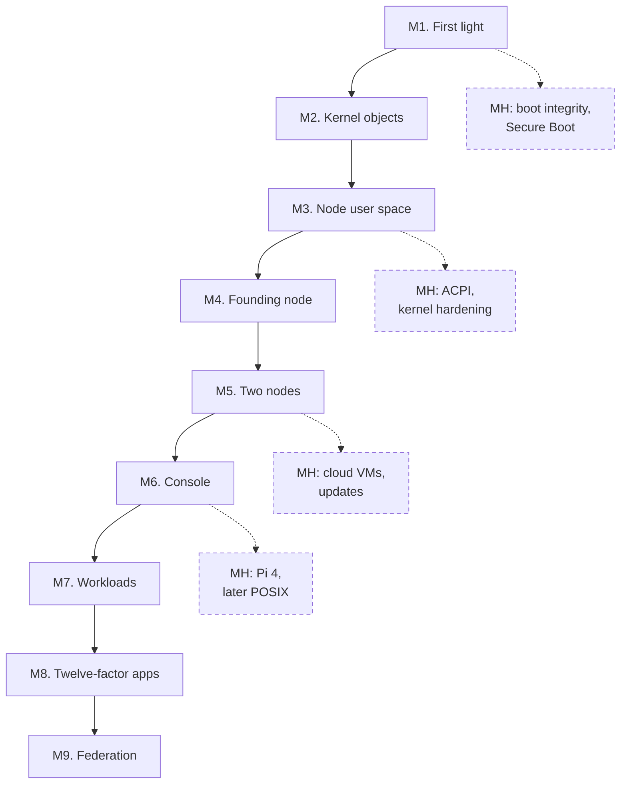
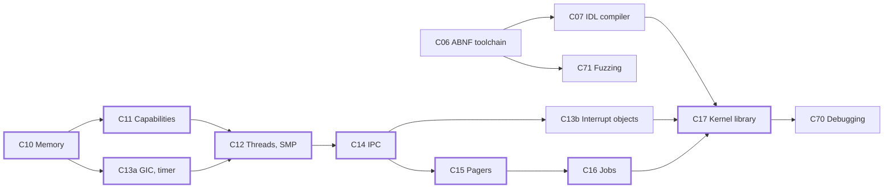
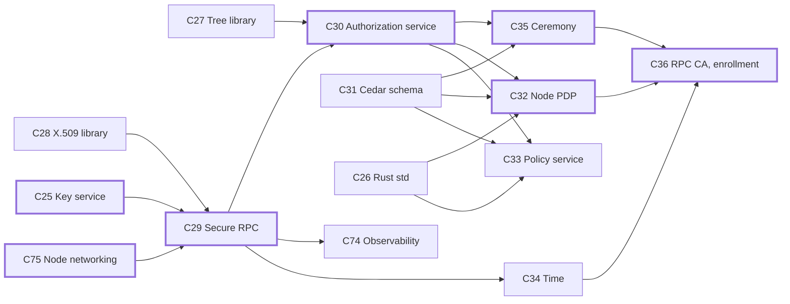
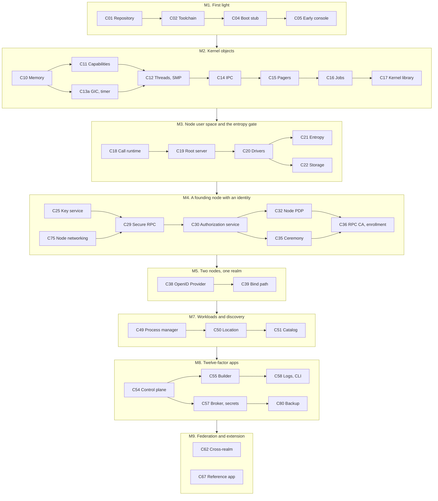

<!-- SPDX-FileCopyrightText: 2026 Nicole Roy -->
<!-- SPDX-License-Identifier: CC-BY-4.0 -->

# Build plan

*2026-11-24, updated 2026-11-27. How ASPIS is built: the chunks of work, the milestones they reach, the critical path, and the work that runs across milestones. It follows ADRs 0001 to 0069. Four of them are superseded: 0030, whose rules are now part of [0015](../decisions/0015-jwt-tokens-and-oidc-identity.md) and [0018](../decisions/0018-cedar-policy-language.md), and 0043, 0044 and 0045, whose rules are now part of [0036](../decisions/0036-qemu-configuration-and-test-builds.md), [0041](../decisions/0041-boot-abi.md) and [0035](../decisions/0035-toolchain-image-linkage-and-esp-layout.md). [0033](../decisions/0033-contributions-docs-license-and-notice-years.md) to [0042](../decisions/0042-log-ring-and-panic-path.md) settle what M1 left open, and [0046](../decisions/0046-fallback-fonts-for-wgl4-symbols.md) adds what building it showed. [0047](../decisions/0047-the-kernel-follows-sel4.md) to [0068](../decisions/0068-the-fuzzing-and-differential-testing-gate.md), accepted on 2026-11-25, settle M2's decisions, and the chunks they change are revised to match. [0069](../decisions/0069-cryptography-libraries.md), accepted on 2026-11-27, settles the cryptography libraries.*

ASPIS is built in chunks. A chunk is a piece of work with its own scope that can be finished and tested on its own: a kernel subsystem, a server, a library or a tool. Its prerequisites are the chunks it can't be finished without. Work on it may start earlier, against stubs.

A milestone groups chunks around an outcome you can demonstrate. It is done when that outcome holds. Milestones are outcomes, not phases: a chunk starts as soon as its prerequisites are done, even while an earlier milestone is still open.

Chunk IDs are stable labels, not an order. C13 is split into C13a and C13b, and C68 to C82 cover work that runs through the whole build, such as testing, debugging, power, observability, provisioning, updates and backup. C83, the memory server, is an ordinary M3 chunk, numbered after them because [0058](../decisions/0058-jobs-and-budgets.md) added it later. Each milestone's table lists its chunks in dependency order.

Each milestone also has open design decisions. They are listed under the same heading in [the design backlog](design-backlog.md), and are settled just before they're needed rather than all at once. Each becomes an ADR that the project owner accepts. The tables here say in words what must be decided before a chunk can be finished; the backlog numbers those decisions and gives their options. The "Decisions" column links the ADRs that already shape each chunk.

1. [Milestone overview](#milestone-overview)
2. [M1. First light](#m1-first-light)
3. [M2. Kernel objects](#m2-kernel-objects)
4. [M3. Node user space and the entropy gate](#m3-node-user-space-and-the-entropy-gate)
5. [M4. A founding node with an identity](#m4-a-founding-node-with-an-identity)
6. [M5. Two nodes, one realm](#m5-two-nodes-one-realm)
7. [M6. A console you can log in to](#m6-a-console-you-can-log-in-to)
8. [M7. Workloads and discovery](#m7-workloads-and-discovery)
9. [M8. Twelve-factor apps on a multi-node realm](#m8-twelve-factor-apps-on-a-multi-node-realm)
10. [M9. Federation and extension](#m9-federation-and-extension)
11. [MH. Hardware and hardening](#mh-hardware-and-hardening)
12. [The critical path](#the-critical-path)
13. [Work across milestones](#work-across-milestones)

## Milestone overview

Nine milestones run in sequence on QEMU, from the first kernel message to a federated realm that hosts apps. A tenth, MH, brings real hardware and hardening. It is a parallel track: its chunks start from M1, M3, M5 and M6 as their prerequisites are done. Every other chunk's prerequisites sit in its own milestone or an earlier one, and the graph has no cycles.

| Milestone | Outcome | Chunks |
|---|---|---|
| [M1](#m1-first-light) | `aspis.efi` boots on QEMU and prints to the text-as-graphics console | C01–C05, C68, C69 |
| [M2](#m2-kernel-objects) | User processes run on the kernel's objects, through the kernel interface library | C06, C07, C10–C12, C13a, C13b, C14–C17, C70, C71 |
| [M3](#m3-node-user-space-and-the-entropy-gate) | The root server starts the node's servers, and the entropy gate opens | C08, C09, C18–C24, C72, C73, C83 |
| [M4](#m4-a-founding-node-with-an-identity) | A ceremony creates a single-node realm, and the node holds its certificate | C25–C36, C74, C75 |
| [M5](#m5-two-nodes-one-realm) | A second node enrolls; remote binds, calls and page faults work | C37–C40, C76 |
| [M6](#m6-a-console-you-can-log-in-to) | POSIX, Display SVG and dm, with login and terminal pads | C41–C48 |
| [M7](#m7-workloads-and-discovery) | Workload identity, location leases, the catalog and the HTTPS edge | C49–C53 |
| [M8](#m8-twelve-factor-apps-on-a-multi-node-realm) | Twelve-factor apps run across several nodes | C54–C58, C80 |
| [M9](#m9-federation-and-extension) | Federation, cross-realm trust and an app that extends the system | C59–C62, C67, C82 |
| [MH](#mh-hardware-and-hardening) | Pi 4 cluster, Secure Boot, ACPI and cloud nodes, hardening, updates | C63–C66, C77–C79, C81 |

Solid arrows join milestones in sequence. Dashed arrows show where parts of MH can start.

## M1. First light

**Done when** `aspis.efi`, one AArch64 PE32+ image, boots on QEMU `virt` under EDK2 and GRUB arm64-efi, with GICv2 and with GICv3. The kernel prints to the text-as-graphics console and to the UART, and a forced panic reaches both. CI runs that boot in two configurations on every change and across the full QEMU matrix nightly ([0036](../decisions/0036-qemu-configuration-and-test-builds.md), rules 3 and 4), and two builds of the same commit give identical `aspis.efi` and `initfs.img` ([0038](../decisions/0038-reproducible-builds-and-provenance.md), rule 1).

| ID | Chunk | Scope | Prerequisites | Decisions | Decide first |
|---|---|---|---|---|---|
| C01 | Repository, licensing and docs tooling | `LICENSE` (MPL-2.0) and `LICENSES/` with the MPL-2.0 and CC BY 4.0 texts; SPDX headers, with year ranges; a `REUSE.toml`, which also names OFL-1.1 for the font files; a REUSE check that fails on any file without both tags; `CONTRIBUTING.md`, quoting the DCO, and a CI check that every commit in a pull request is signed off; the CI skeleton; the Mermaid render check; the ABNF gate's hook in the docs build | — | [0008](../decisions/0008-mpl-2.0-license.md); [0023](../decisions/0023-copyright-notices.md); [0033](../decisions/0033-contributions-docs-license-and-notice-years.md); [0034](../decisions/0034-noto-fonts-under-ofl.md), Consequences; [0024](../decisions/0024-diagrams-mermaid-and-c4.md); [0013](../decisions/0013-abnf-for-protocols-and-calls.md), rule 6 | Nothing open. [0033](../decisions/0033-contributions-docs-license-and-notice-years.md) settled the contribution policy, how notices name years, and the documentation license |
| C02 | Toolchain, image assembly and QEMU harness | `rust-toolchain.toml` pinning stable Rust 1.100.0, with no nightly feature; the kernel, built for `aarch64-unknown-none` as a static PIE linked with `-pie`, `--no-dynamic-linker` and `-z notext`, carried in the `.kernel` section of a stub built for `aarch64-unknown-uefi` and linked with `/version:1.0`, `/Brepro` and `/DEBUG:NONE`; `no_std` user-space programs built for `aarch64-unknown-none`, with ASPIS's runtime crate and linker script; the `initfs.img` builder, in the ASPIS format, which also lists and extracts images; the build order: the kernel, then `initfs.img`, then the stub with the image's SHA-512 in its `.initfs` section, then signing; the two-slot ESP layout and `/aspis/grub.cfg`; QEMU 11.1.3 `virt` with ACPI off and its bundled EDK2, GRUB 2.14 arm64-efi built from source, `ramfb`, the PL011 and PL031, and virtio-rng, virtio-blk and virtio-net on PCIe behind an SMMUv3 | C01 | [0006](../decisions/0006-uefi-boot-image.md), rules 1–3 and 5; [0035](../decisions/0035-toolchain-image-linkage-and-esp-layout.md); [0036](../decisions/0036-qemu-configuration-and-test-builds.md), rules 1 and 2; [0037](../decisions/0037-initial-image-format-and-contents.md); [0040](../decisions/0040-the-stub-checks-the-initial-image.md), rule 1; [0007](../decisions/0007-initial-hardware-targets.md), rule 1; [0009](../decisions/0009-text-as-graphics-console.md), rule 2; [0021](../decisions/0021-entropy-before-keys.md), rule 12 | Nothing open. [0035](../decisions/0035-toolchain-image-linkage-and-esp-layout.md), [0036](../decisions/0036-qemu-configuration-and-test-builds.md) and [0037](../decisions/0037-initial-image-format-and-contents.md) settled the toolchain and linkage, the ESP layout, the QEMU devices, and the initial image's format and contents. The boot manifest's format is the root server's (C19) |
| C03 | Glyph atlas tool and console assets | The build-time rasterizer, a permissively licensed Rust crate: three atlases of 8-bit coverage values, with cells 16, 24 and 32 pixels high, from Noto Sans Mono pinned by release and SHA-512, with Noto Sans Math and Noto Sans Symbols for the 18 WGL4 symbols it lacks, covering WGL4 except the ligatures and two private-use code points, the box-drawing characters, the block elements and U+FFFD; the logo bitmap, rasterized from `assets/logo/aspis-boot.svg` | C01 | [0009](../decisions/0009-text-as-graphics-console.md), rule 3; [0034](../decisions/0034-noto-fonts-under-ofl.md); [0046](../decisions/0046-fallback-fonts-for-wgl4-symbols.md) | Nothing open. [0034](../decisions/0034-noto-fonts-under-ofl.md) settled the family, its license and the sizes. C03 measures the atlases, and may store them compressed ([0034](../decisions/0034-noto-fonts-under-ofl.md), Consequences) |
| C04 | UEFI boot stub | Load options to an ASCII command line, undoing GRUB's rewriting of it; finding `initfs.img` through LoadFile2, then the `initfs` argument, then the stub's own directory; loading the kernel's ELF payload at a 2 MiB-aligned physical address and relocating it for a fixed virtual base; memory map; device tree and ACPI tables; a linear GOP mode and its reserved region; the `EFI_RNG_PROTOCOL` seed, in a page of its own; `ExitBootServices`, with no UEFI runtime services after it; EL2 to EL1, first zeroing `CNTVOFF_EL2` and opening the timer access controls in `CNTHCTL_EL2` when entered at EL2; the kernel's entry state and the tagged boot-information records; the kernel-argument grammar in ABNF; the SHA-512 check of `initfs.img` against the digest in `aspis.efi`, refusing a mismatch, which only a test build may waive, and the boot-information record of its result | C02 | [0006](../decisions/0006-uefi-boot-image.md), rules 1–4; [0035](../decisions/0035-toolchain-image-linkage-and-esp-layout.md), rules 3 and 4; [0039](../decisions/0039-no-uefi-runtime-services.md); [0040](../decisions/0040-the-stub-checks-the-initial-image.md), rules 2 and 4; [0036](../decisions/0036-qemu-configuration-and-test-builds.md), rule 6; [0041](../decisions/0041-boot-abi.md); [0009](../decisions/0009-text-as-graphics-console.md), rule 2; [0021](../decisions/0021-entropy-before-keys.md), rule 3; [0051](../decisions/0051-scheduling-timers-and-deadlines.md), rule 4 | Nothing open. [0041](../decisions/0041-boot-abi.md) settled the boot ABI, [0040](../decisions/0040-the-stub-checks-the-initial-image.md) how the stub checks `initfs.img`, and [0039](../decisions/0039-no-uefi-runtime-services.md) that ASPIS uses no UEFI runtime services. Whether the stub randomizes the kernel's placement moved to C78 ([0035](../decisions/0035-toolchain-image-linkage-and-esp-layout.md), rule 4) |
| C05 | Kernel early platform and text-as-graphics console | The kernel's linker script, in the upper half; MMU on; exception vectors; PL011 UART; the early console with text, rectangles and bitmaps, choosing its atlas by framebuffer width; parsing the kernel arguments; the log ring, with sequence numbers and non-blocking writers; the boot framebuffer's states; the panic path. The ring's read interface comes with M2's IDL | C03, C04 | [0009](../decisions/0009-text-as-graphics-console.md), rules 1–3 and 5; [0034](../decisions/0034-noto-fonts-under-ofl.md), rule 4; [0035](../decisions/0035-toolchain-image-linkage-and-esp-layout.md), rule 2; [0041](../decisions/0041-boot-abi.md), rules 1 and 5; [0042](../decisions/0042-log-ring-and-panic-path.md) | Nothing open. C05 fixed the kernel's virtual base, which [0035](../decisions/0035-toolchain-image-linkage-and-esp-layout.md) rule 2 left to it, at `0xffff_8000_0000_0000`, with 48-bit halves and 4 KiB granules ([0048](../decisions/0048-kernel-memory-and-address-spaces.md), Context). [0042](../decisions/0042-log-ring-and-panic-path.md) settled the log ring's format and who may read it |
| C68 | Test framework and CI matrix | Host tests of `no_std` crates under `cargo test`; in-QEMU tests collected through a linker section, reporting on the UART and ending QEMU through semihosting, with a host-side runner; two configurations on every change to code (`cortex-a72` with a GICv2, `max` with a GICv3) and the full matrix nightly; test builds under `--cfg aspis_test_build`, never a Cargo feature; a CI check that production images hold no test code | C01, C02 | [0036](../decisions/0036-qemu-configuration-and-test-builds.md); [0021](../decisions/0021-entropy-before-keys.md), Consequences; [0013](../decisions/0013-abnf-for-protocols-and-calls.md), rule 6; [0007](../decisions/0007-initial-hardware-targets.md), rule 1 | Nothing open. [0036](../decisions/0036-qemu-configuration-and-test-builds.md) settled the matrix and how a production build is shown to hold no test code |
| C69 | Reproducible builds and provenance for ASPIS's own images | Bit-for-bit reproducible `aspis.efi` and `initfs.img` from pinned inputs, built twice on every change to code and compared; a CycloneDX 1.7 SBOM and SLSA 1.2 provenance, signed with GitHub artifact attestations through Sigstore; the OFL text and Noto's notice beside every image; the release hashes that measured boot uses as known-good values (C64) | C02 | [0038](../decisions/0038-reproducible-builds-and-provenance.md); [0034](../decisions/0034-noto-fonts-under-ofl.md), rule 3; [0026](../decisions/0026-realm-as-cloud-provider.md), rules 3 and 4 | Nothing open. [0038](../decisions/0038-reproducible-builds-and-provenance.md) settled the build, the formats and the signing. App builds (C55) use CycloneDX too |

- **The ESP has two slots from M1.** GRUB sits at `/EFI/BOOT/BOOTAA64.EFI` and reads `/aspis/grub.cfg`. Slot `a` holds `/aspis/a/aspis.efi` and `/aspis/a/initfs.img`, and slot `b`, at `/aspis/b/`, stays empty until updates with rollback (C79) ([0035](../decisions/0035-toolchain-image-linkage-and-esp-layout.md), rule 6). How a slot is chosen and how a failed boot falls back are still open, and are decided before C79. They use files on the ESP, never UEFI variables ([0039](../decisions/0039-no-uefi-runtime-services.md), rule 5).
- **The initial image's digest is built in from M1.** C02's build puts the SHA-512 of `initfs.img` in `aspis.efi` before it is signed, so the two are released as a pair ([0040](../decisions/0040-the-stub-checks-the-initial-image.md), rule 1). C04 builds the check: the stub refuses an image that doesn't match, and only a test build may waive it (rule 2). So every image from M1 on meets 0040. C04 also builds the boot-information record that carries the result ([0040](../decisions/0040-the-stub-checks-the-initial-image.md), rule 4; [0041](../decisions/0041-boot-abi.md), rule 3). C77 adds the PCR 9 measurement, and C64 the Secure Boot signature that makes the embedded digest trustworthy.
- **DMA isolation on QEMU needs PCIe.** QEMU's `iommu=smmuv3` is "a single, machine-wide SMMUv3 instance that applies to all devices in the PCIe topology" ([QEMU `virt` documentation](https://www.qemu.org/docs/master/system/arm/virt.html)). virtio-mmio devices bypass it. [0007](../decisions/0007-initial-hardware-targets.md) rule 1's DMA isolation therefore needs virtio-pci devices, which C20 drives. [0036](../decisions/0036-qemu-configuration-and-test-builds.md), rule 2 puts every virtio device on PCIe, and ASPIS uses no virtio-mmio devices.

Decisions due before this milestone: [design backlog](design-backlog.md#m1-first-light).

## M2. Kernel objects

**Done when** user processes, loaded from static ELF executables, run with capabilities, IPC, eventcounts, memory objects, user-space pagers, typed faults and jobs, reached only through the kernel interface library and IDL-generated stubs. The EL1 virtual timer preempts threads and ends waits, secondary cores start through PSCI, and a user-space test driver receives an interrupt as an advance of an eventcount. Kernel panics are symbolized, a test build's test code can stop a user thread and read its registers and memory through a capability, since no manager hands a debugger capabilities before the node's PDP runs in M4 ([0061](../decisions/0061-debugging.md), rule 4), the fuzzing harness runs on the ABNF toolchain's parsers, and the kernel-call fuzzer runs nightly.

| ID | Chunk | Scope | Prerequisites | Decisions | Decide first |
|---|---|---|---|---|---|
| C06 | ABNF toolchain and ASPIS core rules | `grammars/core.abnf`, in RFC 5234's binary-octet encoding with RFC 7405: big-endian `u8` to `u64` and two's-complement `i8` to `i64`, `f32` and `f64` with one NaN encoding, `bool`, `object-id` and `uuid`, u32 lengths and counts, UTF-8 text without U+0000 (and, since C07, without the Unicode noncharacters), presence octets, and the shapes of struct tails, union arm tags and capability references, each value with exactly one encoding; `grammars/core.vectors`; the closed constraint vocabulary; `; uses:` headers in `tools/ci/check-grammars.py`; `crates/abnf`, a `no_std` Rust checker with no dependencies and no unsafe code, which also enforces the constraints, bounded in time and memory so that the catalog can run it on publishers' grammars; vectors that break only a constraint; the CI gate. The two checkers are a differential pair for C71 | C01 | [0013](../decisions/0013-abnf-for-protocols-and-calls.md), rules 1, 4 and 6; [0062](../decisions/0062-core-rules-big-endian-fixed-width.md); [0068](../decisions/0068-the-fuzzing-and-differential-testing-gate.md), rule 6 | Nothing open. [0062](../decisions/0062-core-rules-big-endian-fixed-width.md) settled byte order, signed integers and the core rules (rules 2 and 3), and C06 settled the constraint vocabulary's own ABNF and the Rust checker's design ([call-language L22](call-language.md#l22-the-constraint-vocabularys-grammar-and-the-rust-checker)) |
| C07 | IDL language and compiler core | The ASPIS IDL: one file per interface major under `interfaces/`, in edition 2026, with a lock file of each published minor's hash; `crates/idl`, a hand-written `no_std` front end tested against `grammars/idl.abnf`, with `crates/idl-rt` and `tools/idlc`; bounded types, open unless `[closed]`; capability parameters and server streams; explicit method numbers; `grammars/names.abnf`; each minor's wire and canonical-text grammars, with vectors; `idlc check`, the minor-version compatibility check; the JSON mapping; Rust `no_std` bindings (views, encoders, client stubs and server dispatchers) with an `alloc` feature, forbidding `unsafe`; the doc model; fuzz support; a conformance runner. Its Cedar back-end comes with C31, and its HTTPS and OpenAPI back-ends with C52 | C06 | [0013](../decisions/0013-abnf-for-protocols-and-calls.md), rules 2, 3 and 5; [0014](../decisions/0014-versioned-object-apis.md), rules 3 and 4; [0063](../decisions/0063-names-and-the-canonical-call-text.md); [0064](../decisions/0064-the-call-header-and-wire-encoding.md); [0065](../decisions/0065-typed-errors-and-minor-versions-on-the-wire.md); [0066](../decisions/0066-capability-parameters-and-server-streams.md); [0067](../decisions/0067-the-aspis-idl.md); [0004](../decisions/0004-network-transparency-and-failure.md), Consequences | Nothing blocks it. [0063](../decisions/0063-names-and-the-canonical-call-text.md) to [0067](../decisions/0067-the-aspis-idl.md) settled the names and the call text, the call header, errors and minor versions, capability parameters and streams, and the IDL. The open questions it touches belong to other chunks: the object-ID text form ([L01](call-language.md#l01-the-object-id-text-form), D34), until which the IDL writes IDs as `reserved(n)` or `hex(...)` ([0067](../decisions/0067-the-aspis-idl.md), rule 2); reserved numbers (L02, D35); and the Cedar schema (L12 and L44, C31). C07's mechanism choices are recorded in [call-language.md](call-language.md#the-idl). Its parsers (the name parsers, the IDL front end and every generated decoder) come with fuzz-ready entry functions and replay tests ([call-language](call-language.md#fuzz-entry-points)); their gate pass, with its CPU-hour and coverage review, is recorded with C71's harness, as for C06's parsers |
| C10 | Kernel memory management and address spaces | Untyped memory and retyping, with no other frame allocator and no heap; after boot, every object, page table and kernel record made from memory a job supplies; memory kept at boot for the kernel's image and panic symbol table, its stacks, page tables and log ring, and on a GICv3 the redistributors' LPI tables, and the rest given to the root server as untyped and device untyped memory, honoring the framebuffer, initial image and seed regions; the boot objects, such as the initial image as a resident immutable memory object; 4 KiB pages, with 2 MiB and 1 GiB blocks; tables and an ASID for each address space in the lower half, and the kernel's half with a never-executable direct map of RAM; no user address dereferenced: user memory other than a thread's pinned IPC buffer is reached by walking the tables in software, failing at once with "not resident" or "not RAM"; W^X, PXN and UXN, and PAN where the processor has it, from the first page tables, which replace M1's early tables | C05 | [0047](../decisions/0047-the-kernel-follows-sel4.md), rules 2 and 6; [0048](../decisions/0048-kernel-memory-and-address-spaces.md); [0041](../decisions/0041-boot-abi.md), rule 3; [0002](../decisions/0002-capability-security-model.md), rule 1; [0005](../decisions/0005-single-level-store.md), rule 1; [0025](../decisions/0025-twelve-factor-app-contract.md), rule 12 | C10 settled ASID allocation, by generation rollover, in the [kernel specification](kernel-specification.md#address-space-layout) (D150: K01). Randomizing the kernel's placement, and whether to emulate PAN on the Cortex-A72, stay with C78 ([0048](../decisions/0048-kernel-memory-and-address-spaces.md), rule 6 and Consequences) |
| C11 | Capability system and kernel object model | Capability spaces as trees of CNodes, with seL4's guarded lookup; the rights read, write, grant and grant-reply, which a copy may only drop; 64-bit badges; the derivation tree, with complete, preemptible revoke and delete; kernel bindings that keep a child copy of the capability presented; badged session copies, so that a manager can revoke what it derived; identify, which reads a capability's kind and rights; transfer of up to three capabilities per message, with C14. The capability-table copy is a library operation (C17). Kernel objects carry no IDs | C10 | [0047](../decisions/0047-the-kernel-follows-sel4.md), rules 2 and 3; [0049](../decisions/0049-capability-spaces-rights-and-revocation.md); [0050](../decisions/0050-ids-for-kernel-objects.md), rule 1; [0002](../decisions/0002-capability-security-model.md), rule 1; [0016](../decisions/0016-authorization-sparse-merkle-tree.md), rule 6; [0019](../decisions/0019-authzen-decision-protocol.md), rule 8 | C11 settled the capability mechanism in the [kernel specification](kernel-specification.md#capabilities): how bindings hold their copies and the address space's record (D151: K07 in part); no operation that compares capabilities (D152: K11); preemption every 100 units, and how revoke, delete and the clearing of untyped memory keep their progress (D155: K22, K23 in part). [0047](../decisions/0047-the-kernel-follows-sel4.md), rule 3 now lists C11's two departures from seL4: every copy is a child of the capability it came from, and deleting an object finishes the objects that only it reached. K09 and K75 stay with C17, K32 with C14, K40 with C13b, K42 with C15 and C70, and K50 with C12 and C15 |
| C13a | Interrupt controllers and the generic timer in the kernel | GICv2 (the Pi 4's GIC-400) and GICv3 bring-up, with every GIC frame kept by the kernel; the EL1 virtual timer on every platform, tickless, its count `CNTVCT_EL0` the kernel's clock, with no offset, since the stub zeroes it at EL2 (C04); software-generated interrupts, the kernel's own, for rescheduling, cross-core requests and the panic stop | C10 | [0007](../decisions/0007-initial-hardware-targets.md), rules 1 and 2, Consequences; [0051](../decisions/0051-scheduling-timers-and-deadlines.md), rule 4; [0052](../decisions/0052-smp-bring-up-and-the-kernel-lock.md), rule 4; [0055](../decisions/0055-interrupt-objects.md), rules 1 and 5 | C13a settled the SGI numbers and the panic stop in the [kernel specification](kernel-specification.md#cross-core-signals-and-tlb-maintenance) (D153: K26, K27): SGIs 0 to 2, and no pseudo-NMI. It recorded the GIC and timer mechanism there too ([The kernel's interrupt controller](kernel-specification.md#the-kernels-interrupt-controller); [The timer and deadlines](kernel-specification.md#the-timer-and-deadlines)). [0051](../decisions/0051-scheduling-timers-and-deadlines.md), rule 4 settled the timer: the EL1 virtual timer on every platform, including cloud VMs (C81) |
| C12 | Threads, scheduling, timers and SMP | Thread control blocks, with `TPIDR_EL0`, register access, and suspend that keeps a thread's wait; fault and timeout endpoints; MCS scheduling contexts, each with a budget and a period in microseconds, bound to one core, configured within its job's CPU share, and badged; fixed priorities from 0 to 255, with maximum controlled priorities; passive servers and scheduling-context donation, and taking a canceled or timed-out caller's context back along a chain of calls; deadlines as values of the virtual count; SMP bring-up through PSCI `CPU_ON`; one kernel lock, with preemption points and bounded batches of interrupt work; run queues per core; broadcast TLB maintenance; the TLA+ spec of scheduling-context donation and taking a context back ([0068](../decisions/0068-the-fuzzing-and-differential-testing-gate.md), rule 10) | C10, C11, C13a | [0047](../decisions/0047-the-kernel-follows-sel4.md), rules 2 and 3; [0051](../decisions/0051-scheduling-timers-and-deadlines.md), rules 1 to 3, 5 and 6; [0052](../decisions/0052-smp-bring-up-and-the-kernel-lock.md); [0056](../decisions/0056-faults-and-page-fetch-deadlines.md), rule 1; [0058](../decisions/0058-jobs-and-budgets.md), rule 8; [0061](../decisions/0061-debugging.md), rule 3; [0025](../decisions/0025-twelve-factor-app-contract.md), rule 12; [POSIX note](posix-compatibility.md) §4.15, §4.18 and §5; [0068](../decisions/0068-the-fuzzing-and-differential-testing-gate.md), rule 10 | Mechanism only, in the [kernel specification](kernel-specification.md#open-questions): the share check, who configures scheduling contexts, the priority bands' ranges, and firmware without PSCI (D153: K13, K14, K16, K21); stranded servers, which core keeps a deadline, deadline edge cases, and a suspended thread's deadlines (D154: K17 to K20); binding slots, object sizes and a fault in flight when its endpoint is unset (D151: K07, K08, K15, K29, K50); long operations, interrupt batches and ordered queues (D155: K23 to K25), where C13a's pending check means a batch that relies on preemption points runs after the end of interrupt; when to unmask SError, which C13a leaves masked (D153: K77); and hardware debug state (D160: K70). C12 settled its part in the [kernel specification](kernel-specification.md#threads-and-scheduling): the share check, exact per job and core, with the root job holding every core until C16 (D153: K13); seL4's per-core scheduling control, copied and revoked as in seL4 (K14); the bands' default ranges as a convention (K16 in part); no usable PSCI leaves the other cores off (K21); SError unmasked on each core once its stack is set (K77); stranded servers' waits canceled as the walk reaches them, deadlines kept on the core they were queued on, the deadline edge cases with EL0 reading the virtual count, and a suspended thread's deadlines running on (D154: K17 to K20); the thread's eight slots, the timeout endpoint's removal, the context's sizes and a queued fault withdrawn when its endpoint goes (D151: K07, K08 in part, K15, K50); the walk's progress, batches of 100 units in turn from three sources, and red-black trees for the release and deadline queues (D155: K23 and K25 in part, K24); and no per-thread hardware debug state (D160: K70 in part). It brings the other cores up through PSCI, each running its own threads under one CLH lock, with remote calls that stall a thread on another core and coalesced reschedule SGIs, and makes the root server's first thread at priority 255. [0047](../decisions/0047-the-kernel-follows-sel4.md), rule 3 now lists C12's two departures from seL4: only the thread that holds a donated context answers its call, and a thread's scheduling context is bound by a copy. [0051](../decisions/0051-scheduling-timers-and-deadlines.md) now points to the bands' ranges and the share check as settled. K16's second half stays with C19, K29 with C14, the wait set's and handler's slots with C14 and C13b, K23's and K25's other operations with C14, C15 and C16, and the rest of K70 with C70 |
| C14 | IPC endpoints and eventcounts | Synchronous endpoints with seL4's send, non-blocking send, call, receive, and reply and receive; messages of up to 120 words, with lengths in octets; a pinned IPC buffer for each thread; up to three capabilities per message, into receive slots the receiver names; deadlines and cancellation, whose results say whether a call was delivered; eventcounts with advance, read and wait, which never wrap; wait sets of up to 60 eventcounts; an eventcount bound to a thread; the TLA+ spec of calls, replies, cancels and eventcount waits ([0068](../decisions/0068-the-fuzzing-and-differential-testing-gate.md), rule 10). Waits on words in user memory come with C15, which has memory objects | C11, C12 | [0053](../decisions/0053-eventcounts.md); [0054](../decisions/0054-ipc-endpoints.md); [0049](../decisions/0049-capability-spaces-rights-and-revocation.md), rule 6; [0064](../decisions/0064-the-call-header-and-wire-encoding.md), rule 2; [0002](../decisions/0002-capability-security-model.md), rule 1; [POSIX note](posix-compatibility.md#5-what-the-kernel-must-provide) §5; [0068](../decisions/0068-the-fuzzing-and-differential-testing-gate.md), rule 10 | Mechanism only, in the [kernel specification](kernel-specification.md#open-questions): binding slots, buffer registration and the wait set's size (D151: K07, K08, K29, K33); rights on wait sets (D152: K32); how waits end for stranded servers, suspended threads and memory requests (D154: K17, K20, K51); long operations, queues and restarted advances (D155: K23 to K25, K31); and the message layout and result names (D156: K28, K30). C14 settled its part in the [kernel specification](kernel-specification.md#ipc): the endpoint's and eventcount's 64 bytes, the wait set's slots and its sizes of 1 to 60 entries chosen at retype, and thread slots 6 and 7 (D151: K07 in part, K33); a wait that goes on when a wait-set entry is removed, ending with an empty mask when none is left (K08); an IPC buffer registered with the capability that backs its page, a copy of which the thread keeps in slot 7 (K29); the write right to change a wait set and the read right to wait on it (D152: K32); the cancels of the endpoint and eventcount waits along a take-back, and messages to a suspended thread written at once (D154: K17, K20); a unit as one waiter node linked or unlinked, with a wake's constant bookkeeping (an endpoint queue, a deadline) in its base unit, and deletion steps that end waits counting them, badge cancels kept in a badge tree, destroyed endpoints and eventcounts releasing one waiter per deletion step, every capability-deleting operation deleting first and restarting, eventcounts on the work list with costed units, red-black trees for the endpoint and eventcount queues, and an advance that returns once the count has changed and is never restarted (D155: K23 in part, K24, K25 in part, K31); seL4's AArch64 registers and buffer with an octet length, and one "object destroyed" result with a delivered bit and the kernel's internal error names (D156: K28 and K30 in part). C14 also built K50's half for faults queued on real endpoints. [0047](../decisions/0047-the-kernel-follows-sel4.md), rule 3 now lists C14's departures from seL4: destroyed endpoints and eventcounts release their waiters one at a time, a call needs grant or grant-reply and a receive a reply object, an out-of-range length is refused, and a passive receiver doesn't hear its bound eventcount, which [0053](../decisions/0053-eventcounts.md), rule 5 now says too. K51 stays with C15 and C16; K34, K49, the word waits' error names, and IPC buffers backed by memory objects, with their page pin and the dirty marking of the kernel's writes (K29, registration steps 4 and 5), with C15; the IPC buffer's job check with C16; K07's handler and the interrupt advance's caller with C13b; and the call numbers, status numbers and IDL errors with C17 |
| C13b | Interrupt objects for user-space drivers | The interrupt control capability, held by the root server, and one handler capability for each shared peripheral interrupt or MSI; a handler bound to an eventcount, which each interrupt advances, masking a level-triggered interrupt until the driver acknowledges through the handler; MSI through GICv2m, and through the GICv3 ITS, with the kernel picking each MSI's vector and giving the driver the address and data to program; the redistributors' LPI tables, taken at boot for a number of LPIs fixed then; the ITS's command queue and tables, kernel objects made from untyped memory the caller supplies; a device's translation table freed only after the ITS has unmapped the device, and the shared tables never deleted while the ITS uses them. The Pi 4's second-level controller and the BCM2711's PCIe MSI are handled in user space; the controller's driver comes with C63 | C11, C13a, C14 | [0055](../decisions/0055-interrupt-objects.md); [0053](../decisions/0053-eventcounts.md), rule 8; [0049](../decisions/0049-capability-spaces-rights-and-revocation.md), rule 2; [0058](../decisions/0058-jobs-and-budgets.md), rule 5; [0002](../decisions/0002-capability-security-model.md), rule 1; [0007](../decisions/0007-initial-hardware-targets.md), Consequences | Mechanism only, in the [kernel specification](kernel-specification.md#open-questions): how an MSI request names its device, interrupt targets, the number of LPIs, the ITS's table sizes, waiting for the ITS, and a revocation that meets an ITS table (D157: K35 to K40); binding slots (D151: K07); and interrupt batches (D155: K24) |
| C15 | Memory objects, pagers and typed faults | Anonymous, pager-backed and device memory objects, with immutability as a property; frames charged to the object's job; mapping with rights and a finite fetch timeout, each mapping holding a copy of its memory-object capability; listing an address space's mappings; copy-on-write clones: snapshots of anonymous objects, read-through clones of pager-backed and immutable objects, and clones of clones; pagers that create the objects they back; one-way page requests that donate no scheduling context, answered by Supply, or by Fail with an error key; read-ahead; write-back, eviction and decommit; typed faults, as requests of `aspis.kernel.fault/1`, with fetch timeouts set by the mapping; waits on words in user memory, keyed by memory object and offset, failing at once with "not resident"; IPC buffers backed by memory objects, with their page pinned in the object's page tracking and the pages the kernel writes marked dirty (C14's seam: K29, registration steps 4 and 5); the TLA+ spec of the pager protocol ([0068](../decisions/0068-the-fuzzing-and-differential-testing-gate.md), rule 10) | C10, C14 | [0057](../decisions/0057-memory-objects-and-the-pager-protocol.md); [0053](../decisions/0053-eventcounts.md), rule 6; [0056](../decisions/0056-faults-and-page-fetch-deadlines.md); [0048](../decisions/0048-kernel-memory-and-address-spaces.md), rule 5; [0064](../decisions/0064-the-call-header-and-wire-encoding.md), rule 9; [0004](../decisions/0004-network-transparency-and-failure.md), rule 4; [0005](../decisions/0005-single-level-store.md), rules 1 and 2; [0068](../decisions/0068-the-fuzzing-and-differential-testing-gate.md), rule 10 | Mechanism only, in the [kernel specification](kernel-specification.md#open-questions): how a pager fills a frame, a Fail's error key, a page request's priority, evicting a pending page, a read-through clone whose original is destroyed, the structure of shared pages, and least-recently-used hints (D158: K43 to K48, K74); small kernel records (D150: K02); how waits end, and the fetch timeout's representation (D154: K17, K20, K51, K52); listing (D152: K42; D155: K23, K41); where word-wait queues live, and their structure (D155: K25, K34); what a word waiter returns when its memory object is destroyed, and the word wait's error names (D156: K30); a fault in flight (D151: K50); and the fault syndrome and older majors of the interfaces the kernel calls (D156: K49, K76) |
| C16 | Jobs and budgets | Nested job objects, with the root job made at boot; a memory reservation and a memory limit in whole pages, reservations carved from the parent's and never taken away, and borrowing from the node's pool up to limits that nest; everything made from a job's memory charged to it, scratch areas included; memory requests, which the kernel sends one-way to the job's memory endpoint without waiting, and memory faults when they are refused; a CPU share per core, carved from the parent's; the job's capability, which gives memory, makes child jobs, sets limits, and lists, stops, resumes and ends threads; ending a job, which destroys everything it made; the IPC buffer's check that its memory object belongs to the thread's job or an ancestor ([0054](../decisions/0054-ipc-endpoints.md), rule 3; C14's seam). The memory server holds the pool and drives reclaim; until it runs, the root server does its work | C11, C12, C15 | [0058](../decisions/0058-jobs-and-budgets.md); [0047](../decisions/0047-the-kernel-follows-sel4.md), rule 3; [0048](../decisions/0048-kernel-memory-and-address-spaces.md), rule 1; [0051](../decisions/0051-scheduling-timers-and-deadlines.md), rule 1; [0025](../decisions/0025-twelve-factor-app-contract.md), rules 6, 8 and 12 | Mechanism only, in the [kernel specification](kernel-specification.md#open-questions): pieces, their index and the records kept in them (D150: K02 to K06); rights on a job's capability (D152: K53); the share check and who configures scheduling contexts (D153: K13, K14); memory waits (D154: K51); long operations and listing (D155: K23, K41); reclaim at a limit and least-recently-used hints (D158: K48, K54 to K57); and how a spawner knows the job (D159: K62). The named sizes are C54's ([0058](../decisions/0058-jobs-and-budgets.md), rule 12) |
| C17 | Kernel interface library and the `no_std` user runtime | The kernel interface library, built from the crate `aspis-kernel-interface` with no writable segment and no dynamic relocations, embedded in the kernel's image, and mapped once in every address space, at a code mapping the kernel records and never lets move; its `[kernel]` interfaces, `aspis.kernel.<object>`, in the IDL, with typed errors and text grammars; the private system-call ABI, accepted only from the library; the entry table, by interface and major version; `aspis-rt`, the `no_std` runtime that wraps the table and holds the `unsafe` glue; the capability-table copy; program loading for static, position-independent ELF64 executables, with read-only segments mapped in place and writable ones as clones, the startup block, and the main thread's `x0` and `TPIDR_EL0`; native spawn as a builder session, in code that the root server and the process manager share; the ELF parser's fuzz targets; the IDL's generated `[kernel]` `Calls` traits, implemented in `aspis-rt` over the entry table, with the `#[repr(C)]` function-table types emitted there | C07, C13b, C14, C15, C16 | [0059](../decisions/0059-the-kernel-interface-library.md); [0060](../decisions/0060-processes-native-spawn-and-elf.md); [0014](../decisions/0014-versioned-object-apis.md), rules 6 and 7; [0049](../decisions/0049-capability-spaces-rights-and-revocation.md), rule 7; [0067](../decisions/0067-the-aspis-idl.md), rule 10; [0068](../decisions/0068-the-fuzzing-and-differential-testing-gate.md), rule 2 | Mechanism only, in the [kernel specification](kernel-specification.md#open-questions): the call numbers, the call-number register and the entry of C14's message ABI (K28's rest), the typed errors and status numbers of C14's results, the call check, the entry table, where the library is mapped, and older majors of the interfaces the kernel calls (D156: K28, K30, K58 to K60, K76); the table copy, how a spawner knows the job, what a runtime needs for its own threads, the startup block, a writable segment's tail, and a process named after it starts (D159: K09, K62, K64 to K67); the main thread's rights and identify (D152: K63, K75); untyped capabilities and fault memory (D150: K06); who configures scheduling contexts (D153: K14); deadline edge cases (D154: K19); how thread configuration learns that it is a restart, and whether to finish what a thread's deletion of its own root leaves when preempted after the thread was stopped (D155: K23); and a Fail's key (D158: K74). The support period of the library's major versions (D115, K61) blocks only C17's release policy, and dynamic linking (D162, K73) waits for M6 |
| C70 | Debugging support | The QEMU gdbstub workflow, with a `cargo xtask run` option that waits for a debugger; symbolized panics: a function-symbol table and a build ID made after linking the kernel, carried in a stub section and placed after the kernel's image, a new non-critical boot-information record, and `cargo xtask symbolize` with each release's unstripped ELF; debugger access through capabilities: a thread's registers, suspend and resume, single steps, hardware breakpoints and watchpoints, and reads and writes of resident memory; software breakpoints in a private copy-on-write clone of the code, which the process's manager makes only under a Cedar decision that allows the debug action with write; ELF core files for user processes. The Pi 4's UART stub comes with C63 | C05, C12, C17 | [0061](../decisions/0061-debugging.md); [0035](../decisions/0035-toolchain-image-linkage-and-esp-layout.md), rule 3; [0041](../decisions/0041-boot-abi.md), rules 2 and 3; [0014](../decisions/0014-versioned-object-apis.md), Consequences; [0009](../decisions/0009-text-as-graphics-console.md), rule 5 | Mechanism only, in the [kernel specification](kernel-specification.md#open-questions): the symbol table's format and the build ID's hash, non-resident reads, hardware debug state, the clone's extent, and what a crash dump contains (D160: K68 to K72); listing and the main thread's rights (D152: K42, K63); and a suspended thread's deadlines (D154: K20). The Cedar check needs a PDP, which runs from M4 (C32). Until then a manager hands a debugger nothing, except to a test build's own test code ([0061](../decisions/0061-debugging.md), rule 4). Crash dumps need storage and a Cedar decision, so they start in M4, and only test builds write them before then (rule 5) |
| C71 | Fuzzing and differential testing | `fuzz/`, a separate Cargo workspace with its own lock file: the target binaries, `fuzz/gate` (the entry functions, oracles, target table, seeds, dictionaries, grammar generator and harness) and `fuzz/alloc` (the memory bound); cargo-fuzz and libFuzzer on the pinned stable toolchain, without sanitizers, so parsers forbid `unsafe`; `cargo xtask fuzz`; the gate for each target, first run on seven targets: five on the ABNF toolchain's parsers (`crates/abnf`) and two on the kernel-argument parser (`crates/kargs`), whose CPU-hours and coverage reviews come from one campaign on C71's final tree, recorded in its pull request; then four more, on C07's parsers (`idl-names`, `idl-front-end`, `idl-decode`, `idl-generated`), from a follow-up whose campaign is recorded in its pull request, except `idl-front-end`'s gate pass, which comes from a campaign on the checker's fixes; then three more, on C08's parsers (`crypto-decode`, `crypto-aead`, `crypto-differential`), with libcrux as the differential oracle, from another follow-up whose campaign is recorded in its pull request; differential tests, first between the two ABNF checkers; the per-change `fuzz` job in `ci.yml`, and the nightly `fuzz` and `abnf-differential` jobs; triage and disclosure; and the kernel-call fuzzer, nightly in QEMU, which C71 builds as a follow-up once the kernel interfaces' IDL and the interface library exist (C07 and C17): until then, C71 leaves the seam, the nightly job `kernel-calls`, and its M2 part is open. It grows with every later parser at a trust boundary, whose chunk brings its own targets ([Work across milestones](#fuzzing-and-differential-testing)) | C06, C68 | [0068](../decisions/0068-the-fuzzing-and-differential-testing-gate.md); [0015](../decisions/0015-jwt-tokens-and-oidc-identity.md), Consequences; [0010](../decisions/0010-svg-core-primitive.md), rule 11 | C71 settled that libFuzzer works on the pinned toolchain ([L35](call-language.md#l35-fuzzing-on-stable-rust)). Coverage thresholds come after a month of nightlies, from the first campaigns' numbers ([L36](call-language.md#l36-coverage-thresholds)), and kernel coverage, Kani and OSS-Fuzz later (L40). C07's parsers became targets in a C71 follow-up, and C08's parsers became targets in another, with libcrux as their differential oracle ([0069](../decisions/0069-cryptography-libraries.md), rule 8). Switching the targets' literal dictionaries to `abnf::dict` is still to do. `crates/initfs` joins with C19. [0068](../decisions/0068-the-fuzzing-and-differential-testing-gate.md) settled which parsers must pass the gate, the PDP's test against Cedar (C32), model checking (C12, C14, C15, C40, C50, C51) and partition injection (C40) |

- **C13 is split in two.** The scheduler needs the kernel's interrupt controller and timer for preemption, deadlines and inter-processor interrupts, so C13a comes before C12. An interrupt handler advances an eventcount ([0055](../decisions/0055-interrupt-objects.md), rule 2), so C13b comes after C14.
- **The stub already sets up the timer and the GICv3 interface.** M1's stub, when entered at EL2, zeroes `CNTVOFF_EL2` and lets EL1 read the physical counter, so C13a can start the EL1 virtual timer with nothing more from C04. C13a added one thing to the stub: with a GICv3 system-register interface, it lets EL1 use `ICC_*_EL1` before it drops from EL2. A kernel test checks that the offset is zero ([0051](../decisions/0051-scheduling-timers-and-deadlines.md), rule 4 and Consequences; [kernel specification](kernel-specification.md#the-timer-and-deadlines)).
- **The kernel specification is written.** C10 to C17 and C70 share the [kernel specification](kernel-specification.md), which gives the mechanism behind [0047](../decisions/0047-the-kernel-follows-sel4.md) to [0061](../decisions/0061-debugging.md) ([0047](../decisions/0047-the-kernel-follows-sel4.md), rule 5). Its open questions, K01 to K77, are mechanism, settled with the prototype of C10 to C16, or with C17 or C70 where they say so, except K12, K61 and K73, which are decisions. The [design backlog](design-backlog.md#m2-kernel-objects) carries them as D150 to D160 under M2, D161 under M3 and D162 under M6, except K10 and K61, which belong to D95 and D115. Where the specification says nothing, the kernel follows seL4 17.0.0 with MCS ([0047](../decisions/0047-the-kernel-follows-sel4.md), rule 1).
- **The call-language specification is written too.** The [call-language specification](call-language.md) gives the mechanism behind [0062](../decisions/0062-core-rules-big-endian-fixed-width.md) to [0068](../decisions/0068-the-fuzzing-and-differential-testing-gate.md). C06, C07 and C71 build it in M2, and C18 and C29 later. Each of its open questions, L01 onward, names its owner: a backlog entry, a chunk or a later design.

The kernel's chunks, with thick borders on the critical path:

Decisions due before this milestone: [design backlog](design-backlog.md#m2-kernel-objects).

## M3. Node user space and the entropy gate

**Done when** the root server checks and maps the programs in `initfs.img` and starts the entropy service first, then the memory server, then the virtio-rng and jitter drivers, `bootfb`, storage and the name service. The gate opens at 384 credited bits, and nothing is served before it. `bootfb` adopts the boot framebuffer, but the kernel keeps drawing until Display SVG claims the display in M6 ([0009](../decisions/0009-text-as-graphics-console.md), rule 4). On a first boot only reserved-authority objects are named, because node-authority IDs need the genesis key, which comes in M4 (C25). The memory server holds the node's pool of untyped memory and lends it to jobs above their reservations, freeing memory before it refuses ([0058](../decisions/0058-jobs-and-budgets.md), rules 4 and 7). The node shuts down and reboots in order, and the root server supervises its servers under a stated restart policy.

| ID | Chunk | Scope | Prerequisites | Decisions | Decide first |
|---|---|---|---|---|---|
| C08 | Cryptographic primitives and composite signatures | `crates/crypto` (`aspis-crypto`), RustCrypto's and dalek's crates wrapped for `no_std` and `alloc`: SHA-3; SHA-256, SHA-384 and SHA-512; HMAC and HKDF, for TLS 1.3's key schedule; X25519; Ed25519; ML-KEM-768; the hybrid key exchange `X25519MLKEM768` (RFC 10024), with its key shares, their checks and the 64-byte shared secret; ML-DSA-65; the RFC 10073 composite, where both halves must verify; ChaCha20-Poly1305, and AES-256-GCM; AES-128-GCM and RFC 9001's header-protection masks, behind an opt-in `quic` feature, for C29's QUIC Initial packets and Retry tags ([0003](../decisions/0003-hybrid-post-quantum-cryptography.md), rule 4); algorithm identifiers; test vectors; fuzz entry functions and a differential seam for libcrux | C01 | [0003](../decisions/0003-hybrid-post-quantum-cryptography.md); [0020](../decisions/0020-realm-certificate-authority.md), rules 2 and 3; [0069](../decisions/0069-cryptography-libraries.md) | Nothing blocks it. [0069](../decisions/0069-cryptography-libraries.md) settles the libraries: RustCrypto and dalek, wrapped by `aspis-crypto`, judged on `no_std` fit and on license ([0008](../decisions/0008-mpl-2.0-license.md), rule 4). The composite's private-use TLS codepoint is D65's, and its JOSE identifier C37's (D86) |
| C09 | Object ID library and ID format specification | The 32-byte ID type; bytewise compare; the text form; the class registry; the reserved authority and well-known table; sequence blocks; the random field; UUIDv8 node-UUID derivation; derivation of non-node authorities | C06, C08 | [0001](../decisions/0001-object-identifiers.md); [0013](../decisions/0013-abnf-for-protocols-and-calls.md), rule 2; [0022](../decisions/0022-spiffe-and-wimse-workload-identity.md), rule 2 | The ID format: text form ([call-language L01](call-language.md#l01-the-object-id-text-form)), class registry and node-UUID encoding; the reserved authority's value and the well-known table, including the numbers of `aspis.rpc`, `aspis.catalog` and the `aspis.kernel.*` interfaces ([L02](call-language.md#l02-reserved-numbers)); how non-node authorities are formed. **Blocking, needs a change to accepted ADRs:** which authority names the node's well-known objects on a first boot, before the genesis key exists, and what fills their random field ([0001](../decisions/0001-object-identifiers.md), rules 3, 4 and 7, against [0021](../decisions/0021-entropy-before-keys.md), rules 3 and 5 and Consequences) |
| C18 | Call protocol runtime and bootstrap binding | The call header and message framing on kernel IPC, with header extensions, spilling and advisory cancels ([0064](../decisions/0064-the-call-header-and-wire-encoding.md), rules 2–7, 10 and 11); request IDs; the reply cache; deadlines; the four outcomes, the error envelope and the `aspis.rpc` system errors ([0065](../decisions/0065-typed-errors-and-minor-versions-on-the-wire.md), rules 1–8); version negotiation, and refusing what is too new (rule 12); sessions, badges and the protocol methods ([0064](../decisions/0064-the-call-header-and-wire-encoding.md), rule 8; [0066](../decisions/0066-capability-parameters-and-server-streams.md), rule 5); server streams pulled with credit ([0066](../decisions/0066-capability-parameters-and-server-streams.md), rules 6–8); bootstrap binds authorized by root-server capabilities; fuzz targets for the call header, protocol-method bodies, the error envelope, struct tails and stream entries ([0068](../decisions/0068-the-fuzzing-and-differential-testing-gate.md), rule 4); built on C07's runtime: idl-rt's error-envelope codec, `CallError` and the generated `META`, with C18 implementing its `Channel`, `Responder` and `CapOps` seams over kernel IPC, and adding `call-header.abnf` with its vectors, the envelope cases among them | C07, C14, C17 | [0004](../decisions/0004-network-transparency-and-failure.md), rule 3; [0013](../decisions/0013-abnf-for-protocols-and-calls.md); [0014](../decisions/0014-versioned-object-apis.md), rules 3 and 4; [0018](../decisions/0018-cedar-policy-language.md), rule 5; [0064](../decisions/0064-the-call-header-and-wire-encoding.md); [0065](../decisions/0065-typed-errors-and-minor-versions-on-the-wire.md); [0066](../decisions/0066-capability-parameters-and-server-streams.md); [0068](../decisions/0068-the-fuzzing-and-differential-testing-gate.md), rule 4 | [0064](../decisions/0064-the-call-header-and-wire-encoding.md) settles how deadlines are encoded: an absolute value of the virtual count on kernel IPC, 0 for none (rule 5), and the nanoseconds remaining over RPC (rule 12). Open: how request IDs stay unique before the gate and after `fork`, how long replies are kept, and default deadlines ([call-language L04](call-language.md#l04-request-ids-the-reply-cache-and-default-deadlines)); how early servers bind before the first PDP ([0018](../decisions/0018-cedar-policy-language.md), rule 5 settles where their authority comes from); what a bind message carries, now about 15 KB of token and proofs ([L05](call-language.md#l05-the-bind-message)); the error envelope's size limit and the per-session defaults, which C18 tunes with C29 ([L23](call-language.md#l23-error-size-limits-and-free-text), [L24](call-language.md#l24-per-session-defaults)) |
| C19 | Root server and boot sequencing | Reading `initfs.img`: checking each entry's SHA-512 before use, and mapping executables in place from the image's memory object ([0048](../decisions/0048-kernel-memory-and-address-spaces.md), rule 2); starting the entropy service first, then the memory server (C83), then the RNG drivers, `bootfb`, storage and network servers, in order, at the priorities the boot manifest assigns ([0051](../decisions/0051-scheduling-timers-and-deadlines.md), rule 2); spawning them with the code the process manager later uses, naming them and managing their jobs, until the process manager (C49) runs ([0060](../decisions/0060-processes-native-spawn-and-elf.md), rule 2; [0050](../decisions/0050-ids-for-kernel-objects.md), rule 3); holding the root job, and holding the node's pool and answering memory requests until it starts the memory server (C83), right after the entropy service ([0058](../decisions/0058-jobs-and-budgets.md), rules 1 and 4); handing out boot capabilities, including the log ring's and interrupt handlers made from the interrupt control capability ([0055](../decisions/0055-interrupt-objects.md), rule 1); supplying the ITS's shared tables from the root job's memory before the first MSI (rule 4); passing `root.` kernel arguments on; supervision; well-known names | C09, C17, C18 | [0006](../decisions/0006-uefi-boot-image.md), rule 2; [0037](../decisions/0037-initial-image-format-and-contents.md), rules 3–5 and 7; [0041](../decisions/0041-boot-abi.md), rules 4 and 5; [0042](../decisions/0042-log-ring-and-panic-path.md), rule 5; [0009](../decisions/0009-text-as-graphics-console.md), rule 4; [0018](../decisions/0018-cedar-policy-language.md), rule 5; [0021](../decisions/0021-entropy-before-keys.md), rules 1 and 3, Consequences; [0048](../decisions/0048-kernel-memory-and-address-spaces.md), rule 2; [0050](../decisions/0050-ids-for-kernel-objects.md), rules 3 and 6; [0051](../decisions/0051-scheduling-timers-and-deadlines.md), rule 2; [0055](../decisions/0055-interrupt-objects.md), rules 1 and 4; [0058](../decisions/0058-jobs-and-budgets.md), rules 1, 4 and 9; [0060](../decisions/0060-processes-native-spawn-and-elf.md), rule 2 | The root server's interface, boot manifest format and supervision; how the seed's page ([0041](../decisions/0041-boot-abi.md), rule 4), a frame the kernel never maps ([0048](../decisions/0048-kernel-memory-and-address-spaces.md), rule 2), passes through it to the entropy service, and how each copy is zeroized; the first-boot naming conflict (C09), and how objects made after the gate but before storage are named ([kernel specification K12](kernel-specification.md#k12-naming-objects-made-after-the-entropy-gate-but-before-storage)); the priority bands' numeric ranges, and how whoever starts a shared server learns its callers' highest priority ([K16](kernel-specification.md#k16-priority-bands)); whether node bring-up and CI get a minimal command interpreter on the serial console before dm and the POSIX shell exist, what it may do, and how it relates to a native command interpreter. Its language isn't ABNF ([0031](../decisions/0031-abnf-is-not-a-command-language.md)). [0048](../decisions/0048-kernel-memory-and-address-spaces.md), rule 2 settles how the image's memory becomes memory objects: the initial image is a resident immutable memory object |
| C83 | Memory server | Holding the node's pool: the root job's memory that no child's reservation holds and the root server doesn't use, which doesn't count against the memory server's own job; a capability to each job it lends to, which gives and takes back memory and nothing else ([0058](../decisions/0058-jobs-and-budgets.md), rules 4 and 9); answering one-way memory requests of `aspis.kernel.memory_request/1` ([0064](../decisions/0064-the-call-header-and-wire-encoding.md), rule 9) from each job's memory endpoint, through the job's capability, never with a reply ([0058](../decisions/0058-jobs-and-budgets.md), rule 6); running on its own scheduling context, since memory requests donate none ([0051](../decisions/0051-scheduling-timers-and-deadlines.md), rule 3); lending page-sized pieces above a job's reservation, within its limit and every ancestor's ([0058](../decisions/0058-jobs-and-budgets.md), rule 4); freeing memory before it refuses, in order: empty pieces held above reservations, clean pages in borrowed memory, the memory-pressure eventcount, then dirty pages in borrowed memory (rule 7); at a limit, having the job's own pagers evict its least recently used clean pages, and refusing only when nothing can be evicted, which the thread takes as a memory fault (rule 6; [0056](../decisions/0056-faults-and-page-fetch-deadlines.md), rule 3). It never takes memory within a reservation, never kills a job, and never borrows ([0058](../decisions/0058-jobs-and-budgets.md), rule 7). It answers `aspis.memory/1`, the `[local]` interface on which a runtime whose explicit call failed with "no memory" asks for more: it replies after lending, or refuses with a typed error (rule 6; [0065](../decisions/0065-typed-errors-and-minor-versions-on-the-wire.md), rule 1). The root server starts it second, right after the entropy service, from the initial image (rule 4; [0037](../decisions/0037-initial-image-format-and-contents.md), rule 5) | C16, C18, C19 | [0058](../decisions/0058-jobs-and-budgets.md), rules 4, 6, 7 and 9, Consequences; [0051](../decisions/0051-scheduling-timers-and-deadlines.md), rule 3; [0057](../decisions/0057-memory-objects-and-the-pager-protocol.md), rules 6–8; [0056](../decisions/0056-faults-and-page-fetch-deadlines.md), rule 3; [0064](../decisions/0064-the-call-header-and-wire-encoding.md), rule 9; [0037](../decisions/0037-initial-image-format-and-contents.md), rule 5; [0060](../decisions/0060-processes-native-spawn-and-elf.md), rule 4 | Open in the kernel specification, to be settled with the prototype of C10 to C16 ([0058](../decisions/0058-jobs-and-budgets.md), Consequences): how it learns which job is at its limit and finds that job's pagers ([K54](kernel-specification.md#k54-reclaim-at-a-limit)); whose pages it evicts under an ancestor's limit ([K55](kernel-specification.md#k55-reclaim-under-an-ancestors-limit)); how reclaim targets borrowed memory ([K56](kernel-specification.md#k56-targeting-borrowed-memory)); whether it evicts dirty pages at a limit ([K57](kernel-specification.md#k57-dirty-pages-at-a-limit)); how a memory request is withdrawn ([K51](kernel-specification.md#k51-memory-waits-on-the-fault-path)); the rights its job capabilities carry ([K53](kernel-specification.md#k53-rights-on-a-jobs-capability)). Also open: the bound its policy sets on reclaim (rule 7); `aspis.memory/1`'s methods and errors, and its number ([call-language L02](call-language.md#l02-reserved-numbers)); how it recovers under C73's policy |
| C20 | Device discovery and the user-space driver framework | The device-tree split; MMIO, interrupt and DMA capabilities; PCIe enumeration (ECAM); virtio-pci; programming the SMMUv3; MMIO devices stay MMIO; UART, virtio-rng, block, NIC and input drivers | C13b, C15, C19 | [0007](../decisions/0007-initial-hardware-targets.md); [0021](../decisions/0021-entropy-before-keys.md), rule 12; [0048](../decisions/0048-kernel-memory-and-address-spaces.md), rule 1; [0055](../decisions/0055-interrupt-objects.md), rules 1–4; [0057](../decisions/0057-memory-objects-and-the-pager-protocol.md), rule 1 | Who parses the device tree; DMA capabilities, and how drivers get memory with known physical addresses behind the SMMUv3 ([0057](../decisions/0057-memory-objects-and-the-pager-protocol.md), Consequences); who programs the SMMUv3; how an MSI request names its device, and what authority it needs ([kernel specification K35](kernel-specification.md#k35-naming-a-device-for-msi)); which drivers exist on QEMU; whether the UART driver takes input for a command interpreter before dm (with C19). [0055](../decisions/0055-interrupt-objects.md) settles interrupts: handler capabilities that advance eventcounts (rules 1–3), and MSI addresses and data that the kernel picks and the PCIe driver programs (rule 4). MMIO is device untyped memory, mapped through device memory objects ([0048](../decisions/0048-kernel-memory-and-address-spaces.md), rule 1; [0057](../decisions/0057-memory-objects-and-the-pager-protocol.md), rule 1) |
| C21 | Entropy service and RNG drivers | HMAC_DRBG with SHA-512 at 256 bits; the gate at 384 credited bits; SP 800-90B health tests; crediting; child DRBGs; reseeds and prediction resistance; status; virtio-rng, jitter and `RNDRRS` sources; the test seed hook, only in test builds | C08, C12, C19, C20, C68 | [0021](../decisions/0021-entropy-before-keys.md); [0036](../decisions/0036-qemu-configuration-and-test-builds.md), rules 6 and 7 | Credit rates and the reseed interval; the service's interface, and where health tests run; where child DRBGs live, and what `fork` does to them; detecting restore, clone, resume and VM-generation change |
| C22 | Storage servers and the object store | Block drivers; the object-store format; storage pagers; durable sequence-block records; the persisted seed | C15, C19, C20 | [0001](../decisions/0001-object-identifiers.md), rule 4; [0005](../decisions/0005-single-level-store.md); [0006](../decisions/0006-uefi-boot-image.md), rule 2; [0057](../decisions/0057-memory-objects-and-the-pager-protocol.md), rules 5–8; [0058](../decisions/0058-jobs-and-budgets.md), rule 7 | The on-disk format and crash consistency; where sequence-block records live; where the persisted seed lives, given that storage would have to start before the gate in a mode that mints nothing |
| C23 | Name service and the object-manager framework | The name service (`/`, `//`, mounts, variant links); the manager library: sessions, the base discovery interface, enumeration with watches | C18, C19, C22 | [0002](../decisions/0002-capability-security-model.md), rule 3; [0012](../decisions/0012-posix-compatibility-layer.md), rule 5; [0014](../decisions/0014-versioned-object-apis.md), rule 5; [0028](../decisions/0028-discovery-and-realm-catalog.md), rule 1 | The realm namespace layout and friendly node names; path resolution; the base discovery and enumeration interfaces ([call-language L19](call-language.md#l19-base-discovery-and-enumeration-interfaces)); how much history a watch keeps ([L18](call-language.md#l18-stream-history-and-replicas)). Watches are server streams ([0066](../decisions/0066-capability-parameters-and-server-streams.md), rules 6–8), and only objects with an ID are discovered and enumerated ([0050](../decisions/0050-ids-for-kernel-objects.md), rule 7) |
| C24 | `bootfb` and the console handoff | `bootfb` adopts the boot framebuffer; the present interface; the calls that move the boot framebuffer from Kernel to Adopted to Retired, for the panic path. The kernel stops drawing only when Display SVG claims the display (C45) | C05, C19, C20 | [0009](../decisions/0009-text-as-graphics-console.md), rules 4 and 5; [0042](../decisions/0042-log-ring-and-panic-path.md), rule 6 | The display-driver interface and the input stack. [0042](../decisions/0042-log-ring-and-panic-path.md), rule 6 makes the kernel's stop-drawing call the move to Adopted |
| C72 | Shutdown, reboot and power | PSCI `SYSTEM_OFF`, `SYSTEM_RESET` and `CPU_OFF`, and the halt when there is no usable PSCI, which C12 decided ([K21](kernel-specification.md#k21-firmware-without-psci)); WFI idle came with C12's scheduler; an orderly shutdown that flushes dirty pages and rewrites the persisted seed; suspend and resume later | C12, C19, C21, C22 | [0021](../decisions/0021-entropy-before-keys.md), rule 9; [0039](../decisions/0039-no-uefi-runtime-services.md), rule 3 | How a node idles, and the rest of power management. [0039](../decisions/0039-no-uefi-runtime-services.md), rule 3 settles power-off and reset: through PSCI, never UEFI runtime services. Also: the shutdown order; when the persisted seed is rewritten |
| C73 | Supervision and crash recovery of system servers | Restart policy and state recovery, first for the entropy service, pagers and the root server; what a fault returns when an object's pager has died; persistent panic records on headless nodes; a watchdog. The key service, network server and PDP adopt it as they arrive in M4 | C15, C19, C21, C22 | [0009](../decisions/0009-text-as-graphics-console.md), rule 5; [0042](../decisions/0042-log-ring-and-panic-path.md), rule 7; [0021](../decisions/0021-entropy-before-keys.md), rule 2 | The restart policy, and which servers' state must survive a restart; what a client sees when a pager dies, beyond the page-deadline fault that the mapping's fetch timeout bounds ([0056](../decisions/0056-faults-and-page-fetch-deadlines.md), rules 3 and 4); where panic records persist. The kernel writes no crash dump, and keeping its panic report across a reboot is C73's ([0061](../decisions/0061-debugging.md), rule 6) |

- **What M3 does not do.** `bootfb` only adopts the framebuffer; the handoff that stops the kernel drawing comes with Display SVG (C45). And on a first boot M3 can name only objects under the reserved authority ([0001](../decisions/0001-object-identifiers.md), rule 7), until the first-boot naming conflict is resolved.
- **The persisted seed and the gate.** The entropy service mixes in a seed persisted in the single-level store, but anything that mints IDs starts after the gate ([0021](../decisions/0021-entropy-before-keys.md), Consequences). Either storage starts before the gate in a mode that mints nothing, or the seed lives elsewhere. C21 and C22 wait for that answer.
- **The memory server is new.** [0058](../decisions/0058-jobs-and-budgets.md) adds it, as C83. The root server starts it second, right after the entropy service and before any driver, and the initial image carries it (rule 4; [0037](../decisions/0037-initial-image-format-and-contents.md), rule 5). Until it starts, the root server holds the pool and answers memory requests, so C19 doesn't wait for C83 to be built. The servers on the reclaim path, which are pagers, the storage and network servers and the memory server, never borrow: their limits equal their reservations, which must cover their peak working memory (rule 7, Consequences).
- **The root server spawns until the process manager runs.** Native spawn is a call on the process manager, C49 in M7. Until then the root server spawns with the same code ([0060](../decisions/0060-processes-native-spawn-and-elf.md), rule 2), names the processes it starts ([0050](../decisions/0050-ids-for-kernel-objects.md), rule 3), and manages the jobs it spawns into.

Decisions due before this milestone: [design backlog](design-backlog.md#m3-node-user-space-and-the-entropy-gate).

## M4. A founding node with an identity

**Done when** the node mints its genesis key and UUID after the gate, and mints IDs from sequence blocks. The `std` port runs. The authorization tree, its service and the node PDP run on the node. A scripted ceremony creates a single-node realm. Following [0029](../decisions/0029-founding-node-self-signed-certificate.md), the founding node starts with an initial certificate signed with its genesis key, then renews with the RPC CA and holds an X.509-SVID before any other node enrolls. Time is authenticated, the node configures its own IPv6 addresses, and its system servers report their health and what they are waiting for.

| ID | Chunk | Scope | Prerequisites | Decisions | Decide first |
|---|---|---|---|---|---|
| C27 | Authorization-tree library and signed roots | The SHA3-256 sparse Merkle tree; batch apply; revoked markers; compressed proofs; the signed-root format and verifier; `no_std` | C06, C08, C09 | [0016](../decisions/0016-authorization-sparse-merkle-tree.md), rules 1–4; [0018](../decisions/0018-cedar-policy-language.md), rule 2 | The tree's key layout and branch namespace; grant and principal record schemas, with group memberships in the principal tree ([0018](../decisions/0018-cedar-policy-language.md), rule 3) |
| C28 | X.509, PKCS #10, CMS and CRL library | DER; the RFC 5280 profile with URI-host and DNS name constraints; the composite OID; CSRs with `extensionRequest`; certs-only CMS; CRLs; path building through cross-certificates; X.509-SVID checks | C08 | [0020](../decisions/0020-realm-certificate-authority.md), rules 2, 5, 8 and 9; [0022](../decisions/0022-spiffe-and-wimse-workload-identity.md), rule 3 | Certificate profile details: names, key identifiers and extension criticality |
| C31 | Cedar schema generation and the ASPIS AuthZEN profile | An IDL back-end that emits Cedar schema fragments, from the IDL's object types and action groups ([0067](../decisions/0067-the-aspis-idl.md), rules 3, 5 and 10); the profile: RPC binding, names from `grammars/names.abnf` ([0063](../decisions/0063-names-and-the-canonical-call-text.md), rule 1), context keys | C07 | [0018](../decisions/0018-cedar-policy-language.md), rule 4; [0019](../decisions/0019-authzen-decision-protocol.md), rules 2, 4 and 7; [0063](../decisions/0063-names-and-the-canonical-call-text.md), rules 1, 7 and 8; [0067](../decisions/0067-the-aspis-idl.md), rules 3, 5 and 10 | [0063](../decisions/0063-names-and-the-canonical-call-text.md), rules 7 and 8 settle action strings and groups, the `aspis` namespace, and how type names become Cedar entity types. Open: the rest of the Cedar schema ([call-language L12](call-language.md#l12-cedar-schema-details), [L44](call-language.md#l44-object-types-in-cedar)); whether a group that gains a method in a minor widens existing grants ([L11](call-language.md#l11-groups-that-grow-in-a-minor)); the ASPIS AuthZEN profile |
| C25 | Key service and node genesis identity | A prediction-resistant genesis key; the node UUID; an operational TLS key certified by the genesis key; signing by capability; restore and clone handling | C08, C09, C21, C22 | [0001](../decisions/0001-object-identifiers.md), rules 3 and 5; [0003](../decisions/0003-hybrid-post-quantum-cryptography.md), rules 2 and 6; [0021](../decisions/0021-entropy-before-keys.md), rule 5 | Key custody on boards without a TPM, and which keys are long-lived; the key service's interface, and which services sign through it |
| C26 | Rust `std` port | `std` on ASPIS APIs, built on the runtime crate `aspis-rt` ([0059](../decisions/0059-the-kernel-interface-library.md), rule 8): threads, files, the environment block, randomness | C17, C18, C21, C23 | [0012](../decisions/0012-posix-compatibility-layer.md), rule 9; [0018](../decisions/0018-cedar-policy-language.md), Consequences; [0035](../decisions/0035-toolchain-image-linkage-and-esp-layout.md), rules 1 and 5 | Whether and when to port `std`, which needs a custom target, and so nightly Rust, until `build-std` is stable ([0035](../decisions/0035-toolchain-image-linkage-and-esp-layout.md), rule 5); the target name; where `std` gets randomness; whether servers that start before the gate may use `std`; async Rust bindings, beside the IDL's `alloc` binding that serves `std` ([0067](../decisions/0067-the-aspis-idl.md), rule 10; [call-language L31](call-language.md#l31-async-rust-bindings)) |
| C75 | Node networking | IPv6 address configuration and neighbor discovery; QUIC's 1,200-byte datagram floor; DNS for realm names; how a node authority, the first location hint, becomes a transport address | C19, C20, C21 | [0004](../decisions/0004-network-transparency-and-failure.md), rules 1 and 5; [0021](../decisions/0021-entropy-before-keys.md), rule 3 and Consequences | SLAAC or DHCPv6; where DNS for realm names comes from; how a node authority maps to an address |
| C29 | Secure RPC transport in the network server | IPv6 and UDP; QUIC with TLS 1.3 (`X25519MLKEM768` from `aspis_crypto::hybrid`, composite signatures at a private-use codepoint, ALPN); mutual node certificates; RPC framing, one QUIC stream per call, and translating headers without parsing bodies ([0064](../decisions/0064-the-call-header-and-wire-encoding.md), rules 12 and 13); capability proxies and proxy endpoints ([0066](../decisions/0066-capability-parameters-and-server-streams.md), rules 4 and 5); server streams pushed within QUIC's credit (rule 9); remote calls with request IDs and deadlines; remote page fetch ([0057](../decisions/0057-memory-objects-and-the-pager-protocol.md), rule 9); resumption; fuzz targets for QUIC frames, capability descriptors, stream push, the translation and the handshake messages ([0068](../decisions/0068-the-fuzzing-and-differential-testing-gate.md), rules 4 and 6) | C08, C18, C20, C21, C25, C28, C75 (and C26 if the stack needs `std`) | [0002](../decisions/0002-capability-security-model.md), rule 5; [0004](../decisions/0004-network-transparency-and-failure.md); [0020](../decisions/0020-realm-certificate-authority.md), rules 2 and 3; [0057](../decisions/0057-memory-objects-and-the-pager-protocol.md), rule 9; [0058](../decisions/0058-jobs-and-budgets.md), rule 7; [0064](../decisions/0064-the-call-header-and-wire-encoding.md), rules 12 and 13; [0066](../decisions/0066-capability-parameters-and-server-streams.md), rules 4, 5 and 9 | The TLS 1.3 and QUIC stack, including whether it needs `std` or an async runtime, and the async Rust bindings ([call-language L31](call-language.md#l31-async-rust-bindings)); the private-use codepoint; the ALPN identifier and the reset codes' values ([L06](call-language.md#l06-the-alpn-identifier-and-reset-codes)); who owns the IPv6 and UDP stack, and whether the POSIX network stack (C43) shares it; how sessions and proxies survive a reconnection ([L07](call-language.md#l07-sessions-across-reconnection)); 0-RTT and transport parameters ([L08](call-language.md#l08-quic-transport-settings)); whether to raise the 16 MiB message limit, decided after C29's measurements ([L25](call-language.md#l25-the-message-size-limit)); whether immutable memory objects cross nodes with a content-hash descriptor ([L28](call-language.md#l28-content-hash-descriptors)). [0064](../decisions/0064-the-call-header-and-wire-encoding.md), rules 12 and 13 settle the framing and what network servers translate, and [0066](../decisions/0066-capability-parameters-and-server-streams.md), rules 4, 5 and 9 settle proxies and remote streams |
| C30 | Authorization service and root distribution | The batch writer; epochs; tree signing through the key service; audit records; root distribution and node replicas with staleness tracking; change submission | C22, C25, C27, C29 | [0016](../decisions/0016-authorization-sparse-merkle-tree.md), rules 3–5 and 7 | Root distribution, the staleness bound behind `tree_too_stale` and its `retry_after` ([call-language L20](call-language.md#l20-the-tree-staleness-bound)), and how a node comes to trust the tree-signing key; the service's replication and key custody; the write path, including how registry changes such as group memberships reach the principal tree; garbage collection; the audit log |
| C32 | Node PDP | The AuthZEN RPC binding server; Cedar on the replica; principal resolution from the principal tree; the manager-manages check; context; determining policies; batches; cross-node signing; subject and action search; the differential test against Cedar's own engine ([0068](../decisions/0068-the-fuzzing-and-differential-testing-gate.md), rule 9) | C26, C30, C31 | [0018](../decisions/0018-cedar-policy-language.md), rules 3 and 5; [0019](../decisions/0019-authzen-decision-protocol.md), rules 1–9 | How the PDP checks that a caller manages the object; how it finds entity ancestors; which key signs decisions |
| C33 | Realm policy service | Schema validation; realm invariants; templates, static policies and links; schema fragments from the catalog; delegation rules | C26, C30, C31 | [0018](../decisions/0018-cedar-policy-language.md), rules 2 and 7 | Which invariants are enforced at write time; how a delegated link stays within its parent's rights |
| C34 | Authenticated time synchronization | The protocol, with a bootstrap that doesn't depend on certificate validity; the node client; the skew policy; the enrollment time gate | C25, C29 | [0015](../decisions/0015-jwt-tokens-and-oidc-identity.md), rule 7 | A post-quantum authenticated protocol whose bootstrap needs no certificate the node can't yet validate; skew tolerance; the first-boot time gate; the unit and sign of wall-clock times in messages ([call-language L34](call-language.md#l34-wall-clock-times-in-messages)); how tests inject clock skew, and the leases' clock-uncertainty bound ([L38](call-language.md#l38-clock-skew-injection)) |
| C35 | Realm-creation ceremony and the offline root CA | The ceremony tool, scripted on QEMU first and run from dm later: root, intermediates, federation keys and the tree-signing key; the genesis tree state and first signed root; the founding node's initial certificate under [0029](../decisions/0029-founding-node-self-signed-certificate.md); CRL generation; the certificate policy | C25, C28, C30, C31 | [0020](../decisions/0020-realm-certificate-authority.md), rules 1, 7 and 8; [0021](../decisions/0021-entropy-before-keys.md), rules 5 and 6; [0018](../decisions/0018-cedar-policy-language.md), rule 4; [0029](../decisions/0029-founding-node-self-signed-certificate.md) | The ceremony's procedure; the genesis tree state, which must hold the founding node's principal and initial certificate and the policies it needs to renew and enroll the next node; lifetimes, policy OIDs and CRL cadence |
| C36 | Realm registry, node enrollment and the RPC CA | The registry, with principals and enrollment; admission; trust-anchor provisioning; the RPC CA issuing X.509-SVIDs with PDP checks and tree records; renewal, whose first use replaces the founding node's initial certificate; the time gate | C29, C30, C32, C34, C35 | [0001](../decisions/0001-object-identifiers.md), rule 6; [0020](../decisions/0020-realm-certificate-authority.md), rules 4–7; [0022](../decisions/0022-spiffe-and-wimse-workload-identity.md), rules 2 and 3; [0029](../decisions/0029-founding-node-self-signed-certificate.md) | Node admission, and how a node whose certificate expired gets back; enrollment proofs, the CA interface and certificate records; how system services get workload identity before the provider and PDP are reachable |
| C74 | Observability | Where system servers log; collecting the kernel's log ring through the capability the root server passes on; health and metrics; how a headless node reports what it is waiting for; trace context across RPC | C19, C22, C29 | [0021](../decisions/0021-entropy-before-keys.md), rule 5; [0042](../decisions/0042-log-ring-and-panic-path.md), rule 5; [0063](../decisions/0063-names-and-the-canonical-call-text.md), rules 8 and 9; [0064](../decisions/0064-the-call-header-and-wire-encoding.md), rule 10 | Where node logs and metrics go before the app platform's log router exists; when trace context is set and sampled, tracestate and baggage, whether it is stripped at the realm edge, and the log record around the call text ([call-language L09](call-language.md#l09-tracing)). [0064](../decisions/0064-the-call-header-and-wire-encoding.md), rule 10 carries W3C trace context as a binary header extension, and [0063](../decisions/0063-names-and-the-canonical-call-text.md), rules 8 and 9 make the action string the span name and fix the call text that logs carry |

- **Bootstrap authority.** Until the first PDP starts (C32), servers run with authority only from the capabilities the root server hands out ([0018](../decisions/0018-cedar-policy-language.md), rule 5). That covers C18 to C30. Binds with tokens start with C39, in M5.
- **Test certificates first.** C29 can be exercised before C36 with test certificates from C28 under a throwaway root. Production paths need C35 and C36.
- **The founding node's path is settled.** [0029](../decisions/0029-founding-node-self-signed-certificate.md) has the founding node certify its own operational key with its genesis key, record that certificate in the genesis tree state, and replace it by an ordinary RPC CA renewal before any other node enrolls. So C35 comes before C36, as the plan has it. Designing the genesis tree state is part of C35.
- **The `std` port needs a toolchain decision.** ASPIS builds with pinned stable Rust and no nightly feature ([0035](../decisions/0035-toolchain-image-linkage-and-esp-layout.md), rule 1). A `std` for ASPIS needs a custom target, and so nightly, until `build-std` is stable (rule 5). The same rule leaves whether and when to port it until the POSIX personality or applications need it. In this plan C32 and C33 depend on C26 as well, so the question comes due before M4. It is still open.
- **The ceremony writes policies.** The genesis tree state holds the Cedar policies the founding node needs, and every policy is validated against the schema generated from the IDL before it is written ([0018](../decisions/0018-cedar-policy-language.md), rule 4). So C35 needs C31.
- **Node networking waits for the gate.** The network server starts after the entropy service and the RNG drivers ([0021](../decisions/0021-entropy-before-keys.md), Consequences). DHCPv6 transaction IDs, the random delays of neighbor discovery and DNS query IDs all need randomness, and nothing may need it before the gate (rule 3). So C75 needs C21, and it sits beside C25 on the critical path.
- **The TLS stack can lengthen the critical path.** If the stack chosen for C29 needs `std` or an async runtime, C29 depends on C26 too ([The critical path](#the-critical-path)).
- **Servers adopt supervision.** The key service, network server and PDP each define their recovery under C73's policy.

The founding node's chunks, with thick borders on the critical path:

Decisions due before this milestone: [design backlog](design-backlog.md#m4-a-founding-node-with-an-identity).

## M5. Two nodes, one realm

**Done when** clients bind with tokens through the PDP. A second QEMU node, whose image holds no secrets, is admitted by an administrator and enrolls. Remote binds, calls and page faults work over TLS 1.3 and QUIC. Revocation ends sessions and closes connections, and partitions fail closed.

| ID | Chunk | Scope | Prerequisites | Decisions | Decide first |
|---|---|---|---|---|---|
| C37 | Token profile and the hardened JOSE verification library | Claims and ABNF for `at+jwt`, `wit+jwt` and `wpt+jwt`; the RFC 8725 profile; composite, ML-DSA-65 and classical algorithms; `cnf` and proof checks; key lookup over RPC, with a cache | C08, C09, C26 | [0015](../decisions/0015-jwt-tokens-and-oidc-identity.md), rules 2 and 3 and Consequences; [0022](../decisions/0022-spiffe-and-wimse-workload-identity.md), rules 4 and 10 | The token profile: claims, scopes, `aud` forms and lifetimes; how an access token travels with a WPT-form proof, and which `oth` key the RPC binding uses; what programs dm starts present on a user's behalf, since a WPT binds to a WIT; whether tokens carry issue epochs or attached proofs; replay protection; which draft revisions to pin, and the composite JOSE identifiers; what scopes mean, now that [0063](../decisions/0063-names-and-the-canonical-call-text.md), rule 7 makes every action string a scope-token ([call-language L10](call-language.md#l10-scope-semantics)); the reasons a `token_rejected` error gives ([L13](call-language.md#l13-token-rejected-reasons)) |
| C38 | The realm's OpenID Provider (core) | Access tokens, WITs and internal token exchange; keys and their publication; replication; node authentication | C32, C36, C37 | [0015](../decisions/0015-jwt-tokens-and-oidc-identity.md), rules 2–4; [0022](../decisions/0022-spiffe-and-wimse-workload-identity.md), rule 4 | Where the provider, the registry, the CAs and the other realm services run, and how they replicate; the provider's signing keys; token exchange and delegation rules; whether a node authenticates to the provider with an assertion or mutual TLS (the key is its operational key, [0020](../decisions/0020-realm-certificate-authority.md), rule 4) |
| C39 | Bind path with tokens: the PEP library and sessions | The WPT RPC binding; managers verify access tokens and WITs, never ID tokens; the AuthZEN batch; capabilities and sessions tagged with determining policies; the revocation watcher; `forbid` re-evaluation; fail-closed staleness | C23, C32, C37, C38 | [0014](../decisions/0014-versioned-object-apis.md), rule 4; [0015](../decisions/0015-jwt-tokens-and-oidc-identity.md), rules 1 and 2; [0016](../decisions/0016-authorization-sparse-merkle-tree.md), rules 6 and 7; [0019](../decisions/0019-authzen-decision-protocol.md), rules 1 and 8; [0022](../decisions/0022-spiffe-and-wimse-workload-identity.md), rule 4 | What the bind message carries, settled with C18 ([call-language L05](call-language.md#l05-the-bind-message)); whether a bind on a user's behalf carries an access token as well as a WIT and WPT; the renewal call, channel binding and the cost of a bind; when new `forbid` policies trigger re-evaluation. [0065](../decisions/0065-typed-errors-and-minor-versions-on-the-wire.md), rule 7 settles what a denied bind answers, and [0066](../decisions/0066-capability-parameters-and-server-streams.md), rule 5 when a session ends |
| C76 | Node provisioning before enrollment | Where a new node's realm domain, enrollment endpoint, anchor, network settings, time sources and friendly name come from; how an administrator admits it out of band; images with no secrets, so cloned SD cards stay safe | C34, C36, C75 | [0021](../decisions/0021-entropy-before-keys.md), rule 11 and Consequences; [0001](../decisions/0001-object-identifiers.md), rule 6 | The provisioning model: kernel arguments, a file on the ESP or a console prompt; what per-node credential an administrator approves |
| C40 | Multi-node QEMU harness and the two-node realm | Several QEMU instances on a virtual network; a second node enrolls; remote binds and calls; remote page faults; revocation closes sessions and connections; partitions fail closed, tested by fault injection through a host-side switch ([0068](../decisions/0068-the-fuzzing-and-differential-testing-gate.md), rule 12); the leases' TLA+ spec, with C50 (rule 10) | C02, C36, C39, C76 | [0004](../decisions/0004-network-transparency-and-failure.md), Consequences; [0005](../decisions/0005-single-level-store.md), rule 4; [0007](../decisions/0007-initial-hardware-targets.md), rule 1; [0068](../decisions/0068-the-fuzzing-and-differential-testing-gate.md), rules 10 and 12 | The lease and coherence protocol for shared remote objects, including how a writable memory object crosses nodes ([call-language L27](call-language.md#l27-writable-memory-across-nodes)); where the realm services run and how they replicate, now that there is a second node |

- **What is already settled.** [0015](../decisions/0015-jwt-tokens-and-oidc-identity.md) says what managers accept at bind (access tokens and WITs, with WPT-form proofs: rule 2) and when a session ends (at token expiry, or when a new root revokes a branch holding one of its determining policies: rule 1). The token profile is what remains.
- **Provisioning comes before the second node.** The founding node needs no provisioning, because the ceremony sets it up. Every later node does, so C76 precedes C40.

Decisions due before this milestone: [design backlog](design-backlog.md#m5-two-nodes-one-realm).

## M6. A console you can log in to

**Done when** the POSIX personality runs a shell, with files, pipes and sockets. Display SVG claims the display and imports the console's text, and the kernel stops drawing. dm runs, with native login in a pad and terminal pads, and a client on the second node can own a surface on this display.

| ID | Chunk | Scope | Prerequisites | Decisions | Decide first |
|---|---|---|---|---|---|
| C41 | relibc runtime and the POSIX process server | relibc's ASPIS runtime layer, built on the runtime crate `aspis-rt` ([0059](../decisions/0059-the-kernel-interface-library.md), rule 8); POSIX instances; `fork`, which clones the parent's private writable objects in the child's job ([0057](../decisions/0057-memory-objects-and-the-pager-protocol.md), rule 4 and Consequences), `exec` and `posix_spawn`; pids, groups and sessions; the signal thread; `poll`; pthreads; randomness; a Capsicum-style capability mode | C17, C18, C21, C23 | [0012](../decisions/0012-posix-compatibility-layer.md), rules 1, 3, 4, 7 and 9; [0021](../decisions/0021-entropy-before-keys.md), rule 10 | What `fork` copies and what it must re-mint (the child DRBG, the request-ID generator, the workload key); whether external services' credentials pass to children, since [0012](../decisions/0012-posix-compatibility-layer.md) rule 4 copies the capability table and [0025](../decisions/0025-twelve-factor-app-contract.md) rule 5 says they are never inherited unless passed explicitly ([kernel specification K10](kernel-specification.md#k10-what-fork-copies)); instances, signals, pids and errno ([call-language L14](call-language.md#l14-errno-mapping)); which Linux and BSD extensions are in scope |
| C43 | Network stack server | User-space TCP/IP sockets; `AF_UNIX` with `SCM_RIGHTS`; per-instance ports | C20, C41, C75 | [0012](../decisions/0012-posix-compatibility-layer.md), rule 1; [0025](../decisions/0025-twelve-factor-app-contract.md), rule 7 | Which server implements `AF_UNIX`, and how socket files appear in the namespace; whether a deploy's processes reach only their bound services by default |
| C42 | POSIX files, namespace projection and permissions | Sessions as open file descriptions; `stat` mapping; the mode-bit view and `chmod`; advisory locks; unlink and rename; `mmap` and `fsync`; `/dev`; pipes; mounts, variant links and `chroot`; remote `//realm/node/…` paths | C22, C32, C33, C39, C40, C41 | [0012](../decisions/0012-posix-compatibility-layer.md), rules 5–7; [0016](../decisions/0016-authorization-sparse-merkle-tree.md), Consequences; [0018](../decisions/0018-cedar-policy-language.md), rules 1, 2 and 7 | Who owns uid numbers ([0012](../decisions/0012-posix-compatibility-layer.md), rules 3 and 6), and whether objects store uids and gids or owner and group principals; which templates give r, w and x; the setuid policy; where a subtree's failure policy is recorded; the lock protocol; who serves `/dev` and pipes |
| C44 | Native SVG layer | The ASPIS SVG profile; the renderer library and render service; text shaping, with fonts as objects; the SVG document type manager; isolated decoders | C03, C22, C23, C26 | [0010](../decisions/0010-svg-core-primitive.md), rules 1–5, 10 and 11; [0034](../decisions/0034-noto-fonts-under-ofl.md), rule 1 | The ASPIS SVG profile; the CPU renderer; the text-shaping stack. [0034](../decisions/0034-noto-fonts-under-ofl.md) settled the fonts: Noto Sans Mono and Noto Sans, and other Noto families can be added as fallbacks |
| C45 | Display SVG server | Retained trees, damage, the layer cache and compositing; the DOM protocol; hit-testing; per-client limits; importing the console's text from the log ring, after which the kernel stops drawing; remote surfaces | C20, C24, C29, C39, C40, C44 | [0009](../decisions/0009-text-as-graphics-console.md), rule 4; [0042](../decisions/0042-log-ring-and-panic-path.md), rules 5 and 6; [0010](../decisions/0010-svg-core-primitive.md), rules 6–9 and 11 | How the DOM protocol names elements, and so what element ID an input event carries |
| C46 | dm, pads and the TTY server | The root document, windows, focus, surface capabilities, decorations and universal editing; pads with transcripts and SVG fragments; console adoption; the login pad with native login; the TTY server and terminal mode | C38, C39, C41, C45 | [0011](../decisions/0011-dm-window-system.md); [0012](../decisions/0012-posix-compatibility-layer.md), rule 8; [0015](../decisions/0015-jwt-tokens-and-oidc-identity.md), rule 2; [0031](../decisions/0031-abnf-is-not-a-command-language.md) | Whether ASPIS has a native command interpreter besides dm's commands and the POSIX shell, what its language is, and how that language is specified, which [0031](../decisions/0031-abnf-is-not-a-command-language.md) says is not ABNF; dm's detailed design, including its command language and how it renders interfaces' doc comments ([call-language L32](call-language.md#l32-rendering-doc-comments)); if ASPIS has a native command interpreter, how it calls an interface from IDL fetched at run time ([L33](call-language.md#l33-dynamic-invocation)); terminal details such as `SIGWINCH`, `SIGHUP` and `termios` ([0011](../decisions/0011-dm-window-system.md), rule 3 settles where the emulator runs); native login, user keys and step-up |
| C47 | POSIX userland, base and executable format | ELF executables, static and position-independent ([0060](../decisions/0060-processes-native-spawn-and-elf.md), rule 5), and the dynamic linker if ASPIS has one; the POSIX.1-2024 shell and utilities; the base object; conformance suites | C41, C42, C43 | [0012](../decisions/0012-posix-compatibility-layer.md), rule 2; [0025](../decisions/0025-twelve-factor-app-contract.md), rule 3; [0060](../decisions/0060-processes-native-spawn-and-elf.md), rules 5 and 6 | Which shell and utilities, under [0008](../decisions/0008-mpl-2.0-license.md), rule 4; how the base is built; which conformance suites run; whether ASPIS has shared libraries, where the dynamic linker lives and how an executable names it ([0060](../decisions/0060-processes-native-spawn-and-elf.md), rule 6; [kernel specification K73](kernel-specification.md#k73-dynamic-linking)); when the IDL's C binding comes, and its shape ([call-language L30](call-language.md#l30-the-c-binding)) |
| C48 | Hardware display drivers and GPU acceleration | virtio-gpu mode setting and page flipping, after retiring the boot framebuffer; GPU rendering later. The Pi 4's display pipeline moves to C63, because it needs the Pi 4 | C20, C24, C45 | [0009](../decisions/0009-text-as-graphics-console.md), rule 4; [0042](../decisions/0042-log-ring-and-panic-path.md), rule 6; [0010](../decisions/0010-svg-core-primitive.md), rule 10 | Nothing of its own: it uses the display-driver interface decided for C24 |

- **POSIX can start early.** C41 can start with bootstrap capabilities before C39 exists. C42's policy-checked binds need C39, and its remote paths need C40. Its `chmod` changes grants, which are policies, and the policy service checks every policy change before it is written ([0018](../decisions/0018-cedar-policy-language.md), rules 2 and 7), so C42 needs C33 too.
- **Remote surfaces need the two-node realm.** [0010](../decisions/0010-svg-core-primitive.md) rule 8's remote surfaces need C29, C39 and C40. All three are in earlier milestones, so they are prerequisites of C45 rather than a later split. The local compositor can be built against C44 alone.
- **dm binds like any client.** Its binds carry a token and a proof of possession, as every client's do ([0027](../decisions/0027-applications-extend-the-system.md), rule 2; [0015](../decisions/0015-jwt-tokens-and-oidc-identity.md), rule 2), so C46 needs C39.
- **Interactive access before dm.** Whether node bring-up and CI get a command interpreter on the serial console before dm is decided with C19, in M3. Without one, interactive use waits for C46.

Decisions due before this milestone: [design backlog](design-backlog.md#m6-a-console-you-can-log-in-to).

## M7. Workloads and discovery

**Done when** the process manager runs instances in jobs with budgets and delivers their workload identity. Ready instances hold location leases. The catalog registers interfaces, types and published objects, and its replicas answer queries and watches. The edge serves HTTPS with the realm's CA and Web PKI chains, and the catalog can be browsed from POSIX, from dm and over HTTPS.

| ID | Chunk | Scope | Prerequisites | Decisions | Decide first |
|---|---|---|---|---|---|
| C49 | Process manager and workload identity | Native spawn, as a builder session, taking over from the root server ([0060](../decisions/0060-processes-native-spawn-and-elf.md), rules 2–4); instances in jobs with memory reservations, limits and CPU shares, whose job capabilities it holds as their manager, while the memory server holds one to each job it lends to ([0058](../decisions/0058-jobs-and-budgets.md), rules 2–4, 8 and 9); namespace assembly; the environment block, bindings, lifecycle and stop notices; fds 1 and 2; attestation, WIT delivery and rotation; the native workload identity interface; handing a debugger capabilities when policy allows, and crash dumps of the processes whose faults it handles ([0061](../decisions/0061-debugging.md), rules 4 and 5); one-off processes | C16, C25, C38, C39, C41, C83 | [0022](../decisions/0022-spiffe-and-wimse-workload-identity.md), rule 7; [0025](../decisions/0025-twelve-factor-app-contract.md), rules 1 and 4–11; [0026](../decisions/0026-realm-as-cloud-provider.md), rule 11; [0058](../decisions/0058-jobs-and-budgets.md), rules 2–4, 8 and 9; [0060](../decisions/0060-processes-native-spawn-and-elf.md); [0061](../decisions/0061-debugging.md), rules 4 and 5 | The app-contract interfaces, and the exact platform variables and paths; credential lifetimes, which workloads get X.509-SVIDs, and how to cut off one instance; whether the instance or the process manager generates the instance's key |
| C50 | Location service with leases | Instance leases (register, renew, withdraw, lapse); authority to ready instances; moved objects; shard locations; deploy authorities; the leases' TLA+ spec, with C40 ([0068](../decisions/0068-the-fuzzing-and-differential-testing-gate.md), rule 10) | C29, C30, C49 | [0004](../decisions/0004-network-transparency-and-failure.md), rule 5; [0027](../decisions/0027-applications-extend-the-system.md), rule 5; [0028](../decisions/0028-discovery-and-realm-catalog.md), rule 5 | Where the location service runs, how it resolves and how it behaves in a partition; how a deploy authority moves to a successor deploy; whether the router (C56) learns of ready instances from location leases or from the scheduler |
| C51 | Catalog core and catalog replicas | Registration with the four checks; schema fragments to the policy service; the catalog branch; queries; 64-bit sequence numbers; list-then-watch; `discover` decisions; mounts and defaults; delegated enumeration; bootstrap entries; replicas with eventcount and RPC watches, as server streams ([0066](../decisions/0066-capability-parameters-and-server-streams.md), rules 6–9); the grammar and IDL checks on registration ([0062](../decisions/0062-core-rules-big-endian-fixed-width.md), rule 8; [0065](../decisions/0065-typed-errors-and-minor-versions-on-the-wire.md), rule 13; [0067](../decisions/0067-the-aspis-idl.md), rule 7); the sequence numbers' TLA+ spec ([0068](../decisions/0068-the-fuzzing-and-differential-testing-gate.md), rule 10) | C23, C30, C32, C33, C50 | [0027](../decisions/0027-applications-extend-the-system.md), rules 2, 4 and 6–8; [0028](../decisions/0028-discovery-and-realm-catalog.md), rules 1–9; [0066](../decisions/0066-capability-parameters-and-server-streams.md), rules 6–9; [0067](../decisions/0067-the-aspis-idl.md), rule 7; [0068](../decisions/0068-the-fuzzing-and-differential-testing-gate.md), rule 10 | **Blocking, needs a change to accepted ADRs:** what a publisher is, and which authority mints an application's interface and type objects so that their IDs stay the same across deploys and realms ([0027](../decisions/0027-applications-extend-the-system.md), rules 4–7; [0028](../decisions/0028-discovery-and-realm-catalog.md), rule 4). A publisher authority stable across realms must be derived deterministically, since the registry refuses an authority it already knows ([0001](../decisions/0001-object-identifiers.md), rule 6). The same question covers who owns a name prefix, how names stay unique in a realm, and where the `aspis.` reservation is enforced ([call-language L03](call-language.md#l03-minting-application-ids-and-prefix-ownership); [0063](../decisions/0063-names-and-the-canonical-call-text.md), rule 3). Also: registration interfaces and lifecycle, and whether a type has one manager or several ([0027](../decisions/0027-applications-extend-the-system.md), rule 4, against [0028](../decisions/0028-discovery-and-realm-catalog.md), rule 2); the catalog branch and sequence numbers; queries and defaults; bootstrap and definition storage; support periods, and where documentation revisions live ([call-language L17](call-language.md#l17-registration-documentation-revisions-and-support-periods)); how much stream history replicas keep, and whether a watch can resume on another replica ([L18](call-language.md#l18-stream-history-and-replicas)) |
| C52 | Edge HTTPS | The HTTPS CA; dual chains and chain selection; ACME and outbound Web PKI trust; TLS over TCP at the edge; HTTPS binding and OpenAPI generators | C07, C29, C36, C43 | [0020](../decisions/0020-realm-certificate-authority.md), rules 1, 4 and 11; [0026](../decisions/0026-realm-as-cloud-provider.md), rule 6; [0027](../decisions/0027-applications-extend-the-system.md), rule 10; [0063](../decisions/0063-names-and-the-canonical-call-text.md), rule 8; [0067](../decisions/0067-the-aspis-idl.md), rules 8 and 10 | How HTTPS bindings and OpenAPI are generated from the JSON mapping that [0067](../decisions/0067-the-aspis-idl.md), rule 8 defines: the JSON decoder, problem details, HTTP methods, App API resources, and paths, for which [0063](../decisions/0063-names-and-the-canonical-call-text.md), rule 8 suggests the action string ([call-language L15](call-language.md#l15-the-https-binding)); how server streams appear over HTTPS ([L16](call-language.md#l16-streams-over-https)); the edge transport, and certificates for the App API, `git push`, generated bindings and `/.well-known/api-catalog`; DNS, ACME and the outbound trust store |
| C53 | Catalog views and HTTPS discovery | A directory-interface view for POSIX; dm's catalog browser; the catalog over HTTPS with watches; `/.well-known/api-catalog` | C46, C47, C51, C52 | [0028](../decisions/0028-discovery-and-realm-catalog.md), rule 10 | How HTTPS clients watch the catalog ([call-language L16](call-language.md#l16-streams-over-https)); whether the api-catalog lists only public exports or is filtered per caller |

- **M7 overlaps M6.** C49 is on the critical path and needs only C41 from M6. So M7's process manager starts while dm and the userland are still being built.
- **Ready instances.** Whether the router learns of them from the scheduler or from location leases is decided with C50, so that C56 inherits the answer.

Decisions due before this milestone: [design backlog](design-backlog.md#m7-workloads-and-discovery).

## M8. Twelve-factor apps on a multi-node realm

**Done when** developers push, build, release, scale, route, bind and log twelve-factor apps across several QEMU nodes, through dm, the command-line tool, the App API and the OpenTofu provider. The realm's services can be backed up and restored, and a restored authorization service never signs a second root for an epoch it already used.

| ID | Chunk | Scope | Prerequisites | Decisions | Decide first |
|---|---|---|---|---|---|
| C54 | App platform control plane | Platform objects and classes; control-plane state and its replication; deploy minting authorities and sequence blocks; the release store; the App API over RPC and HTTPS; the scheduler: formation, placement, rollout, release tasks, singletons, quotas and metering; export registration at go-live | C09, C22, C38, C49, C50, C51, C52 | [0026](../decisions/0026-realm-as-cloud-provider.md), rules 1, 2, 4, 5, 11 and 12; [0027](../decisions/0027-applications-extend-the-system.md), rules 5, 6 and 9; [0058](../decisions/0058-jobs-and-budgets.md), rule 12 | Where control-plane state lives, and how it behaves in a partition; the manifest's name and schema; App API resources; the names and values of the realm's sizes, each a CPU share, a memory reservation and a memory limit ([0058](../decisions/0058-jobs-and-budgets.md), rule 12), with quotas and failure domains; rollout, restarts and retention; which platform service checks provenance ([0026](../decisions/0026-realm-as-cloud-provider.md), rule 4) |
| C55 | Builder, ASPIS base, buildpacks and OCI exchange | Buildpack API 0.12 in a POSIX sandbox; network grants to package registries or the realm mirror; the per-node build cache; a CycloneDX SBOM and SLSA 1.2 provenance; `git push` intake; the ASPIS base and buildpacks; OCI export and import | C47, C49, C54 | [0025](../decisions/0025-twelve-factor-app-contract.md), rule 3; [0026](../decisions/0026-realm-as-cloud-provider.md), rules 3 and 4; [0038](../decisions/0038-reproducible-builds-and-provenance.md), rules 2 and 3 | The buildpacks scope, the `os` value and the base; the OCI layout, and the signatures that verifiers outside ASPIS can check ([0038](../decisions/0038-reproducible-builds-and-provenance.md) settled CycloneDX as the SBOM format); `git push`, private sources, and what the realm mirror is |
| C56 | Router | Edge TLS per route; hostname and path matching; balancing; carriage over RPC to instances; internal routes, with the router as their PEP; access logs | C32, C43, C49, C50, C52, C54 | [0026](../decisions/0026-realm-as-cloud-provider.md), rule 6; [0020](../decisions/0020-realm-certificate-authority.md), rule 11; [0027](../decisions/0027-applications-extend-the-system.md), rule 9 | Router features and carriage; internal-route addressing and the network server's vouching. These are settled in M7, together with how the router learns of ready instances (C50) |
| C57 | Service broker, secret store and bindings delivery | The Open Service Broker model; third-party brokers; grants and revocation; the secret store; `SERVICE_BINDING_ROOT` and the binding interface; interface-named bindings; storage bindings | C25, C33, C49, C51, C54 | [0025](../decisions/0025-twelve-factor-app-contract.md), rules 5 and 6; [0026](../decisions/0026-realm-as-cloud-provider.md), rules 7 and 8; [0027](../decisions/0027-applications-extend-the-system.md), rule 9; [0028](../decisions/0028-discovery-and-realm-catalog.md), rule 3; [0032](../decisions/0032-stateful-services-run-as-platform-deploys.md) | Which services come first; how a storage binding is provisioned, sized and charged, and how a stateful service replicates beyond one singleton instance ([0032](../decisions/0032-stateful-services-run-as-platform-deploys.md) settles that stateful services run as platform deploys); the secret store, broker protocol and binding views |
| C58 | Log router, admin processes, pipelines, CLI and OpenTofu provider | The log stream, platform events, drains and live tails; `run` with `act` and the audit log; pipelines and promotion; the command-line tool; the OpenTofu provider over the HTTPS binding | C46, C54, C55 | [0025](../decisions/0025-twelve-factor-app-contract.md), rule 10; [0026](../decisions/0026-realm-as-cloud-provider.md), rules 9, 10, 12 and 13 | Log mapping, and whether OTLP joins the protocols that keep their own notation ([0013](../decisions/0013-abnf-for-protocols-and-calls.md), rule 2); which principal and release a `run` process uses, since a deploy has one principal per process type and a `run` has no type ([0026](../decisions/0026-realm-as-cloud-provider.md), rules 10 and 11); the command-line tool; the provider's name and publication |
| C80 | Realm backup and disaster recovery | Backups of the authorization service, registry, control plane, secret store, provider keys and stateful deploys' storage; the root key's custody; a restore that never signs a second, different root for an epoch already used | C30, C35, C36, C38, C54, C57 | [0016](../decisions/0016-authorization-sparse-merkle-tree.md), rule 4; [0020](../decisions/0020-realm-certificate-authority.md), rule 1 | What is backed up, how often and where, stateful deploys' storage included ([0032](../decisions/0032-stateful-services-run-as-platform-deploys.md), Consequences); how a restored service learns the last epoch it signed; how the root key is held and recovered |

- **OpenTofu, never Terraform.** The provider and its CI use OpenTofu (`tofu`), as [0026](../decisions/0026-realm-as-cloud-provider.md) rule 12 names it. The version is pinned in `.opentofu-version`, and lock files are generated against `registry.opentofu.org` for linux and darwin, on amd64 and arm64.
- **M8 runs on QEMU.** [0026](../decisions/0026-realm-as-cloud-provider.md) rule 1 lets realm nodes be cloud VMs, but those need ACPI (C65, C81) and come with MH.

Decisions due before this milestone: [design backlog](design-backlog.md#m8-twelve-factor-apps-on-a-multi-node-realm).

## M9. Federation and extension

**Done when** users log in at dm through brokered login, and edge token exchange and SPIFFE interop work. External enforcement points ask the realm's HTTPS PDP. Two realms trust each other through cross-certification. Assistive technology can read the text on screen. And the relational-database example runs end to end, as an application that extends the system.

| ID | Chunk | Scope | Prerequisites | Decisions | Decide first |
|---|---|---|---|---|---|
| C59 | Identity at the edge | The federation entity and its endpoints; the provider's federation roles; brokered dm login (device grant, login page); edge token exchange (external OAuth, CI, JWT-SVID, WIT); the SPIFFE bundle endpoint; outbound external tokens; PKI publication; workload federation entities | C38, C46, C52 | [0015](../decisions/0015-jwt-tokens-and-oidc-identity.md), rule 6; [0017](../decisions/0017-openid-federation-membership.md); [0020](../decisions/0020-realm-certificate-authority.md), rules 8, 9 and 11; [0022](../decisions/0022-spiffe-and-wimse-workload-identity.md), rules 5, 6 and 9 | The ASPIS OpenID Federation profile; what superiors' constraints must allow when the realm is an intermediate, and who signs a workload's Entity Configuration; classical algorithms and bundle profiles at the edge; how CI issuers without federation chains are trusted; PKI publication URLs |
| C60 | SPIFFE Workload Endpoint | gRPC on `AF_UNIX` at `SPIFFE_ENDPOINT_SOCKET`; caller identification through the process server; SVIDs, bundles and rotation pushes | C36, C43, C49 | [0022](../decisions/0022-spiffe-and-wimse-workload-identity.md), rule 8 | Where the endpoint runs, and which gRPC stack; whether gRPC joins the protocols that keep their own notation ([0013](../decisions/0013-abnf-for-protocols-and-calls.md), rule 2) |
| C61 | HTTPS PDP endpoint and AuthZEN search | The AuthZEN HTTPS binding and signed metadata for external PEPs; resource search through the catalog's index of published objects | C32, C51, C52, C59 | [0019](../decisions/0019-authzen-decision-protocol.md), rules 2, 3, 6 and 9; [0028](../decisions/0028-discovery-and-realm-catalog.md), rule 8 | Which component answers resource search, and how its index works |
| C62 | Cross-realm federation and cross-certification | ASPIS-native entity types; cross-certificates; foreign signed roots; cross-realm tokens; federated catalog queries and exports; cross-realm promotion | C35, C51, C58, C59 | [0016](../decisions/0016-authorization-sparse-merkle-tree.md), rule 8; [0017](../decisions/0017-openid-federation-membership.md), rule 8; [0020](../decisions/0020-realm-certificate-authority.md), rule 10; [0026](../decisions/0026-realm-as-cloud-provider.md), rule 13; [0028](../decisions/0028-discovery-and-realm-catalog.md), rule 11 | How another realm's signed roots are distributed and how stale they may be; whether managers accept another realm's tokens or require exchange; how entries are exported; who runs trust anchors for ASPIS-native federations |
| C82 | Accessibility | The interface through which assistive technology reads on-screen text, in Display SVG and dm | C45, C46 | [0010](../decisions/0010-svg-core-primitive.md), rule 5; [0011](../decisions/0011-dm-window-system.md) | What that interface is, and whether Display SVG or dm serves it |
| C67 | Reference application and end-to-end conformance | The relational-database example: `org.example.sql.database` and `.table` (CSV through `aspis.io`), exports, the mount at `//<realm>/sys/sql`, the default provider, POSIX reads | C53, C57, C58 | [0027](../decisions/0027-applications-extend-the-system.md); [0028](../decisions/0028-discovery-and-realm-catalog.md); [0032](../decisions/0032-stateful-services-run-as-platform-deploys.md); [extensibility note](extensibility-and-discovery.md#6-example-a-relational-database-added-later) | Nothing of its own: it exercises the decisions of M7 and M8 |

- **The HTTPS PDP needs federation.** An external enforcement point authenticates with an OAuth token whose issuer the realm trusts through the federation ([policy note §5.4](policy-and-decisions.md#54-external-enforcement-points)), so C61 needs C59.
- **CI token exchange** ([0026](../decisions/0026-realm-as-cloud-provider.md), rule 12) arrives with C59. Until then developers use dm and the command-line tool with realm tokens.
- **Cross-realm promotion needs pipelines.** [0026](../decisions/0026-realm-as-cloud-provider.md) rule 13 promotes a release from one realm to another, and pipelines and promotion come with C58. So C62 needs C58, and it ends the critical path beside C67.
- **Accessibility can start sooner.** C82's prerequisites are done in M6, so it can start there and finish with M9.

Decisions due before this milestone: [design backlog](design-backlog.md#m9-federation-and-extension).

## MH. Hardware and hardening

**Done when** a Pi 4 cluster runs a realm. Secure Boot and measured boot cover both `aspis.efi` and `initfs.img`. ACPI servers and cloud VMs join realms as nodes. The kernel carries its hardening, nodes update with rollback, and the later POSIX work has landed. MH is a parallel track: each chunk starts as soon as its prerequisites are done, the earliest right after M1.

| ID | Chunk | Scope | Prerequisites | Decisions | Decide first |
|---|---|---|---|---|---|
| C77 | Boot integrity | Where the firmware offers `EFI_TCG2_PROTOCOL`, the stub extends PCR 9 with `initfs.img`; tests that a tampered image is refused under Secure Boot, since the digest check C04 builds is what makes Secure Boot cover the initial image | C04 | [0006](../decisions/0006-uefi-boot-image.md), rules 2 and 4, Consequences; [0040](../decisions/0040-the-stub-checks-the-initial-image.md); [0036](../decisions/0036-qemu-configuration-and-test-builds.md), rule 6 | Nothing of its own. [0040](../decisions/0040-the-stub-checks-the-initial-image.md) settled the check and the measurement. How `aspis.efi` is signed is decided with C64 |
| C64 | Secure Boot and measured boot | A signed image, through shim or our own key; GRUB 2.14's shim loader protocol; TPM 2.0 measurements, including the stub's PCR 9 measurement of `initfs.img`, with C69's release hashes as known-good values | C04, C69, C77 | [0006](../decisions/0006-uefi-boot-image.md), Consequences; [0038](../decisions/0038-reproducible-builds-and-provenance.md), rule 5; [0040](../decisions/0040-the-stub-checks-the-initial-image.md), rule 3 | How the image is signed, and how measured boot works beyond the PCR 9 measurement that [0040](../decisions/0040-the-stub-checks-the-initial-image.md) settles |
| C65 | ACPI for SBSA/SBBR servers | ACPI in the stub and in device discovery, for Ampere and AWS Graviton class servers; starting secondary cores through PSCI with the conduit the FADT's flags name ([0052](../decisions/0052-smp-bring-up-and-the-kernel-lock.md), rule 1) | C04, C20 | [0007](../decisions/0007-initial-hardware-targets.md), rule 3; [0052](../decisions/0052-smp-bring-up-and-the-kernel-lock.md), rule 1 | Nothing beyond C20's driver model |
| C78 | Kernel hardening | Spectre-class mitigations on the Cortex-A72; PAN emulation on the Cortex-A72, which lacks PAN, if C78 chooses it, since W^X and PXN, and PAN where the processor has it, come with C10 ([0048](../decisions/0048-kernel-memory-and-address-spaces.md), rule 6); kernel placement chosen by the stub, which relocates the kernel, since the kernel itself uses no randomness; address-space randomization for servers that start before the gate, for position-independent executables ([0060](../decisions/0060-processes-native-spawn-and-elf.md), rule 5) and for the kernel interface library | C04, C10, C12, C19 | [0021](../decisions/0021-entropy-before-keys.md), rule 3; [0035](../decisions/0035-toolchain-image-linkage-and-esp-layout.md), rule 4; [0048](../decisions/0048-kernel-memory-and-address-spaces.md), rule 6; [0060](../decisions/0060-processes-native-spawn-and-elf.md), rule 5 | Which mitigations the Cortex-A72 needs, checked against Arm's tables; whether to emulate PAN there ([0048](../decisions/0048-kernel-memory-and-address-spaces.md), rule 6); whether the kernel interface library's address is randomized ([kernel specification K60](kernel-specification.md#k60-where-the-library-is-mapped)); whether the stub randomizes the kernel's virtual base, using the firmware's seed for its own purpose ([0035](../decisions/0035-toolchain-image-linkage-and-esp-layout.md), rule 4; until then the base is fixed); whether servers that start before the gate can be randomized at all, when nothing may need randomness before it |
| C63 | Raspberry Pi 4 bring-up and cluster | pftf/RPi4, or U-Boot UEFI with Trusted Firmware-A as its armstub, since the kernel starts secondary cores only through PSCI ([0052](../decisions/0052-smp-bring-up-and-the-kernel-lock.md), rule 1 and Consequences), set to device tree; the GIC-400 and the second-level controller; SD/EMMC2, GENET Ethernet and USB (PCIe and the VL805) drivers; the SoC RNG driver and its credit; DMA without an IOMMU; software crypto; the time gate without an RTC; the GOP check; the display pipeline (from C48); a UART debug stub (C70) | C05, C13a, C13b, C20, C21, C22, C24, C34, C40, C45, C70, C76 (and C65 if the firmware stays in ACPI mode) | [0007](../decisions/0007-initial-hardware-targets.md), rule 2 and Consequences; [0021](../decisions/0021-entropy-before-keys.md), rule 12 and Consequences; [0052](../decisions/0052-smp-bring-up-and-the-kernel-lock.md), rule 1 and Consequences; [0055](../decisions/0055-interrupt-objects.md), rule 5; [0061](../decisions/0061-debugging.md), rule 1 | Confirm whether the BCM2711 has an IOMMU, and that the firmware's GOP gives a linear framebuffer; reconfigure the firmware for device tree, or follow C65; the SoC generator's credit rate |
| C79 | Node software update and rollback | Updating `aspis.efi`, `initfs.img` and node servers; the two ESP slots, `/aspis/a/` and `/aspis/b/`, each `aspis.efi` replaced together with its `initfs.img`, one slot at a time; choosing a slot and falling back after a failed boot through files on the ESP, never UEFI variables; kernel interface library compatibility; rolling upgrades of realm services; measurement changes under measured boot | C17, C22, C40, C64, C72, C73 | [0006](../decisions/0006-uefi-boot-image.md), rule 3; [0035](../decisions/0035-toolchain-image-linkage-and-esp-layout.md), rule 6; [0039](../decisions/0039-no-uefi-runtime-services.md), rule 5; [0040](../decisions/0040-the-stub-checks-the-initial-image.md), Consequences; [0014](../decisions/0014-versioned-object-apis.md), rules 6 and 7; [0059](../decisions/0059-the-kernel-interface-library.md), rule 6 | How a slot is chosen, and how a failed boot is detected and falls back, with files that GRUB and the stub can read; the kernel interface library's support period; how realm services upgrade across interface majors |
| C81 | Cloud VM nodes | Graviton-class VMs: ACPI, PCIe, NVMe, the cloud's NICs and the EL1 virtual timer, which the kernel uses on every platform ([0051](../decisions/0051-scheduling-timers-and-deadlines.md), rule 4); a UART-only console, with no framebuffer | C20, C40, C65, C76 | [0026](../decisions/0026-realm-as-cloud-provider.md), rule 1; [0009](../decisions/0009-text-as-graphics-console.md), rule 2; [0007](../decisions/0007-initial-hardware-targets.md), rule 3; [0051](../decisions/0051-scheduling-timers-and-deadlines.md), rule 4 | Which cloud platform comes first; how ACPI-only nodes fit [0007](../decisions/0007-initial-hardware-targets.md) rule 3's "device tree first"; whether VMs with many cores need finer locking than the kernel's one lock, decided from measurements ([0052](../decisions/0052-smp-bring-up-and-the-kernel-lock.md), Consequences) |
| C66 | Later POSIX work | A Linux binary personality on the Starnix model; a Wayland bridge, which presents client buffers in Display SVG; two-phase cross-node rename | C45, C47 | [0012](../decisions/0012-posix-compatibility-layer.md), rule 2 | The later personalities; a protocol that makes `rename` atomic across nodes |

- **Why MH is a track, not a tenth step.** Its chunks depend on M1 (C77, C64), M3 (C65, C78), M5 (C79, C81) and M6 (C63, C66), but nothing in M1 to M9 depends on them.
- **The Pi 4's firmware.** The pftf/RPi4 firmware defaults to ACPI and a 3 GB RAM limit ([pftf/RPi4](https://github.com/pftf/RPi4)), against [0007](../decisions/0007-initial-hardware-targets.md) rule 3's "device tree first". C63 must reconfigure it or come after C65. The 3 GB limit comes from the Pi's DMA addressing limits, which C20's DMA capabilities must respect.
- **Pi 4 work gathered in C63.** Everything that needs the Pi 4 itself sits here: the second-level controller (from C13b), the display pipeline (from C48) and the UART debug stub (from C70). The display pipeline brings C48's need for Display SVG with it, so C63 finishes only after C45, in M6. The rest of the Pi 4 bring-up can go ahead once M5 is done.
- **Cloud VMs and ACPI.** [0026](../decisions/0026-realm-as-cloud-provider.md) rule 1 lets realm nodes be cloud VMs, which need ACPI, while [0007](../decisions/0007-initial-hardware-targets.md) rule 3 puts ACPI later. That doesn't block M8 on QEMU. A realm with cloud nodes waits for C65 and C81.

Decisions due before this milestone: [design backlog](design-backlog.md#mh-hardware-and-hardening).

## The critical path

Nothing is estimated yet, so this path counts every chunk as one step. It is the longest chain of prerequisites in the plan: 29 steps from C01 to C62 and C67, which end M9. M8 is done after 28 steps, when C58 and C80 have both finished. Where two chunks sit side by side, both are on the path, and either one finishing late delays everything after it.

**Why each step is on it:**

- **C01, C02, C04, C05.** Nothing runs without the repository, the toolchain and image, the boot stub, and the early console that every later step reports through.
- **C10, then C11 and C13a, then C12.** Threads need memory, capabilities, and the kernel's own interrupt controller and timer, for preemption, deadlines and inter-processor interrupts. That is why C13 was split.
- **C14, C15, C16, C17.** Pagers are IPC servers, jobs own memory objects, and the kernel interface library exposes all of them. Everything in user space waits for C17.
- **C18, C19, C20.** Every server speaks the call protocol, the root server starts every driver, and drivers bring the hardware the next steps need.
- **C21 and C22, then C25 and C75.** The genesis key needs an open gate, so an RNG driver and the entropy service, and storage for the node's identity and its sequence-block records. Node networking needs the open gate too, for its randomness.
- **C29.** Secure RPC needs the node's operational key, certified by its genesis key, and a configured network to run on.
- **C30.** The authorization service signs roots through the key service and distributes them over RPC to every replica.
- **C32 and C35, then C36.** The RPC CA asks its node's PDP before it issues ([0020](../decisions/0020-realm-certificate-authority.md), rule 6), and it needs the intermediates and the genesis tree state that the ceremony creates. Both the PDP and the ceremony need the authorization service.
- **C38, C39.** The provider issues tokens to enrolled nodes and principals, and binds need tokens.
- **C49, C50, C51.** Instances get workload identity from the provider through the process manager. Ready instances register leases, and the catalog resolves providers through the location service.
- **C54, then C55 and C57, then C58 and C80.** The control plane needs the catalog, the location service and the process manager. Deploys need builds. The log router, `run` and the command-line tool complete the developer's path, and backup waits for the secret store. Nothing in M9 needs C80, so C57 → C80 is critical for M8 but has a step of slack against the end of M9.
- **C62 and C67.** Cross-realm promotion needs C58's pipelines, and the reference application exercises everything above. Together they end M9.

**No chunk of M6 is on the path.** C49 needs only C41 from M6, and C41 has five steps of slack, so M6 and M7 overlap.

**The memory server is off the path.** C83 needs C19, and only C49 waits for it, so it has eight steps of slack. Until it runs, the root server holds the node's pool and answers memory requests ([0058](../decisions/0058-jobs-and-budgets.md), rule 4).

**Near-critical chains.** These have one step of slack, so a slip of more than one step moves the end date:

- **C03 → C05.** The glyph atlases gate the early console. [0034](../decisions/0034-noto-fonts-under-ofl.md) settled the font and the atlas sizes, so the atlas tool can start.
- **C13b → C17.** Interrupt objects must be ready with the kernel interface library.
- **C23 → C26 → C32.** The `std` port feeds the PDP, and the port itself waits on a toolchain decision, since a `std` for ASPIS needs nightly until `build-std` is stable ([0035](../decisions/0035-toolchain-image-linkage-and-esp-layout.md), rule 5). If the TLS and QUIC stack chosen for C29 needs `std` or an async runtime, C26 feeds C29 too. Then C22 → C23 → C26 → C29 becomes the path, and it grows to 30 steps. The stack decision should weigh that.
- **C34 → C36.** Authenticated time gates enrollment.
- **C40 → C42 → C47 → C55.** Buildpacks run under the POSIX personality, and its files need the two-node realm for remote paths.

With two steps of slack: C37 → C38 (the token library); C76 → C40 (provisioning); C40 → C45 → C46, feeding C58 and C53 (live tails and `run` attach use dm pads); C46 → C59, feeding C61 and C62 (federation); and C56 (the router).

**Decisions on the path.** The decisions that gate critical chunks come due first in each milestone's section of the backlog: build and boot, the kernel specification, the call protocol and root server, drivers and entropy, keys, the transport and tree service, PKI and enrollment, tokens and binding, workloads, location and catalog, the platform, and cross-realm federation. M1's build and boot decisions are settled ([0033](../decisions/0033-contributions-docs-license-and-notice-years.md) to [0042](../decisions/0042-log-ring-and-panic-path.md)), and so are M2's, the kernel and the call language ([0047](../decisions/0047-the-kernel-follows-sel4.md) to [0068](../decisions/0068-the-fuzzing-and-differential-testing-gate.md)). Those records leave mechanism to the [kernel specification](kernel-specification.md#open-questions) and the [call-language specification](call-language.md#open-questions), whose open questions each name the chunk or backlog entry that settles them. Two of the others need more than a new ADR:

- **First-boot naming** needs a change to accepted ADRs before C09 is finished. C09 has nine steps of slack, but C19 on the path needs it.
- **Publishers and application interface IDs** need a change to accepted ADRs before C51, which is on the path.

The founding node's first certificate no longer does: [0029](../decisions/0029-founding-node-self-signed-certificate.md) settles it, and C35 designs the genesis tree state.

## Work across milestones

Some work belongs to no single milestone. It starts early, in a chunk of its own, and grows as later chunks land.

### Testing

- **C68, from M1:** host tests of `no_std` crates under `cargo test`, and in-QEMU tests that report on the UART and end QEMU through semihosting. CI pins QEMU 11.1.3 and GRUB 2.14. Every change runs two configurations, `cortex-a72` with a GICv2 and `max` with a GICv3, except one that touches only documents, and the full matrix of CPUs, GIC versions, core counts and memory sizes runs nightly, with one run entered at EL2 ([0036](../decisions/0036-qemu-configuration-and-test-builds.md), rules 1–5).
- **Test builds are separate.** They are compiled with `--cfg aspis_test_build`, never a Cargo feature. Only they hold test code: the runner, semihosting, the seed hook and the switch that waives the initial image's check. CI checks every production image for test code ([0036](../decisions/0036-qemu-configuration-and-test-builds.md), rules 6–8). C21 implements the seed hook ([0021](../decisions/0021-entropy-before-keys.md), Consequences).
- **C06, from M2:** the grammar gate. CI parses every grammar and runs its test vectors ([0013](../decisions/0013-abnf-for-protocols-and-calls.md), rule 6) through two independent checkers, `tools/ci/check-grammars.py` and C06's `crates/abnf` ([0062](../decisions/0062-core-rules-big-endian-fixed-width.md), rule 8). C07 adds conformance tests for every interface, and `idlc check`, which fails if a published minor changed or a step between minors breaks the compatibility rules ([0067](../decisions/0067-the-aspis-idl.md), rule 7; [0065](../decisions/0065-typed-errors-and-minor-versions-on-the-wire.md), rule 13).
- **C40, in M5:** the multi-node harness, with partition and revocation tests.
- **C47, in M6:** the POSIX conformance suites.
- **C67, in M9:** the end-to-end conformance test of an application that extends the system.
- **C63, in MH:** tests on hardware report over the UART, since semihosting works only under QEMU's TCG ([0036](../decisions/0036-qemu-configuration-and-test-builds.md), Consequences).

### Fuzzing and differential testing

[0068](../decisions/0068-the-fuzzing-and-differential-testing-gate.md) sets the gate. The [call-language specification](call-language.md#the-fuzzing-gate) gives its tables, limits and properties.

- **C71, from M2:** the harness: cargo-fuzz and libFuzzer with `--sanitizer none`, on the pinned stable toolchain only, in a separate `fuzz/` workspace whose dependencies never reach the product lock file, the images or the SBOM ([0068](../decisions/0068-the-fuzzing-and-differential-testing-gate.md), rules 2 and 3). C71 showed that libFuzzer works on that toolchain, so afl.rs isn't used ([call-language L35](call-language.md#l35-fuzzing-on-stable-rust)). The harness was first run on the ABNF toolchain's parsers (`crates/abnf`, C06) and the kernel-argument parser (`crates/kargs`, C04 and C05, [0041](../decisions/0041-boot-abi.md), rule 5). C07's parsers joined in a C71 follow-up: the four `idl-` targets. C08's joined in another: the three `crypto-` targets, with libcrux as the differential oracle. Its mechanism is in the call-language specification's [The harness](call-language.md#the-harness).
- **A parser at a trust boundary isn't done until it passes the gate** ([0068](../decisions/0068-the-fuzzing-and-differential-testing-gate.md), rules 1 and 5): no panic within time and memory bounds; round trips where an encoder exists; agreement with its grammar where one exists; every vector line among its seeds, and every error kind reached; at least 1 CPU-hour of fuzzing with no open finding, and a coverage report reviewed in the chunk's pull request; and deterministic, linear parsing, with a depth limit on any recursion. Every crate that parses such input forbids `unsafe` code (rule 2). Coverage thresholds are still open ([L36](call-language.md#l36-coverage-thresholds)).
- **Each parser's chunk brings its targets** ([0068](../decisions/0068-the-fuzzing-and-differential-testing-gate.md), rule 4; [trust-boundary parsers](call-language.md#trust-boundary-parsers)): the ABNF checker (C06); the IDL front end and every generated decoder (C07 brings entry functions and replay tests; C71 wraps them and records their gate pass); the decoders of public keys, ciphertexts, signatures and algorithm identifiers (C08, likewise, with the differential seam for libcrux); the object-ID text form (C09); the ELF parser (C17, [0060](../decisions/0060-processes-native-spawn-and-elf.md), Consequences); the call header, the error envelope and stream entries (C18); the root server's `initfs.img` parser (C19, [0037](../decisions/0037-initial-image-format-and-contents.md), rule 2); authorization-tree proofs and signed roots (C27); DER, X.509, CMS and PKCS #10 (C28); QUIC frames, capability descriptors and handshake messages (C29); JOSE and JSON (C37), which sit at every manager's trust boundary ([0015](../decisions/0015-jwt-tokens-and-oidc-identity.md), Consequences); AuthZEN messages (C31, C32, C61); catalog queries (C51); the JSON mapping's decoder (C52); TOML manifests (C54); and the SVG, XML, font and image decoders (C44, [0010](../decisions/0010-svg-core-primitive.md) rule 11). For a parser from a third-party crate, the chunk fuzzes ASPIS's wrapper, and the crate itself unless it is fuzzed upstream (rule 4). The primitives' crates, RustCrypto's and dalek's, are recorded in [L39](call-language.md#l39-third-party-parsers): none is fuzzed upstream, so C08's targets fuzz their decoders directly. The other families stay open with their chunks.
- **Differential tests** compare each decoder with its grammar, the two ABNF checkers, names with Cedar's parser and RFC 6749's `scope-token`, messages across both network servers' translation (C29), old minors with new, the JSON encoder with a reference parser, and the node PDP with Cedar's own engine (C32), on generated realms written into a real authorization tree ([0068](../decisions/0068-the-fuzzing-and-differential-testing-gate.md), rules 6 and 9).
- **Model checking**, in TLA+ with TLC, covers the kernel's concurrent protocols (scheduling-context donation with C12, IPC and eventcounts with C14, the pager protocol with C15), leases (C40, C50) and catalog sequence numbers with list-then-watch (C51), from specs that come with those chunks ([0068](../decisions/0068-the-fuzzing-and-differential-testing-gate.md), rule 10). C12's spec of scheduling-context donation, and C14's of IPC endpoints and eventcounts, are in `specs/`; the others are still to be written ([L37](call-language.md#l37-the-tla-specs)).
- **The kernel-call fuzzer** runs nightly, in a test build on QEMU, with call sequences generated from the kernel interfaces' IDL. C71 builds it as a follow-up once that IDL and the kernel interface library exist (C07 and C17), as the nightly job `kernel-calls` and the command `cargo xtask fuzz kernel`, neither built yet. Until then M2's "the kernel-call fuzzer runs nightly" is open. It doesn't block per-change CI ([0068](../decisions/0068-the-fuzzing-and-differential-testing-gate.md), rule 11).
- **Fault injection** comes with C40: an unprivileged host-side switch between QEMU nodes applies seeded partitions, loss, delay, reordering, pauses and crashes, and host checkers verify each operation's outcome ([0068](../decisions/0068-the-fuzzing-and-differential-testing-gate.md), rule 12). Clock-skew injection waits for the time service, C34 ([L38](call-language.md#l38-clock-skew-injection)).
- **CI runs the gate on every change and nightly** ([0068](../decisions/0068-the-fuzzing-and-differential-testing-gate.md), rules 7 and 8). On every change, `ci.yml`'s `fuzz` job builds every target, replays seeds, regressions and the cached corpus, fuzzes the targets whose paths changed for 60 s each within 10 minutes, and runs 300 differential cases. Nightly, `nightly.yml`'s `fuzz` job runs every target for 10 minutes on the merged corpus, and its `abnf-differential` job runs 20,000 cases.
- **Findings** are fixed in the open until ASPIS's first release. After it, they go into a private security advisory, and crash artifacts are encrypted and kept only briefly ([0068](../decisions/0068-the-fuzzing-and-differential-testing-gate.md), rule 13).

### Reproducible builds

- **C69, from M1:** bit-for-bit reproducible `aspis.efi` and `initfs.img` ([0038](../decisions/0038-reproducible-builds-and-provenance.md)). The inputs are pinned: the toolchain, `Cargo.lock`, vendored dependencies, the font files and the build container. CI builds both images twice on every change and fails if the bytes differ (rule 1).
- **One SBOM format.** Each release carries a CycloneDX 1.7 SBOM and SLSA 1.2 provenance, signed with GitHub artifact attestations through Sigstore (rules 2–4). Those signatures are classical until Sigstore's post-quantum instance is in production; until then, rebuilding is the post-quantum-safe check.
- **C55, in M8:** apps' builds carry their own CycloneDX SBOM ([0038](../decisions/0038-reproducible-builds-and-provenance.md), rule 2) and SLSA 1.2 provenance ([0026](../decisions/0026-realm-as-cloud-provider.md), rule 3), and deploys run only builds whose provenance verifies ([0026](../decisions/0026-realm-as-cloud-provider.md), rule 4).
- **C64, in MH:** measured boot uses C69's release hashes as its known-good values ([0038](../decisions/0038-reproducible-builds-and-provenance.md), rule 5).

### Debugging

- **From C05, in M1:** QEMU's gdbstub works as soon as the kernel runs, and every panic reaches the UART.
- **C70, in M2:** a `cargo xtask run` option that starts QEMU waiting for a debugger ([0061](../decisions/0061-debugging.md), rule 1); panics symbolized in the kernel from a symbol table the stub carries, with the kernel's build ID, and `cargo xtask symbolize` on the host for file and line (rule 2); a debugger interface to user threads' registers and memory through capabilities, which the process's manager (the root server, the POSIX process server or the process manager) hands out when policy allows, with software breakpoints only in a private clone of the code (rules 3 and 4). Until the node's PDP runs in M4, only a test build's own test code gets them. Still open: the table's format and the build ID's hash, how a debugger reads a page that isn't resident, hardware debug state, and the private clone's extent ([kernel specification K68](kernel-specification.md#k68-the-symbol-tables-format-and-the-build-ids-hash) to [K71](kernel-specification.md#k71-the-private-clones-extent)).
- **C70's crash dumps, from M4:** a user process's dump is an ELF core file, which its fault handler writes when policy asks. Writing dumps needs storage and a Cedar decision, so it starts in M4, when the node's PDP runs; before then only test builds write dumps ([0061](../decisions/0061-debugging.md), rule 5). What a dump contains is open ([kernel specification K72](kernel-specification.md#k72-crash-dump-contents)). The kernel writes no dump, and keeping its panic report across a reboot is C73's (rule 6).
- **C23, in M3:** the base discovery interface lets debuggers introspect objects ([0014](../decisions/0014-versioned-object-apis.md), Consequences).
- **C63, in MH:** a UART debug stub for the Pi 4.

### Observability and crash recovery

- **C05, from M1:** the kernel's log ring and the UART. Reading the ring needs a capability, which the root server passes on to the log collector (C74), Display SVG and debuggers ([0042](../decisions/0042-log-ring-and-panic-path.md), rule 5).
- **C73, from M3:** supervision, restart policy, persistent panic records and a watchdog. The key service, network server and PDP adopt it in M4.
- **C74, in M4:** system-server logs, health and metrics; a headless node reports what it is waiting for ([0021](../decisions/0021-entropy-before-keys.md), rule 5); trace context crosses RPC as W3C trace context, in a binary header extension ([0064](../decisions/0064-the-call-header-and-wire-encoding.md), rule 10). A call is logged as its canonical call text, with the request ID, deadline, trace context and bound version in separate fields ([0063](../decisions/0063-names-and-the-canonical-call-text.md), rule 9), and its action string is the OpenTelemetry span name (rule 8). When trace context is set and sampled, and the log record around the call text, are still open ([call-language L09](call-language.md#l09-tracing)).
- **C30 and C58:** the audit log records what each revocation removed and every admin run.
- **C58, in M8:** the log router for apps, with drains over OTLP and syslog ([0026](../decisions/0026-realm-as-cloud-provider.md), rule 9).

### Hardening

- **C78, in MH,** gathers the rest of kernel hardening: Spectre-class mitigations, whether to emulate PAN where the processor lacks it, and layout randomization. W^X and PXN come with C10's first page tables, and so does PAN where the processor has it ([0048](../decisions/0048-kernel-memory-and-address-spaces.md), rule 6). Whether the stub randomizes kernel placement is decided with C78; until then the base is fixed ([0035](../decisions/0035-toolchain-image-linkage-and-esp-layout.md), rule 4).
- **Spread through the build:** DMA isolation through the SMMUv3 (C20, on QEMU); parsers at trust boundaries that forbid `unsafe` code and pass the fuzzing gate ([0068](../decisions/0068-the-fuzzing-and-differential-testing-gate.md), rules 1 and 2); RFC 8725's JOSE profile (C37); a Capsicum-style capability mode (C41); isolated decoders (C44, [0010](../decisions/0010-svg-core-primitive.md) rule 11); per-client limits in Display SVG (C45).
- **Boot:** from M1, C04's digest check ties `initfs.img` to `aspis.efi` ([0040](../decisions/0040-the-stub-checks-the-initial-image.md), rule 2). C64 signs `aspis.efi` for Secure Boot, which then covers the initial image too, and adds measured boot. C77 adds the PCR 9 measurement.
- **Firmware:** after `ExitBootServices`, no firmware code runs at ASPIS's request. ASPIS calls no UEFI runtime service, and the kernel doesn't map their regions ([0039](../decisions/0039-no-uefi-runtime-services.md), rule 1).

### Update and rollback

- **C79, in MH:** updating `aspis.efi`, `initfs.img` and node servers, one ESP slot at a time, with rollback after a failed boot.
- **It shaped M1.** The ESP has two slots from the start, and slot `b` stays empty until C79 ([0035](../decisions/0035-toolchain-image-linkage-and-esp-layout.md), rule 6). A slot's `aspis.efi` and `initfs.img` are replaced together, because the stub embeds the image's digest ([0040](../decisions/0040-the-stub-checks-the-initial-image.md), Consequences). Slot choice and fallback use files on the ESP, not UEFI variables ([0039](../decisions/0039-no-uefi-runtime-services.md), rule 5). The details are still open, and are decided before C79.
- **It shapes M2.** The kernel interface library carries every major version still in its support period (C17; [0059](../decisions/0059-the-kernel-interface-library.md), rule 6; [0014](../decisions/0014-versioned-object-apis.md), rules 6 and 7). The period is set with the API policy, and is still open.
- **App releases are different.** Rolling back an app creates a new release from an old one ([0026](../decisions/0026-realm-as-cloud-provider.md), rule 2), in C54.

### Backup

- **C80, in M8:** backups of the authorization service, registry, control plane, secret store, provider keys and stateful deploys' storage, and a restore that never signs a second root for an epoch already used ([0016](../decisions/0016-authorization-sparse-merkle-tree.md), rule 4).
- **It shapes M4.** The root key's custody is part of the ceremony (C35), and the authorization service (C30) must be able to learn, on restore, which epochs it has already signed.
