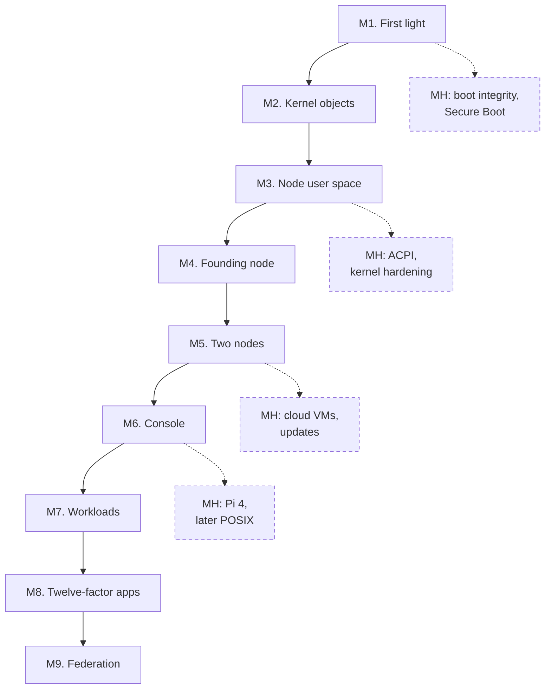
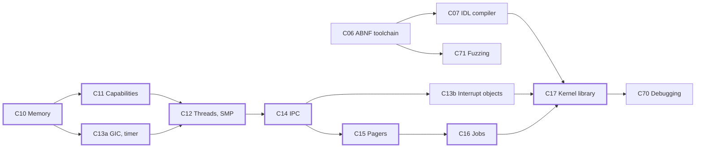
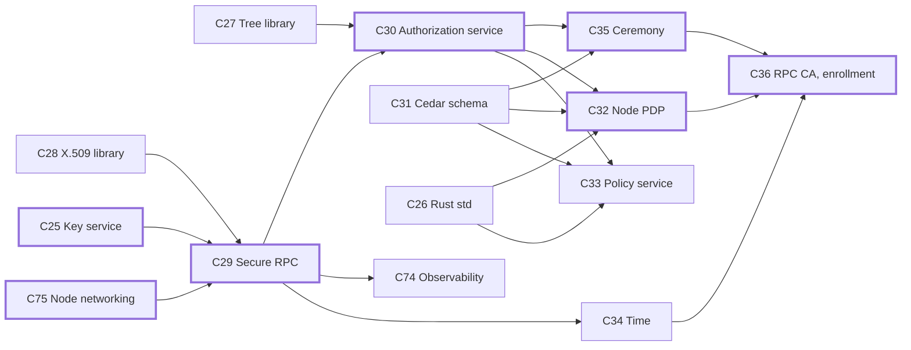
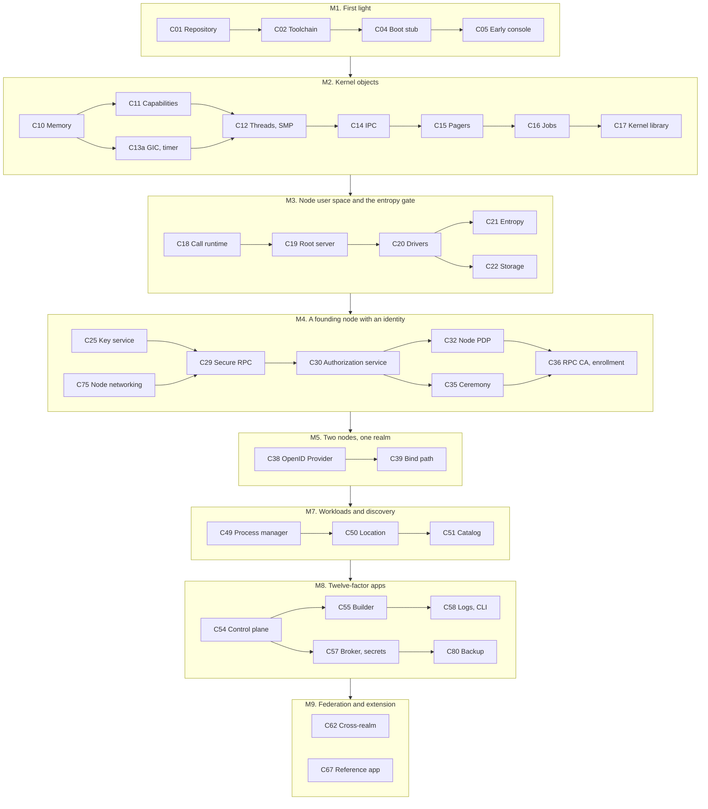

<!-- SPDX-FileCopyrightText: 2026 Nicole Roy -->
<!-- SPDX-License-Identifier: CC-BY-4.0 -->

# Build plan

*2026-11-24, updated 2026-11-25. How ASPIS is built: the chunks of work, the milestones they reach, the critical path, and the work that runs across milestones. It follows ADRs 0001 to 0042, all accepted. [0033](../decisions/0033-contributions-docs-license-and-notice-years.md) to [0042](../decisions/0042-log-ring-and-panic-path.md) settle what M1 left open.*

ASPIS is built in chunks. A chunk is a piece of work with its own scope that can be finished and tested on its own: a kernel subsystem, a server, a library or a tool. Its prerequisites are the chunks it can't be finished without. Work on it may start earlier, against stubs.

A milestone groups chunks around an outcome you can demonstrate. It is done when that outcome holds. Milestones are outcomes, not phases: a chunk starts as soon as its prerequisites are done, even while an earlier milestone is still open.

Chunk IDs are stable labels, not an order. C13 is split into C13a and C13b, and C68 to C82 cover work that runs through the whole build, such as testing, debugging, power, observability, provisioning, updates and backup. Each milestone's table lists its chunks in dependency order.

Each milestone also has open design decisions. They are listed under the same heading in [the design backlog](design-backlog.md), and are settled just before they're needed rather than all at once. Each becomes an ADR that the project owner accepts. The tables here say in words what must be decided before a chunk can be finished; the backlog numbers those decisions and gives their options. The "Decisions" column links the ADRs that already shape each chunk.

1. [Milestone overview](#milestone-overview)
2. [M1. First light](#m1-first-light)
3. [M2. Kernel objects](#m2-kernel-objects)
4. [M3. Node user space and the entropy gate](#m3-node-user-space-and-the-entropy-gate)
5. [M4. A founding node with an identity](#m4-a-founding-node-with-an-identity)
6. [M5. Two nodes, one realm](#m5-two-nodes-one-realm)
7. [M6. A console you can log in to](#m6-a-console-you-can-log-in-to)
8. [M7. Workloads and discovery](#m7-workloads-and-discovery)
9. [M8. Twelve-factor apps on a multi-node realm](#m8-twelve-factor-apps-on-a-multi-node-realm)
10. [M9. Federation and extension](#m9-federation-and-extension)
11. [MH. Hardware and hardening](#mh-hardware-and-hardening)
12. [The critical path](#the-critical-path)
13. [Work across milestones](#work-across-milestones)

## Milestone overview

Nine milestones run in sequence on QEMU, from the first kernel message to a federated realm that hosts apps. A tenth, MH, brings real hardware and hardening. It is a parallel track: its chunks start from M1, M3, M5 and M6 as their prerequisites are done. Every other chunk's prerequisites sit in its own milestone or an earlier one, and the graph has no cycles.

| Milestone | Outcome | Chunks |
|---|---|---|
| [M1](#m1-first-light) | `aspis.efi` boots on QEMU and prints to the text-as-graphics console | C01–C05, C68, C69 |
| [M2](#m2-kernel-objects) | User processes run on the kernel's objects, through the kernel interface library | C06, C07, C10–C12, C13a, C13b, C14–C17, C70, C71 |
| [M3](#m3-node-user-space-and-the-entropy-gate) | The root server starts the node's servers, and the entropy gate opens | C08, C09, C18–C24, C72, C73 |
| [M4](#m4-a-founding-node-with-an-identity) | A ceremony creates a single-node realm, and the node holds its certificate | C25–C36, C74, C75 |
| [M5](#m5-two-nodes-one-realm) | A second node enrolls; remote binds, calls and page faults work | C37–C40, C76 |
| [M6](#m6-a-console-you-can-log-in-to) | POSIX, Display SVG and dm, with login and terminal pads | C41–C48 |
| [M7](#m7-workloads-and-discovery) | Workload identity, location leases, the catalog and the HTTPS edge | C49–C53 |
| [M8](#m8-twelve-factor-apps-on-a-multi-node-realm) | Twelve-factor apps run across several nodes | C54–C58, C80 |
| [M9](#m9-federation-and-extension) | Federation, cross-realm trust and an app that extends the system | C59–C62, C67, C82 |
| [MH](#mh-hardware-and-hardening) | Pi 4 cluster, Secure Boot, ACPI and cloud nodes, hardening, updates | C63–C66, C77–C79, C81 |

Solid arrows join milestones in sequence. Dashed arrows show where parts of MH can start.

## M1. First light

**Done when** `aspis.efi`, one AArch64 PE32+ image, boots on QEMU `virt` under EDK2 and GRUB arm64-efi, with GICv2 and with GICv3. The kernel prints to the text-as-graphics console and to the UART, and a forced panic reaches both. CI runs that boot in two configurations on every change and across the full QEMU matrix nightly ([0036](../decisions/0036-qemu-configuration-and-test-builds.md), rules 3 and 4), and two builds of the same commit give identical `aspis.efi` and `initfs.img` ([0038](../decisions/0038-reproducible-builds-and-provenance.md), rule 1).

| ID | Chunk | Scope | Prerequisites | Decisions | Decide first |
|---|---|---|---|---|---|
| C01 | Repository, licensing and docs tooling | `LICENSE` (MPL-2.0) and `LICENSES/` with the MPL-2.0 and CC BY 4.0 texts; SPDX headers, with year ranges; a `REUSE.toml`, which also names OFL-1.1 for the font files; a REUSE check that fails on any file without both tags; `CONTRIBUTING.md`, quoting the DCO, and a CI check that every commit in a pull request is signed off; the CI skeleton; the Mermaid render check; the ABNF gate's hook in the docs build | — | [0008](../decisions/0008-mpl-2.0-license.md); [0023](../decisions/0023-copyright-notices.md); [0033](../decisions/0033-contributions-docs-license-and-notice-years.md); [0034](../decisions/0034-noto-fonts-under-ofl.md), Consequences; [0024](../decisions/0024-diagrams-mermaid-and-c4.md); [0013](../decisions/0013-abnf-for-protocols-and-calls.md), rule 6 | Nothing open. [0033](../decisions/0033-contributions-docs-license-and-notice-years.md) settled the contribution policy, how notices name years, and the documentation license |
| C02 | Toolchain, image assembly and QEMU harness | `rust-toolchain.toml` pinning stable Rust 1.100.0, with no nightly feature; the kernel, built for `aarch64-unknown-none` as a static, position-independent ELF, carried in the `.kernel` section of a stub built for `aarch64-unknown-uefi` and linked with `/version:1.0` and `/Brepro`; `no_std` user-space programs built for `aarch64-unknown-none`, with ASPIS's runtime crate and linker script; the `initfs.img` builder, in the ASPIS format, which also lists and extracts images; the build order: the kernel, then `initfs.img`, then the stub with the image's SHA-512 in its `.initfs` section, then signing; the two-slot ESP layout and `/aspis/grub.cfg`; QEMU 11.1.3 `virt` with its bundled EDK2, GRUB 2.14 arm64-efi built from source, `ramfb`, the PL011 and PL031, and virtio-rng, virtio-blk and virtio-net on PCIe behind an SMMUv3 | C01 | [0006](../decisions/0006-uefi-boot-image.md), rules 1–3 and 5, with rule 3 as [0035](../decisions/0035-toolchain-image-linkage-and-esp-layout.md) amends it; [0035](../decisions/0035-toolchain-image-linkage-and-esp-layout.md); [0036](../decisions/0036-qemu-configuration-and-test-builds.md), rules 1 and 2; [0037](../decisions/0037-initial-image-format-and-contents.md); [0040](../decisions/0040-the-stub-checks-the-initial-image.md), rule 1; [0007](../decisions/0007-initial-hardware-targets.md), rule 1; [0009](../decisions/0009-text-as-graphics-console.md), rule 2; [0021](../decisions/0021-entropy-before-keys.md), rule 12 | Nothing open. [0035](../decisions/0035-toolchain-image-linkage-and-esp-layout.md), [0036](../decisions/0036-qemu-configuration-and-test-builds.md) and [0037](../decisions/0037-initial-image-format-and-contents.md) settled the toolchain and linkage, the ESP layout, the QEMU devices, and the initial image's format and contents. The boot manifest's format is the root server's (C19) |
| C03 | Glyph atlas tool and console assets | The build-time rasterizer, a permissively licensed Rust crate: three atlases of 8-bit coverage values, with cells 16, 24 and 32 pixels high, from Noto Sans Mono pinned by release and SHA-512, with Noto Sans Math and Noto Sans Symbols for the 18 WGL4 symbols it lacks, covering WGL4 except the ligatures and two private-use code points, the box-drawing characters, the block elements and U+FFFD; the logo bitmap, rasterized from `assets/logo/aspis-boot.svg` | C01 | [0009](../decisions/0009-text-as-graphics-console.md), rule 3; [0034](../decisions/0034-noto-fonts-under-ofl.md); [0046](../decisions/0046-fallback-fonts-for-wgl4-symbols.md) | Nothing open. [0034](../decisions/0034-noto-fonts-under-ofl.md) settled the family, its license and the sizes. C03 measures the atlases, and may store them compressed ([0034](../decisions/0034-noto-fonts-under-ofl.md), Consequences) |
| C04 | UEFI boot stub | Load options to an ASCII command line; finding `initfs.img` through LoadFile2, then the `initfs` argument, then the stub's own directory; loading the kernel's ELF payload at a 2 MiB-aligned physical address and relocating it for a fixed virtual base; memory map; device tree and ACPI tables; a linear GOP mode and its reserved region; the `EFI_RNG_PROTOCOL` seed, in a page of its own; `ExitBootServices`, with no UEFI runtime services after it; EL2 to EL1; the kernel's entry state and the tagged boot-information records; the kernel-argument grammar in ABNF; the SHA-512 check of `initfs.img` against the digest in `aspis.efi`, refusing a mismatch, which only a test build may waive, and the boot-information record of its result | C02 | [0006](../decisions/0006-uefi-boot-image.md), rules 1–4; [0035](../decisions/0035-toolchain-image-linkage-and-esp-layout.md), rules 3 and 4; [0039](../decisions/0039-no-uefi-runtime-services.md); [0040](../decisions/0040-the-stub-checks-the-initial-image.md), rules 2 and 4; [0036](../decisions/0036-qemu-configuration-and-test-builds.md), rule 6; [0041](../decisions/0041-boot-abi.md); [0009](../decisions/0009-text-as-graphics-console.md), rule 2; [0021](../decisions/0021-entropy-before-keys.md), rule 3 | Nothing open. [0041](../decisions/0041-boot-abi.md) settled the boot ABI, [0040](../decisions/0040-the-stub-checks-the-initial-image.md) how the stub checks `initfs.img`, and [0039](../decisions/0039-no-uefi-runtime-services.md) that ASPIS uses no UEFI runtime services. Whether the stub randomizes the kernel's placement moved to C78 ([0035](../decisions/0035-toolchain-image-linkage-and-esp-layout.md), rule 4) |
| C05 | Kernel early platform and text-as-graphics console | The kernel's linker script, in the upper half; MMU on; exception vectors; PL011 UART; the early console with text, rectangles and bitmaps, choosing its atlas by framebuffer width; parsing the kernel arguments; the log ring, with sequence numbers and non-blocking writers; the boot framebuffer's states; the panic path. The ring's read interface comes with M2's IDL | C03, C04 | [0009](../decisions/0009-text-as-graphics-console.md), rules 1–3 and 5; [0034](../decisions/0034-noto-fonts-under-ofl.md), rule 4; [0035](../decisions/0035-toolchain-image-linkage-and-esp-layout.md), rule 2; [0041](../decisions/0041-boot-abi.md), rules 1 and 5; [0042](../decisions/0042-log-ring-and-panic-path.md) | The kernel's exact virtual base, which [0035](../decisions/0035-toolchain-image-linkage-and-esp-layout.md) rule 2 leaves to C05. [0042](../decisions/0042-log-ring-and-panic-path.md) settled the log ring's format and who may read it |
| C68 | Test framework and CI matrix | Host tests of `no_std` crates under `cargo test`; in-QEMU tests collected through a linker section, reporting on the UART and ending QEMU through semihosting, with a host-side runner; two configurations on every change (`cortex-a72` with a GICv2, `max` with a GICv3) and the full matrix nightly; test builds under `--cfg aspis_test_build`, never a Cargo feature; a CI check that production images hold no test code | C01, C02 | [0036](../decisions/0036-qemu-configuration-and-test-builds.md); [0021](../decisions/0021-entropy-before-keys.md), Consequences; [0013](../decisions/0013-abnf-for-protocols-and-calls.md), rule 6; [0007](../decisions/0007-initial-hardware-targets.md), rule 1 | Nothing open. [0036](../decisions/0036-qemu-configuration-and-test-builds.md) settled the matrix and how a production build is shown to hold no test code |
| C69 | Reproducible builds and provenance for ASPIS's own images | Bit-for-bit reproducible `aspis.efi` and `initfs.img` from pinned inputs, built twice on every change and compared; a CycloneDX 1.7 SBOM and SLSA 1.2 provenance, signed with GitHub artifact attestations through Sigstore; the OFL text and Noto's notice beside every image; the release hashes that measured boot uses as known-good values (C64) | C02 | [0038](../decisions/0038-reproducible-builds-and-provenance.md); [0034](../decisions/0034-noto-fonts-under-ofl.md), rule 3; [0026](../decisions/0026-realm-as-cloud-provider.md), rules 3 and 4 | Nothing open. [0038](../decisions/0038-reproducible-builds-and-provenance.md) settled the build, the formats and the signing. App builds (C55) use CycloneDX too |

- **The ESP has two slots from M1.** GRUB sits at `/EFI/BOOT/BOOTAA64.EFI` and reads `/aspis/grub.cfg`. Slot `a` holds `/aspis/a/aspis.efi` and `/aspis/a/initfs.img`, and slot `b`, at `/aspis/b/`, stays empty until updates with rollback (C79) ([0035](../decisions/0035-toolchain-image-linkage-and-esp-layout.md), rule 6). How a slot is chosen and how a failed boot falls back are still open, and are decided before C79. They use files on the ESP, never UEFI variables ([0039](../decisions/0039-no-uefi-runtime-services.md), rule 5).
- **The initial image's digest is built in from M1.** C02's build puts the SHA-512 of `initfs.img` in `aspis.efi` before it is signed, so the two are released as a pair ([0040](../decisions/0040-the-stub-checks-the-initial-image.md), rule 1). C04 builds the check: the stub refuses an image that doesn't match, and only a test build may waive it (rule 2). So every image from M1 on meets 0040. C04 also builds the boot-information record that carries the result ([0040](../decisions/0040-the-stub-checks-the-initial-image.md), rule 4; [0041](../decisions/0041-boot-abi.md), rule 3). C77 adds the PCR 9 measurement, and C64 the Secure Boot signature that makes the embedded digest trustworthy.
- **DMA isolation on QEMU needs PCIe.** QEMU's `iommu=smmuv3` is "a single, machine-wide SMMUv3 instance that applies to all devices in the PCIe topology" ([QEMU `virt` documentation](https://www.qemu.org/docs/master/system/arm/virt.html)). virtio-mmio devices bypass it. [0007](../decisions/0007-initial-hardware-targets.md) rule 1's DMA isolation therefore needs virtio-pci devices, which C20 drives. [0036](../decisions/0036-qemu-configuration-and-test-builds.md), rule 2 puts every virtio device on PCIe, and ASPIS uses no virtio-mmio devices.

Decisions due before this milestone: [design backlog](design-backlog.md#m1-first-light).

## M2. Kernel objects

**Done when** user processes run with capabilities, IPC, eventcounts, memory objects, user-space pagers, typed faults and jobs, reached only through the kernel interface library and IDL-generated stubs. Timer interrupts preempt threads, secondary cores start through PSCI, and a user-space test driver receives an interrupt through an interrupt object. Kernel panics are symbolized, a debugger can stop a user thread and read its registers and memory through a capability, and the fuzzing harness runs on the ABNF toolchain's parsers.

| ID | Chunk | Scope | Prerequisites | Decisions | Decide first |
|---|---|---|---|---|---|
| C06 | ABNF toolchain and ASPIS core rules | ABNF checker (RFC 5234 and RFC 7405); constraint comments; test-vector runner; the CI gate; core rules for fixed-width integers, 32-octet IDs and length-prefixed fields; runnable later inside the catalog | C01 | [0013](../decisions/0013-abnf-for-protocols-and-calls.md), rules 1, 4 and 6 | The byte order of fixed-width integers; whether the core rules define signed integers |
| C07 | IDL language and compiler core | IDL grammar and type system; ABNF emission per interface version; the minor-version compatibility check; canonical call text; Rust `no_std` and `std` bindings; a conformance runner. Its Cedar back-end comes with C31, and its HTTPS and OpenAPI back-ends with C52 | C06 | [0013](../decisions/0013-abnf-for-protocols-and-calls.md), rules 2, 3 and 5; [0014](../decisions/0014-versioned-object-apis.md), rules 3 and 4; [0004](../decisions/0004-network-transparency-and-failure.md), Consequences | The IDL's syntax and type system; the normative call header and wire encoding, with room for trace context (C74); the error model and how minor versions evolve on the wire; capability parameters and streaming calls; method names, the canonical call text, and interface and type names |
| C10 | Kernel memory management and address spaces | Physical memory from the UEFI map, honoring the framebuffer, initrd and seed regions; the kernel-object memory model; page tables; address spaces | C05 | [0041](../decisions/0041-boot-abi.md), rule 3; [0002](../decisions/0002-capability-security-model.md), rule 1; [0005](../decisions/0005-single-level-store.md), rule 1; [0025](../decisions/0025-twelve-factor-app-contract.md), rule 12 | The kernel specification, written with C11 to C17 in mind; the memory model, frame allocator, translation granule and address-space layout; whether W^X and PAN come with the first page tables (C78) |
| C11 | Capability system and kernel object model | Capability spaces; rights; copy with fewer rights; transfer; revocation, including a manager revoking the capabilities it derived; capability-table copy | C10 | [0002](../decisions/0002-capability-security-model.md), rule 1; [0016](../decisions/0016-authorization-sparse-merkle-tree.md), rule 6; [0019](../decisions/0019-authzen-decision-protocol.md), rule 8 | Capability-space structure, rights bits, derivation tracking and badges; who mints the IDs of processes, threads and endpoints, which [0001](../decisions/0001-object-identifiers.md) names but the kernel can't mint |
| C13a | Interrupt controllers and the generic timer in the kernel | GICv2 (the Pi 4's GIC-400) and GICv3 bring-up; the ARM generic timer; inter-processor interrupts | C10 | [0007](../decisions/0007-initial-hardware-targets.md), rules 1 and 2, Consequences | Which timer the kernel uses under a hypervisor, since cloud VMs need the EL1 virtual timer (C81) |
| C12 | Threads, scheduling, timers and SMP | Thread objects; `TPIDR_EL0`; suspend and register access; a scheduler with CPU budgets; deadlines; SMP bring-up through PSCI `CPU_ON` | C10, C11, C13a | [0025](../decisions/0025-twelve-factor-app-contract.md), rule 12; [POSIX note](posix-compatibility.md) §4.15, §4.18 and §5 | The scheduler model and per-job CPU budgets; priorities, and priority inversion when many clients call one server; how the kernel represents deadlines, and where wall time lives; the SMP locking model |
| C14 | IPC endpoints and eventcounts | Endpoints with capability transfer, call and reply, cancellation and timeouts; eventcounts; waiting on a set; wait and wake on a word in user memory | C11, C12 | [0002](../decisions/0002-capability-security-model.md), rule 1; [POSIX note](posix-compatibility.md#5-what-the-kernel-must-provide) §5 | IPC semantics: synchronous or asynchronous, message size and buffers, transfer, cancellation; eventcount semantics |
| C13b | Interrupt objects for user-space drivers | Interrupt capabilities; what an interrupt signals and how a driver acknowledges it; MSI through GICv2m and the GICv3 ITS for PCIe devices. The Pi 4's second-level controller comes with C63 | C11, C13a, C14 | [0002](../decisions/0002-capability-security-model.md), rule 1; [0007](../decisions/0007-initial-hardware-targets.md), Consequences | What an interrupt object signals and how it is acknowledged; where the Pi 4's second-level controller is handled |
| C15 | Memory objects, pagers and typed faults | Anonymous, immutable and device memory objects; copy-on-write clones; mapping; page faults forwarded to user-space pagers; typed faults with deadlines | C10, C14 | [0004](../decisions/0004-network-transparency-and-failure.md), rule 4; [0005](../decisions/0005-single-level-store.md), rules 1 and 2 | The pager protocol; the typed-fault taxonomy, and who sets a page fetch's deadline |
| C16 | Jobs and budgets | Nested job objects, stopped as a unit; memory and CPU budgets; anonymous memory objects that end with their job | C11, C12, C15 | [0025](../decisions/0025-twelve-factor-app-contract.md), rules 8 and 12 | What a budget's size is: its units, how budgets nest, whether scratch counts, and who pays for shared immutable pages |
| C17 | Kernel interface library and the `no_std` user runtime | Versioned kernel-object interfaces mapped into every process over a private ABI; program loading; native spawn; a `no_std` runtime for early servers | C07, C13b, C14, C15, C16 | [0014](../decisions/0014-versioned-object-apis.md), rules 6 and 7 | The library's packaging and versioning, and whether the kernel accepts calls only from it; the process model, native spawn, the executable format and where the dynamic linker lives |
| C70 | Debugging support | The QEMU gdbstub workflow; symbolized panics; a debugger interface to user threads' registers and memory through capabilities; crash dumps. The Pi 4's UART stub comes with C63 | C05, C12, C17 | [0014](../decisions/0014-versioned-object-apis.md), Consequences; [0009](../decisions/0009-text-as-graphics-console.md), rule 5 | How a debugger gets a capability to another process's threads and memory; the crash-dump format, and where dumps go |
| C71 | Fuzzing and differential testing | The harness, first run on the ABNF toolchain's generated parsers. It grows with every later parser at a trust boundary ([Work across milestones](#fuzzing-and-differential-testing)) | C06, C68 | [0015](../decisions/0015-jwt-tokens-and-oidc-identity.md), Consequences; [0010](../decisions/0010-svg-core-primitive.md), rule 11 | Which parsers must be fuzzed before their chunk counts as done; how the PDP is tested against Cedar's own engine; whether leases and catalog sequence numbers are model-checked; how partitions are injected. Each parser's chunk brings its own targets |

- **C13 is split in two.** The scheduler needs the kernel's interrupt controller and timer for preemption, deadlines and inter-processor interrupts, so C13a comes before C12. Interrupt objects signal through eventcounts or endpoints, so C13b comes after C14.
- **The kernel specification comes first.** C10 to C17 share one specification, written before C10 starts. It turns the POSIX and twelve-factor needs into kernel objects ([Inside the kernel](kernel-components.md#3-open) lists what it must settle).

The kernel's chunks, with thick borders on the critical path:

Decisions due before this milestone: [design backlog](design-backlog.md#m2-kernel-objects).

## M3. Node user space and the entropy gate

**Done when** the root server checks and maps the programs in `initfs.img` and starts the entropy service first, then the virtio-rng and jitter drivers, `bootfb`, storage and the name service. The gate opens at 384 credited bits, and nothing is served before it. `bootfb` adopts the boot framebuffer, but the kernel keeps drawing until Display SVG claims the display in M6 ([0009](../decisions/0009-text-as-graphics-console.md), rule 4). On a first boot only reserved-authority objects are named, because node-authority IDs need the genesis key, which comes in M4 (C25). The node shuts down and reboots in order, and the root server supervises its servers under a stated restart policy.

| ID | Chunk | Scope | Prerequisites | Decisions | Decide first |
|---|---|---|---|---|---|
| C08 | Cryptographic primitives and composite signatures | Chosen libraries wrapped for `no_std` and `alloc`: SHA-3; SHA-256, SHA-384 and SHA-512; HMAC and HKDF, for TLS 1.3's key schedule; X25519; Ed25519; ML-KEM-768; ML-DSA-65; the RFC 10073 composite, where both halves must verify; ChaCha20-Poly1305, and optionally AES-256-GCM; algorithm identifiers; test vectors | C01 | [0003](../decisions/0003-hybrid-post-quantum-cryptography.md); [0020](../decisions/0020-realm-certificate-authority.md), rules 2, 3 and 12 | The libraries, judged on `no_std` fit and on license ([0008](../decisions/0008-mpl-2.0-license.md), rule 4) |
| C09 | Object ID library and ID format specification | The 32-byte ID type; bytewise compare; the text form; the class registry; the reserved authority and well-known table; sequence blocks; the random field; UUIDv8 node-UUID derivation; derivation of non-node authorities | C06, C08 | [0001](../decisions/0001-object-identifiers.md); [0013](../decisions/0013-abnf-for-protocols-and-calls.md), rule 2; [0022](../decisions/0022-spiffe-and-wimse-workload-identity.md), rule 2 | The ID format: text form, class registry and node-UUID encoding; the reserved authority's value and the well-known table; how non-node authorities are formed. **Blocking, needs an amendment:** which authority names the node's well-known objects on a first boot, before the genesis key exists, and what fills their random field ([0001](../decisions/0001-object-identifiers.md), rules 3, 4 and 7, against [0021](../decisions/0021-entropy-before-keys.md), rules 3 and 5 and Consequences) |
| C18 | Call protocol runtime and bootstrap binding | Message framing on kernel IPC; request IDs; the reply cache; deadlines; the four outcomes; typed errors; version negotiation; bootstrap binds authorized by root-server capabilities | C07, C14, C17 | [0004](../decisions/0004-network-transparency-and-failure.md), rule 3; [0013](../decisions/0013-abnf-for-protocols-and-calls.md); [0014](../decisions/0014-versioned-object-apis.md), rules 3 and 4; [0018](../decisions/0018-cedar-policy-language.md), rule 5 | How request IDs stay unique before the gate and after `fork`; how long replies are kept; how deadlines are encoded; how early servers bind before the first PDP ([0018](../decisions/0018-cedar-policy-language.md), rule 5 settles where their authority comes from); what a bind message carries, now about 15 KB of token and proofs |
| C19 | Root server and boot sequencing | Reading `initfs.img`: checking each entry's SHA-512 before use, and mapping executables in place; starting the entropy service first, then the RNG drivers, `bootfb`, storage and network servers, in order; handing out boot capabilities, including the log ring's; passing `root.` kernel arguments on; supervision; well-known names | C09, C17, C18 | [0006](../decisions/0006-uefi-boot-image.md), rule 2; [0037](../decisions/0037-initial-image-format-and-contents.md), rules 3–5 and 7; [0041](../decisions/0041-boot-abi.md), rules 4 and 5; [0042](../decisions/0042-log-ring-and-panic-path.md), rule 5; [0009](../decisions/0009-text-as-graphics-console.md), rule 4; [0018](../decisions/0018-cedar-policy-language.md), rule 5; [0021](../decisions/0021-entropy-before-keys.md), rules 1 and 3, Consequences | The root server's interface, boot manifest format and supervision; how the image's memory becomes memory objects, with the kernel specification ([0037](../decisions/0037-initial-image-format-and-contents.md), rule 4); how the seed's page ([0041](../decisions/0041-boot-abi.md), rule 4) passes through it to the entropy service, and how each copy is zeroized; the first-boot naming conflict (C09); whether node bring-up and CI get a minimal command interpreter on the serial console before dm and the POSIX shell exist, what it may do, and how it relates to a native command interpreter. Its language isn't ABNF ([0031](../decisions/0031-abnf-is-not-a-command-language.md)) |
| C20 | Device discovery and the user-space driver framework | The device-tree split; MMIO, interrupt and DMA capabilities; PCIe enumeration (ECAM); virtio-pci; programming the SMMUv3; MMIO devices stay MMIO; UART, virtio-rng, block, NIC and input drivers | C13b, C15, C19 | [0007](../decisions/0007-initial-hardware-targets.md); [0021](../decisions/0021-entropy-before-keys.md), rule 12 | Who parses the device tree; capability types for MMIO, interrupts and DMA; who programs the SMMUv3; which drivers exist on QEMU; whether the UART driver takes input for a command interpreter before dm (with C19) |
| C21 | Entropy service and RNG drivers | HMAC_DRBG with SHA-512 at 256 bits; the gate at 384 credited bits; SP 800-90B health tests; crediting; child DRBGs; reseeds and prediction resistance; status; virtio-rng, jitter and `RNDRRS` sources; the test seed hook, only in test builds | C08, C12, C19, C20, C68 | [0021](../decisions/0021-entropy-before-keys.md); [0036](../decisions/0036-qemu-configuration-and-test-builds.md), rules 6 and 7 | Credit rates and the reseed interval; the service's interface, and where health tests run; where child DRBGs live, and what `fork` does to them; detecting restore, clone, resume and VM-generation change |
| C22 | Storage servers and the object store | Block drivers; the object-store format; storage pagers; durable sequence-block records; the persisted seed | C15, C19, C20 | [0001](../decisions/0001-object-identifiers.md), rule 4; [0005](../decisions/0005-single-level-store.md); [0006](../decisions/0006-uefi-boot-image.md), rule 2 | The on-disk format and crash consistency; where sequence-block records live; where the persisted seed lives, given that storage would have to start before the gate in a mode that mints nothing |
| C23 | Name service and the object-manager framework | The name service (`/`, `//`, mounts, variant links); the manager library: sessions, the base discovery interface, enumeration with watches | C18, C19, C22 | [0002](../decisions/0002-capability-security-model.md), rule 3; [0012](../decisions/0012-posix-compatibility-layer.md), rule 5; [0014](../decisions/0014-versioned-object-apis.md), rule 5; [0028](../decisions/0028-discovery-and-realm-catalog.md), rule 1 | The realm namespace layout and friendly node names; path resolution; the base discovery interface; enumeration and watch semantics |
| C24 | `bootfb` and the console handoff | `bootfb` adopts the boot framebuffer; the present interface; the calls that move the boot framebuffer from Kernel to Adopted to Retired, for the panic path. The kernel stops drawing only when Display SVG claims the display (C45) | C05, C19, C20 | [0009](../decisions/0009-text-as-graphics-console.md), rules 4 and 5; [0042](../decisions/0042-log-ring-and-panic-path.md), rule 6 | The display-driver interface and the input stack. [0042](../decisions/0042-log-ring-and-panic-path.md), rule 6 makes the kernel's stop-drawing call the move to Adopted |
| C72 | Shutdown, reboot and power | PSCI `SYSTEM_OFF`, `SYSTEM_RESET` and `CPU_OFF`; WFI idle; an orderly shutdown that flushes dirty pages and rewrites the persisted seed; suspend and resume later | C12, C19, C21, C22 | [0021](../decisions/0021-entropy-before-keys.md), rule 9; [0039](../decisions/0039-no-uefi-runtime-services.md), rule 3 | How a node idles, and the rest of power management. [0039](../decisions/0039-no-uefi-runtime-services.md), rule 3 settles power-off and reset: through PSCI, never UEFI runtime services. Also: the shutdown order; when the persisted seed is rewritten |
| C73 | Supervision and crash recovery of system servers | Restart policy and state recovery, first for the entropy service, pagers and the root server; what a fault returns when an object's pager has died; persistent panic records on headless nodes; a watchdog. The key service, network server and PDP adopt it as they arrive in M4 | C15, C19, C21, C22 | [0009](../decisions/0009-text-as-graphics-console.md), rule 5; [0042](../decisions/0042-log-ring-and-panic-path.md), rule 7; [0021](../decisions/0021-entropy-before-keys.md), rule 2 | The restart policy, and which servers' state must survive a restart; what a client sees when a pager dies; where panic records persist |

- **What M3 does not do.** `bootfb` only adopts the framebuffer; the handoff that stops the kernel drawing comes with Display SVG (C45). And on a first boot M3 can name only objects under the reserved authority ([0001](../decisions/0001-object-identifiers.md), rule 7), until the first-boot naming conflict is amended.
- **The persisted seed and the gate.** The entropy service mixes in a seed persisted in the single-level store, but anything that mints IDs starts after the gate ([0021](../decisions/0021-entropy-before-keys.md), Consequences). Either storage starts before the gate in a mode that mints nothing, or the seed lives elsewhere. C21 and C22 wait for that answer.

Decisions due before this milestone: [design backlog](design-backlog.md#m3-node-user-space-and-the-entropy-gate).

## M4. A founding node with an identity

**Done when** the node mints its genesis key and UUID after the gate, and mints IDs from sequence blocks. The `std` port runs. The authorization tree, its service and the node PDP run on the node. A scripted ceremony creates a single-node realm. Following [0029](../decisions/0029-founding-node-self-signed-certificate.md), the founding node starts with an initial certificate signed with its genesis key, then renews with the RPC CA and holds an X.509-SVID before any other node enrolls. Time is authenticated, the node configures its own IPv6 addresses, and its system servers report their health and what they are waiting for.

| ID | Chunk | Scope | Prerequisites | Decisions | Decide first |
|---|---|---|---|---|---|
| C27 | Authorization-tree library and signed roots | The SHA3-256 sparse Merkle tree; batch apply; revoked markers; compressed proofs; the signed-root format and verifier; `no_std` | C06, C08, C09 | [0016](../decisions/0016-authorization-sparse-merkle-tree.md), rules 1–4; [0018](../decisions/0018-cedar-policy-language.md), rule 2 | The tree's key layout and branch namespace; grant and principal record schemas, with group memberships in the principal tree ([0030](../decisions/0030-bind-tokens-sessions-and-group-memberships.md), rule 3) |
| C28 | X.509, PKCS #10, CMS and CRL library | DER; the RFC 5280 profile with URI-host and DNS name constraints; the composite OID; CSRs with `extensionRequest`; certs-only CMS; CRLs; path building through cross-certificates; X.509-SVID checks | C08 | [0020](../decisions/0020-realm-certificate-authority.md), rules 2, 5, 8 and 9; [0022](../decisions/0022-spiffe-and-wimse-workload-identity.md), rule 3 | Certificate profile details: names, key identifiers and extension criticality |
| C31 | Cedar schema generation and the ASPIS AuthZEN profile | An IDL back-end that emits Cedar schema fragments; the profile: RPC binding, naming ABNF, context keys | C07 | [0018](../decisions/0018-cedar-policy-language.md), rule 4; [0019](../decisions/0019-authzen-decision-protocol.md), rules 2, 4 and 7 | The Cedar schema generated from the IDL; the ASPIS AuthZEN profile |
| C25 | Key service and node genesis identity | A prediction-resistant genesis key; the node UUID; an operational TLS key certified by the genesis key; signing by capability; restore and clone handling | C08, C09, C21, C22 | [0001](../decisions/0001-object-identifiers.md), rules 3 and 5; [0003](../decisions/0003-hybrid-post-quantum-cryptography.md), rules 2 and 6; [0021](../decisions/0021-entropy-before-keys.md), rule 5 | Key custody on boards without a TPM, and which keys are long-lived; the key service's interface, and which services sign through it |
| C26 | Rust `std` port | `std` on ASPIS APIs: threads, files, the environment block, randomness | C17, C18, C21, C23 | [0012](../decisions/0012-posix-compatibility-layer.md), rule 9; [0018](../decisions/0018-cedar-policy-language.md), Consequences; [0035](../decisions/0035-toolchain-image-linkage-and-esp-layout.md), rules 1 and 5 | Whether and when to port `std`, which needs a custom target, and so nightly Rust, until `build-std` is stable ([0035](../decisions/0035-toolchain-image-linkage-and-esp-layout.md), rule 5); the target name; where `std` gets randomness; whether servers that start before the gate may use `std` |
| C75 | Node networking | IPv6 address configuration and neighbor discovery; QUIC's 1,200-byte datagram floor; DNS for realm names; how a node authority, the first location hint, becomes a transport address | C19, C20, C21 | [0004](../decisions/0004-network-transparency-and-failure.md), rules 1 and 5; [0021](../decisions/0021-entropy-before-keys.md), rule 3 and Consequences | SLAAC or DHCPv6; where DNS for realm names comes from; how a node authority maps to an address |
| C29 | Secure RPC transport in the network server | IPv6 and UDP; QUIC with TLS 1.3 (`X25519MLKEM768`, composite signatures at a private-use codepoint, ALPN); mutual node certificates; proxy endpoints; remote calls with request IDs and deadlines; remote page fetch; resumption | C08, C18, C20, C21, C25, C28, C75 (and C26 if the stack needs `std`) | [0002](../decisions/0002-capability-security-model.md), rule 5; [0004](../decisions/0004-network-transparency-and-failure.md); [0020](../decisions/0020-realm-certificate-authority.md), rules 2 and 3 | The TLS 1.3 and QUIC stack, including whether it needs `std` or an async runtime; the private-use codepoint and the ALPN identifier; who owns the IPv6 and UDP stack, and whether the POSIX network stack (C43) shares it; 0-RTT and transport parameters |
| C30 | Authorization service and root distribution | The batch writer; epochs; tree signing through the key service; audit records; root distribution and node replicas with staleness tracking; change submission | C22, C25, C27, C29 | [0016](../decisions/0016-authorization-sparse-merkle-tree.md), rules 3–5 and 7 | Root distribution, the staleness bound, and how a node comes to trust the tree-signing key; the service's replication and key custody; the write path, including how registry changes such as group memberships reach the principal tree; garbage collection; the audit log |
| C32 | Node PDP | The AuthZEN RPC binding server; Cedar on the replica; principal resolution from the principal tree; the manager-manages check; context; determining policies; batches; cross-node signing; subject and action search | C26, C30, C31 | [0018](../decisions/0018-cedar-policy-language.md), rules 3 and 5; [0019](../decisions/0019-authzen-decision-protocol.md), rules 1–9; [0030](../decisions/0030-bind-tokens-sessions-and-group-memberships.md), rule 3 | How the PDP checks that a caller manages the object; how it finds entity ancestors; which key signs decisions |
| C33 | Realm policy service | Schema validation; realm invariants; templates, static policies and links; schema fragments from the catalog; delegation rules | C26, C30, C31 | [0018](../decisions/0018-cedar-policy-language.md), rules 2 and 7 | Which invariants are enforced at write time; how a delegated link stays within its parent's rights |
| C34 | Authenticated time synchronization | The protocol, with a bootstrap that doesn't depend on certificate validity; the node client; the skew policy; the enrollment time gate | C25, C29 | [0015](../decisions/0015-jwt-tokens-and-oidc-identity.md), rule 7 | A post-quantum authenticated protocol whose bootstrap needs no certificate the node can't yet validate; skew tolerance; the first-boot time gate |
| C35 | Realm-creation ceremony and the offline root CA | The ceremony tool, scripted on QEMU first and run from dm later: root, intermediates, federation keys and the tree-signing key; the genesis tree state and first signed root; the founding node's initial certificate under [0029](../decisions/0029-founding-node-self-signed-certificate.md); CRL generation; the certificate policy | C25, C28, C30, C31 | [0020](../decisions/0020-realm-certificate-authority.md), rules 1, 7 and 8; [0021](../decisions/0021-entropy-before-keys.md), rules 5 and 6; [0018](../decisions/0018-cedar-policy-language.md), rule 4; [0029](../decisions/0029-founding-node-self-signed-certificate.md) | The ceremony's procedure; the genesis tree state, which must hold the founding node's principal and initial certificate and the policies it needs to renew and enroll the next node; lifetimes, policy OIDs and CRL cadence |
| C36 | Realm registry, node enrollment and the RPC CA | The registry, with principals and enrollment; admission; trust-anchor provisioning; the RPC CA issuing X.509-SVIDs with PDP checks and tree records; renewal, whose first use replaces the founding node's initial certificate; the time gate | C29, C30, C32, C34, C35 | [0001](../decisions/0001-object-identifiers.md), rule 6; [0020](../decisions/0020-realm-certificate-authority.md), rules 4–7; [0022](../decisions/0022-spiffe-and-wimse-workload-identity.md), rules 2 and 3; [0029](../decisions/0029-founding-node-self-signed-certificate.md) | Node admission, and how a node whose certificate expired gets back; enrollment proofs, the CA interface and certificate records; how system services get workload identity before the provider and PDP are reachable |
| C74 | Observability | Where system servers log; collecting the kernel's log ring through the capability the root server passes on; health and metrics; how a headless node reports what it is waiting for; trace context across RPC | C19, C22, C29 | [0021](../decisions/0021-entropy-before-keys.md), rule 5; [0042](../decisions/0042-log-ring-and-panic-path.md), rule 5 | Where node logs and metrics go before the app platform's log router exists; the trace-context format the call header carries |

- **Bootstrap authority.** Until the first PDP starts (C32), servers run with authority only from the capabilities the root server hands out ([0018](../decisions/0018-cedar-policy-language.md), rule 5). That covers C18 to C30. Binds with tokens start with C39, in M5.
- **Test certificates first.** C29 can be exercised before C36 with test certificates from C28 under a throwaway root. Production paths need C35 and C36.
- **The founding node's path is settled.** [0029](../decisions/0029-founding-node-self-signed-certificate.md) has the founding node certify its own operational key with its genesis key, record that certificate in the genesis tree state, and replace it by an ordinary RPC CA renewal before any other node enrolls. So C35 comes before C36, as the plan has it. Designing the genesis tree state is part of C35.
- **The `std` port needs a toolchain decision.** ASPIS builds with pinned stable Rust and no nightly feature ([0035](../decisions/0035-toolchain-image-linkage-and-esp-layout.md), rule 1). A `std` for ASPIS needs a custom target, and so nightly, until `build-std` is stable (rule 5). The same rule leaves whether and when to port it until the POSIX personality or applications need it. In this plan C32 and C33 depend on C26 as well, so the question comes due before M4. It is still open.
- **The ceremony writes policies.** The genesis tree state holds the Cedar policies the founding node needs, and every policy is validated against the schema generated from the IDL before it is written ([0018](../decisions/0018-cedar-policy-language.md), rule 4). So C35 needs C31.
- **Node networking waits for the gate.** The network server starts after the entropy service and the RNG drivers ([0021](../decisions/0021-entropy-before-keys.md), Consequences). DHCPv6 transaction IDs, the random delays of neighbor discovery and DNS query IDs all need randomness, and nothing may need it before the gate (rule 3). So C75 needs C21, and it sits beside C25 on the critical path.
- **The TLS stack can lengthen the critical path.** If the stack chosen for C29 needs `std` or an async runtime, C29 depends on C26 too ([The critical path](#the-critical-path)).
- **Servers adopt supervision.** The key service, network server and PDP each define their recovery under C73's policy.

The founding node's chunks, with thick borders on the critical path:

Decisions due before this milestone: [design backlog](design-backlog.md#m4-a-founding-node-with-an-identity).

## M5. Two nodes, one realm

**Done when** clients bind with tokens through the PDP. A second QEMU node, whose image holds no secrets, is admitted by an administrator and enrolls. Remote binds, calls and page faults work over TLS 1.3 and QUIC. Revocation ends sessions and closes connections, and partitions fail closed.

| ID | Chunk | Scope | Prerequisites | Decisions | Decide first |
|---|---|---|---|---|---|
| C37 | Token profile and the hardened JOSE verification library | Claims and ABNF for `at+jwt`, `wit+jwt` and `wpt+jwt`; the RFC 8725 profile; composite, ML-DSA-65 and classical algorithms; `cnf` and proof checks; key lookup over RPC, with a cache | C08, C09, C26 | [0015](../decisions/0015-jwt-tokens-and-oidc-identity.md), rule 3 and Consequences; [0022](../decisions/0022-spiffe-and-wimse-workload-identity.md), rules 4 and 10; [0030](../decisions/0030-bind-tokens-sessions-and-group-memberships.md), rule 1 | The token profile: claims, scopes, `aud` forms and lifetimes; how an access token travels with a WPT-form proof, and which `oth` key the RPC binding uses; what programs dm starts present on a user's behalf, since a WPT binds to a WIT; whether tokens carry issue epochs or attached proofs; replay protection; which draft revisions to pin, and the composite JOSE identifiers |
| C38 | The realm's OpenID Provider (core) | Access tokens, WITs and internal token exchange; keys and their publication; replication; node authentication | C32, C36, C37 | [0015](../decisions/0015-jwt-tokens-and-oidc-identity.md), rules 2–4; [0022](../decisions/0022-spiffe-and-wimse-workload-identity.md), rule 4 | Where the provider, the registry, the CAs and the other realm services run, and how they replicate; the provider's signing keys; token exchange and delegation rules; whether a node authenticates to the provider with an assertion or mutual TLS (the key is its operational key, [0020](../decisions/0020-realm-certificate-authority.md), rule 4) |
| C39 | Bind path with tokens: the PEP library and sessions | The WPT RPC binding; managers verify access tokens and WITs, never ID tokens; the AuthZEN batch; capabilities and sessions tagged with determining policies; the revocation watcher; `forbid` re-evaluation; fail-closed staleness | C23, C32, C37, C38 | [0014](../decisions/0014-versioned-object-apis.md), rule 4; [0016](../decisions/0016-authorization-sparse-merkle-tree.md), rules 6 and 7; [0019](../decisions/0019-authzen-decision-protocol.md), rules 1 and 8; [0022](../decisions/0022-spiffe-and-wimse-workload-identity.md), rule 4; [0030](../decisions/0030-bind-tokens-sessions-and-group-memberships.md), rules 1 and 2 | Whether a bind on a user's behalf carries an access token as well as a WIT and WPT; the renewal call, channel binding and the cost of a bind; when new `forbid` policies trigger re-evaluation |
| C76 | Node provisioning before enrollment | Where a new node's realm domain, enrollment endpoint, anchor, network settings, time sources and friendly name come from; how an administrator admits it out of band; images with no secrets, so cloned SD cards stay safe | C34, C36, C75 | [0021](../decisions/0021-entropy-before-keys.md), rule 11 and Consequences; [0001](../decisions/0001-object-identifiers.md), rule 6 | The provisioning model: kernel arguments, a file on the ESP or a console prompt; what per-node credential an administrator approves |
| C40 | Multi-node QEMU harness and the two-node realm | Several QEMU instances on a virtual network; a second node enrolls; remote binds and calls; remote page faults; revocation closes sessions and connections; partitions fail closed, tested by fault injection (C71) | C02, C36, C39, C76 | [0004](../decisions/0004-network-transparency-and-failure.md), Consequences; [0005](../decisions/0005-single-level-store.md), rule 4; [0007](../decisions/0007-initial-hardware-targets.md), rule 1 | The lease and coherence protocol for shared remote objects; where the realm services run and how they replicate, now that there is a second node |

- **What is already settled.** [0030](../decisions/0030-bind-tokens-sessions-and-group-memberships.md) settled what managers accept at bind (access tokens and WITs, with WPT-form proofs) and when a session ends (at token expiry, or when a new root revokes a branch holding one of its determining policies). The token profile is what remains.
- **Provisioning comes before the second node.** The founding node needs no provisioning, because the ceremony sets it up. Every later node does, so C76 precedes C40.

Decisions due before this milestone: [design backlog](design-backlog.md#m5-two-nodes-one-realm).

## M6. A console you can log in to

**Done when** the POSIX personality runs a shell, with files, pipes and sockets. Display SVG claims the display and imports the console's text, and the kernel stops drawing. dm runs, with native login in a pad and terminal pads, and a client on the second node can own a surface on this display.

| ID | Chunk | Scope | Prerequisites | Decisions | Decide first |
|---|---|---|---|---|---|
| C41 | relibc runtime and the POSIX process server | relibc's ASPIS runtime layer; POSIX instances; `fork`, `exec` and `posix_spawn`; pids, groups and sessions; the signal thread; `poll`; pthreads; randomness; a Capsicum-style capability mode | C17, C18, C21, C23 | [0012](../decisions/0012-posix-compatibility-layer.md), rules 1, 3, 4, 7 and 9; [0021](../decisions/0021-entropy-before-keys.md), rule 10 | What `fork` copies and what it must re-mint (the child DRBG, the request-ID generator, the workload key); whether external services' credentials pass to children, since [0012](../decisions/0012-posix-compatibility-layer.md) rule 4 copies the capability table and [0025](../decisions/0025-twelve-factor-app-contract.md) rule 5 says they are never inherited unless passed explicitly; instances, signals, pids and errno; which Linux and BSD extensions are in scope |
| C43 | Network stack server | User-space TCP/IP sockets; `AF_UNIX` with `SCM_RIGHTS`; per-instance ports | C20, C41, C75 | [0012](../decisions/0012-posix-compatibility-layer.md), rule 1; [0025](../decisions/0025-twelve-factor-app-contract.md), rule 7 | Which server implements `AF_UNIX`, and how socket files appear in the namespace; whether a deploy's processes reach only their bound services by default |
| C42 | POSIX files, namespace projection and permissions | Sessions as open file descriptions; `stat` mapping; the mode-bit view and `chmod`; advisory locks; unlink and rename; `mmap` and `fsync`; `/dev`; pipes; mounts, variant links and `chroot`; remote `//realm/node/…` paths | C22, C32, C33, C39, C40, C41 | [0012](../decisions/0012-posix-compatibility-layer.md), rules 5–7; [0016](../decisions/0016-authorization-sparse-merkle-tree.md), Consequences; [0018](../decisions/0018-cedar-policy-language.md), rules 1, 2 and 7 | Who owns uid numbers ([0012](../decisions/0012-posix-compatibility-layer.md), rules 3 and 6), and whether objects store uids and gids or owner and group principals; which templates give r, w and x; the setuid policy; where a subtree's failure policy is recorded; the lock protocol; who serves `/dev` and pipes |
| C44 | Native SVG layer | The ASPIS SVG profile; the renderer library and render service; text shaping, with fonts as objects; the SVG document type manager; isolated decoders | C03, C22, C23, C26 | [0010](../decisions/0010-svg-core-primitive.md), rules 1–5, 10 and 11; [0034](../decisions/0034-noto-fonts-under-ofl.md), rule 1 | The ASPIS SVG profile; the CPU renderer; the text-shaping stack. [0034](../decisions/0034-noto-fonts-under-ofl.md) settled the fonts: Noto Sans Mono and Noto Sans, and other Noto families can be added as fallbacks |
| C45 | Display SVG server | Retained trees, damage, the layer cache and compositing; the DOM protocol; hit-testing; per-client limits; importing the console's text from the log ring, after which the kernel stops drawing; remote surfaces | C20, C24, C29, C39, C40, C44 | [0009](../decisions/0009-text-as-graphics-console.md), rule 4; [0042](../decisions/0042-log-ring-and-panic-path.md), rules 5 and 6; [0010](../decisions/0010-svg-core-primitive.md), rules 6–9 and 11 | How the DOM protocol names elements, and so what element ID an input event carries |
| C46 | dm, pads and the TTY server | The root document, windows, focus, surface capabilities, decorations and universal editing; pads with transcripts and SVG fragments; console adoption; the login pad with native login; the TTY server and terminal mode | C38, C39, C41, C45 | [0011](../decisions/0011-dm-window-system.md); [0012](../decisions/0012-posix-compatibility-layer.md), rule 8; [0015](../decisions/0015-jwt-tokens-and-oidc-identity.md), rule 2; [0030](../decisions/0030-bind-tokens-sessions-and-group-memberships.md), rule 1; [0031](../decisions/0031-abnf-is-not-a-command-language.md) | Whether ASPIS has a native command interpreter besides dm's commands and the POSIX shell, what its language is, and how that language is specified, which [0031](../decisions/0031-abnf-is-not-a-command-language.md) says is not ABNF; dm's detailed design, including its command language; terminal details such as `SIGWINCH`, `SIGHUP` and `termios` ([0011](../decisions/0011-dm-window-system.md), rule 3 settles where the emulator runs); native login, user keys and step-up |
| C47 | POSIX userland, base and executable format | ELF and the dynamic linker; the POSIX.1-2024 shell and utilities; the base object; conformance suites | C41, C42, C43 | [0012](../decisions/0012-posix-compatibility-layer.md), rule 2; [0025](../decisions/0025-twelve-factor-app-contract.md), rule 3 | Which shell and utilities, under [0008](../decisions/0008-mpl-2.0-license.md), rule 4; how the base is built; which conformance suites run |
| C48 | Hardware display drivers and GPU acceleration | virtio-gpu mode setting and page flipping, after retiring the boot framebuffer; GPU rendering later. The Pi 4's display pipeline moves to C63, because it needs the Pi 4 | C20, C24, C45 | [0009](../decisions/0009-text-as-graphics-console.md), rule 4; [0042](../decisions/0042-log-ring-and-panic-path.md), rule 6; [0010](../decisions/0010-svg-core-primitive.md), rule 10 | Nothing of its own: it uses the display-driver interface decided for C24 |

- **POSIX can start early.** C41 can start with bootstrap capabilities before C39 exists. C42's policy-checked binds need C39, and its remote paths need C40. Its `chmod` changes grants, which are policies, and the policy service checks every policy change before it is written ([0018](../decisions/0018-cedar-policy-language.md), rules 2 and 7), so C42 needs C33 too.
- **Remote surfaces need the two-node realm.** [0010](../decisions/0010-svg-core-primitive.md) rule 8's remote surfaces need C29, C39 and C40. All three are in earlier milestones, so they are prerequisites of C45 rather than a later split. The local compositor can be built against C44 alone.
- **dm binds like any client.** Its binds carry a token and a proof of possession, as every client's do ([0027](../decisions/0027-applications-extend-the-system.md), rule 2; [0030](../decisions/0030-bind-tokens-sessions-and-group-memberships.md), rule 1), so C46 needs C39.
- **Interactive access before dm.** Whether node bring-up and CI get a command interpreter on the serial console before dm is decided with C19, in M3. Without one, interactive use waits for C46.

Decisions due before this milestone: [design backlog](design-backlog.md#m6-a-console-you-can-log-in-to).

## M7. Workloads and discovery

**Done when** the process manager runs instances in jobs with budgets and delivers their workload identity. Ready instances hold location leases. The catalog registers interfaces, types and published objects, and its replicas answer queries and watches. The edge serves HTTPS with the realm's CA and Web PKI chains, and the catalog can be browsed from POSIX, from dm and over HTTPS.

| ID | Chunk | Scope | Prerequisites | Decisions | Decide first |
|---|---|---|---|---|---|
| C49 | Process manager and workload identity | Instances in jobs with budgets; namespace assembly; the environment block, bindings, lifecycle and stop notices; fds 1 and 2; attestation, WIT delivery and rotation; the native workload identity interface; one-off processes | C16, C25, C38, C39, C41 | [0022](../decisions/0022-spiffe-and-wimse-workload-identity.md), rule 7; [0025](../decisions/0025-twelve-factor-app-contract.md), rules 1 and 4–11; [0026](../decisions/0026-realm-as-cloud-provider.md), rule 11 | The app-contract interfaces, and the exact platform variables and paths; credential lifetimes, which workloads get X.509-SVIDs, and how to cut off one instance; whether the instance or the process manager generates the instance's key |
| C50 | Location service with leases | Instance leases (register, renew, withdraw, lapse); authority to ready instances; moved objects; shard locations; deploy authorities | C29, C30, C49 | [0004](../decisions/0004-network-transparency-and-failure.md), rule 5; [0027](../decisions/0027-applications-extend-the-system.md), rule 5; [0028](../decisions/0028-discovery-and-realm-catalog.md), rule 5 | Where the location service runs, how it resolves and how it behaves in a partition; how a deploy authority moves to a successor deploy; whether the router (C56) learns of ready instances from location leases or from the scheduler |
| C51 | Catalog core and catalog replicas | Registration with the four checks; schema fragments to the policy service; the catalog branch; queries; 64-bit sequence numbers; list-then-watch; `discover` decisions; mounts and defaults; delegated enumeration; bootstrap entries; replicas with eventcount and RPC watches | C23, C30, C32, C33, C50 | [0027](../decisions/0027-applications-extend-the-system.md), rules 2, 4 and 6–8; [0028](../decisions/0028-discovery-and-realm-catalog.md), rules 1–9 | **Blocking, needs an amendment:** what a publisher is, and which authority mints an application's interface and type objects so that their IDs stay the same across deploys and realms ([0027](../decisions/0027-applications-extend-the-system.md), rules 4–7; [0028](../decisions/0028-discovery-and-realm-catalog.md), rule 4). A publisher authority stable across realms must be derived deterministically, since the registry refuses an authority it already knows ([0001](../decisions/0001-object-identifiers.md), rule 6). Also: registration interfaces and lifecycle, and whether a type has one manager or several ([0027](../decisions/0027-applications-extend-the-system.md), rule 4, against [0028](../decisions/0028-discovery-and-realm-catalog.md), rule 2); the catalog branch and sequence numbers; queries and defaults; bootstrap and definition storage; support periods |
| C52 | Edge HTTPS | The HTTPS CA; dual chains and chain selection; ACME and outbound Web PKI trust; TLS over TCP at the edge; HTTPS binding and OpenAPI generators | C07, C29, C36, C43 | [0020](../decisions/0020-realm-certificate-authority.md), rules 1, 4 and 11; [0026](../decisions/0026-realm-as-cloud-provider.md), rule 14; [0027](../decisions/0027-applications-extend-the-system.md), rule 10 | How HTTPS bindings and OpenAPI are generated; the edge transport, and certificates for the App API, `git push`, generated bindings and `/.well-known/api-catalog`; DNS, ACME and the outbound trust store |
| C53 | Catalog views and HTTPS discovery | A directory-interface view for POSIX; dm's catalog browser; the catalog over HTTPS with watches; `/.well-known/api-catalog` | C46, C47, C51, C52 | [0028](../decisions/0028-discovery-and-realm-catalog.md), rule 10 | How HTTPS clients watch the catalog; whether the api-catalog lists only public exports or is filtered per caller |

- **M7 overlaps M6.** C49 is on the critical path and needs only C41 from M6. So M7's process manager starts while dm and the userland are still being built.
- **Ready instances.** Whether the router learns of them from the scheduler or from location leases is decided with C50, so that C56 inherits the answer.

Decisions due before this milestone: [design backlog](design-backlog.md#m7-workloads-and-discovery).

## M8. Twelve-factor apps on a multi-node realm

**Done when** developers push, build, release, scale, route, bind and log twelve-factor apps across several QEMU nodes, through dm, the command-line tool, the App API and the OpenTofu provider. The realm's services can be backed up and restored, and a restored authorization service never signs a second root for an epoch it already used.

| ID | Chunk | Scope | Prerequisites | Decisions | Decide first |
|---|---|---|---|---|---|
| C54 | App platform control plane | Platform objects and classes; control-plane state and its replication; deploy minting authorities and sequence blocks; the release store; the App API over RPC and HTTPS; the scheduler: formation, placement, rollout, release tasks, singletons, quotas and metering; export registration at go-live | C09, C22, C38, C49, C50, C51, C52 | [0026](../decisions/0026-realm-as-cloud-provider.md), rules 1, 2, 4, 5, 11 and 12; [0027](../decisions/0027-applications-extend-the-system.md), rules 5, 6 and 9 | Where control-plane state lives, and how it behaves in a partition; the manifest's name and schema; App API resources; sizes, quotas and failure domains; rollout, restarts and retention; which platform service checks provenance ([0026](../decisions/0026-realm-as-cloud-provider.md), rule 4) |
| C55 | Builder, ASPIS base, buildpacks and OCI exchange | Buildpack API 0.12 in a POSIX sandbox; network grants to package registries or the realm mirror; the per-node build cache; a CycloneDX SBOM and SLSA 1.2 provenance; `git push` intake; the ASPIS base and buildpacks; OCI export and import | C47, C49, C54 | [0025](../decisions/0025-twelve-factor-app-contract.md), rule 3; [0026](../decisions/0026-realm-as-cloud-provider.md), rules 3 and 4; [0038](../decisions/0038-reproducible-builds-and-provenance.md), rules 2 and 3 | The buildpacks scope, the `os` value and the base; the OCI layout, and the signatures that verifiers outside ASPIS can check ([0038](../decisions/0038-reproducible-builds-and-provenance.md) settled CycloneDX as the SBOM format); `git push`, private sources, and what the realm mirror is |
| C56 | Router | Edge TLS per route; hostname and path matching; balancing; carriage over RPC to instances; internal routes, with the router as their PEP; access logs | C32, C43, C49, C50, C52, C54 | [0026](../decisions/0026-realm-as-cloud-provider.md), rules 6 and 14; [0027](../decisions/0027-applications-extend-the-system.md), rule 9 | Router features and carriage; internal-route addressing and the network server's vouching. These are settled in M7, together with how the router learns of ready instances (C50) |
| C57 | Service broker, secret store and bindings delivery | The Open Service Broker model; third-party brokers; grants and revocation; the secret store; `SERVICE_BINDING_ROOT` and the binding interface; interface-named bindings; storage bindings | C25, C33, C49, C51, C54 | [0025](../decisions/0025-twelve-factor-app-contract.md), rules 5 and 6; [0026](../decisions/0026-realm-as-cloud-provider.md), rules 7 and 8; [0027](../decisions/0027-applications-extend-the-system.md), rule 9; [0028](../decisions/0028-discovery-and-realm-catalog.md), rule 3; [0032](../decisions/0032-stateful-services-run-as-platform-deploys.md) | Which services come first; how a storage binding is provisioned, sized and charged, and how a stateful service replicates beyond one singleton instance ([0032](../decisions/0032-stateful-services-run-as-platform-deploys.md) settles that stateful services run as platform deploys); the secret store, broker protocol and binding views |
| C58 | Log router, admin processes, pipelines, CLI and OpenTofu provider | The log stream, platform events, drains and live tails; `run` with `act` and the audit log; pipelines and promotion; the command-line tool; the OpenTofu provider over the HTTPS binding | C46, C54, C55 | [0025](../decisions/0025-twelve-factor-app-contract.md), rule 10; [0026](../decisions/0026-realm-as-cloud-provider.md), rules 9, 10, 12 and 13 | Log mapping, and whether OTLP joins the protocols that keep their own notation ([0013](../decisions/0013-abnf-for-protocols-and-calls.md), rule 2); which principal and release a `run` process uses, since a deploy has one principal per process type and a `run` has no type ([0026](../decisions/0026-realm-as-cloud-provider.md), rules 10 and 11); the command-line tool; the provider's name and publication |
| C80 | Realm backup and disaster recovery | Backups of the authorization service, registry, control plane, secret store, provider keys and stateful deploys' storage; the root key's custody; a restore that never signs a second, different root for an epoch already used | C30, C35, C36, C38, C54, C57 | [0016](../decisions/0016-authorization-sparse-merkle-tree.md), rule 4; [0020](../decisions/0020-realm-certificate-authority.md), rule 1 | What is backed up, how often and where, stateful deploys' storage included ([0032](../decisions/0032-stateful-services-run-as-platform-deploys.md), Consequences); how a restored service learns the last epoch it signed; how the root key is held and recovered |

- **OpenTofu, never Terraform.** The provider and its CI use OpenTofu (`tofu`), as [0026](../decisions/0026-realm-as-cloud-provider.md) rule 12 names it. The version is pinned in `.opentofu-version`, and lock files are generated against `registry.opentofu.org` for linux and darwin, on amd64 and arm64.
- **M8 runs on QEMU.** [0026](../decisions/0026-realm-as-cloud-provider.md) rule 1 lets realm nodes be cloud VMs, but those need ACPI (C65, C81) and come with MH.

Decisions due before this milestone: [design backlog](design-backlog.md#m8-twelve-factor-apps-on-a-multi-node-realm).

## M9. Federation and extension

**Done when** users log in at dm through brokered login, and edge token exchange and SPIFFE interop work. External enforcement points ask the realm's HTTPS PDP. Two realms trust each other through cross-certification. Assistive technology can read the text on screen. And the relational-database example runs end to end, as an application that extends the system.

| ID | Chunk | Scope | Prerequisites | Decisions | Decide first |
|---|---|---|---|---|---|
| C59 | Identity at the edge | The federation entity and its endpoints; the provider's federation roles; brokered dm login (device grant, login page); edge token exchange (external OAuth, CI, JWT-SVID, WIT); the SPIFFE bundle endpoint; outbound external tokens; PKI publication; workload federation entities | C38, C46, C52 | [0015](../decisions/0015-jwt-tokens-and-oidc-identity.md), rule 6; [0017](../decisions/0017-openid-federation-membership.md); [0020](../decisions/0020-realm-certificate-authority.md), rules 8, 9 and 11; [0022](../decisions/0022-spiffe-and-wimse-workload-identity.md), rules 5, 6 and 9 | The ASPIS OpenID Federation profile; what superiors' constraints must allow when the realm is an intermediate, and who signs a workload's Entity Configuration; classical algorithms and bundle profiles at the edge; how CI issuers without federation chains are trusted; PKI publication URLs |
| C60 | SPIFFE Workload Endpoint | gRPC on `AF_UNIX` at `SPIFFE_ENDPOINT_SOCKET`; caller identification through the process server; SVIDs, bundles and rotation pushes | C36, C43, C49 | [0022](../decisions/0022-spiffe-and-wimse-workload-identity.md), rule 8 | Where the endpoint runs, and which gRPC stack; whether gRPC joins the protocols that keep their own notation ([0013](../decisions/0013-abnf-for-protocols-and-calls.md), rule 2, as [0020](../decisions/0020-realm-certificate-authority.md), rule 12 amends it) |
| C61 | HTTPS PDP endpoint and AuthZEN search | The AuthZEN HTTPS binding and signed metadata for external PEPs; resource search through the catalog's index of published objects | C32, C51, C52, C59 | [0019](../decisions/0019-authzen-decision-protocol.md), rules 2, 3, 6 and 9; [0028](../decisions/0028-discovery-and-realm-catalog.md), rule 8 | Which component answers resource search, and how its index works |
| C62 | Cross-realm federation and cross-certification | ASPIS-native entity types; cross-certificates; foreign signed roots; cross-realm tokens; federated catalog queries and exports; cross-realm promotion | C35, C51, C58, C59 | [0016](../decisions/0016-authorization-sparse-merkle-tree.md), rule 8; [0017](../decisions/0017-openid-federation-membership.md), rule 8; [0020](../decisions/0020-realm-certificate-authority.md), rule 10; [0026](../decisions/0026-realm-as-cloud-provider.md), rule 13; [0028](../decisions/0028-discovery-and-realm-catalog.md), rule 11 | How another realm's signed roots are distributed and how stale they may be; whether managers accept another realm's tokens or require exchange; how entries are exported; who runs trust anchors for ASPIS-native federations |
| C82 | Accessibility | The interface through which assistive technology reads on-screen text, in Display SVG and dm | C45, C46 | [0010](../decisions/0010-svg-core-primitive.md), rule 5; [0011](../decisions/0011-dm-window-system.md) | What that interface is, and whether Display SVG or dm serves it |
| C67 | Reference application and end-to-end conformance | The relational-database example: `org.example.sql.database` and `.table` (CSV through `aspis.io`), exports, the mount at `//<realm>/sys/sql`, the default provider, POSIX reads | C53, C57, C58 | [0027](../decisions/0027-applications-extend-the-system.md); [0028](../decisions/0028-discovery-and-realm-catalog.md); [0032](../decisions/0032-stateful-services-run-as-platform-deploys.md); [extensibility note](extensibility-and-discovery.md#6-example-a-relational-database-added-later) | Nothing of its own: it exercises the decisions of M7 and M8 |

- **The HTTPS PDP needs federation.** An external enforcement point authenticates with an OAuth token whose issuer the realm trusts through the federation ([policy note §5.4](policy-and-decisions.md#54-external-enforcement-points)), so C61 needs C59.
- **CI token exchange** ([0026](../decisions/0026-realm-as-cloud-provider.md), rule 12) arrives with C59. Until then developers use dm and the command-line tool with realm tokens.
- **Cross-realm promotion needs pipelines.** [0026](../decisions/0026-realm-as-cloud-provider.md) rule 13 promotes a release from one realm to another, and pipelines and promotion come with C58. So C62 needs C58, and it ends the critical path beside C67.
- **Accessibility can start sooner.** C82's prerequisites are done in M6, so it can start there and finish with M9.

Decisions due before this milestone: [design backlog](design-backlog.md#m9-federation-and-extension).

## MH. Hardware and hardening

**Done when** a Pi 4 cluster runs a realm. Secure Boot and measured boot cover both `aspis.efi` and `initfs.img`. ACPI servers and cloud VMs join realms as nodes. The kernel carries its hardening, nodes update with rollback, and the later POSIX work has landed. MH is a parallel track: each chunk starts as soon as its prerequisites are done, the earliest right after M1.

| ID | Chunk | Scope | Prerequisites | Decisions | Decide first |
|---|---|---|---|---|---|
| C77 | Boot integrity | Where the firmware offers `EFI_TCG2_PROTOCOL`, the stub extends PCR 9 with `initfs.img`; tests that a tampered image is refused under Secure Boot, since the digest check C04 builds is what makes Secure Boot cover the initial image | C04 | [0006](../decisions/0006-uefi-boot-image.md), rules 2 and 4, Consequences; [0040](../decisions/0040-the-stub-checks-the-initial-image.md); [0036](../decisions/0036-qemu-configuration-and-test-builds.md), rule 6 | Nothing of its own. [0040](../decisions/0040-the-stub-checks-the-initial-image.md) settled the check and the measurement. How `aspis.efi` is signed is decided with C64 |
| C64 | Secure Boot and measured boot | A signed image, through shim or our own key; GRUB 2.14's shim loader protocol; TPM 2.0 measurements, including the stub's PCR 9 measurement of `initfs.img`, with C69's release hashes as known-good values | C04, C69, C77 | [0006](../decisions/0006-uefi-boot-image.md), Consequences; [0038](../decisions/0038-reproducible-builds-and-provenance.md), rule 5; [0040](../decisions/0040-the-stub-checks-the-initial-image.md), rule 3 | How the image is signed, and how measured boot works beyond the PCR 9 measurement that [0040](../decisions/0040-the-stub-checks-the-initial-image.md) settles |
| C65 | ACPI for SBSA/SBBR servers | ACPI in the stub and in device discovery, for Ampere and AWS Graviton class servers | C04, C20 | [0007](../decisions/0007-initial-hardware-targets.md), rule 3 | Nothing beyond C20's driver model |
| C78 | Kernel hardening | Spectre-class mitigations on the Cortex-A72; W^X, PAN and PXN; kernel placement chosen by the stub, which relocates the kernel, since the kernel itself uses no randomness; address-space randomization for servers that start before the gate | C04, C10, C12, C19 | [0021](../decisions/0021-entropy-before-keys.md), rule 3; [0035](../decisions/0035-toolchain-image-linkage-and-esp-layout.md), rule 4 | Which mitigations the Cortex-A72 needs, checked against Arm's tables; whether the stub randomizes the kernel's virtual base, using the firmware's seed for its own purpose ([0035](../decisions/0035-toolchain-image-linkage-and-esp-layout.md), rule 4; until then the base is fixed); whether servers that start before the gate can be randomized at all, when nothing may need randomness before it |
| C63 | Raspberry Pi 4 bring-up and cluster | pftf/RPi4 or U-Boot UEFI, set to device tree; the GIC-400 and the second-level controller; SD/EMMC2, GENET Ethernet and USB (PCIe and the VL805) drivers; the SoC RNG driver and its credit; DMA without an IOMMU; software crypto; the time gate without an RTC; the GOP check; the display pipeline (from C48); a UART debug stub (C70) | C05, C13a, C13b, C20, C21, C22, C24, C34, C40, C45, C70, C76 (and C65 if the firmware stays in ACPI mode) | [0007](../decisions/0007-initial-hardware-targets.md), rule 2 and Consequences; [0021](../decisions/0021-entropy-before-keys.md), rule 12 and Consequences | Confirm whether the BCM2711 has an IOMMU, and that the firmware's GOP gives a linear framebuffer; reconfigure the firmware for device tree, or follow C65; the SoC generator's credit rate |
| C79 | Node software update and rollback | Updating `aspis.efi`, `initfs.img` and node servers; the two ESP slots, `/aspis/a/` and `/aspis/b/`, each `aspis.efi` replaced together with its `initfs.img`, one slot at a time; choosing a slot and falling back after a failed boot through files on the ESP, never UEFI variables; kernel interface library compatibility; rolling upgrades of realm services; measurement changes under measured boot | C17, C22, C40, C64, C72, C73 | [0006](../decisions/0006-uefi-boot-image.md), rule 3, as [0035](../decisions/0035-toolchain-image-linkage-and-esp-layout.md) rule 6 amends it; [0039](../decisions/0039-no-uefi-runtime-services.md), rule 5; [0040](../decisions/0040-the-stub-checks-the-initial-image.md), Consequences; [0014](../decisions/0014-versioned-object-apis.md), rules 6 and 7 | How a slot is chosen, and how a failed boot is detected and falls back, with files that GRUB and the stub can read; the kernel interface library's support period; how realm services upgrade across interface majors |
| C81 | Cloud VM nodes | Graviton-class VMs: ACPI, PCIe, NVMe, the cloud's NICs and the EL1 virtual timer; a UART-only console, with no framebuffer | C20, C40, C65, C76 | [0026](../decisions/0026-realm-as-cloud-provider.md), rule 1; [0009](../decisions/0009-text-as-graphics-console.md), rule 2; [0007](../decisions/0007-initial-hardware-targets.md), rule 3 | Which cloud platform comes first; how ACPI-only nodes fit [0007](../decisions/0007-initial-hardware-targets.md) rule 3's "device tree first" |
| C66 | Later POSIX work | A Linux binary personality on the Starnix model; a Wayland bridge, which presents client buffers in Display SVG; two-phase cross-node rename | C45, C47 | [0012](../decisions/0012-posix-compatibility-layer.md), rule 2 | The later personalities; a protocol that makes `rename` atomic across nodes |

- **Why MH is a track, not a tenth step.** Its chunks depend on M1 (C77, C64), M3 (C65, C78), M5 (C79, C81) and M6 (C63, C66), but nothing in M1 to M9 depends on them.
- **The Pi 4's firmware.** The pftf/RPi4 firmware defaults to ACPI and a 3 GB RAM limit ([pftf/RPi4](https://github.com/pftf/RPi4)), against [0007](../decisions/0007-initial-hardware-targets.md) rule 3's "device tree first". C63 must reconfigure it or come after C65. The 3 GB limit comes from the Pi's DMA addressing limits, which C20's DMA capabilities must respect.
- **Pi 4 work gathered in C63.** Everything that needs the Pi 4 itself sits here: the second-level controller (from C13b), the display pipeline (from C48) and the UART debug stub (from C70). The display pipeline brings C48's need for Display SVG with it, so C63 finishes only after C45, in M6. The rest of the Pi 4 bring-up can go ahead once M5 is done.
- **Cloud VMs and ACPI.** [0026](../decisions/0026-realm-as-cloud-provider.md) rule 1 lets realm nodes be cloud VMs, which need ACPI, while [0007](../decisions/0007-initial-hardware-targets.md) rule 3 puts ACPI later. That doesn't block M8 on QEMU. A realm with cloud nodes waits for C65 and C81.

Decisions due before this milestone: [design backlog](design-backlog.md#mh-hardware-and-hardening).

## The critical path

Nothing is estimated yet, so this path counts every chunk as one step. It is the longest chain of prerequisites in the plan: 29 steps from C01 to C62 and C67, which end M9. M8 is done after 28 steps, when C58 and C80 have both finished. Where two chunks sit side by side, both are on the path, and either one finishing late delays everything after it.

**Why each step is on it:**

- **C01, C02, C04, C05.** Nothing runs without the repository, the toolchain and image, the boot stub, and the early console that every later step reports through.
- **C10, then C11 and C13a, then C12.** Threads need memory, capabilities, and the kernel's own interrupt controller and timer, for preemption, deadlines and inter-processor interrupts. That is why C13 was split.
- **C14, C15, C16, C17.** Pagers are IPC servers, jobs own memory objects, and the kernel interface library exposes all of them. Everything in user space waits for C17.
- **C18, C19, C20.** Every server speaks the call protocol, the root server starts every driver, and drivers bring the hardware the next steps need.
- **C21 and C22, then C25 and C75.** The genesis key needs an open gate, so an RNG driver and the entropy service, and storage for the node's identity and its sequence-block records. Node networking needs the open gate too, for its randomness.
- **C29.** Secure RPC needs the node's operational key, certified by its genesis key, and a configured network to run on.
- **C30.** The authorization service signs roots through the key service and distributes them over RPC to every replica.
- **C32 and C35, then C36.** The RPC CA asks its node's PDP before it issues ([0020](../decisions/0020-realm-certificate-authority.md), rule 6), and it needs the intermediates and the genesis tree state that the ceremony creates. Both the PDP and the ceremony need the authorization service.
- **C38, C39.** The provider issues tokens to enrolled nodes and principals, and binds need tokens.
- **C49, C50, C51.** Instances get workload identity from the provider through the process manager. Ready instances register leases, and the catalog resolves providers through the location service.
- **C54, then C55 and C57, then C58 and C80.** The control plane needs the catalog, the location service and the process manager. Deploys need builds. The log router, `run` and the command-line tool complete the developer's path, and backup waits for the secret store. Nothing in M9 needs C80, so C57 → C80 is critical for M8 but has a step of slack against the end of M9.
- **C62 and C67.** Cross-realm promotion needs C58's pipelines, and the reference application exercises everything above. Together they end M9.

**No chunk of M6 is on the path.** C49 needs only C41 from M6, and C41 has five steps of slack, so M6 and M7 overlap.

**Near-critical chains.** These have one step of slack, so a slip of more than one step moves the end date:

- **C03 → C05.** The glyph atlases gate the early console. [0034](../decisions/0034-noto-fonts-under-ofl.md) settled the font and the atlas sizes, so the atlas tool can start.
- **C13b → C17.** Interrupt objects must be ready with the kernel interface library.
- **C23 → C26 → C32.** The `std` port feeds the PDP, and the port itself waits on a toolchain decision, since a `std` for ASPIS needs nightly until `build-std` is stable ([0035](../decisions/0035-toolchain-image-linkage-and-esp-layout.md), rule 5). If the TLS and QUIC stack chosen for C29 needs `std` or an async runtime, C26 feeds C29 too. Then C22 → C23 → C26 → C29 becomes the path, and it grows to 30 steps. The stack decision should weigh that.
- **C34 → C36.** Authenticated time gates enrollment.
- **C40 → C42 → C47 → C55.** Buildpacks run under the POSIX personality, and its files need the two-node realm for remote paths.

With two steps of slack: C37 → C38 (the token library); C76 → C40 (provisioning); C40 → C45 → C46, feeding C58 and C53 (live tails and `run` attach use dm pads); C46 → C59, feeding C61 and C62 (federation); and C56 (the router).

**Decisions on the path.** The decisions that gate critical chunks come due first in each milestone's section of the backlog: build and boot, the kernel specification, the call protocol and root server, drivers and entropy, keys, the transport and tree service, PKI and enrollment, tokens and binding, workloads, location and catalog, the platform, and cross-realm federation. M1's build and boot decisions are settled ([0033](../decisions/0033-contributions-docs-license-and-notice-years.md) to [0042](../decisions/0042-log-ring-and-panic-path.md)). Two of the others need more than a new ADR:

- **First-boot naming** needs an amendment of accepted ADRs before C09 is finished. C09 has nine steps of slack, but C19 on the path needs it.
- **Publishers and application interface IDs** need an amendment before C51, which is on the path.

The founding node's first certificate no longer does: [0029](../decisions/0029-founding-node-self-signed-certificate.md) settles it, and C35 designs the genesis tree state.

## Work across milestones

Some work belongs to no single milestone. It starts early, in a chunk of its own, and grows as later chunks land.

### Testing

- **C68, from M1:** host tests of `no_std` crates under `cargo test`, and in-QEMU tests that report on the UART and end QEMU through semihosting. CI pins QEMU 11.1.3 and GRUB 2.14. Every change runs two configurations, `cortex-a72` with a GICv2 and `max` with a GICv3, and the full matrix of CPUs, GIC versions, core counts and memory sizes runs nightly, with one run entered at EL2 ([0036](../decisions/0036-qemu-configuration-and-test-builds.md), rules 1–5).
- **Test builds are separate.** They are compiled with `--cfg aspis_test_build`, never a Cargo feature. Only they hold test code: the runner, semihosting, the seed hook and the switch that waives the initial image's check. CI checks every production image for test code ([0036](../decisions/0036-qemu-configuration-and-test-builds.md), rules 6–8). C21 implements the seed hook ([0021](../decisions/0021-entropy-before-keys.md), Consequences).
- **C06, from M2:** the grammar gate. CI parses every grammar and runs its test vectors ([0013](../decisions/0013-abnf-for-protocols-and-calls.md), rule 6). C07 adds conformance tests for every interface.
- **C40, in M5:** the multi-node harness, with partition and revocation tests.
- **C47, in M6:** the POSIX conformance suites.
- **C67, in M9:** the end-to-end conformance test of an application that extends the system.
- **C63, in MH:** tests on hardware report over the UART, since semihosting works only under QEMU's TCG ([0036](../decisions/0036-qemu-configuration-and-test-builds.md), Consequences).

### Fuzzing and differential testing

- **C71, from M2:** the harness, first run on the ABNF toolchain's generated parsers and the kernel-argument grammar (C04 and C05, [0041](../decisions/0041-boot-abi.md), rule 5).
- **It grows with every parser at a trust boundary:** the root server's `initfs.img` parser (C19, [0037](../decisions/0037-initial-image-format-and-contents.md), rule 2); DER, X.509, CMS and PKCS #10 (C28); JOSE and JSON (C37), which sit at every manager's trust boundary ([0015](../decisions/0015-jwt-tokens-and-oidc-identity.md), Consequences); AuthZEN messages (C31, C32, C61); TOML manifests (C54); and the SVG, XML, font and image decoders (C44, [0010](../decisions/0010-svg-core-primitive.md) rule 11).
- **Differential testing** runs the node PDP against Cedar's own engine (C32).
- **Model checking** covers leases (C40, C50) and catalog sequence numbers (C51).
- **Fault injection** partitions the multi-node harness (C40).

### Reproducible builds

- **C69, from M1:** bit-for-bit reproducible `aspis.efi` and `initfs.img` ([0038](../decisions/0038-reproducible-builds-and-provenance.md)). The inputs are pinned: the toolchain, `Cargo.lock`, vendored dependencies, the font files and the build container. CI builds both images twice on every change and fails if the bytes differ (rule 1).
- **One SBOM format.** Each release carries a CycloneDX 1.7 SBOM and SLSA 1.2 provenance, signed with GitHub artifact attestations through Sigstore (rules 2–4). Those signatures are classical until Sigstore's post-quantum instance is in production; until then, rebuilding is the post-quantum-safe check.
- **C55, in M8:** apps' builds carry their own CycloneDX SBOM ([0038](../decisions/0038-reproducible-builds-and-provenance.md), rule 2) and SLSA 1.2 provenance ([0026](../decisions/0026-realm-as-cloud-provider.md), rule 3), and deploys run only builds whose provenance verifies ([0026](../decisions/0026-realm-as-cloud-provider.md), rule 4).
- **C64, in MH:** measured boot uses C69's release hashes as its known-good values ([0038](../decisions/0038-reproducible-builds-and-provenance.md), rule 5).

### Debugging

- **From C05, in M1:** QEMU's gdbstub works as soon as the kernel runs, and every panic reaches the UART.
- **C70, in M2:** symbolized panics, a debugger interface to user threads' registers and memory through capabilities, and crash dumps.
- **C23, in M3:** the base discovery interface lets debuggers introspect objects ([0014](../decisions/0014-versioned-object-apis.md), Consequences).
- **C63, in MH:** a UART debug stub for the Pi 4.

### Observability and crash recovery

- **C05, from M1:** the kernel's log ring and the UART. Reading the ring needs a capability, which the root server passes on to the log collector (C74), Display SVG and debuggers ([0042](../decisions/0042-log-ring-and-panic-path.md), rule 5).
- **C73, from M3:** supervision, restart policy, persistent panic records and a watchdog. The key service, network server and PDP adopt it in M4.
- **C74, in M4:** system-server logs, health and metrics; a headless node reports what it is waiting for ([0021](../decisions/0021-entropy-before-keys.md), rule 5); trace context crosses RPC, in a field that C07's call header leaves room for.
- **C30 and C58:** the audit log records what each revocation removed and every admin run.
- **C58, in M8:** the log router for apps, with drains over OTLP and syslog ([0026](../decisions/0026-realm-as-cloud-provider.md), rule 9).

### Hardening

- **C78, in MH,** gathers kernel hardening: Spectre-class mitigations, W^X, PAN and PXN, and layout randomization. W^X and PAN may come with C10's first page tables if they cost little there. Whether the stub randomizes kernel placement is decided with C78; until then the base is fixed ([0035](../decisions/0035-toolchain-image-linkage-and-esp-layout.md), rule 4).
- **Spread through the build:** DMA isolation through the SMMUv3 (C20, on QEMU); RFC 8725's JOSE profile (C37); a Capsicum-style capability mode (C41); isolated decoders (C44, [0010](../decisions/0010-svg-core-primitive.md) rule 11); per-client limits in Display SVG (C45).
- **Boot:** from M1, C04's digest check ties `initfs.img` to `aspis.efi` ([0040](../decisions/0040-the-stub-checks-the-initial-image.md), rule 2). C64 signs `aspis.efi` for Secure Boot, which then covers the initial image too, and adds measured boot. C77 adds the PCR 9 measurement.
- **Firmware:** after `ExitBootServices`, no firmware code runs at ASPIS's request. ASPIS calls no UEFI runtime service, and the kernel doesn't map their regions ([0039](../decisions/0039-no-uefi-runtime-services.md), rule 1).

### Update and rollback

- **C79, in MH:** updating `aspis.efi`, `initfs.img` and node servers, one ESP slot at a time, with rollback after a failed boot.
- **It shaped M1.** The ESP has two slots from the start, and slot `b` stays empty until C79 ([0035](../decisions/0035-toolchain-image-linkage-and-esp-layout.md), rule 6). A slot's `aspis.efi` and `initfs.img` are replaced together, because the stub embeds the image's digest ([0040](../decisions/0040-the-stub-checks-the-initial-image.md), Consequences). Slot choice and fallback use files on the ESP, not UEFI variables ([0039](../decisions/0039-no-uefi-runtime-services.md), rule 5). The details are still open, and are decided before C79.
- **It shapes M2.** The kernel interface library keeps old versions for a declared support period ([0014](../decisions/0014-versioned-object-apis.md), rules 6 and 7, C17).
- **App releases are different.** Rolling back an app creates a new release from an old one ([0026](../decisions/0026-realm-as-cloud-provider.md), rule 2), in C54.

### Backup

- **C80, in M8:** backups of the authorization service, registry, control plane, secret store, provider keys and stateful deploys' storage, and a restore that never signs a second root for an epoch already used ([0016](../decisions/0016-authorization-sparse-merkle-tree.md), rule 4).
- **It shapes M4.** The root key's custody is part of the ceremony (C35), and the authorization service (C30) must be able to learn, on restore, which epochs it has already signed.
