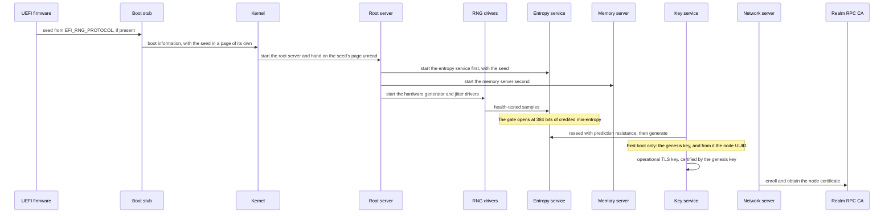

<!-- SPDX-FileCopyrightText: 2026 Nicole Roy -->
<!-- SPDX-License-Identifier: CC-BY-4.0 -->

# Entropy and the first keys

*2026-11-24. Input to the design session. The decisions it led to are recorded in [ADR 0021](../decisions/0021-entropy-before-keys.md).*

1. [The tenet](#1-the-tenet)
2. [Standards and platform facts](#2-standards-and-platform-facts)
3. [Where the first keys and certificates are minted](#3-where-the-first-keys-and-certificates-are-minted)
4. [Options](#4-options)
5. [Conflicts with the ASPIS model](#5-conflicts-with-the-aspis-model)
6. [Open questions](#6-open-questions)

## 1. The tenet

Where in the OS's initialization lifecycle the first certificates are minted decides how much entropy is available when they are. Sufficient entropy, with blocking until there is enough, is therefore a core concern.

## 2. Standards and platform facts

### Standards

| Standard | Status | What it settles |
|---|---|---|
| NIST SP 800-90A Rev. 1 | Final, June 2015 [SP800-90A] | The approved DRBGs: Hash_DRBG, HMAC_DRBG and CTR_DRBG |
| NIST SP 800-90A Rev. 2 | Pre-draft call for comments, 4 September 2025. No draft text yet [SP800-90A-R2] | Plans a DRBG built on SHAKE, the SHA-3 extendable-output function |
| NIST SP 800-90B | Final, January 2018 [SP800-90B] | Entropy sources: estimating min-entropy, and continuous health tests |
| NIST SP 800-90C | Final, September 2025 [SP800-90C] | How DRBGs and entropy sources combine into a random bit generator (RBG) |
| FIPS 203 (ML-KEM) and FIPS 204 (ML-DSA) | Final, August 2024 | Their randomness must come from an approved RBG of sufficient strength |

- **Seeding.** Instantiating a DRBG at security strength *s* from an entropy source needs at least 3*s*/2 bits of min-entropy. Reseeding a Hash_DRBG or HMAC_DRBG needs at least *s* bits [SP800-90C §2.4, §5]. At *s* = 256, that is 384 bits to instantiate and 256 bits to reseed.
- **Classes of RBG** [SP800-90C]:
  - An **RBG2(P)** construction seeds its DRBG from a physical entropy source.
  - An **RBG2(NP)** construction seeds it from a non-physical source, such as timing jitter.
  - Either can give prediction resistance by reseeding before it generates.
  - Only **RBG3** constructions give full-entropy output.
- **Trees of generators.** An RBGC construction lets the DRBGs on one platform form a tree. Each child is instantiated from its parent with 3*s*/2 bits of seed material [SP800-90C §7].
- **Strength.**
  - FIPS 203 requires an approved RBG with a security strength of at least 192 bits for ML-KEM-768 [FIPS203 §3.3].
  - FIPS 204 requires the same for ML-DSA-65 key generation. Hedged signing should use an approved RBG, but may use other fresh randomness [FIPS204 §3.6.1].
- **The cautionary tale.** In 2012, Heninger, Durumeric, Wustrow and Halderman recovered private keys from a large share of internet hosts [PSQS]:
  - RSA keys for 0.50% of TLS hosts and 0.03% of SSH hosts;
  - DSA keys for 1.03% of SSH hosts.

  The main cause was headless devices that generated their keys on first boot, before their generators had enough entropy.
- **Linux's answer.** `getrandom()` blocks until the kernel's generator has been initialized, and never blocks after that [GETRANDOM].
- **A kernel-resident alternative.** Fuchsia's kernel offers a generator directly, through `zx_cprng_draw` [ZIRCON].

### Platforms

| Platform | Seed from firmware | Sources ASPIS can read after boot |
|---|---|---|
| QEMU `virt` with EDK2 | `EFI_RNG_PROTOCOL`. Before edk2-stable202405, it existed only when a virtio-rng device was attached. Since then it can also come from `RNDR` on QEMU's `max` CPU under TCG, or from the SMCCC TRNG hypercall [EDK2-RNG] | virtio-rng, which the host backs. `RNDR`/`RNDRRS` where the CPU model has FEAT_RNG |
| Raspberry Pi 4 (BCM2711, Cortex-A72) | `EFI_RNG_PROTOCOL` from the SoC's random number generator, through the edk2-platforms driver [RPI-RNG] | The SoC generator, through an ASPIS driver. The Cortex-A72 is ARMv8.0, so it has no FEAT_RNG |
| Any | — | CPU timing jitter [JENT], and a seed persisted in the single-level store ([0005](../decisions/0005-single-level-store.md)) |

The Pi 4 also has no battery-backed clock, so a first boot begins without trustworthy time as well ([0015](../decisions/0015-jwt-tokens-and-oidc-identity.md), rule 7; [0020](../decisions/0020-realm-certificate-authority.md)).

## 3. Where the first keys and certificates are minted

**How the seed reaches the kernel.** The stub fills a page with bytes from `EFI_RNG_PROTOCOL` that it hasn't used for its own purposes, and erases every other copy. The page's address, length and source travel in the boot information. The kernel never reads the page. It hands it on and keeps no copy ([0041](../decisions/0041-boot-abi.md), rule 4). How the page travels through the root server to the entropy service, and how it is erased once ingested, is still open ([design backlog, D42](design-backlog.md#m3-node-user-space-and-the-entropy-gate)).

**Who needs randomness, and when**

| Phase | Consumer | What it needs | Before the gate? |
|---|---|---|---|
| Boot stub | Anything it randomizes itself | The firmware's seed | Yes, using that seed only |
| Kernel | Nothing | — | — |
| Root server and early servers | Object IDs ([0001](../decisions/0001-object-identifiers.md)) | No randomness: these are well-known IDs from the reserved sequence range | Yes |
| Entropy service | Its own DRBG | Seed material | It is the gate |
| Key service, first boot | The genesis key, which is permanent, and the first operational keys | 192-bit strength, prediction resistance and a physical source | No: it waits |
| ID minting | 40 random bits for each ID | Uniqueness, not secrecy | No |
| Network server | TLS key shares and ML-KEM encapsulation | 192-bit strength | No |
| Realm creation, on the founding node | The CA's root and intermediates, and the federation and tree-signing keys | Long-lived keys ([0021](../decisions/0021-entropy-before-keys.md), rule 5): a physical source and prediction resistance | No, and never automatically at first boot |
| Token issuance | `jti` values and hedged signatures | Fresh randomness | No |

The first certificates are minted at two points:

- **A realm's first certificates**, its root and intermediates, are minted when the realm is created ([0020](../decisions/0020-realm-certificate-authority.md), rule 1).
- **A node's first certificate** is minted when the node first enrolls, after the key service has minted the genesis key ([0020](../decisions/0020-realm-certificate-authority.md), rule 4). The founding node is the exception: no CA can issue its first certificate, so during the realm's creation it signs its initial certificate itself, with its genesis key, and later replaces it by renewal with the RPC CA ([0029](../decisions/0029-founding-node-self-signed-certificate.md), rules 1, 2 and 5).

Both come after the gate, provided nothing can produce a key before the entropy service answers.

## 4. Options

### 4.1 Where the generator lives

- **In the kernel**, as in Fuchsia.
  - It is available from the first instruction.
  - But it puts a DRBG and its hash function in the kernel, against [0003](../decisions/0003-hybrid-post-quantum-cryptography.md) rule 6, and it enlarges the trusted computing base.
- **In a user-space entropy service** (chosen).
  - Cryptography stays out of the kernel.
  - Every consumer must wait for the service. That works because neither the kernel nor the early servers need randomness: the objects they create have well-known IDs.

### 4.2 Crediting sources

| Source | Class | Credit |
|---|---|---|
| Hardware generator read by an ASPIS driver (virtio-rng, the Pi 4's SoC generator) | Physical | Its estimated rate, once SP 800-90B health tests pass on its output |
| `RNDRRS`, where the CPU has FEAT_RNG | Physical, already conditioned by the CPU | Conservatively, since ASPIS can't see the raw noise |
| The firmware's seed | Physical when the firmware draws on hardware, but ASPIS can't test it | Up to a platform-set limit. It never counts as the physical source that long-lived keys need |
| CPU timing jitter | Non-physical | Only at a rate measured on that platform, since the estimate depends on timer resolution |
| A seed persisted in the store | — | Never. A cloned disk carries the same seed |
| Entropy an operator supplies at a ceremony | — | Never; it is only mixed in |

### 4.3 Which DRBG

- **HMAC_DRBG with SHA-512** (chosen).
  - It is approved today (SP 800-90A Rev. 1).
  - It runs well in software on 64-bit cores that lack SHA instructions, such as the Pi 4's.
- **CTR_DRBG with AES-256.** Rejected: the Pi 4 has no AES instructions, and software AES risks timing leaks.
- **The SHAKE-based DRBG from SP 800-90A Rev. 2.** This would match 0003's preference for SHA-3, but no draft text exists yet. ASPIS can adopt it when it is final. Decided: [0021](../decisions/0021-entropy-before-keys.md), rule 8. ASPIS moves to it once Rev. 2 is final.
- **Designs outside NIST's list**, such as the ChaCha20 generators that Linux and OpenBSD use. Rejected: their output wouldn't come from an approved RBG, which FIPS 203 and 204 require.

## 5. Conflicts with the ASPIS model

1. **No cryptography in the kernel, versus randomness from the first instruction.**
   - [0003](../decisions/0003-hybrid-post-quantum-cryptography.md) rule 6 keeps cryptography out of the kernel.
   - **Resolution:**
     - The generator lives in a user-space service.
     - The kernel only passes the firmware's seed along, in a page of its own that it never reads ([0041](../decisions/0041-boot-abi.md), rule 4).
     - Nothing that runs before the gate needs randomness.
2. **0001's random bits, before the gate and before storage.**
   - An ID's sequence number needs a durably reserved block ([0001](../decisions/0001-object-identifiers.md), rule 4), and its 40 random bits need the generator. Early in boot, neither storage nor the generator is ready.
   - **Resolution:** objects that exist before the gate are the node's well-known objects, named from the reserved sequence range. The design session settles what fills their random field.
3. **Cloned images.**
   - Pi clusters are often built by flashing one image onto many cards. If that image held a genesis key or a credited seed, every node would share it.
   - **Resolution:**
     - Images never hold keys or credited seeds.
     - Every node mints its own keys after the gate.
     - A persisted seed is never credited.
     - Detecting a clone forces a new authority ([0001](../decisions/0001-object-identifiers.md), rule 5) and a reseed.
4. **Time is the other first-boot gate.**
   - Certificates ([0020](../decisions/0020-realm-certificate-authority.md)) and tokens ([0015](../decisions/0015-jwt-tokens-and-oidc-identity.md)) need trustworthy time, and the Pi 4 has no battery-backed clock.
   - **Resolution:** enrollment waits for authenticated time as well as for the entropy gate. The design of time synchronization is still open.
5. **Reproducible tests versus real entropy.** Continuous integration wants repeatable runs, but a production node must never accept an injected seed.
   - **Resolution:** a seed hook in test builds only. Decided: [0036](../decisions/0036-qemu-configuration-and-test-builds.md), rules 6–8.
     - Test builds are compiled with `--cfg aspis_test_build`, in a separate target directory, never as a Cargo feature.
     - In a test build, the entropy service accepts a fixed seed from a kernel argument, and credits it, so a run can be replayed. A production build doesn't recognize that argument.
     - CI checks every production image for test-only code, and fails the build on a hit.

## 6. Open questions

- **Credit rates** for each source on each platform, including jitter measurements on the Pi 4.
- **The Pi 4's SoC generator.** Its noise source isn't publicly documented, so how far can it be credited?
- **The reseed interval.**
- **IDs minted before the gate:** what fills the random field of the node's well-known objects.
- **The realm-creation ceremony:** whether it should demand a full-entropy (RBG3) source, such as an HSM, for the root key. Decided: [0021](../decisions/0021-entropy-before-keys.md), rules 5 and 6. The ceremony demands a node that meets rule 5, with a physical source and prediction resistance, not an RBG3 source; entropy from an HSM may be mixed in but is never credited.
- **Reproducible tests:** a seed-injection hook for test builds only, and how production builds are kept free of it. Decided: [0036](../decisions/0036-qemu-configuration-and-test-builds.md), rules 6–8. Only builds compiled with `--cfg aspis_test_build` contain the hook, and CI checks that production images hold no test code.
- **The persisted seed:** where it lives in the store, and when it is rewritten.
- **Time synchronization** that doesn't depend on certificates a node can't yet validate.

## Sources

- [SP800-90A] NIST SP 800-90A Rev. 1, June 2015: https://csrc.nist.gov/pubs/sp/800/90/a/r1/final
- [SP800-90A-R2] NIST SP 800-90A Rev. 2, pre-draft call for comments, 4 September 2025: https://csrc.nist.gov/pubs/sp/800/90/a/r2/iprd
- [SP800-90B] NIST SP 800-90B, January 2018: https://csrc.nist.gov/pubs/sp/800/90/b/final
- [SP800-90C] NIST SP 800-90C, September 2025: https://csrc.nist.gov/pubs/sp/800/90/c/final
- [FIPS203] FIPS 203, ML-KEM, §3.3: https://csrc.nist.gov/pubs/fips/203/final
- [FIPS204] FIPS 204, ML-DSA, §3.6.1: https://csrc.nist.gov/pubs/fips/204/final
- [PSQS] Heninger, Durumeric, Wustrow and Halderman, "Mining Your Ps and Qs: Detection of Widespread Weak Keys in Network Devices", USENIX Security 2012: https://factorable.net/
- [GETRANDOM] Linux `getrandom(2)`: https://man7.org/linux/man-pages/man2/getrandom.2.html
- [ZIRCON] Fuchsia `zx_cprng_draw`: https://fuchsia.dev/fuchsia-src/reference/syscalls/cprng_draw
- [EDK2-RNG] "ArmVirtPkg/ArmVirtQemu: Add RngDxe driver", edk2-stable202405: https://qemu.googlesource.com/edk2/+/refs/tags/edk2-stable202405%5E%21 ; and the 2022 series that preceded it: https://listman.redhat.com/archives/edk2-devel-archive/2022-November/055607.html
- [RPI-RNG] edk2-platforms Bcm2838 RNG driver: https://patchew.org/EDK2/20191202115506.4068-1-pete@akeo.ie/20191202115506.4068-4-pete@akeo.ie ; Pi 4 RngLib over the platform's `EFI_RNG_PROTOCOL`: https://patchew.org/EDK2/20200926145230.5332-1-Samer.El-Haj-Mahmoud@arm.com/20200926145230.5332-2-Samer.El-Haj-Mahmoud@arm.com
- [JENT] Stephan Müller, CPU Jitter Random Number Generator: https://www.chronox.de/jent/
