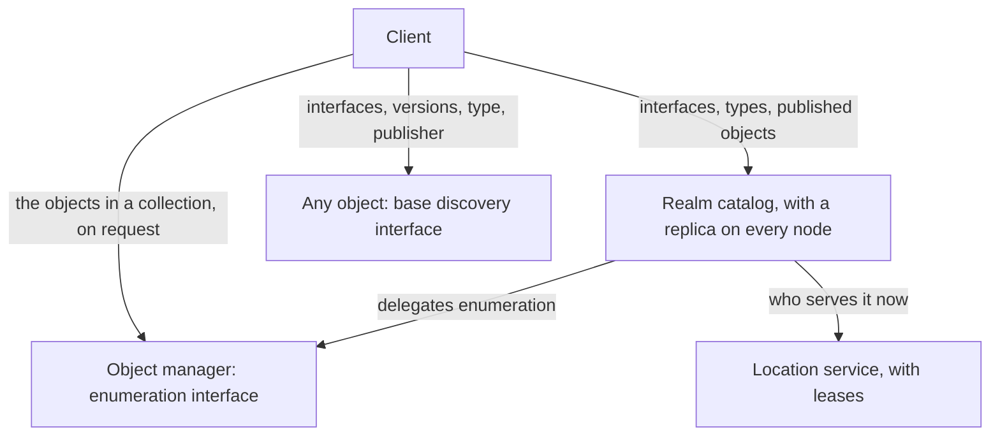
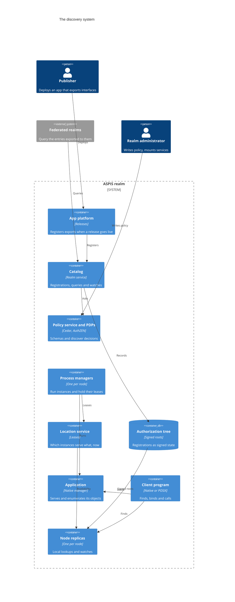
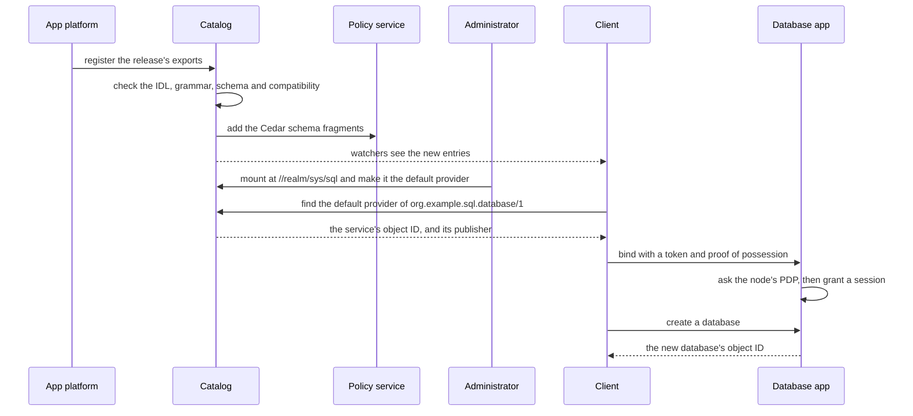

<!-- SPDX-FileCopyrightText: 2026 Nicole Roy -->
<!-- SPDX-License-Identifier: CC-BY-4.0 -->

# Applications that extend the system, and the catalog that finds them

*2026-11-24. Input to the design session. The decisions it led to are recorded in [ADR 0027](../decisions/0027-applications-extend-the-system.md) and [ADR 0028](../decisions/0028-discovery-and-realm-catalog.md).*

1. [The tenets](#1-the-tenets)
2. [What ASPIS already has](#2-what-aspis-already-has)
3. [Precedents](#3-precedents)
4. [Applications as providers](#4-applications-as-providers)
5. [The discovery system](#5-the-discovery-system)
6. [Example: a relational database added later](#6-example-a-relational-database-added-later)
7. [Conflicts and resolutions](#7-conflicts-and-resolutions)
8. [Open questions](#8-open-questions)

## 1. The tenets

- **Applications extend the system.**
  - Applications at the ASPIS level, below the POSIX layer, expose their functionality to the system and the realm as objects, with the same versioned API standards as ASPIS itself.
  - An application such as a relational database service can then offer the whole realm what looks like a core OS function, although it was added later and isn't built in.
- **Discoverability is a core concern.**
  - The OS and the realm make every API and object discoverable.
  - A catalog, updated in real time, enumerates them through the discovery system.

## 2. What ASPIS already has

| Already decided | Where | What the tenets add |
|---|---|---|
| Every interaction goes through an interface. Interfaces are objects, and any program can fetch an interface's IDL and ABNF | [0014](../decisions/0014-versioned-object-apis.md), rules 1 and 2 | An obligation on applications, and the machinery to register their interfaces and types at run time |
| An interface defined outside ASPIS uses its definer's authority | [0014](../decisions/0014-versioned-object-apis.md), rule 2 | Names, prefixes and publishers that people can see |
| Every object reports its interfaces, versions, type and attributes | [0014](../decisions/0014-versioned-object-apis.md), rule 5 | Its publisher and catalog entry, and enumeration by managers |
| The authority in an ID is the first location hint, and a location service tracks objects that move | [0004](../decisions/0004-network-transparency-and-failure.md), rule 5 | Leases, and authorities that resolve to an application's instances |
| Cedar schema is generated from the IDL | [0018](../decisions/0018-cedar-policy-language.md), rule 4 | Schema fragments registered along with an application's interfaces |
| AuthZEN resource search waits for a per-principal index | [0019](../decisions/0019-authzen-decision-protocol.md), rule 9 | The catalog is that index, for published objects |
| Native processes export listener endpoints, and deploys reach one another through internal routes | [0025](../decisions/0025-twelve-factor-app-contract.md), rule 7; [0026](../decisions/0026-realm-as-cloud-provider.md), rules 6 and 7 | Native applications offer their functionality as objects instead |
| The service broker keeps a catalog of service types and plans | [0026](../decisions/0026-realm-as-cloud-provider.md), rule 7 | It becomes part of the realm catalog |

**AEGIS tried this and fell short.**
- Its type managers implemented traits, and a type database mapped type UIDs to managers and names ([research §2.4](../research/aegis-domain-os.md#24-typed-objects-type-managers-and-traits)).
- But Apollo never published how to write a trait, so few third-party ones existed ([research §3.2](../research/aegis-domain-os.md#32-other-weaknesses)).
- The research notes already proposed opening the trait system to third parties ([research §5](../research/aegis-domain-os.md#5-implications-for-aspis)).

## 3. Precedents

| System | What it shows |
|---|---|
| NCS location brokers (Apollo) | Servers registered entries in a broker on each host and in a replicated Global Location Broker. Each entry held an object UUID, type UUID, interface UUID, a flag, a 64-character annotation and a socket address. Clients looked up any combination of object, type and interface [NCS-LB], [W3-LB]. A server that died without unregistering left its entry behind until an administrator removed it with `lb_admin`. A server that started while the global broker was down had to be entered by hand [NCS-LB] |
| DCE RPC name service | Server entries pair interface identifiers with binding information and list object UUIDs. Group and profile entries collect and rank them. The stable part of a binding lives in the name service; each host's endpoint map holds the volatile endpoint [C706] |
| D-Bus | Applications on the system bus provide services just as system components do. They claim well-known names. The bus lists current and activatable names, and broadcasts `NameOwnerChanged` as names come and go. Any object can describe its interfaces through `Introspect`. Interface names are reverse-domain, and the specification recommends putting a major version in them [DBUS] |
| Kubernetes | Custom resources appear and disappear in a running cluster through dynamic registration, and are used like built-in resources. Many core functions are themselves built as custom resources [K8S-CR]. Aggregated discovery, stable since 1.30, lists every resource in one document [K8S-API]. Clients list at a resource version and watch for changes from it\* |
| COM\* | A system-wide registry of classes and interfaces made third-party components usable like the system's own |
| Fuchsia | Components declare what they `expose`, and reach only what is routed to them [FUCHSIA-CAP] |
| RFC 9727, api-catalog | Proposed Standard, June 2025. `/.well-known/api-catalog` returns a Linkset (RFC 9264) of a publisher's APIs. Each API links to its description, such as OpenAPI, with `service-desc` [RFC9727] |
| OpenAPI | 3.2.0, September 2025 [OPENAPI] |

\* General background, not re-verified for this note.

**Lessons** (analysis):

1. The location brokers have the shape ASPIS needs: entries keyed by object, type and interface, with a broker on every host and a replicated global one.
2. Their failure is the other lesson. Registrations outlived the servers that made them, so availability needs leases.
3. DCE separates what is stable (the name service) from what is volatile (the endpoint map). ASPIS needs the same split.
4. D-Bus and Kubernetes show that applications can provide system services without being second-class, provided the mechanism is the same and discovery is live.

## 4. Applications as providers

### 4.1 One standard for everyone

The ASPIS interface standard is what ASPIS's own interfaces already meet, and an application's interfaces meet the same one:

| The standard | Where |
|---|---|
| Defined in the IDL, with ABNF generated, published and checked in CI | [0013](../decisions/0013-abnf-for-protocols-and-calls.md) |
| Interfaces are objects with IDs. Versions are major.minor under the DCE rule, and method numbers are stable | [0014](../decisions/0014-versioned-object-apis.md) |
| Every object implements the base discovery interface | [0014](../decisions/0014-versioned-object-apis.md), rule 5 |
| Clients bind with a token and proof of possession, and call through a capability or session | [0015](../decisions/0015-jwt-tokens-and-oidc-identity.md), [0022](../decisions/0022-spiffe-and-wimse-workload-identity.md) |
| The manager is the enforcement point. Cedar schema comes from the IDL, and decisions travel as AuthZEN | [0018](../decisions/0018-cedar-policy-language.md), [0019](../decisions/0019-authzen-decision-protocol.md) |
| Calls have deadlines and request IDs, and failure is visible | [0004](../decisions/0004-network-transparency-and-failure.md) |
| Errors are typed and namespaced by interface | [Research §5](../research/aegis-domain-os.md#5-implications-for-aspis) |
| Each major version has a declared support period | [0014](../decisions/0014-versioned-object-apis.md), rule 7 |

**The catalog enforces the standard.** It registers an interface version only after the checks ASPIS's own interfaces pass:
- the IDL compiles;
- the generated grammar parses and matches its test vectors;
- the Cedar schema fragment validates;
- the version is compatible with the earlier minor versions of its major version.

Only the catalog holds every publisher's earlier versions, so the catalog is where compatibility can be checked.

### 4.2 Parity

- **The same path.** A bind to an application's object travels the same path as a bind to a system object: name or ID, location service, manager, PDP, then capability or session.
- **The same views.**
  - dm and the command-line tool introspect and call an application's interfaces as they do the system's.
  - An application type that implements the `io` or directory interface appears in the POSIX personality as files or directories ([POSIX note §4.17](posix-compatibility.md#417-typed-objects)).
- **What differs.** Only two things set ASPIS's own interfaces apart:
  - they carry the reserved authority in their IDs ([0001](../decisions/0001-object-identifiers.md), rule 7);
  - they exist before the app platform starts.

  Nothing else is reserved for built-in code.

### 4.3 Types, without new ID classes

[0001](../decisions/0001-object-identifiers.md) puts a 16-bit class in every ID, taken from one global registry: file, directory, process, type and so on. Applications can't each claim a class, so:

- An application defines a type with a type object (class `type`), minted under its own authority. The type object names its manager and the interfaces that objects of the type implement.
- Objects of an application's type use a general-purpose class. Their type is an attribute, which their manager reports through the base interface. AEGIS likewise recorded an object's type in its volume table of contents ([research §2.4](../research/aegis-domain-os.md#24-typed-objects-type-managers-and-traits)).

### 4.4 Reaching an application's objects

- Objects that an application creates are minted under an authority the realm assigns to its deploy ([0026](../decisions/0026-realm-as-cloud-provider.md), rule 11). The control plane holds that authority's counter and gives instances blocks of sequence numbers, as [0001](../decisions/0001-object-identifiers.md) rule 4 requires.
- The location service resolves the authority to the deploy's ready instances. A bind to any of the application's objects therefore reaches it from anywhere in the realm, just as a bind to a system object does.
- A manager that shards its objects across instances can register finer-grained locations.

### 4.5 Declaring and registering exports

- An application's manifest ([0025](../decisions/0025-twelve-factor-app-contract.md), rule 2) declares what the application exports: interfaces, types and published objects. Fuchsia components declare what they expose in the same way.
- When a release goes live, the platform registers those exports in the catalog for the deploy. The platform attests each registration; no process can assert one for itself.
- A native service that runs outside the app platform registers through its own service principal.
- Registration is an authorized call.

### 4.6 Names

- Interface and type names are dotted and reverse-DNS, as D-Bus recommends: `org.example.sql.table`, for example. The prefix `aspis.` is reserved for ASPIS.
- Cedar policy decides which publisher may register which prefix.
- Names serve people and searches. Binding always uses IDs ([0014](../decisions/0014-versioned-object-apis.md), rule 4), so a look-alike name can't capture a binding.
- An illustrative grammar, not normative:

  ```abnf
  interface-ref  = interface-name "/" major [ "." minor ]
  interface-name = label 1*( "." label )     ; at least two labels
  label          = lc-alpha *( lc-alpha / DIGIT / "-" )
  lc-alpha       = %x61-7A                    ; a-z
  major          = 1*5DIGIT                   ; constraint: at most 65535
  minor          = 1*5DIGIT                   ; constraint: at most 65535
  ```

  `org.example.sql.table/1.2` means major version 1, minor version 2 or later. The Cedar actions of [0019](../decisions/0019-authzen-decision-protocol.md) rule 4 add the method: `org.example.sql.table/1/select`.

### 4.7 Becoming a realm function

A realm administrator can make an application's service look like part of the OS in two ways:

- **Mount it.** Bind a system name in the realm's namespace, such as `//<realm>/sys/sql`, to the service's published object. Mounts are name-service bindings ([POSIX note §4.4](posix-compatibility.md#44-pathnames)).
- **Make it the default provider** of an interface. A client that asks for the realm's provider of `org.example.sql.database/1` then finds it.

Either way, the catalog still shows who provides the service. An interface mounted as a realm function follows the realm's deprecation policy, as ASPIS's own interfaces do.

### 4.8 Binding between applications

- A native deploy binds to another application's published objects directly ([0025](../decisions/0025-twelve-factor-app-contract.md), rule 5), with grants in the authorization tree. Internal routes ([0026](../decisions/0026-realm-as-cloud-provider.md), rule 6) remain for POSIX apps.
- A binding may name an interface instead of an object. The platform resolves it through the catalog when it creates the release, and the release pins the object it resolved to, so releases stay immutable ([0026](../decisions/0026-realm-as-cloud-provider.md), rule 2).
- A native application still uses listener endpoints for routes, which serve browsers, external clients and POSIX callers. It doesn't use them to offer functionality to the realm.

### 4.9 HTTPS bindings

- Any interface can also be offered over HTTPS, through a binding the IDL compiler generates. The App API and AuthZEN are already offered this way ([0026](../decisions/0026-realm-as-cloud-provider.md), rule 12; [0019](../decisions/0019-authzen-decision-protocol.md), rule 2).
- The compiler generates an OpenAPI 3.2 description alongside the binding [OPENAPI], and the realm lists it at its edge (§5.7).
- POSIX programs, and clients outside ASPIS, can then call an application's objects without a native client library.

## 5. The discovery system

### 5.1 Three layers



- **Per object.** The base discovery interface ([0014](../decisions/0014-versioned-object-apis.md), rule 5) also reports the object's publisher, and its catalog entry if it has one.
- **Per manager.** Every manager implements an enumeration interface:
  - it lists the objects it manages, one page at a time;
  - it lists them only to callers allowed to see them;
  - it notifies watchers of changes.

  A directory already does all three for its entries.
- **Per realm.** The catalog.

### 5.2 What the catalog lists

| Listed eagerly and completely | Enumerated on request, through their managers |
|---|---|
| Every interface and version, with the hashes of its IDL, ABNF and Cedar schema | Every other object, such as a file, a directory or a database's rows |
| Every type, its managers and its interfaces | |
| Every published object: services, databases, queues, routes | |
| Mounts at system names, and default providers | |
| Each entry's publisher | |

**Why not index every object?** (analysis)
- Every file is an object, so a realm can hold billions of objects, and they change constantly.
- An index of everything would be a complete map of the realm. It would be valuable to an attacker even if every answer were filtered by policy.
- IDs already reveal which node minted them, and in what order ([0001](../decisions/0001-object-identifiers.md)). A global index would gather all of that in one place.

Delegation keeps enumeration complete without the copy. When asked to enumerate a collection, the catalog passes the request to the collection's manager.

### 5.3 Signed registrations, soft availability

- **Registrations** (what exists, and who provides it) are recorded in the authorization tree, in a catalog branch. Certificates are already recorded there ([0020](../decisions/0020-realm-certificate-authority.md), rule 7).
  - Keys are laid out so that everything one publisher registered shares a prefix. An ID begins with its minting authority, so keys built from IDs already group by publisher.
  - Each entry holds the hashes of the definitions it registers, so a client can check an IDL it fetched against a signed root.
  - Revoking a publisher's branch withdraws all its entries in one epoch, together with its grants.
- **Availability** (which instances serve an entry right now) lives in the location service, outside the tree.
  - A process manager registers an instance when it becomes ready, and withdraws it when the instance stops.
  - Every registration is a lease, so a crashed server's entries lapse on their own.

This is DCE's split between the name service and the endpoint map. The leases handle what NCS left to administrators.

**Alternative considered: a separate verifiable map.**
- It would need its own signing key, and so a change to the realm-creation ceremony ([0021](../decisions/0021-entropy-before-keys.md), rule 6).
- Revoking a publisher would then take two writes, not one.
- Registrations change only when releases go live or services register ([0027](../decisions/0027-applications-extend-the-system.md), rule 6), so the tree's epochs can absorb them.

### 5.4 Real time

- **Sequence numbers.** Every change gets a 64-bit sequence number: a registration when its epoch is signed, and an availability change when its lease starts or ends.
- **List, then watch.** A client lists at a sequence number and then watches from it, so it misses nothing and sees nothing twice.
- **Delivery.**
  - Local watchers are woken through eventcounts, as AEGIS's `ec2_$` calls woke waiters ([research §2.5](../research/aegis-domain-os.md#25-processes-synchronization-and-errors)).
  - Remote watchers receive a stream over RPC.
- **Replicas.** Every node keeps a replica, so lookups are local.
  - During a partition, lookups keep answering from the replica, marked with the epoch they reflect.
  - Binds still fail closed when the node's tree is too stale ([0016](../decisions/0016-authorization-sparse-merkle-tree.md), rule 7).

### 5.5 Queries

- A query can select by ID, name, publisher, type or attribute.
- It can also select by interface and minimum version, under the DCE rule: a request for 1.2 matches providers of 1.2 and of any later minor version.
- Results arrive a page at a time, with a sequence number to watch from.
- Every query and result has a text form, defined in ABNF ([0013](../decisions/0013-abnf-for-protocols-and-calls.md), rule 5).

### 5.6 Who may discover what

- **A Cedar action.** Seeing an entry is a Cedar action, `discover`. The catalog asks its node's PDP, in batches ([0019](../decisions/0019-authzen-decision-protocol.md)).
- **Default policy:**
  - interfaces and types are visible to every principal in the realm;
  - published objects follow their publisher's and the realm's policy;
  - principals from outside the realm see only the entries exported to them.
- **The missing index.** AuthZEN resource search was waiting for a per-principal index ([0019](../decisions/0019-authzen-decision-protocol.md), rule 9). The catalog's index of published objects is that index.

### 5.7 Views

- **POSIX.** The catalog implements the directory interface, so POSIX tools can browse it, for example at `//<realm>/catalog/interfaces/org.example.sql.table/1.2/idl`.
- **dm.** A catalog browser shows entries and their documentation, and updates as they change.
- **HTTPS.** The realm serves `/.well-known/api-catalog` (RFC 9727). It is a Linkset of the realm's HTTPS APIs, each with a `service-desc` link to its OpenAPI description [RFC9727].
- **Federation.** ASPIS-native federation metadata names the realm's catalog endpoint ([0017](../decisions/0017-openid-federation-membership.md), rule 8). Realms can then query one another for the entries exported to them, and each entry carries its own realm's signed root.

### 5.8 Components

The identity services and the rest of the app platform are left out of this view for space. [ASPIS in context](system-context.md) and the [twelve-factor note](twelve-factor-apps.md#52-containers) show them.



- **The catalog asks the policy service** to add each schema fragment, and asks the PDPs who may discover what.
- **Clients find entries** through their node's replica, and watch it for changes. They then bind to and call the application directly.
- **The administrator's mounts and default providers** are catalog operations, which the catalog checks with the PDP.

## 6. Example: a relational database added later

1. A publisher builds a native database application.
   - Its IDL defines two interfaces, `org.example.sql.database` and `org.example.sql.table`.
   - Its `table` type also implements `aspis.io`, so a table can be read as CSV.
2. The application is deployed with a storage binding. Its manifest exports both interfaces, both types and one published object: the service.
3. When the release goes live, the platform registers the exports.
   - The catalog checks them, and passes the Cedar schema fragments to the policy service.
   - It records them in the next epoch, and watchers see the new entries.
4. The realm administrator mounts the service at `//<realm>/sys/sql`, and makes it the default provider of `org.example.sql.database/1`.
5. A client program asks the catalog for that provider, or opens the mounted name. It binds with its token, the PDP decides, and the client receives a session.
6. The client creates a database. The database's ID is minted under the deploy's authority, so the location service on any node resolves it to the application's instances.
7. A POSIX program reads `//<realm>/sys/sql/<database>/<table>` as a file, through `aspis.io`.



## 7. Conflicts and resolutions

1. **Enumerating every object versus scale and privacy.**
   - **Resolution:** three layers. Interfaces, types and published objects are listed eagerly; everything else is enumerated through its manager on request (§5.2).
2. **Real time versus signed, batched state.**
   - **Resolution:** registrations follow the tree's epochs, and availability streams from leases (§5.3, §5.4).
3. **Application types versus a fixed set of ID classes.**
   - **Resolution:** an application's type is an attribute naming a type object, not a new class (§4.3).
4. **Looking like an OS function versus trust.**
   - **Resolution:** only an administrator's mount or default makes an application's service look built in, and the catalog always shows the publisher (§4.7).
5. **Look-alike names.**
   - **Resolution:** `aspis.` is reserved, Cedar policy controls prefixes, and binding uses IDs, never names (§4.6).
6. **Listener endpoints and internal routes versus the tenet.**
   - [0025](../decisions/0025-twelve-factor-app-contract.md) rule 7 gives native processes listener endpoints. [0026](../decisions/0026-realm-as-cloud-provider.md) rule 7 has deploys reach one another through internal routes.
   - **Resolution:** native applications offer functionality as objects. Listener endpoints serve only routes, and internal routes serve only POSIX apps (§4.8).
7. **A catalog is a map of the realm.**
   - **Resolution:** discovery is a Cedar action, with defaults that show external principals only what is exported to them (§5.6).
8. **Stale entries, as NCS had.**
   - **Resolution:** availability is leased, and registrations end with the release or publisher that made them (§5.3).
9. **Compatibility discipline for third parties.**
   - **Resolution:** the catalog checks each new minor version against the earlier versions it has registered (§4.1).
10. **Partitions.**
    - **Resolution:**
      - node replicas keep answering;
      - ASPIS's own interfaces are well-known objects, identical on every node ([0001](../decisions/0001-object-identifiers.md), rule 7);
      - binds still respect the tree's staleness bound.
11. **Bootstrap.**
    - **Resolution:** nothing the catalog, the platform or the identity services depend on can be provided by an application.

## 8. Open questions

- **Namespace layout.** Where system names (`//<realm>/sys/…`) and the catalog's view sit in the realm's namespace.
- **Standard service interfaces.** Should ASPIS define standard interfaces for common kinds of service, such as `aspis.sql`, `aspis.kv` and `aspis.queue`, so that providers are interchangeable?
- **Moving an authority.** How a deploy's authority moves to a successor deploy, for blue/green releases or migrations.
- **Queries.** Fixed kinds of query, or a small query language.
- **Watching over HTTPS.** How HTTPS clients watch: server-sent events, WebSockets or long polling.
- **Delay targets.** How quickly a change must reach a node's replica, and its watchers.
- **Enumeration.** Must every manager support watching every collection, or only directories? Decided: [0028](../decisions/0028-discovery-and-realm-catalog.md), rule 1: every manager's enumeration interface notifies watchers of changes, so watching isn't limited to directories.
- **Prefix ownership.** How the realm verifies that a publisher owns a prefix, for example through the publisher's OpenID Federation entity identifier.
- **Documentation.** Doc comments in the IDL, and how dm renders them.
- **AI agents.** WIMSE treats agents as workloads, and a typed catalog is what an agent needs to find tools. Should the realm offer the catalog through an agent protocol?

## Sources

- [NCS-LB] IBM, AIX 5.2 *Communications Programming Concepts*, "The Location Broker": http://ps-2.kev009.com/wisclibrary/aix52/usr/share/man/info/en_US/a_doc_lib/aixprggd/progcomc/rpc_lb.htm
- [W3-LB] `lb_$` calls, 1992 CERN mirror of Domain/OS documentation: https://www.w3.org/History/1992/nfs_dxcern_mirror/web/Apollo/calls/lb.html
- [C706] The Open Group, *DCE 1.1: Remote Procedure Call*, chapter 2, "Name Service Interface": https://pubs.opengroup.org/onlinepubs/9629399/chap2.htm
- [DBUS] D-Bus Specification, version 0.43: https://dbus.freedesktop.org/doc/dbus-specification.html
- [K8S-CR] Kubernetes, "Custom Resources": https://kubernetes.io/docs/concepts/extend-kubernetes/api-extension/custom-resources/
- [K8S-API] Kubernetes, "The Kubernetes API": https://kubernetes.io/docs/concepts/overview/kubernetes-api/
- [FUCHSIA-CAP] Fuchsia, capabilities and capability routing: https://fuchsia.dev/fuchsia-src/concepts/components/v2/capabilities
- [RFC9727] RFC 9727, api-catalog: A Well-Known URI and Link Relation to Help Discovery of APIs: https://www.rfc-editor.org/info/rfc9727; RFC 9264, Linkset: https://www.rfc-editor.org/info/rfc9264; RFC 8631, Link Relation Types for Web Services: https://www.rfc-editor.org/info/rfc8631
- [OPENAPI] OpenAPI Specification 3.2.0: https://spec.openapis.org/oas/v3.2
