<!-- SPDX-FileCopyrightText: 2026 Nicole Roy -->
<!-- SPDX-License-Identifier: CC-BY-4.0 -->

# Inside the kernel

*2026-11-24, updated 2026-11-25. C4's third level for the kernel box of [Inside a node](node-components.md). Drawn with the C4 model ([ADR 0024](../decisions/0024-diagrams-mermaid-and-c4.md)).*

The ASPIS kernel is a capability microkernel with seL4 as its reference model ([0002](../decisions/0002-capability-security-model.md)). This note shows what the accepted decisions put inside it. Most of how those parts work is not decided yet: writing the kernel specification is the next part of the design session, and section 3 lists what it has to settle.

1. [Components](#1-components)
2. [What the kernel does not do](#2-what-the-kernel-does-not-do)
3. [Open](#3-open)

## 1. Components

This view shows the kernel at C4's component level: what runs at EL1, and where the boot stub and user space meet it. It opens the kernel box of [the node view](node-components.md#1-overview), and groups what the decisions require of the kernel rather than fixing its modules.

```mermaid
---
config:
  c4:
    c4ShapeMargin: 80
    component_bg_color: "#2F6DB5"
    component_border_color: "#245A96"
    component_db_bg_color: "#2F6DB5"
    component_db_border_color: "#245A96"
    external_component_bg_color: "#6E6E6E"
    external_component_border_color: "#5A5A5A"
    external_container_bg_color: "#6E6E6E"
    external_container_border_color: "#5A5A5A"
---
C4Component
    title Inside the kernel
    Component_Ext(stub, "Boot stub", "In aspis.efi", "Collects boot information")
    Container_Ext(servers, "User-space servers", "", "Root server, pagers, drivers")
    Component_Ext(lib, "Kernel interface library", "In every process", "Versioned interfaces")
    Container_Boundary(k, "Kernel") {
        Component(boot, "Boot intake", "EL1 entry", "Boot information, root server")
        Component(caps, "Capabilities", "seL4 model", "Rights, transfer, revocation")
        Component(entry, "Exception entry", "Vector table", "Calls, faults, interrupts")
        Component(console, "Early console", "Framebuffer, UART", "Text as graphics, log, panic")
        Component(ipc, "IPC", "Endpoints", "Messages and capabilities")
        Component(irq, "Interrupts", "GICv2, GICv3", "Interrupt objects for drivers")
        Component(threads, "Threads and scheduler", "Timers, budgets", "Run, suspend, registers, TLS")
        Component(faults, "Faults", "Pagers, handlers", "Forwarding, deadlines, typed faults")
        Component(mem, "Memory", "Address spaces", "Memory objects, mapping, COW")
        Component(ec, "Eventcounts", "Kernel object", "Wait, sets, words in memory")
        Component(jobs, "Jobs", "Budgets", "Stopped as a unit")
    }
    Rel(stub, boot, "Boot information")
    Rel(boot, servers, "Starts root server")
    Rel(lib, entry, "System calls")
    Rel(boot, console, "First message")
    Rel(entry, caps, "Every call")
    Rel(entry, irq, "Interrupts")
    Rel(caps, ipc, "Endpoints")
    Rel(faults, ipc, "Page faults")
    Rel(mem, faults, "Absent pages")
    Rel(threads, ec, "Wait, wake")
    Rel(jobs, mem, "Memory budget")
    Rel(jobs, threads, "CPU budget")
    UpdateRelStyle(stub, boot, $offsetX="8", $offsetY="-40")
    UpdateRelStyle(boot, servers, $offsetX="25", $offsetY="-40")
    UpdateRelStyle(lib, entry, $offsetY="-40")
    UpdateRelStyle(entry, caps, $offsetY="-16")
    UpdateRelStyle(mem, faults, $offsetY="-16")
    UpdateRelStyle(boot, console, $offsetX="8")
    UpdateRelStyle(caps, ipc, $offsetX="8")
    UpdateRelStyle(entry, irq, $offsetX="8")
    UpdateRelStyle(faults, ipc, $offsetX="8")
    UpdateRelStyle(threads, ec, $offsetX="8")
    UpdateRelStyle(jobs, threads, $offsetX="55")
    UpdateLayoutConfig($c4ShapeInRow="3", $c4BoundaryInRow="1")
```

| Component | What it does | Decisions |
|---|---|---|
| Boot intake | Takes over from the boot stub at EL1, which has placed and relocated the kernel. The kernel is entered with the MMU and data cache off, all exceptions masked, and `x0` holding the boot information's physical address; it turns on the MMU itself. The boot information is a header followed by tagged records, and the kernel skips records it doesn't know unless they are marked critical. They carry what the stub collected: the command line, the memory map, the device tree and/or ACPI tables, the initial image with its digest, the framebuffer's base, size, dimensions, stride and pixel format, the kernel's placement, and a seed where the firmware offers one. The kernel parses its arguments with an ABNF grammar. Starts the root server from the initial image. Never reads the seed's page: it hands the page on toward the entropy service and keeps no copy | [0006](../decisions/0006-uefi-boot-image.md), rules 2 and 4; [0009](../decisions/0009-text-as-graphics-console.md), rule 2; [0021](../decisions/0021-entropy-before-keys.md), rule 1; [0035](../decisions/0035-toolchain-image-linkage-and-esp-layout.md), rule 3; [0041](../decisions/0041-boot-abi.md), rules 1–5; [entropy note §3](entropy-and-first-keys.md#3-where-the-first-keys-and-certificates-are-minted) |
| Exception entry | AArch64's exception vector table at EL1, where system calls, faults and interrupts enter the kernel. Programs reach system calls only through the kernel interface library, whose versioned interfaces let the raw system-call ABI change underneath. Every kernel operation goes through a capability | [0014](../decisions/0014-versioned-object-apis.md), rule 6; [0002](../decisions/0002-capability-security-model.md), rule 1 |
| Early console | Draws text, filled rectangles and bitmaps on the boot framebuffer from the kernel's first message, with glyph atlases rasterized at build time from Noto Sans Mono, with Noto Sans Math and Noto Sans Symbols for the WGL4 symbols it lacks ([0034](../decisions/0034-noto-fonts-under-ofl.md), rule 1). Noto Sans Mono is the monospace face of the SVG layer's family. It picks 16-, 24- or 32-pixel cells by framebuffer width. Also writes to the serial UART and the log ring: a fixed-size ring of records with sequence numbers, where writing never blocks and reading needs a capability. Where there is no linear framebuffer, uses the UART until a display driver starts. Stops drawing once Display SVG claims the display and imports the console's text from the log ring. Tracks the boot framebuffer's state: Kernel, Adopted or Retired. On a panic, draws the report on the boot framebuffer unless it is retired, and always on the UART | [0009](../decisions/0009-text-as-graphics-console.md), rules 1–5; [0034](../decisions/0034-noto-fonts-under-ofl.md), rules 1 and 4; [0042](../decisions/0042-log-ring-and-panic-path.md), rules 1–7 |
| Capabilities | Unforgeable handles in a process's capability space, each naming a kernel object with a set of rights; seL4 is the reference model. They are copied with fewer rights, passed over IPC and revoked, and a whole capability table can be copied for `fork`. Managers tag the capabilities they hand out with the policies that determined the decision, and revoke them when a new root revokes one of those branches | [0002](../decisions/0002-capability-security-model.md), rule 1; [0012](../decisions/0012-posix-compatibility-layer.md), rule 4; [0016](../decisions/0016-authorization-sparse-merkle-tree.md), rule 6; [0019](../decisions/0019-authzen-decision-protocol.md), rule 8 |
| IPC | Endpoints carry messages, and capabilities with them, between processes. When a local client binds, its manager returns a capability to an endpoint or memory object; for a remote object, the network server holds a proxy endpoint. Page faults reach pagers over IPC, and managers reach their node's PDP the same way. A blocked IPC wait can be canceled, which gives POSIX its `EINTR` | [0002](../decisions/0002-capability-security-model.md), rules 1 and 3; [0014](../decisions/0014-versioned-object-apis.md), rule 4; [0015](../decisions/0015-jwt-tokens-and-oidc-identity.md), rule 1; [0004](../decisions/0004-network-transparency-and-failure.md), rule 5; [0005](../decisions/0005-single-level-store.md), rule 2; [0019](../decisions/0019-authzen-decision-protocol.md), rule 3; [POSIX note §4.8](posix-compatibility.md#48-signals), [§5](posix-compatibility.md#5-what-the-kernel-must-provide) |
| Eventcounts | Kernel objects that threads wait on. A thread can wait on a set of them, which is how libc builds `poll`, or wait and wake on an eventcount word in user memory, for futex-style locks. Sessions expose readiness through them, credential rotation is signaled with one, and local catalog watchers are woken through them | [0002](../decisions/0002-capability-security-model.md), rule 1; [0025](../decisions/0025-twelve-factor-app-contract.md), rule 5; [0028](../decisions/0028-discovery-and-realm-catalog.md), rule 6; [POSIX note §4.14](posix-compatibility.md#414-waiting-on-many-descriptors), [§4.15](posix-compatibility.md#415-threads) |
| Memory | Address spaces and memory objects. Mapping is the primary way to access data: a process maps an object, through a capability, into an address space, and a global address is an object ID plus a byte offset. Copy-on-write clones of memory objects and address spaces serve `fork` and `MAP_PRIVATE`. Memory objects can be immutable and shared across processes, and anonymous ones end with their job. The root server gives the display driver a capability to the framebuffer memory | [0005](../decisions/0005-single-level-store.md), rule 1; [0012](../decisions/0012-posix-compatibility-layer.md), rule 4; [0025](../decisions/0025-twelve-factor-app-contract.md), rule 12; [0009](../decisions/0009-text-as-graphics-console.md), rule 4; [POSIX note §4.11](posix-compatibility.md#411-memory-mapping), [§5](posix-compatibility.md#5-what-the-kernel-must-provide) |
| Faults | Forwards a page fault on a mapped object, over IPC, to that object's pager, which runs in user space. The pager supplies the page from local storage, or from a remote node through the network server. When a page can't be fetched by its deadline, delivers a typed fault to the faulting thread's fault handler instead of blocking forever. Other faults go to a user-level handler too, and the POSIX layer turns them into `SIGSEGV`, `SIGBUS` or `SIGFPE` | [0005](../decisions/0005-single-level-store.md), rule 2; [0004](../decisions/0004-network-transparency-and-failure.md), rule 4; [POSIX note §4.8](posix-compatibility.md#48-signals), [§5](posix-compatibility.md#5-what-the-kernel-must-provide) |
| Threads and scheduler | Runs threads within their job's CPU budget. A thread can be suspended and its registers read or written, which is how the POSIX layer builds signal frames, and each thread has a TLS register, `TPIDR_EL0` | [0002](../decisions/0002-capability-security-model.md), rule 1; [0025](../decisions/0025-twelve-factor-app-contract.md), rule 12; [POSIX note §4.8](posix-compatibility.md#48-signals), [§4.15](posix-compatibility.md#415-threads) |
| Jobs | A job holds an instance and everything it starts, including child jobs, and can be stopped as a unit, so a process that daemonizes can't outlive its instance. Each job has a memory budget and a CPU budget. The process manager runs each instance in a job, and the job is destroyed at the stop deadline | [0025](../decisions/0025-twelve-factor-app-contract.md), rules 8, 9 and 12; [twelve-factor note §8](twelve-factor-apps.md#8-what-the-kernel-must-provide) |
| Interrupts | Drives the interrupt controllers: GICv2, for the Pi 4's GIC-400, and GICv3, for servers. QEMU `virt` offers either. Interrupts are kernel objects reached by capability, for drivers that run in user space | [0007](../decisions/0007-initial-hardware-targets.md), rule 1 and Consequences; [0002](../decisions/0002-capability-security-model.md), rule 1; [0009](../decisions/0009-text-as-graphics-console.md), rule 4; [0021](../decisions/0021-entropy-before-keys.md), rule 12 |

**Kernel objects.** [0002](../decisions/0002-capability-security-model.md) names address spaces, threads, endpoints, eventcounts, memory objects and interrupts, in a list that ends with "…" (rule 1). [0025](../decisions/0025-twelve-factor-app-contract.md) has the kernel provide jobs as well (rule 12). [0042](../decisions/0042-log-ring-and-panic-path.md) adds the log ring, with a read-only interface (rule 5), and the boot framebuffer, whose state moves by calls on it (rule 6). The rest of the list is the kernel specification's to settle.

**Not drawn.** Two relationships are in the text only, to keep the diagram readable: IPC delivers messages to user-space servers, page faults to pagers among them, and interrupts reach their drivers in user space.

**Open.** How each component works is for the kernel specification, and section 3 lists what it must decide. No decision covers SMP yet.

## 2. What the kernel does not do

The decisions keep the kernel small. What it leaves out, and where that work happens instead:

- **Policy.** No ACL parsing, no principal database and no policy ([0002](../decisions/0002-capability-security-model.md), Consequences). Cedar runs in user-space decision points, never in the kernel ([0018](../decisions/0018-cedar-policy-language.md), rule 5).
- **Tokens.** The kernel never sees or parses tokens. An object's manager verifies a token once, at bind, and returns a kernel capability to a local client ([0015](../decisions/0015-jwt-tokens-and-oidc-identity.md), rule 1).
- **Cryptography and randomness.** Cryptography runs in user-space servers: the network server and a key service ([0003](../decisions/0003-hybrid-post-quantum-cryptography.md), rule 6). The kernel holds no generator, uses no randomness and keeps no copy of the boot stub's seed ([0021](../decisions/0021-entropy-before-keys.md), rules 1 and 3).
- **The network.** The kernel knows nothing about it. Each node's network server holds proxy endpoints for remote objects ([0004](../decisions/0004-network-transparency-and-failure.md), rule 5).
- **POSIX.** The kernel gains no POSIX-specific features ([0012](../decisions/0012-posix-compatibility-layer.md), rule 1). Signals, job control and terminals live in the POSIX personality (rule 8), and `fork` uses general copy-on-write clones and a capability-table copy (rule 4).
- **Firmware calls.** ASPIS calls no UEFI runtime service. The kernel doesn't map the runtime regions, which the boot information reports as firmware-reserved, and reset and power-off go through PSCI ([0039](../decisions/0039-no-uefi-runtime-services.md), rules 1–3).
- **Fonts and SVG.** No font rasterizer and no SVG code. The early console's drawing code and glyph atlases are the only graphics code in the kernel ([0009](../decisions/0009-text-as-graphics-console.md), rule 3 and Consequences).
- **Drivers.** Drivers belong in user space ([0009](../decisions/0009-text-as-graphics-console.md), Context): the display drivers, which the root server starts (rule 4), the Pi 4's RNG driver ([0021](../decisions/0021-entropy-before-keys.md), rule 12) and DMA-capable drivers ([0007](../decisions/0007-initial-hardware-targets.md), rule 1). The kernel itself draws its early console and drives the interrupt controllers ([0009](../decisions/0009-text-as-graphics-console.md), rule 3; [0007](../decisions/0007-initial-hardware-targets.md), Consequences). Its timers and budgets also need the ARM generic timer, which gives POSIX its `CLOCK_MONOTONIC` ([POSIX note §4.18](posix-compatibility.md#418-time)). Starting the other CPUs belongs to SMP, which no decision covers yet, and who programs the SMMU is open.
- **Object IDs.** An ID's 40 random bits are CSPRNG output chosen when it is minted ([0001](../decisions/0001-object-identifiers.md)), and the kernel uses no randomness ([0021](../decisions/0021-entropy-before-keys.md), rule 3), so the kernel can't mint ordinary IDs. What fills the random field of IDs that exist before the gate is still open ([0021](../decisions/0021-entropy-before-keys.md), Consequences).

## 3. Open

The kernel specification turns these requirements into a design ([0012](../decisions/0012-posix-compatibility-layer.md), Consequences; [0025](../decisions/0025-twelve-factor-app-contract.md), rule 12). Until it exists, the following are open, apart from the parts that an item says a record decides. Section 1 decides nothing beyond those records:

- **Memory model.** How kernel objects get their memory, the physical frame allocator, the translation granule and the address-space layout. [0005](../decisions/0005-single-level-store.md) calls the virtual-memory subsystem early, critical work (Consequences). Two parts are decided: the kernel is a position-independent ELF linked in the upper half of the address space, which the stub relocates for the virtual base it chooses ([0035](../decisions/0035-toolchain-image-linkage-and-esp-layout.md), rules 2–4), and the initial image's entries are aligned to 64 KiB until the page size is fixed ([0037](../decisions/0037-initial-image-format-and-contents.md), rule 1). The exact base is left to C05. [0025](../decisions/0025-twelve-factor-app-contract.md) notes that seL4's untyped memory and MCS scheduling contexts already provide most of what jobs and budgets need (Consequences), but no decision adopts them.
- **Capability spaces and revocation.** The structure of a capability space and its rights; how derived capabilities are tracked, so that a manager can revoke the ones it handed out ([0016](../decisions/0016-authorization-sparse-merkle-tree.md), rule 6; [0019](../decisions/0019-authzen-decision-protocol.md), rule 8); and how a manager tells which session a call belongs to. [0002](../decisions/0002-capability-security-model.md) says revocation needs careful design (Consequences).
- **IPC semantics.** Synchronous or asynchronous, message size and buffers, how capabilities travel, call and reply, timeouts and cancellation. The decisions say only that capabilities pass over IPC ([0002](../decisions/0002-capability-security-model.md), rule 1), that page faults reach pagers over it ([0005](../decisions/0005-single-level-store.md), rule 2) and that a blocked wait can be canceled ([POSIX note §5](posix-compatibility.md#5-what-the-kernel-must-provide)).
- **Eventcount semantics.** How an eventcount is advanced, read and waited on; its width; how it relates to a word in user memory; and limits on waiting on a set. The [POSIX note](posix-compatibility.md#5-what-the-kernel-must-provide) lists what POSIX needs from eventcounts, not how they work.
- **Scheduling and CPU budgets.** The scheduler, how a job's CPU budget applies to its threads, timers, and how the kernel represents a deadline. [0025](../decisions/0025-twelve-factor-app-contract.md) requires the budget (rule 12) and points to seL4's MCS scheduling contexts (Consequences).
- **SMP.** CPU bring-up and the locking model, for machines such as the Pi 4 with its four cores ([0007](../decisions/0007-initial-hardware-targets.md), rule 2). No decision covers it yet.
- **Interrupt delivery to user-space drivers.** What an interrupt object signals, how a driver acknowledges it, and where the Pi 4's Broadcom second-level controller is handled ([0007](../decisions/0007-initial-hardware-targets.md), Consequences). How drivers reach device memory and DMA is open too, with the driver model.
- **The pager protocol and the fault model.** The messages between the kernel and pagers, page supply, write-back and eviction; the typed-fault taxonomy, and how a thread's fault handler is set. [0005](../decisions/0005-single-level-store.md) calls the pager protocol early, critical work (Consequences). The kernel knows nothing about the network ([0004](../decisions/0004-network-transparency-and-failure.md), rule 5), yet delivers a typed fault when a page misses its deadline (rule 4), so who sets that deadline is open too.
- **Job budgets.** What a job's size means: the units of its memory and CPU budgets, how budgets nest with child jobs, whether a scratch area counts against memory, and who is charged for immutable build pages that many instances map ([0025](../decisions/0025-twelve-factor-app-contract.md), rules 6 and 12).
- **The kernel interface library.** Its name, packaging and mapping; whether its interfaces for kernel objects are defined in the IDL, with the generated ABNF that [0013](../decisions/0013-abnf-for-protocols-and-calls.md) requires for every IPC call (rules 2 and 3); how they are versioned, and for how long ([0014](../decisions/0014-versioned-object-apis.md), rules 6 and 7); and how early servers, relibc and Rust's standard library use it.
- **The process model and executable format.** What a process is at kernel level, and how native spawn loads a program and hands it its initial capabilities and environment block ([0025](../decisions/0025-twelve-factor-app-contract.md), rule 4). Native process creation is spawn-only ([POSIX note §4.2](posix-compatibility.md#42-process-creation)). The executable format, and where the dynamic linker lives, are among the [POSIX note's open questions](posix-compatibility.md#8-open-questions). Partly decided: executables in the initial image are static ELF64 AArch64 programs, mapped in place from the image ([0037](../decisions/0037-initial-image-format-and-contents.md), rules 3 and 4). How the image's memory becomes memory objects is the kernel specification's to decide (0037, rule 4).
- **The boot hand-off.** The layout of the boot information, the grammar of the kernel arguments ([0006](../decisions/0006-uefi-boot-image.md), rule 3), and the root server's interface, including the capabilities the kernel hands it. How the seed is handed over is open too. The kernel hands it to the entropy service and keeps no copy ([0021](../decisions/0021-entropy-before-keys.md), rule 1), and since the root server starts the entropy service, [the entropy design note](entropy-and-first-keys.md#3-where-the-first-keys-and-certificates-are-minted) passes it through the root server. Partly decided: [0041](../decisions/0041-boot-abi.md). It fixes the entry state (rule 1), the boot information's header and records (rules 2 and 3), the kernel arguments' grammar and first keys (rule 5), and a page of its own for the seed, which the kernel never reads (rule 4). Still open: the root server's interface and its capabilities, of which the log ring's is one ([0042](../decisions/0042-log-ring-and-panic-path.md), rule 5), and how the seed's page reaches the entropy service and is erased ([design backlog, D40 and D42](design-backlog.md#m3-node-user-space-and-the-entropy-gate)).
- **The console handoff.** How Display SVG imports the console's text, how the kernel learns to stop drawing, and how it knows at a panic whether the boot framebuffer is still the active scan-out ([0009](../decisions/0009-text-as-graphics-console.md), rules 4 and 5). Also, who may read the log ring buffer (rule 3). Partly decided: [0042](../decisions/0042-log-ring-and-panic-path.md). The log ring's format is fixed (rules 1–4). Reading it needs a capability, which the kernel gives only to the root server (rule 5). At a panic the kernel goes by the boot framebuffer's state, Kernel, Adopted or Retired, and each move between states is a call on the framebuffer's kernel object (rule 6). The log ring's interface is written in the IDL with the other kernel interfaces (rule 5), and the rest of Display SVG's import is still open ([design backlog, D55](design-backlog.md#m3-node-user-space-and-the-entropy-gate)).
- **IDs for kernel objects.** [0001](../decisions/0001-object-identifiers.md) counts processes, threads and endpoints among the objects IDs name (Context), and every object implements the base discovery interface ([0014](../decisions/0014-versioned-object-apis.md), rule 5). The kernel can't mint ordinary IDs (section 2), so who mints the IDs of processes, threads and endpoints, whether other kernel objects carry IDs, and who answers their base interface, is open.
