<!-- SPDX-FileCopyrightText: 2026 Nicole Roy -->
<!-- SPDX-License-Identifier: CC-BY-4.0 -->

# Inside the kernel

*2026-11-24, updated 2026-11-26. C4's third level for the kernel box of [Inside a node](node-components.md). It follows ADRs 0047 to 0061, and 0062 to 0068 where they touch the kernel. Drawn with the C4 model ([ADR 0024](../decisions/0024-diagrams-mermaid-and-c4.md)).*

The ASPIS kernel is a capability microkernel ([0002](../decisions/0002-capability-security-model.md), rule 1). It follows seL4 17.0.0 with MCS enabled wherever a record leaves the kernel's design open. It follows seL4's design, not its code, and departs from it only where [0047](../decisions/0047-the-kernel-follows-sel4.md), rule 3 lists ([0047](../decisions/0047-the-kernel-follows-sel4.md), rules 1 to 3). It never waits for anything outside itself, so no pager, server or remote node can stall it (rule 4).

The records 0047 to 0061 say what the kernel guarantees, and why. The [kernel specification](kernel-specification.md) holds the mechanism: each object's operations, the layouts, the order of steps inside the kernel, and every mechanism question that is still open ([0047](../decisions/0047-the-kernel-follows-sel4.md), rule 5). Where the specification says nothing, the kernel does what seL4's reference manual says. This note shows the kernel's parts and the records that decide each one. It decides nothing itself.

1. [Components](#1-components)
2. [What the kernel does not do](#2-what-the-kernel-does-not-do)
3. [Open](#3-open)

## 1. Components

This view shows the kernel at C4's component level: what runs at EL1, and where the boot stub and user space meet it. It opens the kernel box of [the node view](node-components.md#1-overview). It groups what the records require of the kernel, roughly in the order of the kernel specification's sections, rather than fixing its modules.

```mermaid
---
config:
  c4:
    c4ShapeMargin: 80
    component_bg_color: "#2F6DB5"
    component_border_color: "#245A96"
    component_db_bg_color: "#2F6DB5"
    component_db_border_color: "#245A96"
    external_component_bg_color: "#6E6E6E"
    external_component_border_color: "#5A5A5A"
    external_container_bg_color: "#6E6E6E"
    external_container_border_color: "#5A5A5A"
---
C4Component
    title Inside the kernel
    Component_Ext(stub, "Boot stub", "In aspis.efi", "Boot information")
    Container_Ext(servers, "User-space servers", "", "Root server, pagers, drivers")
    Component_Ext(lib, "Kernel interface library", "In every process", "IDL interfaces")
    Container_Boundary(k, "Kernel") {
        Component(boot, "Boot intake", "EL1 entry", "Boot objects, root server")
        Component(caps, "Capabilities", "CNodes", "Rights, badges, revocation")
        Component(entry, "Exception entry", "Vector table", "Calls, faults, interrupts")
        Component(console, "Early console", "Framebuffer, UART", "Log ring, panics")
        Component(ipc, "IPC", "Endpoints", "Call, reply, deadlines")
        Component(irq, "Interrupts", "GICv2, GICv3", "Handlers, MSI")
        Component(threads, "Threads", "Control blocks", "Registers, suspend, cancel")
        Component(faults, "Faults", "Fault endpoints", "Typed faults")
        Component(ec, "Eventcounts", "Kernel objects", "Wait sets, word waits")
        Component(sched, "Scheduling", "MCS, virtual timer", "Budgets, priorities")
        Component(memobj, "Memory objects", "Pagers", "Mapping, clones, eviction")
        Component(aspace, "Address spaces", "4 KiB pages", "ASIDs, direct map")
        Component(smp, "SMP", "PSCI, one lock", "Run queues per core")
        Component(jobs, "Jobs", "Kernel objects", "Reservations, shares")
        Component(untyped, "Untyped memory", "Retype", "No heap")
    }
    Rel(stub, boot, "Boot information")
    Rel(boot, servers, "Starts root server")
    Rel(lib, entry, "System calls")
    Rel(boot, console, "First message")
    Rel(entry, caps, "Every call")
    Rel(entry, irq, "Interrupts")
    Rel(caps, ipc, "Endpoints")
    Rel(irq, ec, "Advance")
    Rel(faults, ipc, "Fault messages")
    Rel(faults, memobj, "Missing pages")
    Rel(aspace, memobj, "Maps")
    Rel(sched, threads, "Runs")
    Rel(smp, sched, "Run queues")
    Rel(jobs, sched, "CPU share")
    Rel(jobs, untyped, "Pieces")
    Rel(untyped, memobj, "Frames")
    UpdateRelStyle(stub, boot, $offsetX="8", $offsetY="-40")
    UpdateRelStyle(boot, servers, $offsetX="25", $offsetY="-40")
    UpdateRelStyle(lib, entry, $offsetY="-40")
    UpdateRelStyle(entry, caps, $offsetY="-16")
    UpdateRelStyle(aspace, memobj, $offsetY="-16")
    UpdateRelStyle(jobs, untyped, $offsetY="-16")
    UpdateRelStyle(boot, console, $offsetX="8")
    UpdateRelStyle(caps, ipc, $offsetX="8")
    UpdateRelStyle(entry, irq, $offsetX="8")
    UpdateRelStyle(irq, ec, $offsetX="8")
    UpdateRelStyle(faults, ipc, $offsetX="8")
    UpdateRelStyle(faults, memobj, $offsetX="8")
    UpdateRelStyle(sched, threads, $offsetX="8")
    UpdateRelStyle(smp, sched, $offsetX="8")
    UpdateRelStyle(jobs, sched, $offsetX="-60")
    UpdateRelStyle(untyped, memobj, $offsetX="50")
    UpdateLayoutConfig($c4ShapeInRow="3", $c4BoundaryInRow="1")
```

| Component | What it does | Decisions |
|---|---|---|
| Boot intake | Takes over at EL1 from the boot stub, which has placed and relocated the kernel. The kernel is entered with the MMU and data cache off, all exceptions masked, and `x0` holding the boot information's physical address; it turns on the MMU itself. The boot information is a header followed by tagged records, and the kernel skips records it doesn't know unless they are marked critical. They carry what the stub collected: the command line, the memory map, the device tree and/or ACPI tables, the initial image with its digest, the framebuffer's base, size, dimensions, stride and pixel format, the kernel's placement, a seed where the firmware offers one, and the place of the panic symbol table with the kernel's build ID. The kernel parses its arguments with an ABNF grammar. It keeps the memory it needs for itself, and makes the boot objects from it: the initial image, the device tree and the boot information as resident immutable memory objects; the kernel interface library's memory object; the framebuffer's device memory object and kernel object; the seed's page, as a frame it never maps or reads; the root job; the root server's first thread, IPC buffer, capability space and address space; and the control capabilities, for interrupts and for each core's scheduling. Boot objects belong to no job and are never destroyed. The root server gets them all, the rest of usable RAM as untyped memory in the root job, and the MMIO ranges as device untyped memory, except the GIC's frames and the UART. Then the kernel starts the root server from the initial image | [0006](../decisions/0006-uefi-boot-image.md), rules 2 and 4; [0009](../decisions/0009-text-as-graphics-console.md), rule 2; [0021](../decisions/0021-entropy-before-keys.md), rule 1; [0035](../decisions/0035-toolchain-image-linkage-and-esp-layout.md), rule 3; [0041](../decisions/0041-boot-abi.md), rules 1–5; [0048](../decisions/0048-kernel-memory-and-address-spaces.md), rules 1 and 2; [0058](../decisions/0058-jobs-and-budgets.md), rule 1; [0061](../decisions/0061-debugging.md), rule 2; [kernel specification](kernel-specification.md#what-the-root-server-receives); [entropy note §3](entropy-and-first-keys.md#3-where-the-first-keys-and-certificates-are-minted) |
| Exception entry | AArch64's exception vector table at EL1, where system calls, faults and interrupts enter the kernel. Each entry takes the kernel lock, and releases it on exit (SMP, below). Every kernel operation goes through a capability. System calls come only through the kernel interface library, whose versioned interfaces let the raw system-call ABI change underneath. That ABI is private to the kernel and the library. The kernel accepts a system call only from the library's code mapping, and turns any other into an unknown-system-call fault. This is a stability measure, not a security boundary. The kernel never takes a page fault in kernel mode, and treats a synchronous abort at EL1 as a panic | [0002](../decisions/0002-capability-security-model.md), rule 1; [0014](../decisions/0014-versioned-object-apis.md), rule 6; [0048](../decisions/0048-kernel-memory-and-address-spaces.md), rule 5; [0052](../decisions/0052-smp-bring-up-and-the-kernel-lock.md), rule 2; [0056](../decisions/0056-faults-and-page-fetch-deadlines.md), rule 3; [0059](../decisions/0059-the-kernel-interface-library.md), rules 2 and 4; [kernel specification](kernel-specification.md#invariants-the-prototype-checks) |
| Early console | Draws text, filled rectangles and bitmaps on the boot framebuffer from the kernel's first message, with glyph atlases rasterized at build time from Noto Sans Mono, with Noto Sans Math and Noto Sans Symbols for the WGL4 symbols it lacks ([0034](../decisions/0034-noto-fonts-under-ofl.md), rule 1). Noto Sans Mono is the monospace face of the SVG layer's family. It picks 16-, 24- or 32-pixel cells by framebuffer width. Also writes to the serial UART and the log ring: a fixed-size ring of records with sequence numbers, where writing never blocks and reading needs a capability. Where there is no linear framebuffer, uses the UART until a display driver starts. Stops drawing once Display SVG claims the display and imports the console's text from the log ring. Tracks the boot framebuffer's state: Kernel, Adopted or Retired. The log ring and the boot framebuffer are kernel objects with `[kernel]` interfaces in the IDL, and the log ring's read is a lossy server stream. The log ring and the panic path take no lock. On a panic, stops the other cores with a software-generated interrupt, and draws the report on the boot framebuffer unless it is retired, and always on the UART. The report gives each stack frame as symbol and offset, from a table of the kernel's function symbols that the stub places after the kernel's image, with the kernel's build ID. The kernel writes no crash dump | [0009](../decisions/0009-text-as-graphics-console.md), rules 1–5; [0034](../decisions/0034-noto-fonts-under-ofl.md), rules 1 and 4; [0042](../decisions/0042-log-ring-and-panic-path.md), rules 1–7; [0047](../decisions/0047-the-kernel-follows-sel4.md), rule 3; [0052](../decisions/0052-smp-bring-up-and-the-kernel-lock.md), rules 2 and 4; [0059](../decisions/0059-the-kernel-interface-library.md), rule 1; [0061](../decisions/0061-debugging.md), rules 2 and 6 |
| Untyped memory | Memory is untyped until a holder retypes it, as in seL4. The kernel has no other frame allocator and no heap. After boot, every kernel object, page table, frame and kernel record is made from untyped memory that a job supplies, so the kernel's own memory never grows. An object belongs to the job whose untyped memory it is made from. Making one needs that memory, not the job's capability; the one exception is a child job. Memory that no caller supplies, such as a fault's, comes from the job responsible. Records that no capability names, such as mapping records and each memory object's page tracking, come from a job's memory too. Jobs hold memory in pieces, and a piece can be retyped again once every object made from it is gone. Borrowed memory comes in page-sized pieces, or larger ones for large objects, so a piece a job empties can be returned whole. MMIO is device untyped memory | [0047](../decisions/0047-the-kernel-follows-sel4.md), rules 2 and 3; [0048](../decisions/0048-kernel-memory-and-address-spaces.md), rule 1; [0049](../decisions/0049-capability-spaces-rights-and-revocation.md), rule 4; [0058](../decisions/0058-jobs-and-budgets.md), rules 1, 3 and 4; [kernel specification](kernel-specification.md#untyped-memory-and-kernel-records) |
| Address spaces | Pages are 4 KiB, with 2 MiB and 1 GiB block mappings where a range allows, and addresses are 48 bits in each half. The lower half (`TTBR0`) is user space: each address space has its own tables and ASID, and ASIDs are allocated by generation rollover, as Linux on arm64 does, so that no job can use them up. The upper half (`TTBR1`) is the kernel's. The kernel is a position-independent ELF that the stub relocates, and the upper half holds its image, stacks, the devices it drives, the boot framebuffer until it is retired, and a direct map of RAM only, never executable, with the kernel's image read-only. No mapping is both writable and executable. User mappings are PXN, kernel mappings UXN, and PAN is on where the processor has it. The kernel never dereferences a user address: it reads arguments from registers and messages from the pinned IPC buffer through the direct map, and reaches other user memory by walking the tables in software, failing at once with "not resident" or "not RAM". It writes only where the process could, into a frame its object owns, and marks the page dirty. The address space's capability maps and unmaps, reads and writes resident memory, and lists mappings. Each address space has at most one code mapping of the kernel interface library, which the kernel records and never lets move | [0035](../decisions/0035-toolchain-image-linkage-and-esp-layout.md), rules 2–4; [0048](../decisions/0048-kernel-memory-and-address-spaces.md), rules 3–6; [0049](../decisions/0049-capability-spaces-rights-and-revocation.md), rule 2; [0057](../decisions/0057-memory-objects-and-the-pager-protocol.md), rule 3; [0059](../decisions/0059-the-kernel-interface-library.md), rule 3; [0061](../decisions/0061-debugging.md), rule 3; [kernel specification](kernel-specification.md#address-space-layout) |
| Capabilities | Unforgeable handles, each naming a kernel object with a set of rights. A capability space is a tree of CNodes, resolved with seL4's guarded lookup. There are four rights, read, write, grant and grant-reply, and a copy may drop rights, never add them. Endpoint badges are 64 bits. The kernel records every copy, transfer and retype in a derivation tree modeled on seL4's, each as a child of the capability it came from ([0047](../decisions/0047-the-kernel-follows-sel4.md), rule 3), so revocation is complete and preemptible; the one exception is an ITS table the hardware still uses. Every binding the kernel keeps, such as a mapping's memory object or a thread's fault endpoint, holds its own copy of the capability, so revoking that capability removes the binding. A holder can ask the kind and rights of a capability in its own space (identify). Up to three capabilities move in a message. A manager tells sessions apart by badge: it keeps a badged copy of its endpoint capability for each, and releases a badge by revoking that copy. When a new root of the authorization tree revokes a branch, the manager ends the sessions bound under it. Copying a whole capability table, for `fork`, is a library operation that copies slot by slot | [0002](../decisions/0002-capability-security-model.md), rule 1; [0012](../decisions/0012-posix-compatibility-layer.md), rule 4; [0016](../decisions/0016-authorization-sparse-merkle-tree.md), rule 6; [0019](../decisions/0019-authzen-decision-protocol.md), rule 8; [0047](../decisions/0047-the-kernel-follows-sel4.md), rules 2 and 3; [0049](../decisions/0049-capability-spaces-rights-and-revocation.md), rules 1–7; [0055](../decisions/0055-interrupt-objects.md), rule 4; [0066](../decisions/0066-capability-parameters-and-server-streams.md), rules 1 and 4 |
| Threads | Thread control blocks, as in seL4: the kernel saves and restores each thread's registers, the thread pointer `TPIDR_EL0` included. The thread's capability with read reads its state and registers. With write, it also suspends and resumes the thread, writes its registers, single-steps it, sets hardware breakpoints and watchpoints, cancels its current wait, sets its fault and timeout endpoints, registers its IPC buffer and binds an eventcount. That is how the POSIX layer builds signal frames, and how a debugger works. Unlike seL4's, suspending a thread doesn't cancel its wait. The kernel has no process object: a process is an address space, a capability space and one or more threads in one job, with the kernel interface library mapped. The runtime makes threads after the first from untyped memory of its own job | [0047](../decisions/0047-the-kernel-follows-sel4.md), rules 2 and 3; [0049](../decisions/0049-capability-spaces-rights-and-revocation.md), rule 2; [0054](../decisions/0054-ipc-endpoints.md), rule 6; [0060](../decisions/0060-processes-native-spawn-and-elf.md), rules 1 and 7; [0061](../decisions/0061-debugging.md), rule 3; [POSIX note §4.8](posix-compatibility.md#48-signals), [§4.15](posix-compatibility.md#415-threads) |
| Scheduling | Follows seL4's MCS model. A thread runs only with a scheduling context: a budget and a period in microseconds, bound to one core, with a 64-bit badge. A context is made from a job's untyped memory, and configured only within that job's CPU share. When a budget runs out, the thread waits for its refill, or gets a timeout fault on its timeout endpoint. Priorities are fixed, 0 to 255, with seL4's maximum controlled priority. The kernel sets no policy: the root server's boot manifest assigns priorities, in four default bands. Shared servers are passive where they can be, and run on the caller's donated context. Pagers and the memory server aren't. Canceling a call, or its deadline passing, takes the caller's context back along the chain of calls, and each passive server left without one gets a context-withdrawn fault. The kernel's clock is the EL1 virtual timer's count, `CNTVCT_EL0`, on every platform, and a deadline is an absolute value of that count. The kernel knows no wall time | [0047](../decisions/0047-the-kernel-follows-sel4.md), rules 2 and 3; [0051](../decisions/0051-scheduling-timers-and-deadlines.md), rules 1–6; [0054](../decisions/0054-ipc-endpoints.md), rule 6; [0058](../decisions/0058-jobs-and-budgets.md), rule 8 |
| SMP | Starts the secondary cores through PSCI `CPU_ON`, never spin tables, so a Pi 4 needs firmware with PSCI. Takes one kernel lock, as seL4's SMP kernel does, on every system call, fault and interrupt. A core waiting for the lock serves cross-core requests while it spins. The lock is never held for unbounded time: long operations have preemption points, work started from an interrupt runs in bounded batches, and ordered queues insert and remove in bounded or logarithmic time. Each core has its own run queues. A thread moves to another core only with a donated scheduling context or by an explicit call, and the kernel never balances load. Software-generated interrupts are the kernel's own, for rescheduling, cross-core requests and the panic stop. TLB maintenance uses broadcast `TLBI` instructions, with no interrupt. Finer locks need an edit to 0052 | [0047](../decisions/0047-the-kernel-follows-sel4.md), rule 2; [0052](../decisions/0052-smp-bring-up-and-the-kernel-lock.md), rules 1–4; [kernel specification](kernel-specification.md#smp) |
| IPC | Synchronous endpoints, as in seL4. An endpoint holds no messages, and senders and receivers wait in priority order. The operations are seL4's: send, send without blocking, call, receive, and reply and receive. A call gives the receiver a reply object, used once. A message has up to 120 64-bit words, the first four in registers and the rest in each thread's pinned IPC buffer, and its length is in octets, 0 to 960. It carries up to three capabilities, into receive slots the receiver names. The kernel never reads a message's contents. Their layout is the IDL's, on the common call header. Every blocking operation takes an optional deadline and can be canceled, which gives POSIX its `EINTR`, and a call's result says whether it was delivered. There is no asynchronous message queue in the kernel: asynchronous work uses eventcounts and shared memory. When a local client binds, its manager returns a capability to an endpoint or memory object; for a remote object, the network server holds a proxy endpoint. Managers reach their node's PDP over IPC. The kernel's own messages to servers, faults, page requests and memory requests, are requests of `[local]` interfaces defined in the IDL | [0002](../decisions/0002-capability-security-model.md), rules 1 and 3; [0004](../decisions/0004-network-transparency-and-failure.md), rule 5; [0005](../decisions/0005-single-level-store.md), rule 2; [0014](../decisions/0014-versioned-object-apis.md), rule 4; [0015](../decisions/0015-jwt-tokens-and-oidc-identity.md), rule 1; [0019](../decisions/0019-authzen-decision-protocol.md), rule 3; [0054](../decisions/0054-ipc-endpoints.md), rules 1–8; [0059](../decisions/0059-the-kernel-interface-library.md), rule 2; [0062](../decisions/0062-core-rules-big-endian-fixed-width.md), rule 2; [0064](../decisions/0064-the-call-header-and-wire-encoding.md), rules 2 and 9; [POSIX note §4.8](posix-compatibility.md#48-signals), [§5](posix-compatibility.md#5-what-the-kernel-must-provide) |
| Eventcounts | A 64-bit count that starts at zero and never wraps, made from a job's untyped memory. Eventcounts replace seL4's notifications. Advance adds one, and wakes every waiter whose target the count has reached; read and wait never change the count. A thread can wait on a wait set of up to 60 eventcounts, which is how libc builds `poll`. It can have one eventcount bound to it, so a server waits for requests and events in one receive. It can also wait and wake on a 32- or 64-bit word in user memory, for futex-style locks. Waiters are keyed by memory object and offset, and a word wait fails at once if the page isn't resident. Every wait takes a deadline and can be canceled. Interrupt handlers advance eventcounts. They are local to a node: a remote watcher receives a stream, and a local program waits on the stream's readiness eventcount. Sessions expose readiness through them, credential rotation is signaled with one, and local catalog watchers are woken through them | [0002](../decisions/0002-capability-security-model.md), rule 1; [0025](../decisions/0025-twelve-factor-app-contract.md), rule 5; [0028](../decisions/0028-discovery-and-realm-catalog.md), rule 6; [0047](../decisions/0047-the-kernel-follows-sel4.md), rule 3; [0053](../decisions/0053-eventcounts.md), rules 1–9; [0066](../decisions/0066-capability-parameters-and-server-streams.md), rule 8; [POSIX note §4.14](posix-compatibility.md#414-waiting-on-many-descriptors), [§4.15](posix-compatibility.md#415-threads) |
| Interrupts | Drives the interrupt controllers: GICv2, for the Pi 4's GIC-400, and GICv3, for servers. QEMU `virt` offers either. The kernel keeps every GIC frame, so no user-space program can map one. The root server holds the interrupt control capability, from which a holder makes one handler capability for each shared peripheral interrupt or MSI, for drivers that run in user space. A handler is bound to an eventcount, and each interrupt advances it by one. The kernel masks a level-triggered interrupt until the driver acknowledges it through the handler. The kernel manages MSI where the GIC receives it, through the GICv2m frame or the GICv3 ITS: it picks each MSI's vector and gives the driver the address and data to program. The ITS's tables are kernel objects made from untyped memory the caller supplies. The Pi 4's second-level controller and the BCM2711's PCIe MSIs are handled in user space | [0002](../decisions/0002-capability-security-model.md), rule 1; [0007](../decisions/0007-initial-hardware-targets.md), rule 1 and Consequences; [0009](../decisions/0009-text-as-graphics-console.md), rule 4; [0021](../decisions/0021-entropy-before-keys.md), rule 12; [0048](../decisions/0048-kernel-memory-and-address-spaces.md), rule 1; [0055](../decisions/0055-interrupt-objects.md), rules 1–5 |
| Memory objects | A memory object is a kernel object holding a range of pages: anonymous, pager-backed or device. Immutability is a property, not a kind, and immutable objects can be shared across jobs. Mapping is the primary way to access data: a process maps a range of an object, through a capability, into an address space, with rights and a finite fetch timeout, and the mapping holds its own copy of that capability. An object's pages come from its job. A clone is copy-on-write: a snapshot of an anonymous object, or a clone that reads through to a pager-backed or immutable one. Clones serve `fork` and `MAP_PRIVATE`, and no writer ever spends another job's memory. A pager creates the objects it backs. On a missing page, the kernel takes a frame from the object's job and sends the pager a one-way page request, without waiting; the pager answers with Supply or Fail. Pages leave an object only when user space asks: the pager writes back and evicts, and a holder of anonymous memory can decommit it. The kernel knows nothing of where pages come from. Anonymous objects end with their job. The root server gives the display driver a capability to the framebuffer's device memory object | [0005](../decisions/0005-single-level-store.md), rules 1 and 2; [0009](../decisions/0009-text-as-graphics-console.md), rule 4; [0012](../decisions/0012-posix-compatibility-layer.md), rule 4; [0025](../decisions/0025-twelve-factor-app-contract.md), rule 12; [0048](../decisions/0048-kernel-memory-and-address-spaces.md), rule 2; [0057](../decisions/0057-memory-objects-and-the-pager-protocol.md), rules 1–9; [POSIX note §4.11](posix-compatibility.md#411-memory-mapping), [§5](posix-compatibility.md#5-what-the-kernel-must-provide) |
| Faults | Each thread has a fault endpoint, and may have a timeout endpoint, as in seL4 MCS. The thread keeps its own copy of each endpoint capability. A fault goes to the fault endpoint as a call on the thread's behalf, and the handler's reply only resumes the thread. A handler changes registers through the thread's capability, or doesn't reply. Faults are typed: capability, unmapped, page unavailable, page deadline, memory, user exception, unknown system call, timeout, context withdrawn and debug. They are requests of the `[local]` interface `aspis.kernel.fault/1`. A fault on a missing page of a mapped object goes to the object's pager instead (Memory objects). The mapping's fetch timeout bounds the whole wait, for memory and then for the pager. A thread whose wait times out or is canceled takes a page-deadline or memory fault, instead of blocking forever. The kernel doesn't retry, and doesn't decide whether a fault is fatal. The POSIX layer turns faults into `SIGSEGV`, `SIGBUS` or `SIGFPE` | [0004](../decisions/0004-network-transparency-and-failure.md), rules 3 and 4; [0005](../decisions/0005-single-level-store.md), rule 2; [0056](../decisions/0056-faults-and-page-fetch-deadlines.md), rules 1–5; [0057](../decisions/0057-memory-objects-and-the-pager-protocol.md), rules 6 and 7; [0058](../decisions/0058-jobs-and-budgets.md), rule 6; [0064](../decisions/0064-the-call-header-and-wire-encoding.md), rule 9; [POSIX note §4.8](posix-compatibility.md#48-signals), [§5](posix-compatibility.md#5-what-the-kernel-must-provide) |
| Jobs | A job is a kernel object. Jobs nest, and the root server holds the root job, with all the node's memory and CPU. A job holds an instance and everything it starts, including child jobs, and can be stopped as a unit, so a process that daemonizes can't outlive its instance. A job has a memory reservation, which is guaranteed and never taken away while it runs, and a memory limit, in whole pages, with nested limits. Above its reservation it borrows from the node's pool, which the memory server holds. Everything made from a job's memory counts against it, scratch areas included, and shared immutable pages are charged to the job they belong to. When a job runs out, the kernel doesn't wait: an explicit call fails with "no memory", and a fault sends a one-way memory request to the job's memory endpoint. A job also has a CPU share of each core. Its capability stays with its manager, such as the process manager, and gives the job memory, sets its limits, makes child jobs, and lists, stops, resumes and ends its threads. Ending a job destroys everything it made, and the process manager ends each instance's job at the stop deadline | [0025](../decisions/0025-twelve-factor-app-contract.md), rules 6, 8, 9 and 12; [0058](../decisions/0058-jobs-and-budgets.md), rules 1–12; [0060](../decisions/0060-processes-native-spawn-and-elf.md), rule 2; [twelve-factor note §8](twelve-factor-apps.md#8-what-the-kernel-must-provide); [kernel specification](kernel-specification.md#job-capabilities) |

**Kernel objects.** The records and the kernel specification name these: untyped memory, device untyped memory included; CNodes; threads; scheduling contexts, with a scheduling-control capability for each core; address spaces; endpoints and reply objects; eventcounts and wait sets; memory objects, with the pager capability a pager holds to each object it backs; interrupt control and interrupt handlers; the ITS's command queue and tables; jobs; and the log ring and the boot framebuffer ([0047](../decisions/0047-the-kernel-follows-sel4.md), rules 2 and 3; [0048](../decisions/0048-kernel-memory-and-address-spaces.md), rule 4; [0049](../decisions/0049-capability-spaces-rights-and-revocation.md), rule 1; [0053](../decisions/0053-eventcounts.md), rules 1 and 4; [0054](../decisions/0054-ipc-endpoints.md), rule 2; [0055](../decisions/0055-interrupt-objects.md), rules 1 and 4; [0057](../decisions/0057-memory-objects-and-the-pager-protocol.md), rules 1 and 5; [0058](../decisions/0058-jobs-and-budgets.md), rule 1; [0042](../decisions/0042-log-ring-and-panic-path.md), rules 5 and 6; [kernel specification](kernel-specification.md#what-the-root-server-receives)). Eventcounts and wait sets replace seL4's notifications, and memory objects, jobs, the log ring and the boot framebuffer are ASPIS's own ([0047](../decisions/0047-the-kernel-follows-sel4.md), rule 3). There is no process object ([0060](../decisions/0060-processes-native-spawn-and-elf.md), rule 1). The kernel also keeps records that no capability names, such as mapping records and page tracking, made from the memory of the job responsible ([0047](../decisions/0047-the-kernel-follows-sel4.md), rule 3). Each kind of object has a `[kernel]` interface in the IDL, `aspis.kernel.<object>`, which names its object only by capability ([0059](../decisions/0059-the-kernel-interface-library.md), rule 1). The kernel specification says [what each right allows on each type](kernel-specification.md#rights-by-object-type).

**Debugging.** It has no component of its own. The kernel is debugged through QEMU's gdbstub, outside the kernel ([0061](../decisions/0061-debugging.md), rule 1). The early console prints symbolized panics (rule 2). A debugger of a user process works only through the capabilities of its threads and address space, which the process's manager hands out when a Cedar decision allows it (rules 3 and 4). Software breakpoints go into a private copy-on-write clone of the code, and the kernel interface library takes hardware breakpoints only (rule 4). Fault handlers, not the kernel, write user crash dumps (rule 5).

**Not drawn.** These relationships are in the text only, to keep the diagram readable. IPC delivers messages to user-space servers: faults to handlers, page requests to pagers and memory requests to the memory server. Interrupts reach their drivers through eventcounts. Every object made after boot comes from untyped memory, not only memory objects' frames. Every entry to the kernel takes SMP's lock.

**Mechanism.** How each component works is in the kernel specification, section by section. Section 3 says what is still open.

## 2. What the kernel does not do

The records keep the kernel small. What it leaves out, and where that work happens instead:

- **Policy.** No ACL parsing, no principal database and no policy ([0002](../decisions/0002-capability-security-model.md), Consequences). Cedar runs in user-space decision points, never in the kernel ([0018](../decisions/0018-cedar-policy-language.md), rule 5). The kernel sets no scheduling policy: the root server's boot manifest assigns priorities ([0051](../decisions/0051-scheduling-timers-and-deadlines.md), rule 2).
- **Tokens.** The kernel never sees or parses tokens. An object's manager verifies a token once, at bind, and returns a kernel capability to a local client ([0015](../decisions/0015-jwt-tokens-and-oidc-identity.md), rule 1).
- **Cryptography and randomness.** Cryptography runs in user-space servers: the network server and a key service ([0003](../decisions/0003-hybrid-post-quantum-cryptography.md), rule 6). The kernel holds no generator, uses no randomness and keeps no copy of the boot stub's seed ([0021](../decisions/0021-entropy-before-keys.md), rules 1 and 3). It never maps the seed's page ([0048](../decisions/0048-kernel-memory-and-address-spaces.md), rules 2 and 4).
- **The network.** The kernel knows nothing about it. Each node's network server holds proxy endpoints for remote objects, and raw capabilities never leave a node ([0004](../decisions/0004-network-transparency-and-failure.md), rule 5; [0002](../decisions/0002-capability-security-model.md), rule 5). The kernel doesn't know where a pager's pages come from ([0057](../decisions/0057-memory-objects-and-the-pager-protocol.md), rule 9). Eventcounts and deadlines are local to a node: a deadline that crosses nodes travels as a duration ([0053](../decisions/0053-eventcounts.md), rule 9; [0051](../decisions/0051-scheduling-timers-and-deadlines.md), rule 5).
- **Waiting.** The kernel never waits for anything outside itself. A thread may wait for a pager, a server or the memory server; the kernel doesn't, and holds no lock across such a wait ([0047](../decisions/0047-the-kernel-follows-sel4.md), rule 4).
- **Memory policy.** No heap, and after boot no memory that no job supplied ([0048](../decisions/0048-kernel-memory-and-address-spaces.md), rule 1). The kernel never evicts pages on its own ([0057](../decisions/0057-memory-objects-and-the-pager-protocol.md), rule 8). Lending, reclaim and refusal are the user-space memory server's, and nothing kills a job for memory ([0058](../decisions/0058-jobs-and-budgets.md), rules 4, 6 and 7).
- **Processes and program loading.** The kernel has no process object, and loads no programs. Native spawn is a call on the process manager, which loads the static ELF program ([0060](../decisions/0060-processes-native-spawn-and-elf.md), rules 1 to 3 and 5).
- **POSIX.** The kernel gains no POSIX-specific features ([0012](../decisions/0012-posix-compatibility-layer.md), rule 1). Signals, job control and terminals live in the POSIX personality (rule 8). `fork` uses general copy-on-write clones ([0057](../decisions/0057-memory-objects-and-the-pager-protocol.md), rule 4) and a capability-table copy that the kernel interface library makes slot by slot ([0049](../decisions/0049-capability-spaces-rights-and-revocation.md), rule 7).
- **Wall time.** The kernel knows no date or time of day. A user-space time service supplies wall time ([0051](../decisions/0051-scheduling-timers-and-deadlines.md), rule 6).
- **Firmware calls.** ASPIS calls no UEFI runtime service. The kernel doesn't map the runtime regions, which the boot information reports as firmware-reserved, and reset and power-off go through PSCI ([0039](../decisions/0039-no-uefi-runtime-services.md), rules 1–3). So does starting the other cores ([0052](../decisions/0052-smp-bring-up-and-the-kernel-lock.md), rule 1).
- **Fonts and SVG.** No font rasterizer and no SVG code. The early console's drawing code and glyph atlases are the only graphics code in the kernel ([0009](../decisions/0009-text-as-graphics-console.md), rule 3 and Consequences).
- **Drivers.** Drivers belong in user space ([0009](../decisions/0009-text-as-graphics-console.md), Context): the display drivers, which the root server starts (rule 4), the Pi 4's RNG driver ([0021](../decisions/0021-entropy-before-keys.md), rule 12), DMA-capable drivers ([0007](../decisions/0007-initial-hardware-targets.md), rule 1), the Pi 4's second-level interrupt controller and the BCM2711's PCIe MSIs ([0055](../decisions/0055-interrupt-objects.md), rule 5). The kernel itself draws its early console, and drives the GIC and the UART, whose frames it keeps ([0009](../decisions/0009-text-as-graphics-console.md), rule 3; [0048](../decisions/0048-kernel-memory-and-address-spaces.md), rule 1; [0055](../decisions/0055-interrupt-objects.md), rule 5). It uses the EL1 virtual timer ([0051](../decisions/0051-scheduling-timers-and-deadlines.md), rule 4), whose count gives POSIX its `CLOCK_MONOTONIC` ([POSIX note §4.18](posix-compatibility.md#418-time)). DMA, and who programs the SMMU, are open with the driver model (section 3).
- **Object IDs.** Kernel objects have no IDs inside the kernel: it never stores, checks or returns one, since minting needs storage and randomness ([0050](../decisions/0050-ids-for-kernel-objects.md), rule 1; [0021](../decisions/0021-entropy-before-keys.md), rule 3). A user-space server that presents a kernel object as an object mints its ID and answers its base interface (rules 2 to 5). The process manager or the root server names the processes it creates (rule 3).
- **Crash dumps.** The kernel writes none. A panic's report goes to the UART, the framebuffer if allowed, and the log ring ([0061](../decisions/0061-debugging.md), rule 6).

## 3. Open

Records 0047 to 0061 settle the kernel's design questions: the memory model, capability spaces and revocation, IDs for kernel objects, scheduling, SMP, eventcounts, IPC, interrupts, faults, the pager protocol, jobs and budgets, the kernel interface library, processes and spawn, and debugging. The call-language records fix how the kernel's interfaces and messages are written ([0062](../decisions/0062-core-rules-big-endian-fixed-width.md) to [0067](../decisions/0067-the-aspis-idl.md)), and [0068](../decisions/0068-the-fuzzing-and-differential-testing-gate.md), rule 11 adds a nightly kernel-call fuzzer. The [design backlog](design-backlog.md#m2-kernel-objects) marks the kernel's entries under M2, D13 to D24 and D29 to D31, settled. What is still open falls in three groups.

**Mechanism.** The kernel specification lists the kernel's open questions as K01 to K77, under [Open questions](kernel-specification.md#open-questions). The mechanism questions are settled alongside a prototype of C10 to C16, and the specification records each answer ([0047](../decisions/0047-the-kernel-follows-sel4.md), rule 5). The specification names C17 instead for the kernel interface library, and C70 for debugging. The [design backlog](design-backlog.md#m2-kernel-objects) groups all but four of the questions under M2:

| Backlog | What is open | Questions |
|---|---|---|
| D150 | Kernel memory bookkeeping: small records and pieces of a job's memory. ASID allocation (K01) was settled with C10 | K01–K06 |
| D151 | Bindings that hold capabilities, and object sizes. K07 was settled in part with C11 | K07, K08, K15, K29, K33, K50 |
| D152 | Rights on wait sets, jobs and the main thread; capabilities from listing; identify; capability identity. K11 was settled with C11 | K11, K32, K42, K53, K63, K75 |
| D153 | The share check, who configures scheduling contexts, priority bands and firmware without PSCI. When the kernel unmasks SError (K77). The SGIs and the panic stop (K26, K27) were settled with C13a | K13, K14, K16, K21, K26, K27, K77 |
| D154 | How waits end: deadlines, cancellation and suspension | K17–K20, K51, K52 |
| D155 | Long operations and ordered queues. K22, and K23 in part, were settled with C11 | K22–K25, K31, K34, K41 |
| D156 | The private ABI and the kernel's messages | K28, K30, K49, K58–K60, K76 |
| D157 | MSI and the GICv3 ITS | K35–K40 |
| D158 | The pager protocol and reclaim at a limit | K43–K48, K54–K57, K74 |
| D159 | Spawn, the startup block and the capability-table copy | K09, K62, K64–K67 |
| D160 | The debugging mechanism | K68–K72 |

[K02](kernel-specification.md#k02-small-kernel-records), for example, is open: how the kernel keeps the small records it makes on faults, such as mapping records and page-index nodes, in a job's memory without fragmenting it. The options are per-job slab pages, records reserved inside the object they describe, or a fixed allowance per address space and memory object.

**Questions carried elsewhere.** Three questions are decisions rather than mechanism: naming objects made after the entropy gate but before storage (K12, [D161](design-backlog.md#m3-node-user-space-and-the-entropy-gate)); dynamic linking (K73, [D162](design-backlog.md#m6-a-console-you-can-log-in-to)); and the support period of the library's major versions (K61, [D115](design-backlog.md#m7-workloads-and-discovery)). A fourth, what `fork` copies (K10), belongs to [D95](design-backlog.md#m6-a-console-you-can-log-in-to), which already asks it.

**Beyond the kernel specification.** Later milestones' backlog entries and chunks that touch the kernel:

- **The root server.** Its interface and boot manifest are open ([D40](design-backlog.md#m3-node-user-space-and-the-entropy-gate)). What the kernel gives it is settled ([0048](../decisions/0048-kernel-memory-and-address-spaces.md), rules 1 and 2).
- **The seed.** How the seed passes from the root server to the entropy service, and how each copy is erased ([D42](design-backlog.md#m3-node-user-space-and-the-entropy-gate)). The kernel's step is settled ([0048](../decisions/0048-kernel-memory-and-address-spaces.md), rule 2).
- **The console handoff.** The display driver's interface is open ([D55](design-backlog.md#m3-node-user-space-and-the-entropy-gate)). The log ring, Display SVG's import of the console's text from it, and the moves of the boot framebuffer's state are settled ([0042](../decisions/0042-log-ring-and-panic-path.md), rules 1–6).
- **The driver model.** Who parses the device tree, DMA, and who programs the SMMUv3 ([D43](design-backlog.md#m3-node-user-space-and-the-entropy-gate)). Interrupts and MMIO are settled ([0055](../decisions/0055-interrupt-objects.md); [0048](../decisions/0048-kernel-memory-and-address-spaces.md), rule 1).
- **Names and IDs.** The authority and random field of the node's well-known objects before the gate ([D36](design-backlog.md#m3-node-user-space-and-the-entropy-gate); [0050](../decisions/0050-ids-for-kernel-objects.md), rule 6), and the IDs of the `aspis.kernel.*` interfaces under the reserved authority ([D35](design-backlog.md#m3-node-user-space-and-the-entropy-gate); [0059](../decisions/0059-the-kernel-interface-library.md), rule 1).
- **The memory server's interface.** The methods and errors of `aspis.memory/1` are C83's, and the realm's named sizes C54's ([0058](../decisions/0058-jobs-and-budgets.md), rules 6 and 12).
- **Locks across nodes.** A word wait doesn't work as a lock between nodes. Such locks use leases or tokens, whose protocol is open ([D87](design-backlog.md#m5-two-nodes-one-realm); [0053](../decisions/0053-eventcounts.md), rule 6; [0057](../decisions/0057-memory-objects-and-the-pager-protocol.md), rule 9).
- **Hardening.** Spectre-class mitigations, PAN emulation on the Pi 4's Cortex-A72, and whether the stub randomizes the kernel's placement ([D145](design-backlog.md#mh-hardware-and-hardening), C78; [0048](../decisions/0048-kernel-memory-and-address-spaces.md), rule 6; [0035](../decisions/0035-toolchain-image-linkage-and-esp-layout.md), rule 4).
- **Panics and debugging.** Keeping panic records across a reboot is C73's ([0061](../decisions/0061-debugging.md), rule 6). The Pi 4's UART debug stub comes with C63 (rule 1). A debugger that may write memory keeps the memory-object capabilities it got by listing mappings after its session ends, until a record closes that gap ([0061](../decisions/0061-debugging.md), rule 4; [K42](kernel-specification.md#k42-capabilities-yielded-by-listing)).
