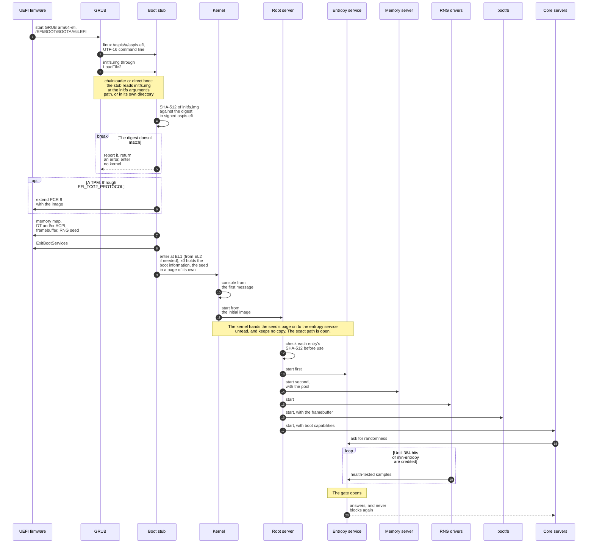
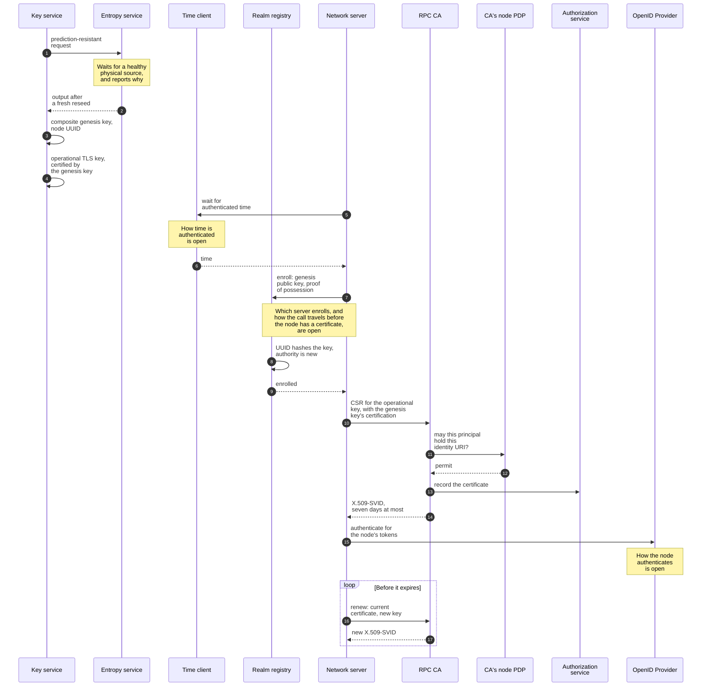
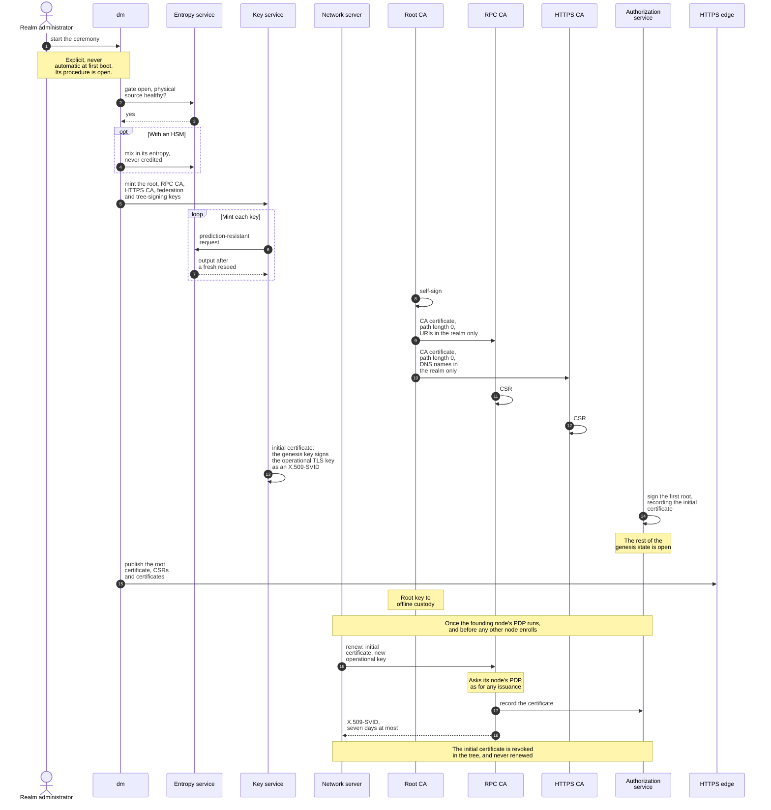
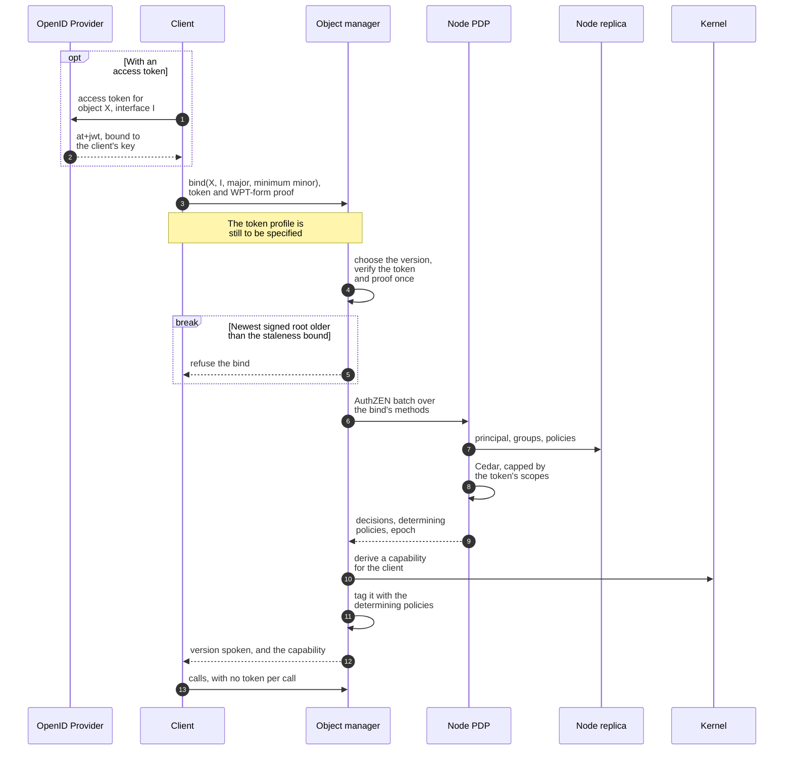
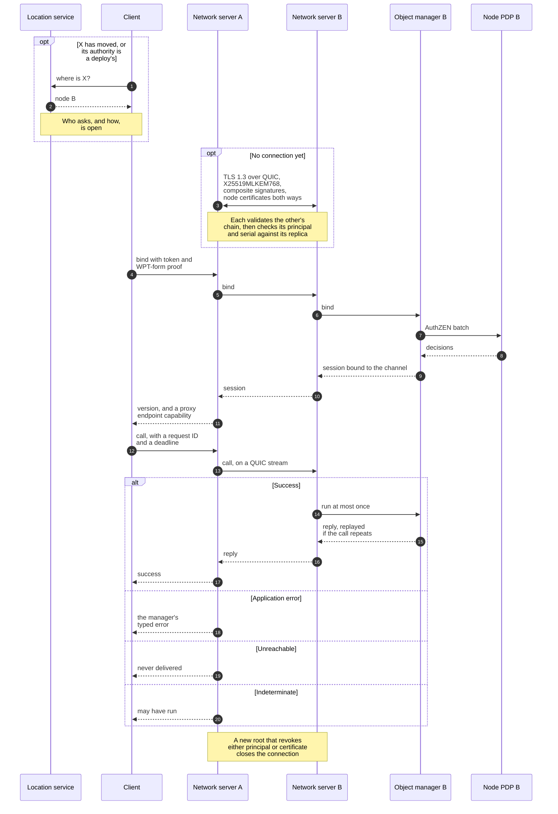
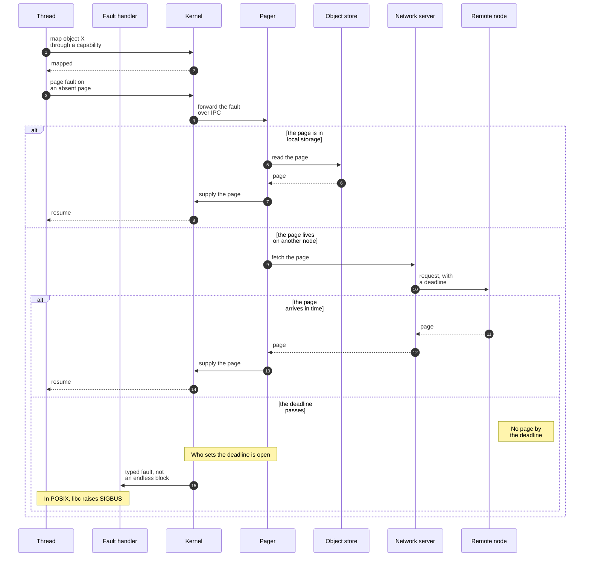
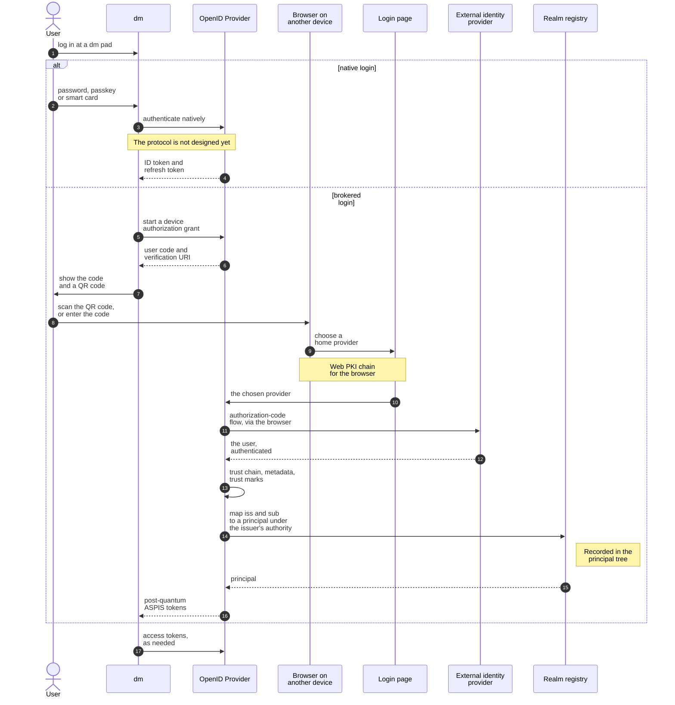
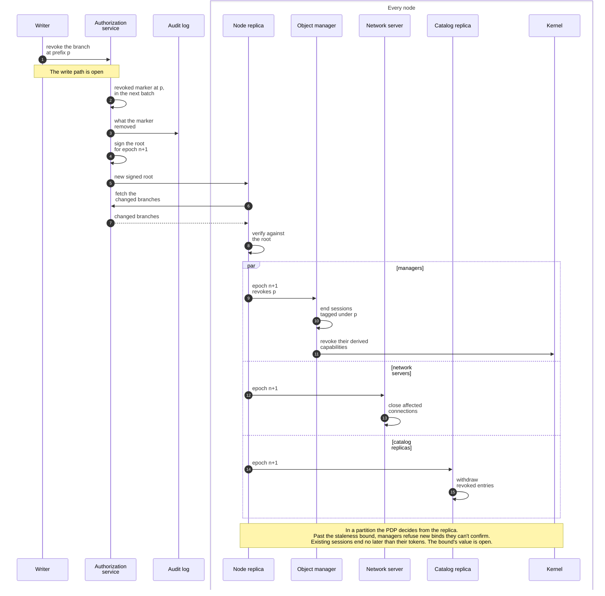
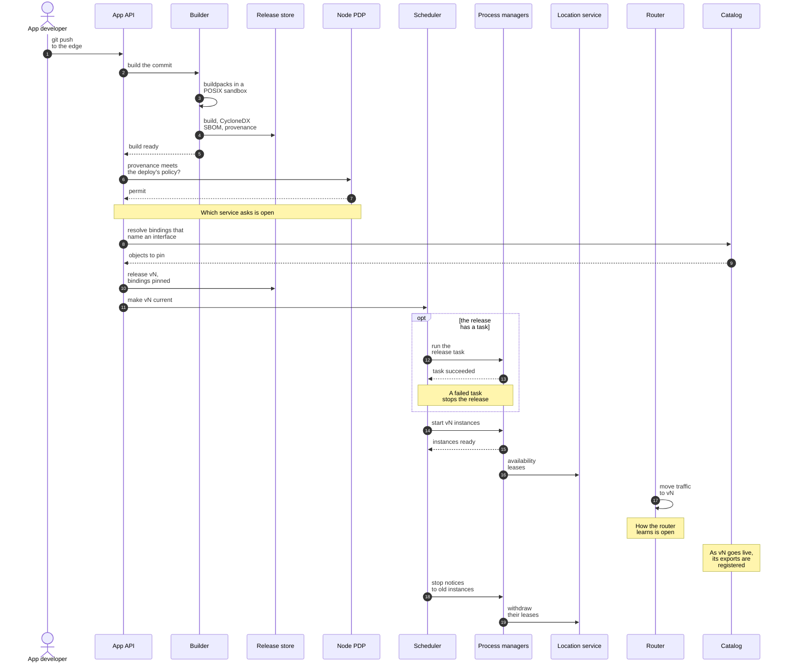
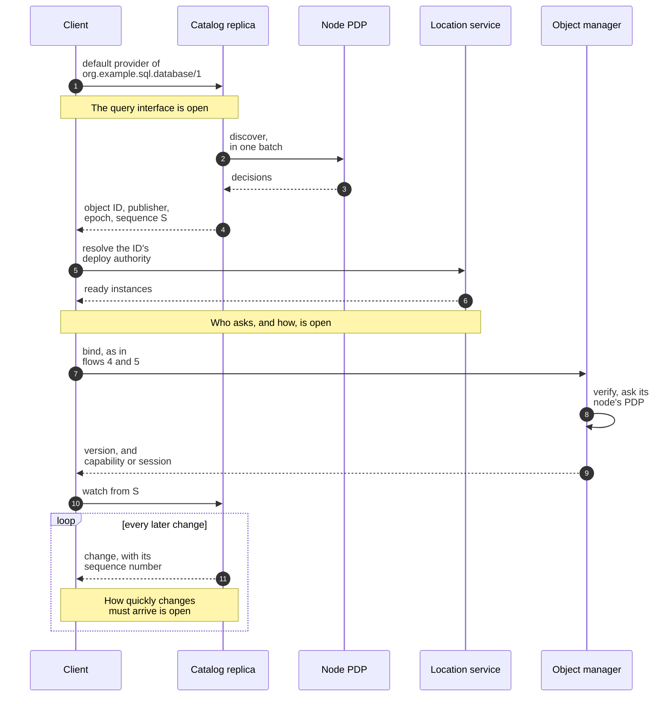

<!-- SPDX-FileCopyrightText: 2026 Nicole Roy -->
<!-- SPDX-License-Identifier: CC-BY-4.0 -->

# Key flows

*2026-11-24, updated 2026-11-26. The dynamic views: ten flows that show how the parts in [Inside a realm](realm-containers.md), [Inside a node](node-components.md) and [Inside the kernel](kernel-components.md) work together.*

Each flow follows the accepted decisions it cites. Where a step depends on something not yet decided, the diagram says so in a note rather than guessing.

1. [Boot to the entropy gate](#1-boot-to-the-entropy-gate)
2. [First boot: genesis identity and enrollment](#2-first-boot-genesis-identity-and-enrollment)
3. [Realm-creation ceremony](#3-realm-creation-ceremony)
4. [Binding to an object on the same node](#4-binding-to-an-object-on-the-same-node)
5. [Binding and calling across nodes](#5-binding-and-calling-across-nodes)
6. [Mapping an object and taking a page fault](#6-mapping-an-object-and-taking-a-page-fault)
7. [Logging in at dm](#7-logging-in-at-dm)
8. [Revoking a branch](#8-revoking-a-branch)
9. [Deploying a change](#9-deploying-a-change)
10. [Finding a provider, binding and watching](#10-finding-a-provider-binding-and-watching)

## 1. Boot to the entropy gate

This flow runs from power-on until the node's generator is seeded. Nothing on the node can get randomness before the entropy service opens its gate, and nothing that runs before then needs any, so no key is ever made from too little entropy ([0021](../decisions/0021-entropy-before-keys.md), rules 2 and 3).

**Notes**

- **Steps 1–3.** The firmware starts GRUB arm64-efi from `/EFI/BOOT/BOOTAA64.EFI`, and GRUB reads its menu from `/aspis/grub.cfg`. The EFI system partition has two slots, `/aspis/a/` and `/aspis/b/`, each with room for an `aspis.efi` and an `initfs.img`. Slot `b` stays empty until updates exist ([0006](../decisions/0006-uefi-boot-image.md), rule 3; [0035](../decisions/0035-toolchain-image-linkage-and-esp-layout.md), rule 6). GRUB's `linux` command starts `/aspis/a/aspis.efi`, an AArch64 PE32+ image, with `LoadImage` and `StartImage`, and passes the command line as UTF-16 load options. `aspis.efi` is the boot stub, with the kernel's ELF in a `.kernel` section ([0035](../decisions/0035-toolchain-image-linkage-and-esp-layout.md), rule 3). The image's PE major image version is 1 or higher, so GRUB serves `initfs.img` through `EFI_LOAD_FILE2_PROTOCOL` ([0006](../decisions/0006-uefi-boot-image.md), Context and rules 1 and 3). The stub looks for the initial image through `LoadFile2` first, then at the ESP path in the `initfs` kernel argument, then as `initfs.img` in the directory that holds `aspis.efi`. So under `chainloader` or direct firmware boot each slot is self-contained, and if no image is found the stub doesn't enter the kernel ([0041](../decisions/0041-boot-abi.md), rule 6). U-Boot boards that implement UEFI boot the same image ([0006](../decisions/0006-uefi-boot-image.md), Consequences).
- **Steps 4–6.** The build places the SHA-512 of `initfs.img` in the stub's `.initfs` section before `aspis.efi` is signed, so Secure Boot's signature covers the digest. The stub computes the SHA-512 of the whole image, however it got it. On a mismatch it doesn't enter the kernel: it reports the failure on the GOP console and the UART, and returns an error to its caller, so GRUB or the firmware can try another entry. Only a test build can waive the check ([0040](../decisions/0040-the-stub-checks-the-initial-image.md), rules 1 and 2; [0036](../decisions/0036-qemu-configuration-and-test-builds.md), rule 6). Where the firmware offers `EFI_TCG2_PROTOCOL`, the stub also extends PCR 9 with the image, for attestation. That doesn't replace the check ([0040](../decisions/0040-the-stub-checks-the-initial-image.md), rule 3).
- **Steps 7–9.** The stub reads the command line and collects the memory map, the device tree and/or ACPI tables, the framebuffer and, where the firmware offers one, a seed from `EFI_RNG_PROTOCOL`. It loads the kernel's segments at a physical address aligned to 2 MiB and applies its relocations ([0035](../decisions/0035-toolchain-image-linkage-and-esp-layout.md), rule 3). It then exits boot services, leaves EL2 if the firmware handed over there, and enters the kernel at EL1 ([0006](../decisions/0006-uefi-boot-image.md), rule 4). It picks a GOP mode with a linear framebuffer and reserves that region in the memory map ([0009](../decisions/0009-text-as-graphics-console.md), rule 2). It uses the seed only for what it does itself ([0021](../decisions/0021-entropy-before-keys.md), rule 3).
  - **Entry state.** The kernel is entered with the MMU and data cache off, all exceptions masked, and `x0` holding the boot information's physical address ([0041](../decisions/0041-boot-abi.md), rule 1).
  - **Boot information.** A header followed by tagged records: the command line, the memory map, the device tree, ACPI, the framebuffer, the initial image with its digest and whether the check ran or was waived, the seed, the kernel's placement and the stub's own facts. Only the memory map and the kernel placement are required, and a kernel skips records it doesn't know unless they are marked critical ([0041](../decisions/0041-boot-abi.md), rules 2 and 3; [0040](../decisions/0040-the-stub-checks-the-initial-image.md), rule 4).
  - **The seed.** The stub puts the seed bytes it hasn't used in a page of their own, and erases every other copy. The kernel never reads that page ([0041](../decisions/0041-boot-abi.md), rule 4).
  - **No runtime services.** The stub doesn't call `SetVirtualAddressMap`, and the memory map marks the firmware's runtime regions as reserved. After `ExitBootServices`, no firmware code runs at ASPIS's request ([0039](../decisions/0039-no-uefi-runtime-services.md), rules 1 and 2).
- **Step 10.** From its first message, the kernel draws its console as text on the boot framebuffer, and also writes it to the serial UART and a log ring. Without a linear framebuffer, the console uses the UART until a display driver starts ([0009](../decisions/0009-text-as-graphics-console.md), rules 1–3). The ring keeps every level. The UART and the framebuffer show records at or above the `log.level` kernel argument. Reading the ring needs a capability, which the kernel gives only to the root server ([0042](../decisions/0042-log-ring-and-panic-path.md), rules 1, 4 and 5).
- **Steps 11–12.** The kernel starts the root server from the initial image ([the entropy note](entropy-and-first-keys.md#3-where-the-first-keys-and-certificates-are-minted)). The kernel holds no generator and uses no randomness ([0021](../decisions/0021-entropy-before-keys.md), rules 1 and 3). The initial image is in an ASPIS format, with a SHA-512 digest for each entry and each file aligned so that executables are mapped in place. It carries everything the root server starts before storage is up: the root server and its boot manifest, the entropy service and the RNG drivers, the memory server, `bootfb`, the key service, the drivers the storage and network servers need, and those servers ([0037](../decisions/0037-initial-image-format-and-contents.md), rules 1, 4 and 5). The root server checks each entry against its own digest before it starts or reads it ([0037](../decisions/0037-initial-image-format-and-contents.md), rule 7; [0040](../decisions/0040-the-stub-checks-the-initial-image.md), rule 5).
- **Steps 13–17.** The root server starts the entropy service first ([0021](../decisions/0021-entropy-before-keys.md), rule 1), and the memory server second, before any driver. The memory server holds the node's pool of untyped memory, which the root server held until then ([0058](../decisions/0058-jobs-and-budgets.md), rule 4). The RNG drivers read virtio-rng on QEMU, the Pi 4's SoC generator and `RNDRRS` where the CPU has FEAT_RNG. CPU timing jitter is a further, non-physical source (rules 4 and 12). `bootfb` gets a capability to the framebuffer memory and adopts it. The kernel keeps drawing its console until Display SVG claims the display ([0009](../decisions/0009-text-as-graphics-console.md), rule 4). The kernel tracks the boot framebuffer's state: Kernel while the kernel draws its console, Adopted once Display SVG has claimed the display, and Retired once a hardware display driver has changed the scan-out. A panic is drawn on it until it is retired ([0042](../decisions/0042-log-ring-and-panic-path.md), rule 6). The key service, the network server and anything that mints IDs start after the entropy service and the RNG drivers ([0021](../decisions/0021-entropy-before-keys.md), Consequences). Until a decision point runs, the capabilities the root server hands out are the only authority ([0018](../decisions/0018-cedar-policy-language.md), rule 5). The objects that exist before the gate are the node's well-known objects, named from [0001](../decisions/0001-object-identifiers.md)'s reserved sequence range ([0021](../decisions/0021-entropy-before-keys.md), rule 3).
- **Steps 18–20.** Requests wait until the root DRBG, HMAC_DRBG with SHA-512 at a security strength of 256 bits, has been instantiated with at least 384 bits of credited min-entropy. No request gets weaker output instead, and once the gate opens the service never blocks again ([0021](../decisions/0021-entropy-before-keys.md), rules 1, 2 and 8). Hardware generators are credited once SP 800-90B health tests pass on their output, the firmware's seed only up to a limit set for each platform, and jitter only at a rate measured on that platform (rule 4). In a test build only, the entropy service also accepts a fixed seed from a kernel argument and credits it, so a test run can be replayed. A production build doesn't recognize that argument ([0036](../decisions/0036-qemu-configuration-and-test-builds.md), rules 6 and 7).
- **Settled since this flow was first drawn.** The boot information's layout ([0041](../decisions/0041-boot-abi.md)), the initial image's format and contents ([0037](../decisions/0037-initial-image-format-and-contents.md)) and how the stub checks it ([0040](../decisions/0040-the-stub-checks-the-initial-image.md)) were open here, and are now decided.
- **Open.**
  - The rest of the seed's path. The seed travels in a page of its own, which the kernel never reads, and the kernel keeps no copy ([0041](../decisions/0041-boot-abi.md), rule 4; [0021](../decisions/0021-entropy-before-keys.md), rule 1). The root server starts the entropy service, so [the entropy note](entropy-and-first-keys.md#3-where-the-first-keys-and-certificates-are-minted) passes the seed through the root server. How the page reaches the entropy service, and how it is erased once ingested, is not decided yet ([design backlog, D42](design-backlog.md#m3-node-user-space-and-the-entropy-gate)).
  - The boot manifest's format, which is the root server's design ([0037](../decisions/0037-initial-image-format-and-contents.md), rule 3; [design backlog, D40](design-backlog.md#m3-node-user-space-and-the-entropy-gate)).
  - How a slot is chosen, and how a failed boot falls back to the other slot. It uses files on the ESP, not UEFI variables ([0039](../decisions/0039-no-uefi-runtime-services.md), rule 5). [D146](design-backlog.md#mh-hardware-and-hardening) decides the details ([0035](../decisions/0035-toolchain-image-linkage-and-esp-layout.md), rule 6).
  - Names before the gate. On a first boot, no node authority exists until the key service mints the genesis key after the gate ([0001](../decisions/0001-object-identifiers.md), rule 3; [0021](../decisions/0021-entropy-before-keys.md), rule 5). So which authority names the node's well-known objects is open, and so is what fills their random field ([0021](../decisions/0021-entropy-before-keys.md), Consequences; [design backlog, D36](design-backlog.md#m3-node-user-space-and-the-entropy-gate)).

## 2. First boot: genesis identity and enrollment

Once its gate is open, a new node mints the key that names it, joins the realm and gets its first certificate. The genesis key is minted once, at first boot, and the certificate lives seven days at most and renews automatically. The founding node is the one exception: it gets its first certificate in [flow 3](#3-realm-creation-ceremony), and every later node enrolls as drawn here ([0029](../decisions/0029-founding-node-self-signed-certificate.md), rule 6).

**Notes**

- **Steps 1–2.** The genesis key is long-lived, so it is generated only once a physical source has contributed to the generator's state, and immediately after a reseed with fresh entropy. With no healthy physical source, the request waits and the node reports what it is waiting for ([0021](../decisions/0021-entropy-before-keys.md), rule 5). Requests for prediction resistance go to the root DRBG (rule 7).
- **Step 3.** The genesis key is a composite of Ed25519 and ML-DSA-65 ([0003](../decisions/0003-hybrid-post-quantum-cryptography.md), rule 2). The node's UUID is a UUIDv8 built from a truncated SHA3-256 hash of the genesis public key, and it is the node's authority in object IDs ([0001](../decisions/0001-object-identifiers.md), rule 3). Images carry no keys, so every node mints its own ([0021](../decisions/0021-entropy-before-keys.md), rule 11).
- **Step 4.** The genesis key only certifies operational keys, so they rotate without changing the UUID ([0001](../decisions/0001-object-identifiers.md), rule 3). The RPC CA certifies an operational key that the genesis key has certified, never the genesis key itself ([0020](../decisions/0020-realm-certificate-authority.md), rule 4).
- **Steps 5–6.** Certificates and tokens depend on the clock, and the Pi 4 has no battery-backed clock, so enrollment also waits for authenticated time ([0021](../decisions/0021-entropy-before-keys.md), Consequences; [0015](../decisions/0015-jwt-tokens-and-oidc-identity.md), rule 7). Time never comes from firmware: on QEMU a driver reads the PL031 clock, and the Pi 4 has none to read ([0039](../decisions/0039-no-uefi-runtime-services.md), rule 4).
- **Steps 7–9.** The registry enrolls a node once it proves that it holds its genesis key ([0020](../decisions/0020-realm-certificate-authority.md), rule 4). It checks that the UUID is that key's hash, and refuses an authority it already knows, so authorities stay unique ([0001](../decisions/0001-object-identifiers.md), rule 6; [the CA note](realm-certificate-authority.md#61-enrolling-a-node-and-renewing-its-certificate)). The network server acts for the node here, as it does in [the entropy note](entropy-and-first-keys.md#3-where-the-first-keys-and-certificates-are-minted). No decision says which server does.
- **Steps 10–14.** Issuing a certificate is an authorized call: the CA asks its node's PDP whether the caller may hold the identity URI it asks for ([0020](../decisions/0020-realm-certificate-authority.md), rule 6). The CA records every certificate it issues in the authorization tree, under its own branch (rule 7). The certificate is an X.509-SVID with one URI SAN, `spiffe://<realm-domain>/<object-id-text>` ([0022](../decisions/0022-spiffe-and-wimse-workload-identity.md), rules 2 and 3), signed with `id-MLDSA65-Ed25519-SHA512` ([0020](../decisions/0020-realm-certificate-authority.md), rule 2). It lives seven days at most and carries no revocation pointers (rule 7).
- **Step 15.** Nodes, like other workloads, receive tokens bound to keys they hold, and a node bootstraps its identity from its genesis key ([0015](../decisions/0015-jwt-tokens-and-oidc-identity.md), rule 2).
- **Steps 16–17.** Certificates renew automatically. Renewal authenticates with the current certificate and uses a new key ([0020](../decisions/0020-realm-certificate-authority.md), rules 6 and 7).
- **Open.**
  - How the enrollment call travels before the node has a certificate, since RPC's secure channel needs a node certificate at each end ([0020](../decisions/0020-realm-certificate-authority.md), rule 3).
  - What a new node knows before it enrolls, such as the realm's name and where to enroll, and what admits it. The registry needs proof that the node holds its genesis key ([0020](../decisions/0020-realm-certificate-authority.md), rule 4), and images carry no secrets ([0021](../decisions/0021-entropy-before-keys.md), rule 11), so a join credential can't come in a shared image.
  - Time synchronization. It is a requirement whose design is still open ([0015](../decisions/0015-jwt-tokens-and-oidc-identity.md), rule 7), and it must not depend on a certificate the node can't validate before its clock is set ([0020](../decisions/0020-realm-certificate-authority.md), Consequences).
  - How the node authenticates to the provider. A node bootstraps its identity from its genesis key ([0015](../decisions/0015-jwt-tokens-and-oidc-identity.md), rule 2), but that key only certifies operational keys ([0001](../decisions/0001-object-identifiers.md), rule 3), so the node authenticates with a key the genesis key has certified. The mechanism is open.
  - Lifetimes under the seven-day ceiling, and when renewal starts ([the CA note's open questions](realm-certificate-authority.md#8-open-questions)).

## 3. Realm-creation ceremony

A realm's roots of trust are made when the realm is created, on its founding node: the CA hierarchy, the federation keys and the tree-signing key. The realm administrator creates them in an explicit ceremony, never as a step of a node's first boot ([0021](../decisions/0021-entropy-before-keys.md), rule 6).

**Notes**

- **Steps 1–4.** The ceremony is never automatic. It runs on a node that meets rule 5 of [0021](../decisions/0021-entropy-before-keys.md), with a healthy physical source (rule 6). Entropy from outside, such as an HSM's, may be mixed in but is never credited (rules 4 and 6). For a single-node realm on QEMU, a script can drive the ceremony ([the twelve-factor note](twelve-factor-apps.md#410-devprod-parity-x)).
- **Steps 5–7.** Long-lived keys are generated only once a physical source has contributed, each immediately after a reseed with fresh entropy ([0021](../decisions/0021-entropy-before-keys.md), rule 5). The root's key is used for nothing else, and each intermediate has its own key ([0020](../decisions/0020-realm-certificate-authority.md), rule 1). Federation keys come per class of topology: the algorithms an external topology mandates, or the composite for ASPIS-native ones ([0017](../decisions/0017-openid-federation-membership.md), rule 6).
- **Steps 8–10.** The root is self-signed ([the CA note](realm-certificate-authority.md#3-the-hierarchy)). It limits each intermediate to the realm's names, with path length 0: the RPC CA to URIs in the realm's trust domain, and the HTTPS CA to DNS names in the realm's domain ([0020](../decisions/0020-realm-certificate-authority.md), rules 1 and 5). The RPC CA's certificate also carries `spiffe://<realm-domain>` ([0022](../decisions/0022-spiffe-and-wimse-workload-identity.md), rule 3). Every certificate uses `id-MLDSA65-Ed25519-SHA512` ([0020](../decisions/0020-realm-certificate-authority.md), rule 2).
- **Steps 11–12.** Each intermediate's CSR is a PKCS #10 request. Its `extensionRequest` proposes CA with path length 0, `keyCertSign` and `cRLSign`, name constraints that permit only the realm's domain, and the realm's policy OID. Other PKIs use the same CSR to import or cross-sign the intermediate ([0020](../decisions/0020-realm-certificate-authority.md), rule 8).
- **Step 13.** The founding node needs a certificate of its own, because RPC's secure channel needs a node certificate at each end ([0020](../decisions/0020-realm-certificate-authority.md), rule 3). No CA can issue it yet: the RPC CA certifies only enrolled nodes and asks its node's PDP first, and no PDP runs during the ceremony ([0020](../decisions/0020-realm-certificate-authority.md), rules 4 and 6). So the founding node generates its initial certificate itself, and its genesis key signs it ([0029](../decisions/0029-founding-node-self-signed-certificate.md), rules 1 and 2; [0020](../decisions/0020-realm-certificate-authority.md), rules 4 and 6).
  - The certified key is the node's operational TLS key, never the genesis key itself. The certificate is the genesis key's certification of that key, in X.509 form. In RFC 5280's terms it is self-issued: the node is both issuer and subject.
  - Otherwise it follows the X.509-SVID profile: one URI SAN, `spiffe://<realm-domain>/<object-id-text>`, signed with `id-MLDSA65-Ed25519-SHA512`, and a life of seven days at most ([0029](../decisions/0029-founding-node-self-signed-certificate.md), rule 2).
  - Only the founding node uses it. It doesn't chain to the realm's root, the one anchor every node trusts, so no other node or realm ever accepts it ([0029](../decisions/0029-founding-node-self-signed-certificate.md), rule 4; [0020](../decisions/0020-realm-certificate-authority.md), rule 10).
  - The diagram has the key service make it, because the key service holds the genesis key, as in [flow 2](#2-first-boot-genesis-identity-and-enrollment). No decision names the server that does this.
- **Step 14.** Every root of the authorization tree is numbered with a 64-bit epoch and signed with the tree-signing key ([0016](../decisions/0016-authorization-sparse-merkle-tree.md), rule 4; [0020](../decisions/0020-realm-certificate-authority.md), rule 1). The ceremony records the initial certificate in the tree's genesis state, so the first signed root commits to it. It is the only certificate in force that no CA issued ([0029](../decisions/0029-founding-node-self-signed-certificate.md), rule 3).
- **Step 15.** The realm publishes its root certificate, each intermediate's CSR and every certificate issued for an intermediate. They appear over HTTPS under the realm's entity identifier, and in its ASPIS-native federation metadata, which the federation key signs. The realm also publishes its certificate policy ([0020](../decisions/0020-realm-certificate-authority.md), rules 8 and 9; [0017](../decisions/0017-openid-federation-membership.md), rule 8).
- **After the ceremony.** The root signs only intermediate certificates, cross-certificates and its CRL, in a ceremony, and is otherwise offline ([0020](../decisions/0020-realm-certificate-authority.md), rule 1).
- **Steps 16–18.** Once the founding node's PDP runs, the node renews with the RPC CA. It authenticates with its initial certificate and uses a new operational key, which its genesis key certifies in turn. The CA asks its node's PDP as for any issuance, and records the new certificate in the tree. The initial certificate is then revoked in the tree and never renewed. All of this happens before any other node enrolls ([0029](../decisions/0029-founding-node-self-signed-certificate.md), rule 5; [0020](../decisions/0020-realm-certificate-authority.md), rules 6 and 7). From then on, the founding node's certificates renew like any node's, as in [flow 2](#2-first-boot-genesis-identity-and-enrollment) ([0029](../decisions/0029-founding-node-self-signed-certificate.md), rule 6). As in flow 2, the network server acts for the node, and no decision says which server does.
- **The bootstrap window.** Until its first renewal, the founding node holds a certificate no CA issued. The window is bounded by the certificate's seven-day life and by the rule to renew before another node enrolls, and the tree records the certificate throughout ([0029](../decisions/0029-founding-node-self-signed-certificate.md), Consequences).
- **Open.**
  - The ceremony's procedure and key custody: how the root key is kept offline, and how the intermediates' keys are protected on boards without a TPM ([the CA note](realm-certificate-authority.md#8-open-questions); [design backlog, D79](design-backlog.md#m4-a-founding-node-with-an-identity)).
  - The authorization tree's genesis state. It must hold the initial certificate, the founding node's principal with its genesis public key, and the policies that let the founding node renew, enroll the next node and run the realm's services ([0029](../decisions/0029-founding-node-self-signed-certificate.md), rule 3 and Consequences). Its exact contents are not decided yet ([design backlog, D79](design-backlog.md#m4-a-founding-node-with-an-identity)).

## 4. Binding to an object on the same node

Binding is how a client gets a capability from an object's manager. The manager checks the client's token once, the node PDP decides against the node replica of the authorization tree, and calls then go through a kernel capability with no token.

**Notes**

- **Steps 1–2.** A client can get an access token from the provider, which is part of the realm registry ([0015](../decisions/0015-jwt-tokens-and-oidc-identity.md), rule 2). An access token is a JWS with `typ` `at+jwt`, signed with the composite ML-DSA-65 + Ed25519 algorithm, bound to its holder's key by `cnf`, and valid for minutes (rule 3). Managers accept access tokens and WITs, never ID tokens ([0015](../decisions/0015-jwt-tokens-and-oidc-identity.md), rule 2). A workload binds with its workload identity: a WIT bound to a key the instance holds. Its process manager assigns that identity when it starts the instance ([0025](../decisions/0025-twelve-factor-app-contract.md), rules 5 and 11; [0022](../decisions/0022-spiffe-and-wimse-workload-identity.md), rules 4 and 7).
- **Step 3.** A bind names an object, an interface ID, a major version and a minimum minor version ([0014](../decisions/0014-versioned-object-apis.md), rule 4). It carries the token and a proof of possession ([0015](../decisions/0015-jwt-tokens-and-oidc-identity.md), rule 3) in the WPT form, whose `aud` names the object, interface and version being bound ([0022](../decisions/0022-spiffe-and-wimse-workload-identity.md), rule 4).
- **Step 4.** A client asking for M.n can use an implementation of M.m whenever m ≥ n ([0014](../decisions/0014-versioned-object-apis.md), rule 3). The manager verifies the token's signature, `iss`, `aud`, times and `cnf`, and the proof ([the security tokens note](security-tokens.md#43-binding-to-an-object-interface)), once per bind. The kernel never sees or parses the token ([0015](../decisions/0015-jwt-tokens-and-oidc-identity.md), rule 1).
- **Step 5.** Partitions fail closed. If the node's newest signed root is older than the bound, the manager refuses any new bind it can't confirm ([0016](../decisions/0016-authorization-sparse-merkle-tree.md), rule 7).
- **Step 6.** The manager is the enforcement point. It sends one AuthZEN batch evaluation over local IPC, through a kernel capability to the node's PDP ([0019](../decisions/0019-authzen-decision-protocol.md), rules 1, 3 and 6), with `deny_on_first_deny` ([the policy note](policy-and-decisions.md#51-binding-to-an-object)). It names the principal's ID as the subject, the interface, major version and method as the action, and the object's ID and type as the resource. The context carries verified token claims, the tree's epoch and the calling channel ([0019](../decisions/0019-authzen-decision-protocol.md), rule 4).
- **Steps 7–8.** The PDP resolves the principal's attributes and groups itself, from the principal tree, and accepts resource properties only from the object's own manager ([0019](../decisions/0019-authzen-decision-protocol.md), rule 5). Cedar evaluates the grants under the object's branch and the realm-wide policies ([0018](../decisions/0018-cedar-policy-language.md), rule 2). A realm-wide `forbid` rule keeps every decision within the token's scopes ([0019](../decisions/0019-authzen-decision-protocol.md), rule 8).
- **Step 9.** A decision carries the policies that determined it, the epoch and any step-up hints. The manager rejects a permit whose context it doesn't understand ([0019](../decisions/0019-authzen-decision-protocol.md), rule 7), and a deny refuses the bind.
- **Steps 10–12.** The manager returns a capability to an endpoint or memory object ([0002](../decisions/0002-capability-security-model.md), rule 3), with the version it will speak ([0014](../decisions/0014-versioned-object-apis.md), rule 4). It tags the capability with the determining policies, so it can revoke the capability when a new root revokes any of their branches ([0019](../decisions/0019-authzen-decision-protocol.md), rule 8).
- **Step 13.** Calls go through the capability, with no token per call. The session also ends when its token expires ([0015](../decisions/0015-jwt-tokens-and-oidc-identity.md), rule 1).
- **Open.**
  - The token profile: the claims each token carries, and how an access token travels with the WPT-form proof. [0022](../decisions/0022-spiffe-and-wimse-workload-identity.md), rule 4, fixes only the proof's form and its `aud`.
  - How servers bind before the node's first PDP runs, when authority comes only from the root server's capabilities ([0018](../decisions/0018-cedar-policy-language.md), rule 5).
  - The staleness bound, and how signed roots are distributed ([the authorization tree note](authorization-tree.md#6-open-questions)).
  - The ASPIS AuthZEN profile: the RPC binding, type and action names, and context keys ([0019](../decisions/0019-authzen-decision-protocol.md), Consequences).

## 5. Binding and calling across nodes

The same bind when the object is on another node: the client is on node A, and the object's manager is on node B. Raw capabilities never cross the network, so the client holds a capability to a proxy endpoint in its own node's network server, and the two network servers carry the bind and every call over TLS 1.3 on QUIC.

**Notes**

- **Steps 1–2.** An object ID's authority is the first hint of where the object lives, and a location service tracks objects that move ([0004](../decisions/0004-network-transparency-and-failure.md), rule 5). For objects an application creates, the location service resolves the deploy's authority to its ready instances ([0027](../decisions/0027-applications-extend-the-system.md), rule 5). No decision says which component asks it, so the diagram draws the client asking and marks it open.
- **Step 3.** Inside the realm, key exchange is `X25519MLKEM768` and nothing else, and TLS signatures use the composite `mldsa65_ed25519_sha512` at a private-use codepoint ([0020](../decisions/0020-realm-certificate-authority.md), rule 2). Both network servers present node certificates (rule 3). Each validates the chain to its realm's root and checks the identity URI's trust domain ([the CA note](realm-certificate-authority.md#62-rpc-between-two-nodes-of-a-realm)), then checks the peer's principal and the certificate's serial number against its replica ([0020](../decisions/0020-realm-certificate-authority.md), rule 7). Connections between nodes are long-lived, which spreads the cost of the large handshake (Consequences).
- **Steps 4–11.** Raw capabilities never travel: network server A holds a proxy endpoint for the remote object and gives the client a capability to it ([0002](../decisions/0002-capability-security-model.md), rule 5; [0004](../decisions/0004-network-transparency-and-failure.md), rule 5). Object manager B checks the token and its tree's freshness as in [flow 4](#4-binding-to-an-object-on-the-same-node), asks its own node's PDP ([0019](../decisions/0019-authzen-decision-protocol.md), rule 3), and returns a session bound to the secure channel ([0015](../decisions/0015-jwt-tokens-and-oidc-identity.md), rule 1). The token crosses the channel once, at bind. It is bound to the client's key, so a stolen token is useless without that key ([the security tokens note](security-tokens.md#44-calls-across-nodes)).
- **Steps 12–20.** Every operation that may cross the network carries a deadline, and requests carry IDs, so the server runs each request at most once and can replay its reply. The client sees one of four outcomes: success, an application error, unreachable (the request was never delivered) or indeterminate (it may have run) ([0004](../decisions/0004-network-transparency-and-failure.md), rule 3). Calls flow over QUIC streams ([the CA note](realm-certificate-authority.md#62-rpc-between-two-nodes-of-a-realm)).
- **Revocation.** When a new root revokes either principal or either certificate, the connection closes ([0020](../decisions/0020-realm-certificate-authority.md), rule 7). A node from another realm is validated through a cross-certificate, and checked against its own realm's signed roots ([0020](../decisions/0020-realm-certificate-authority.md), rules 7 and 10; [0016](../decisions/0016-authorization-sparse-merkle-tree.md), rule 8).
- **Open.**
  - The location service, which is still new work, including its protocol for deploy authorities ([0027](../decisions/0027-applications-extend-the-system.md), Consequences; [0028](../decisions/0028-discovery-and-realm-catalog.md), Consequences).
  - What each call carries on the wire. The call header in [0013](../decisions/0013-abnf-for-protocols-and-calls.md) is an illustrative example, not normative.
  - RPC's own ALPN identifier ([0020](../decisions/0020-realm-certificate-authority.md), rule 3; [the CA note](realm-certificate-authority.md#8-open-questions)), and the IANA codepoint that will replace the private-use value for the composite scheme (rule 2).
  - The token profile, as in flow 4.

## 6. Mapping an object and taking a page fault

Mapping is the primary way to reach data in ASPIS: a process maps an object through a capability, and a pager in user space supplies its pages ([0005](../decisions/0005-single-level-store.md), rules 1 and 2). This flow follows one page fault three ways: to local storage, to another node, and past its deadline.

**Notes**

- **Steps 1–2.** A process maps an object into an address space through a capability. A global address is an object ID plus a byte offset ([0005](../decisions/0005-single-level-store.md), rule 1).
- **Steps 3–8.** The kernel forwards a page fault on a mapped object to that object's pager over IPC, and the pager supplies the page from local storage ([0005](../decisions/0005-single-level-store.md), rule 2).
- **Steps 9–14.** For a remote object, the pager fetches the page through the network server ([0005](../decisions/0005-single-level-store.md), rule 2). The kernel itself knows nothing about the network ([0004](../decisions/0004-network-transparency-and-failure.md), rule 5). Every operation that may cross the network carries a deadline, and requests carry IDs ([0004](../decisions/0004-network-transparency-and-failure.md), rule 3).
- **Step 15.** If the page can't be fetched by its deadline, the kernel delivers a typed fault to the thread's fault handler instead of blocking forever ([0004](../decisions/0004-network-transparency-and-failure.md), rule 4). In a POSIX process, libc turns it into `SIGBUS`, the signal POSIX already uses when a mapped file is truncated ([the POSIX note](posix-compatibility.md#48-signals)). The kernel gains no POSIX-specific feature for this ([0012](../decisions/0012-posix-compatibility-layer.md), rule 1): delivering faults to a user-level handler is a general primitive ([the POSIX note](posix-compatibility.md#5-what-the-kernel-must-provide)).
- **Open.**
  - The pager protocol, which [0005](../decisions/0005-single-level-store.md) calls early, critical work (Consequences).
  - Who sets a page fetch's deadline. The kernel enforces it, but knows nothing about the network ([0004](../decisions/0004-network-transparency-and-failure.md), rules 4 and 5).
  - The kinds of typed fault, and how a thread's fault handler is set.
  - What a fault returns when the object's pager has crashed. The deadline in [0004](../decisions/0004-network-transparency-and-failure.md), rule 4, covers remote pages, and no decision yet covers a failed local pager.
  - Coherence for shared remote objects: leases or tokens, under a protocol the design session still has to define ([0005](../decisions/0005-single-level-store.md), rule 4).

## 7. Logging in at dm

dm is the console, and login happens in a dm pad ([0011](../decisions/0011-dm-window-system.md), rule 5). A user either authenticates natively to the realm's provider or, if their identity comes from an external provider, uses the device authorization grant while the provider brokers to their home provider in a browser on another device ([0015](../decisions/0015-jwt-tokens-and-oidc-identity.md), rule 2; [0017](../decisions/0017-openid-federation-membership.md), rule 10).

**Notes**

- **Steps 2–4.** The user authenticates natively with a password, passkey or smart card, since ASPIS has no web browser ([0015](../decisions/0015-jwt-tokens-and-oidc-identity.md), rule 2). dm receives an ID token and a refresh token ([the security tokens note](security-tokens.md#41-user-login)).
- **Steps 5–7.** The device authorization grant (RFC 8628) runs against the realm's own provider. External providers therefore need only standard OIDC and federation registration, not device-grant or CIBA support ([0015](../decisions/0015-jwt-tokens-and-oidc-identity.md), rule 2; [0017](../decisions/0017-openid-federation-membership.md), rule 10).
- **Steps 8–9.** The browser can't verify composite signatures, so the login page sends its Web PKI chain. ASPIS clients never accept a Web PKI certificate for a name in the realm's domain ([0020](../decisions/0020-realm-certificate-authority.md), rule 11; [the CA note](realm-certificate-authority.md#65-a-browser-reaches-the-login-page)).
- **Steps 10–12.** The provider brokers with the standard authorization-code flow ([0017](../decisions/0017-openid-federation-membership.md), rule 10). If it has never registered at that external provider, it registers automatically ([the OpenID Federation note](openid-federation.md#41-an-external-user-logs-in-to-dm)).
- **Step 13.** An external identity is accepted only if its issuer resolves through a valid trust chain to a trust anchor the realm accepts, its Resolved Metadata satisfies the realm's policy, and every trust mark the realm requires is present and active ([0017](../decisions/0017-openid-federation-membership.md), rule 4).
- **Steps 14–15.** The registry maps `iss` and `sub` to a principal, minted under an authority dedicated to that issuer, and the principal is recorded in the principal tree. Distrusting the issuer is then one branch revocation ([0017](../decisions/0017-openid-federation-membership.md), rules 4 and 5; [the OpenID Federation note](openid-federation.md#5-where-federation-meets-the-aspis-model)).
- **Step 16.** The realm issues post-quantum-signed ASPIS tokens for use inside the realm ([0017](../decisions/0017-openid-federation-membership.md), rule 4). Tokens from external providers use classical algorithms, and are accepted only at the edge ([0015](../decisions/0015-jwt-tokens-and-oidc-identity.md), rule 6).
- **Step 17.** dm and the programs it starts get access tokens for specific objects and interfaces as they need them ([the security tokens note](security-tokens.md#41-user-login)). Access tokens are composite-signed, bound to their holder's key and live for minutes ([0015](../decisions/0015-jwt-tokens-and-oidc-identity.md), rule 3). A session ends when its token expires, and renewing it needs a fresh token (rule 1).
- **Open.**
  - The native login protocol between dm and the provider, including how passkeys and smart cards are checked. The realm's CA issues no certificates for people ([0020](../decisions/0020-realm-certificate-authority.md), rule 4).
  - What dm and the programs it starts present when they bind. Every proof of possession at bind takes the WPT form ([0022](../decisions/0022-spiffe-and-wimse-workload-identity.md), rule 4), and a WPT is bound to a WIT ([the workload identity note](workload-identity.md#2-the-specifications)), so these programs need workload identities too. Whether and how a bind made on the user's behalf carries the user's access token is open.

## 8. Revoking a branch

Revoking access marks a branch of the authorization tree, and the next signed root carries the revocation to every node ([0016](../decisions/0016-authorization-sparse-merkle-tree.md), rules 3–6). The writer is the service that asks for it, such as the policy service, the service broker, the registry or the app platform.

**Notes**

- **Step 1.** Revocations come from several places. Unbinding a service revokes the grant's branch ([0026](../decisions/0026-realm-as-cloud-provider.md), rule 7). Distrusting an external issuer revokes its authority's branch ([0017](../decisions/0017-openid-federation-membership.md), rule 5), and revoking a deploy revokes its authority's branch ([0026](../decisions/0026-realm-as-cloud-provider.md), rule 11). Policy changes go through the policy service, which checks each one ([0018](../decisions/0018-cedar-policy-language.md), rule 7).
- **Steps 2–3.** The revoked marker replaces the subtree at the prefix. Its hash commits to the prefix and the epoch, and a proof for any key under the prefix ends at it. Revocation is permanent, and the realm's audit log records what each marker removed ([0016](../decisions/0016-authorization-sparse-merkle-tree.md), rule 3).
- **Step 4.** The authorization service applies changes in batches. Each batch produces a new root, numbered with a 64-bit epoch and signed ([0016](../decisions/0016-authorization-sparse-merkle-tree.md), rule 4) with the tree-signing key, which is distinct from the root CA's key ([0020](../decisions/0020-realm-certificate-authority.md), rule 1).
- **Steps 5–8.** Every node holds the tree, or the branches it needs, and follows the signed roots ([0016](../decisions/0016-authorization-sparse-merkle-tree.md), rule 5). Nodes subscribe to new roots and fetch the branches that changed, over ASPIS RPC ([the authorization tree note](authorization-tree.md#4-roots-epochs-and-replication)).
- **Steps 9–11.** Managers tag each session and capability with the policies that determined its decision. When a new root revokes any of those branches, the session ends and the kernel capabilities derived from it are revoked ([0019](../decisions/0019-authzen-decision-protocol.md), rule 8; [0016](../decisions/0016-authorization-sparse-merkle-tree.md), rule 6). A new `forbid` policy is not a revoked branch, so managers re-evaluate the sessions it could affect ([0019](../decisions/0019-authzen-decision-protocol.md), Consequences).
- **Steps 12–13.** Connections that use a revoked certificate close. Revoking a principal's branch or a CA's branch revokes every certificate under it ([0020](../decisions/0020-realm-certificate-authority.md), rule 7).
- **Steps 14–15.** Revoking a publisher's branch withdraws all its catalog entries in one epoch ([0028](../decisions/0028-discovery-and-realm-catalog.md), rule 4).
- **Not drawn.** Revoking a workload's branch also stops the realm issuing its Subordinate Statement, and marks its keys revoked in the realm's historical-keys endpoint ([0017](../decisions/0017-openid-federation-membership.md), rule 11).
- **Partitions.** The PDP keeps deciding from the node's replica, within the staleness bound ([0019](../decisions/0019-authzen-decision-protocol.md), rule 3). Past the bound, managers refuse any new bind they can't confirm, and existing sessions last no longer than their tokens ([0016](../decisions/0016-authorization-sparse-merkle-tree.md), rule 7). Catalog lookups keep answering, marked with their epoch ([0028](../decisions/0028-discovery-and-realm-catalog.md), rule 6).
- **Open.**
  - The write path from each writer into the authorization service.
  - The staleness bound's value, the batch interval and the distribution protocol ([the authorization tree note](authorization-tree.md#6-open-questions)).
  - The audit log: no decision yet says where it lives or how it is read.

## 9. Deploying a change

An app developer pushes a commit, and the realm builds and releases it, then rolls it out in four steps ([0026](../decisions/0026-realm-as-cloud-provider.md), rules 3 and 4). This extends [the twelve-factor note's flow](twelve-factor-apps.md#71-deploying-a-change) with the provenance check, the catalog and the location service.

**Notes**

- **Step 1.** Code reaches the realm by `git push` to the edge, or the builder fetches a commit from the codebase's host ([0026](../decisions/0026-realm-as-cloud-provider.md), rule 12).
- **Steps 2–5.** The builder runs buildpacks (Buildpack API 0.12) in a sandbox under the POSIX personality, with network grants only to the declared package registries or a realm mirror. Each build is immutable, and carries an SBOM and SLSA 1.2 provenance signed with the builder's workload identity ([0026](../decisions/0026-realm-as-cloud-provider.md), rules 2 and 3). The SBOM is CycloneDX, ASPIS's one SBOM format. That settles the format that [0026](../decisions/0026-realm-as-cloud-provider.md), rule 3 left open ([0038](../decisions/0038-reproducible-builds-and-provenance.md), rule 2).
- **Steps 6–7.** A deploy runs a build only if its provenance verifies and meets the deploy's Cedar policy, which may require a particular builder or SLSA build level ([0026](../decisions/0026-realm-as-cloud-provider.md), rule 4). That rule doesn't say which service asks for the decision, so the diagram marks it open. Each platform service asks its node's PDP for its decisions (rule 1), and the diagram draws the App API doing so.
- **Steps 8–11.** Every new build creates a release, numbered per deploy ([0026](../decisions/0026-realm-as-cloud-provider.md), rule 2). A binding that names an interface is resolved through the catalog when the release is created, and the release pins the object it resolved to ([0027](../decisions/0027-applications-extend-the-system.md), rule 9). The release store holds immutable builds and releases ([the twelve-factor note](twelve-factor-apps.md#52-containers)). The App API then makes the release current, as in [the twelve-factor note's flow](twelve-factor-apps.md#71-deploying-a-change).
- **Steps 12–13.** If the release has a task, it runs to completion as a one-off process before the release goes live. If the task fails, the release stops there ([0026](../decisions/0026-realm-as-cloud-provider.md), rule 4).
- **Steps 14–19.** New instances start, they report ready, the router moves traffic to them, and the old instances receive stop notices ([0026](../decisions/0026-realm-as-cloud-provider.md), rule 4). A stop notice carries a deadline, 30 seconds by default ([0025](../decisions/0025-twelve-factor-app-contract.md), rule 9). A process manager registers an availability lease when an instance becomes ready, and withdraws it when the instance stops ([0028](../decisions/0028-discovery-and-realm-catalog.md), rule 5).
- **Exports.** When a release goes live, the platform registers the interfaces, types and published objects its manifest exports in the catalog, for the deploy ([0027](../decisions/0027-applications-extend-the-system.md), rule 6).
- **Open.**
  - How the router learns which instances are ready. [The twelve-factor note](twelve-factor-apps.md#71-deploying-a-change) has the scheduler tell it, but availability leases ([0028](../decisions/0028-discovery-and-realm-catalog.md), rule 5) could serve instead.
  - Which platform service registers the exports, and at which step of the rollout.
  - Where the control plane keeps desired state, and how that state is replicated ([0026](../decisions/0026-realm-as-cloud-provider.md), Consequences; [the twelve-factor note](twelve-factor-apps.md#9-open-questions)).

## 10. Finding a provider, binding and watching

A client finds a provider through its node's catalog replica, binds to it, and then watches the catalog for changes ([0028](../decisions/0028-discovery-and-realm-catalog.md), rules 6–8). The example asks for the default provider of a database interface, as in [the discovery note's example](extensibility-and-discovery.md#6-example-a-relational-database-added-later).

**Notes**

- **Step 1.** A query can select by ID, name, publisher, type or attribute, or by interface and minimum version under the DCE rule ([0028](../decisions/0028-discovery-and-realm-catalog.md), rule 7). The catalog lists default providers ([0028](../decisions/0028-discovery-and-realm-catalog.md), rule 2), which a realm administrator sets. The administrator can also mount the provider at a system name such as `//<realm>/sys/sql` ([0027](../decisions/0027-applications-extend-the-system.md), rule 8), and mounts are name-service bindings ([the POSIX note](posix-compatibility.md#44-pathnames)).
- **Steps 2–3.** Seeing an entry is the Cedar action `discover`, and the catalog asks its node's PDP in batches. By default, interfaces and types are visible to every principal in the realm, and published objects follow their publisher's and the realm's policy ([0028](../decisions/0028-discovery-and-realm-catalog.md), rule 8).
- **Step 4.** The replica answers locally, also during a partition, and marks each answer with the epoch it reflects ([0028](../decisions/0028-discovery-and-realm-catalog.md), rule 6). Every entry names its publisher (rule 2), and results arrive a page at a time, with a sequence number to watch from (rule 7).
- **Steps 5–6.** Objects an application creates are minted under its deploy's authority, and the location service resolves that authority to the deploy's ready instances ([0027](../decisions/0027-applications-extend-the-system.md), rule 5). Which instances serve an entry is leased soft state, outside the tree ([0028](../decisions/0028-discovery-and-realm-catalog.md), rule 5). As in flow 5, no decision says which component asks the location service.
- **Steps 7–9.** Binding always uses the ID, so a look-alike name can't capture it ([0027](../decisions/0027-applications-extend-the-system.md), rule 7). The bind follows [flow 4](#4-binding-to-an-object-on-the-same-node) or [flow 5](#5-binding-and-calling-across-nodes), and still fails closed if the node's tree is too stale ([0028](../decisions/0028-discovery-and-realm-catalog.md), rule 6).
- **Steps 10–11.** The client listed at S and watches from S, so it misses no change and sees none twice. Local watchers are woken through eventcounts, and remote watchers receive a stream over RPC. Each change has a 64-bit sequence number: a registration when its epoch is signed, and an availability change when its lease starts or ends ([0028](../decisions/0028-discovery-and-realm-catalog.md), rule 6).
- **Open.**
  - The catalog's query interface: fixed kinds of query, or selectors composed as an IDL value. A query is never a string in a query language ([0013](../decisions/0013-abnf-for-protocols-and-calls.md), rule 7; [the discovery note](extensibility-and-discovery.md#8-open-questions)).
  - How quickly changes must reach replicas and watchers ([0028](../decisions/0028-discovery-and-realm-catalog.md), rule 6).
  - The location service's architecture and replication, and its protocol for deploy authorities ([0027](../decisions/0027-applications-extend-the-system.md), Consequences; [0028](../decisions/0028-discovery-and-realm-catalog.md), Consequences).
