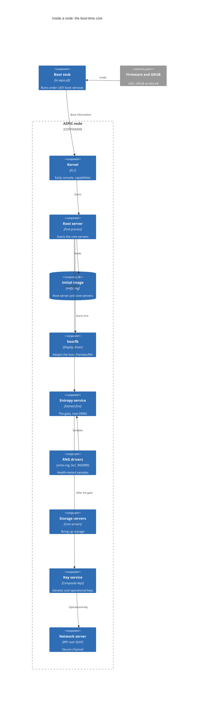
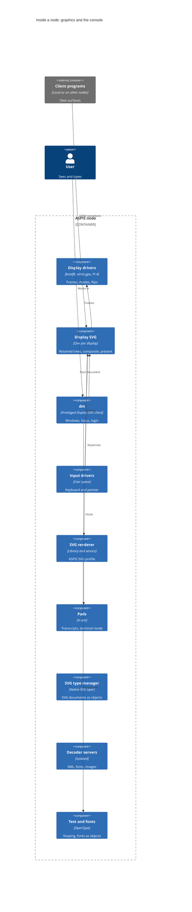
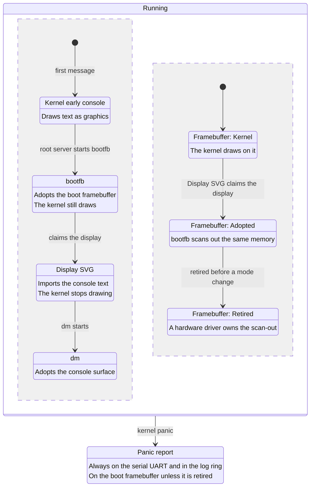

<!-- SPDX-FileCopyrightText: 2026 Nicole Roy -->
<!-- SPDX-License-Identifier: CC-BY-4.0 -->

# Inside a node

*2026-11-24. C4's third level for one node: the components that run on each machine in a realm. The realm-level view is [Inside a realm](realm-containers.md); the kernel box is opened up in [Inside the kernel](kernel-components.md). Drawn with the C4 model ([ADR 0024](../decisions/0024-diagrams-mermaid-and-c4.md)).*

A node is one machine or virtual machine running ASPIS: the kernel at EL1 and the user-space servers above it. The kernel holds capabilities, memory and threads and does little else; drivers, storage, networking, cryptography, policy and the user interface all run in user space ([0002](../decisions/0002-capability-security-model.md), [0004](../decisions/0004-network-transparency-and-failure.md), [0009](../decisions/0009-text-as-graphics-console.md)). Every component reaches the kernel through the kernel interface library mapped into its process ([0014](../decisions/0014-versioned-object-apis.md), rule 6), so the views don't draw an edge from every component to the kernel.

1. [Overview](#1-overview)
2. [Boot-time core](#2-boot-time-core)
3. [The POSIX personality](#3-the-posix-personality)
4. [Graphics and the console](#4-graphics-and-the-console)

## 1. Overview

This view shows a node's components in four layers: what people and programs touch; the servers that bind, decide and connect; the core servers; and the base. The later sections zoom in on the boot-time core, the POSIX personality and the graphics stack.

```mermaid
---
config:
  c4:
    c4ShapeMargin: 80
    component_bg_color: "#2F6DB5"
    component_border_color: "#245A96"
    component_db_bg_color: "#2F6DB5"
    component_db_border_color: "#245A96"
    external_component_bg_color: "#6E6E6E"
    external_component_border_color: "#5A5A5A"
    external_container_bg_color: "#6E6E6E"
    external_container_border_color: "#5A5A5A"
---
C4Component
    title Inside a node: overview
    Person(users, "Users", "Work at dm")
    Container_Ext(peers, "Other nodes", "", "Same or federated realms")
    Container_Ext(realm, "Realm services", "", "Scheduler, registry, CAs, authorization, catalog")
    Container_Boundary(node, "ASPIS node") {
        Component(ui, "Display SVG and dm", "User space", "Display server, windows, pads")
        Component(posix, "POSIX personality", "User space", "libc, processes, terminals, sockets")
        Component(pm, "Process manager", "Workloads", "Jobs, identity, lifecycle")
        Component(net, "Network server", "RPC over QUIC", "Proxy endpoints, secure channel")
        Component(managers, "Name service and managers", "Objects", "Bind, resolve, enumerate")
        Component(pdp, "Node PDP and replicas", "Cedar", "Decisions; tree and catalog replicas")
        Component(keys, "Entropy and key services", "HMAC_DRBG, composite keys", "The gate, DRBG, keys")
        Component(store, "Object store and pagers", "Storage", "Persist and page objects")
        Component(drivers, "Drivers", "User space", "Storage, NIC, RNG, display, input")
        Component(root, "Root server", "First process", "Starts servers, hands out capabilities")
        Component(kernel, "Kernel", "EL1", "Capabilities, IPC, memory, scheduling")
    }
    Rel(users, ui, "Work at")
    BiRel(peers, net, "ASPIS RPC")
    Rel(realm, pm, "Starts instances")
    Rel(posix, managers, "Binds, files")
    Rel(managers, pdp, "Decisions")
    Rel(managers, store, "Pages")
    Rel(kernel, store, "Page faults")
    Rel(kernel, drivers, "Interrupts")
    Rel(kernel, root, "Starts")
    Rel(root, keys, "Starts entropy first")
    UpdateRelStyle(users, ui, $offsetX="6", $offsetY="-40")
    UpdateRelStyle(peers, net, $offsetX="-40")
    UpdateRelStyle(realm, pm, $offsetY="-40")
    UpdateRelStyle(posix, managers, $offsetX="8")
    UpdateRelStyle(managers, pdp, $offsetX="-26", $offsetY="-16")
    UpdateRelStyle(managers, store, $offsetX="8")
    UpdateRelStyle(kernel, store, $offsetX="8")
    UpdateRelStyle(kernel, root, $offsetX="-16", $offsetY="-16")
    UpdateRelStyle(root, keys, $offsetX="8")
    UpdateLayoutConfig($c4ShapeInRow="3", $c4BoundaryInRow="1")
```

| Component | What it does | Decisions |
|---|---|---|
| Display SVG and dm | Display SVG keeps each client's SVG document as a retained tree, composites the documents and presents frames through a display driver, one server per display. dm, its privileged client, owns the screen's root document, places windows, routes focus and hosts pads. It is also the console. [Section 4](#4-graphics-and-the-console) zooms in | [0010](../decisions/0010-svg-core-primitive.md), rule 6; [0011](../decisions/0011-dm-window-system.md), rules 1, 3 and 5 |
| POSIX personality | libc in each POSIX process, the POSIX process server, the TTY server and the network stack server, all in user space: the kernel gains no POSIX-specific features. The personality also runs the SPIFFE Workload Endpoint server, for unmodified software. Each node runs one POSIX instance by default. [Section 3](#3-the-posix-personality) zooms in | [0012](../decisions/0012-posix-compatibility-layer.md), rules 1 and 3; [0022](../decisions/0022-spiffe-and-wimse-workload-identity.md), rule 8 |
| Process manager | Starts the instances that the realm's scheduler places on the node, each in a kernel job with memory and CPU budgets. Delivers each instance's environment, bindings, scratch area, workload identity and lifecycle events ([the twelve-factor design note](twelve-factor-apps.md#52-containers)). Attests workloads from the program object and the service principal, never from a process ID, and registers ready instances with the location service as leases | [0022](../decisions/0022-spiffe-and-wimse-workload-identity.md), rule 7; [0025](../decisions/0025-twelve-factor-app-contract.md), rules 4–12; [0026](../decisions/0026-realm-as-cloud-provider.md), rule 5; [0028](../decisions/0028-discovery-and-realm-catalog.md), rule 5 |
| Network server | Holds proxy endpoints for remote objects, so raw capabilities never leave the node. Carries ASPIS RPC over TLS 1.3 on QUIC, with node certificates on both sides, and checks each peer against the node replica; a connection closes when a new root revokes its certificate. Every request carries an ID and a deadline. Also fetches remote pages for pagers | [0002](../decisions/0002-capability-security-model.md), rule 5; [0004](../decisions/0004-network-transparency-and-failure.md), rules 3 and 5; [0005](../decisions/0005-single-level-store.md), rule 2; [0020](../decisions/0020-realm-certificate-authority.md), rules 3 and 7 |
| Name service and managers | Every interaction with an object goes through one of its interfaces, served by its manager: its type manager, or the name service for directories. A client binds with a token and a proof of possession; the manager verifies them once, asks the node PDP and returns a kernel capability, or a session to a remote client. Managers also answer discovery and enumeration, and end a session when a new root revokes a policy that decided it. The name service resolves names to object IDs ([the POSIX design note](posix-compatibility.md#44-pathnames)) | [0002](../decisions/0002-capability-security-model.md), rule 3; [0014](../decisions/0014-versioned-object-apis.md), rules 1, 4 and 5; [0015](../decisions/0015-jwt-tokens-and-oidc-identity.md), rule 1; [0019](../decisions/0019-authzen-decision-protocol.md), rules 1 and 8; [0028](../decisions/0028-discovery-and-realm-catalog.md), rule 1 |
| Node PDP and replicas | The node PDP runs Cedar against the node replica of the authorization tree, so decisions are local and keep working during a partition, within the staleness bound. Managers reach it over local IPC, through a kernel capability. The node replica follows the realm's signed roots. The catalog replica answers lookups locally and wakes local watchers | [0016](../decisions/0016-authorization-sparse-merkle-tree.md), rule 5; [0018](../decisions/0018-cedar-policy-language.md), rule 5; [0019](../decisions/0019-authzen-decision-protocol.md), rules 3 and 6; [0028](../decisions/0028-discovery-and-realm-catalog.md), rules 3 and 6 |
| Entropy and key services | The entropy service holds the node's root DRBG, the only source of randomness for ASPIS code, and answers nothing until it has 384 bits of credited min-entropy. Cryptography runs outside the kernel, in the key service and the network server. On first boot the key service mints the node's genesis key, and so its UUID ([the entropy design note](entropy-and-first-keys.md#3-where-the-first-keys-and-certificates-are-minted)). [Section 2](#2-boot-time-core) shows how they start | [0001](../decisions/0001-object-identifiers.md), rule 3; [0003](../decisions/0003-hybrid-post-quantum-cryptography.md), rule 6; [0021](../decisions/0021-entropy-before-keys.md), rules 1, 2 and 5 |
| Object store and pagers | Storage servers bring up the node's storage at boot. A process maps an object through a capability; the kernel forwards a page fault on it to the object's pager, in user space, which supplies the page from local storage or, through the network server, from a remote node. A page that can't be fetched by its deadline becomes a typed fault | [0004](../decisions/0004-network-transparency-and-failure.md), rule 4; [0005](../decisions/0005-single-level-store.md), rules 1 and 2; [0006](../decisions/0006-uefi-boot-image.md), rule 2 |
| Drivers | Run in user space, and reach device memory and interrupts only through capabilities. They drive the devices of QEMU `virt` and the Pi 4, such as virtio devices, the RNG sources and the display. DMA isolation is developed with QEMU's SMMUv3, which covers only PCIe devices such as virtio-pci ([QEMU `virt`](https://www.qemu.org/docs/master/system/arm/virt.html)), so ASPIS's QEMU configurations put every virtio device on PCIe; the Pi 4 probably has no IOMMU | [0002](../decisions/0002-capability-security-model.md), rule 1; [0007](../decisions/0007-initial-hardware-targets.md), rules 1 and 2, and Consequences; [0009](../decisions/0009-text-as-graphics-console.md), Context and rule 4; [0021](../decisions/0021-entropy-before-keys.md), rule 12; [0036](../decisions/0036-qemu-configuration-and-test-builds.md), rule 2 |
| Root server | The first user process, which the kernel starts from the initial image. It starts the entropy service first, then the other servers the node needs at boot. It hands out the boot-time capabilities: until the first PDP runs, they are the only authority on the node. [Section 2](#2-boot-time-core) zooms in | [0006](../decisions/0006-uefi-boot-image.md), rule 2; [0018](../decisions/0018-cedar-policy-language.md), rule 5; [0021](../decisions/0021-entropy-before-keys.md), rule 1 |
| Kernel | Runs at EL1 and uses capabilities only, with seL4 as the reference model. It holds no policy, never parses tokens, does no cryptography and knows nothing about the network. [Inside the kernel](kernel-components.md) shows its parts | [0002](../decisions/0002-capability-security-model.md), rule 1 and Consequences; [0003](../decisions/0003-hybrid-post-quantum-cryptography.md), rule 6; [0004](../decisions/0004-network-transparency-and-failure.md), rule 5; [0006](../decisions/0006-uefi-boot-image.md), rule 4; [0015](../decisions/0015-jwt-tokens-and-oidc-identity.md), rule 1 |

**Open**

- **Where the name service runs.** `/` is a POSIX instance's root, the node's root by default, and `//` is the network root ([0012](../decisions/0012-posix-compatibility-layer.md), rule 5; [the POSIX design note](posix-compatibility.md#44-pathnames)). No decision yet says whether the name service runs on each node, in each instance or once for the realm.
- **The driver model and device discovery.** No decision yet says who reads the device tree ([0007](../decisions/0007-initial-hardware-targets.md), rule 3), which drivers exist on each platform, how a driver gets the capabilities for its device, or who programs the SMMU.
- **The root server's interface**, and which servers it starts once the boot-time core is up ([0006](../decisions/0006-uefi-boot-image.md), rule 2; [0018](../decisions/0018-cedar-policy-language.md), rule 5).
- **Two network servers.** The network server carries ASPIS RPC ([0004](../decisions/0004-network-transparency-and-failure.md), rule 5; [0020](../decisions/0020-realm-certificate-authority.md), rule 3). The POSIX personality's network stack server provides TCP/IP behind the sockets API ([0012](../decisions/0012-posix-compatibility-layer.md), rule 1; [the POSIX design note](posix-compatibility.md#3-proposed-architecture)). Whether they share NIC drivers and an IP stack is open.

## 2. Boot-time core

This view shows what exists before anything else on a node, in the order it starts. GRUB loads `aspis.efi`, whose boot stub enters the kernel; the kernel starts the root server, and the root server starts the entropy service first ([0006](../decisions/0006-uefi-boot-image.md), rules 1–4; [0021](../decisions/0021-entropy-before-keys.md), rule 1). The entropy service serves nothing until its gate opens, and the boot order is fixed: the entropy service and the RNG drivers start before the key service, the network server and anything that mints IDs ([0021](../decisions/0021-entropy-before-keys.md), rule 2 and Consequences).

| Component | What it does | Decisions |
|---|---|---|
| Boot stub | Rust code inside `aspis.efi`, a PE32+ image built for `aarch64-unknown-uefi` that carries the kernel's ELF in a `.kernel` section. GRUB's `linux` command loads it from an ESP slot, such as `/aspis/a/aspis.efi`; `chainloader` and direct firmware boot work too. It reads the command line and collects the memory map, the device tree, ACPI tables or both, the initial image, a linear framebuffer and, where the firmware offers one, a seed from `EFI_RNG_PROTOCOL`. It checks the initial image against a SHA-512 digest embedded in the signed `aspis.efi`, refuses one that doesn't match, and measures it into PCR 9 where a TPM exists. It uses the seed only for its own needs. It places and relocates the kernel, passes what it collected as tagged boot-information records, with the seed bytes it hasn't used in a page of their own, exits boot services and enters the kernel at EL1 with the MMU off. No UEFI runtime service is called after that | [0006](../decisions/0006-uefi-boot-image.md), rules 1, 3 and 4; [0009](../decisions/0009-text-as-graphics-console.md), rule 2; [0021](../decisions/0021-entropy-before-keys.md), rule 3; [0035](../decisions/0035-toolchain-image-linkage-and-esp-layout.md), rules 2, 3 and 6; [0039](../decisions/0039-no-uefi-runtime-services.md), rule 1; [0040](../decisions/0040-the-stub-checks-the-initial-image.md), rules 1–3; [0041](../decisions/0041-boot-abi.md), rules 1–4 and 6 |
| Kernel | Draws its console, text as graphics, on the boot framebuffer from the first message, and also writes it to the serial UART and the log ring. Reading the log ring needs a capability, which the kernel gives only to the root server. Starts the root server from the initial image ([the entropy design note](entropy-and-first-keys.md#3-where-the-first-keys-and-certificates-are-minted)). It uses no randomness: it never reads the seed's page, hands it on toward the entropy service and keeps no copy | [0009](../decisions/0009-text-as-graphics-console.md), rules 1 and 3; [0021](../decisions/0021-entropy-before-keys.md), rules 1 and 3; [0041](../decisions/0041-boot-abi.md), rule 4; [0042](../decisions/0042-log-ring-and-panic-path.md), rules 1 and 5 |
| Root server | The first user process. Starts the entropy service first, then the RNG drivers, bootfb and the core servers. Hands out the boot-time capabilities: until the first PDP runs, they are the only authority on the node | [0006](../decisions/0006-uefi-boot-image.md), rule 2; [0009](../decisions/0009-text-as-graphics-console.md), rule 4; [0018](../decisions/0018-cedar-policy-language.md), rule 5; [0021](../decisions/0021-entropy-before-keys.md), rule 1 |
| Initial image | `initfs.img`, which GRUB serves as the initrd; under `chainloader` or direct boot the stub finds it at the path in the `initfs` argument, or beside `aspis.efi` in its slot. It uses an ASPIS format: each entry is page-aligned and has its own SHA-512 digest, and one entry is the boot manifest. It carries everything the root server starts before storage is up: the root server and the boot manifest, the entropy service and the RNG drivers, `bootfb`, the key service, the drivers that storage and networking need, and the storage servers and the network server. Executables are static ELF programs, mapped in place. Like every boot or disk image, it holds no genesis key, no CA key and no credited seed | [0006](../decisions/0006-uefi-boot-image.md), rules 1–3; [0021](../decisions/0021-entropy-before-keys.md), rule 11; [0037](../decisions/0037-initial-image-format-and-contents.md), rules 1 and 3–6; [0041](../decisions/0041-boot-abi.md), rule 6 |
| Entropy service | Holds the node's root DRBG, HMAC_DRBG with SHA-512 at security strength 256, and is the only source of randomness for ASPIS code. It answers no request until the DRBG has been instantiated with at least 384 bits of credited min-entropy: the gate. Requests wait until then, and once the gate opens it never blocks again. The firmware's seed counts only up to a limit set for each platform. Objects that exist before the gate are the node's well-known objects | [0021](../decisions/0021-entropy-before-keys.md), rules 1–4 and 8 |
| RNG drivers | Read the hardware generators: virtio-rng, which QEMU configurations always attach; the Pi 4's SoC generator; and `RNDRRS` where the CPU has FEAT_RNG. Each is credited at its estimated rate once SP 800-90B health tests pass on its output. CPU timing jitter counts only at a rate measured on each platform | [0021](../decisions/0021-entropy-before-keys.md), rules 4 and 12 |
| bootfb | The first display driver, in user space. Adopts the boot framebuffer through a capability to its memory, which the root server gives it. The kernel keeps drawing the console until Display SVG claims the display. Hardware drivers, virtio-gpu first, later add mode setting and page flipping ([section 4](#4-graphics-and-the-console)) | [0009](../decisions/0009-text-as-graphics-console.md), rule 4 |
| Storage servers | Core servers that bring up the node's storage, from which pagers supply the pages of mapped objects | [0005](../decisions/0005-single-level-store.md), rule 2; [0006](../decisions/0006-uefi-boot-image.md), rule 2 |
| Key service | Starts after the entropy service and the RNG drivers, and its requests wait at the gate. On first boot it mints the genesis key, an Ed25519 and ML-DSA-65 composite whose hash gives the node its UUID. It does so only once a physical source has contributed to the generator, and immediately after a reseed with fresh entropy. It then mints the operational TLS key, which the genesis key certifies ([the entropy design note](entropy-and-first-keys.md#3-where-the-first-keys-and-certificates-are-minted)) | [0001](../decisions/0001-object-identifiers.md), rule 3; [0003](../decisions/0003-hybrid-post-quantum-cryptography.md), rule 2; [0020](../decisions/0020-realm-certificate-authority.md), rule 4; [0021](../decisions/0021-entropy-before-keys.md), rule 5 and Consequences |
| Network server | Starts after the entropy service and the RNG drivers. Uses the operational key for ASPIS RPC's secure channel, TLS 1.3 over QUIC. The RPC CA certifies that key when the node enrolls. The founding node is the exception: its initial certificate is signed with its own genesis key, and it renews with the RPC CA later | [0020](../decisions/0020-realm-certificate-authority.md), rules 3 and 4; [0021](../decisions/0021-entropy-before-keys.md), Consequences; [0029](../decisions/0029-founding-node-self-signed-certificate.md), rules 1, 2 and 5 |

**Open**

- **The initial image's format and full contents.** [0006](../decisions/0006-uefi-boot-image.md), rule 2 names only the root server and the core servers for storage and networking, but boot also needs the entropy service, the RNG drivers, bootfb and the key service. Decided: [0037](../decisions/0037-initial-image-format-and-contents.md), rules 1 and 5. The image uses an ASPIS format, and carries everything the root server starts before storage is up. Rule 2 of 0006 is read as a minimum. How the image's memory becomes memory objects is left to the kernel specification (0037, rule 4).
- **How the seed is handed over.** The kernel hands the stub's seed to the entropy service and keeps no copy ([0021](../decisions/0021-entropy-before-keys.md), rule 1). The root server starts the entropy service, so [the entropy design note](entropy-and-first-keys.md#3-where-the-first-keys-and-certificates-are-minted) passes the seed through the root server. Partly decided: [0041](../decisions/0041-boot-abi.md), rule 4. The stub puts the seed in a page of its own and erases every other copy, and the kernel never reads that page. How the page travels from the kernel through the root server to the entropy service, and how it is erased after use, is still open ([design backlog, D42](design-backlog.md#m3-node-user-space-and-the-entropy-gate)), so the diagram draws no edge for the seed.
- **The root server's design:** its interface, how it learns what to start, and which capabilities the kernel gives it ([0006](../decisions/0006-uefi-boot-image.md), rule 2; [0018](../decisions/0018-cedar-policy-language.md), rule 5; [0021](../decisions/0021-entropy-before-keys.md), rule 1). Partly decided: it learns what to start before storage from the boot manifest in the initial image ([0037](../decisions/0037-initial-image-format-and-contents.md), rules 3 and 5), and the kernel gives it the capability to read the log ring ([0042](../decisions/0042-log-ring-and-panic-path.md), rule 5). The manifest's format and the rest of the design are still open ([design backlog, D40](design-backlog.md#m3-node-user-space-and-the-entropy-gate)).
- **Names before the gate.** Objects that exist before the gate are the node's well-known objects, named from [0001](../decisions/0001-object-identifiers.md)'s reserved sequence range ([0021](../decisions/0021-entropy-before-keys.md), rule 3). On a first boot no node authority exists until the key service mints the genesis key after the gate ([0001](../decisions/0001-object-identifiers.md), rule 3; [0021](../decisions/0021-entropy-before-keys.md), rule 5). So which authority names those objects is open, and so is what fills their random field ([0021](../decisions/0021-entropy-before-keys.md), Consequences).

## 3. The POSIX personality

The POSIX personality lets Unix software run on ASPIS APIs, entirely in user space ([0012](../decisions/0012-posix-compatibility-layer.md), rule 1). The view follows one POSIX program's calls: to the personality's servers for processes, terminals, sockets and workload identity, and straight to native components for files, since there is no POSIX file server ([POSIX note §3](posix-compatibility.md#3-proposed-architecture)). Native programs never pass through the layer, and Rust's standard library targets ASPIS APIs directly ([0012](../decisions/0012-posix-compatibility-layer.md), rule 9). Until that port exists, native programs are `no_std` ([0035](../decisions/0035-toolchain-image-linkage-and-esp-layout.md), rule 5).

```mermaid
---
config:
  c4:
    c4ShapeMargin: 90
    component_bg_color: "#2F6DB5"
    component_border_color: "#245A96"
    component_db_bg_color: "#2F6DB5"
    component_db_border_color: "#245A96"
    external_component_bg_color: "#6E6E6E"
    external_component_border_color: "#5A5A5A"
    external_container_bg_color: "#6E6E6E"
    external_container_border_color: "#5A5A5A"
---
C4Component
    title Inside a node: the POSIX personality
    Person(user, "User", "At a pad in dm")
    Container_Boundary(node, "ASPIS node") {
        Component(pad, "dm pad", "Terminal mode", "The terminal's far end")
        Component(tty, "TTY server", "POSIX personality", "Pseudo-terminals, job control")
        Component(netstack, "Network stack server", "POSIX personality", "TCP/IP, sockets, AF_UNIX")
        Component(psrv, "POSIX process server", "One per POSIX instance", "pids, fork, exec, wait, kill")
        Component(prog, "POSIX program", "With relibc", "fd table, signals, environ")
        Component(managers, "Object managers", "Native", "Open file descriptions")
        Component(kernel, "Kernel", "General primitives", "COW clones, capability copies")
        Component(wl, "Workload Endpoint server", "SPIFFE Workload API", "SVIDs and bundles over AF_UNIX")
        Component(names, "Name service", "Native", "Resolves paths to IDs")
        Component(pm, "Process manager", "One per node", "Twelve-factor instances")
    }
    Rel(user, pad, "Types")
    Rel(pad, tty, "Terminal I/O")
    Rel(tty, prog, "fds 0–2")
    Rel(tty, psrv, "Signals")
    Rel(prog, psrv, "fork, exec, kill")
    Rel(prog, netstack, "Sockets")
    Rel(prog, managers, "Binds")
    Rel(prog, wl, "Workload API")
    Rel(prog, names, "Paths")
    Rel(psrv, kernel, "COW, caps")
    Rel(pm, wl, "Identity")
    UpdateRelStyle(user, pad, $offsetX="8")
    UpdateRelStyle(pad, tty, $offsetX="-36", $offsetY="-16")
    UpdateRelStyle(tty, prog, $offsetX="8")
    UpdateRelStyle(tty, psrv, $offsetX="-30")
    UpdateRelStyle(prog, psrv, $offsetX="-42", $offsetY="-16")
    UpdateRelStyle(prog, managers, $offsetX="-15", $offsetY="-16")
    UpdateRelStyle(prog, wl, $offsetX="8")
    UpdateRelStyle(psrv, kernel, $offsetX="8")
    UpdateLayoutConfig($c4ShapeInRow="3", $c4BoundaryInRow="1")
```

| Component | What it does | Decisions |
|---|---|---|
| POSIX program | A Unix program compiled for ASPIS, with relibc as its C library. libc keeps the descriptor table, the signal state and `environ`, built from the environment block, and runs a signal thread that delivers signals. By default it retries until the deadline, then fails with `EIO` or `ETIMEDOUT`; "hard" subtrees wait instead, and a signal can interrupt them. `getrandom`, `getentropy`, `/dev/random` and `/dev/urandom` block until the entropy gate opens, and never after | [0012](../decisions/0012-posix-compatibility-layer.md), rules 7 and 9; [0025](../decisions/0025-twelve-factor-app-contract.md), rule 4; [0021](../decisions/0021-entropy-before-keys.md), rule 10; [POSIX note §4.8](posix-compatibility.md#48-signals) |
| POSIX process server | One per POSIX instance, with the instance's pid space, uid/gid map and root directory. A node runs one instance by default, and each instance of a POSIX app runs in its own. It owns process groups, sessions, `wait`, signal routing and credentials. `fork` uses copy-on-write clones of memory objects and a copy of the capability table; `posix_spawn` is the fast path. uid 0 is an administrative principal limited by policy, not an all-powerful superuser | [0012](../decisions/0012-posix-compatibility-layer.md), rules 3, 4 and 6; [0025](../decisions/0025-twelve-factor-app-contract.md), rule 8; [POSIX note §3](posix-compatibility.md#3-proposed-architecture) |
| TTY server | Pseudo-terminals and the line discipline. A dm pad in terminal mode holds the manager side of each pseudo-terminal (POSIX.1-2024's term for the master side), and the program's standard streams use the subsidiary side. Job control lives here and in the process server | [0012](../decisions/0012-posix-compatibility-layer.md), rules 2 and 8; [POSIX note §4.10](posix-compatibility.md#410-terminals-and-job-control) |
| dm pad | Pads are not terminals. A program that needs a terminal gets a pad in terminal mode, which the POSIX layer provides | [0011](../decisions/0011-dm-window-system.md), rule 3 |
| Network stack server | User-space TCP/IP behind the sockets API. `AF_UNIX` with `SCM_RIGHTS` carries capabilities, and ASPIS RPC is not a socket family. Port numbers are local to each app instance. It is not the network server, which carries ASPIS RPC between nodes | [0012](../decisions/0012-posix-compatibility-layer.md), rule 1; [0025](../decisions/0025-twelve-factor-app-contract.md), rule 7; [0004](../decisions/0004-network-transparency-and-failure.md), rule 5; [POSIX note §4.20](posix-compatibility.md#420-sockets) |
| Workload Endpoint server | Serves the SPIFFE Workload API to unmodified software: gRPC on the Unix socket that `SPIFFE_ENDPOINT_SOCKET` names. It identifies each caller through the process server, and native interfaces back it. Native programs use the native workload identity interface instead | [0022](../decisions/0022-spiffe-and-wimse-workload-identity.md), rule 8; [0025](../decisions/0025-twelve-factor-app-contract.md), rules 1 and 4 |
| Name service | The manager for directories. It resolves names to object IDs: `/` is the instance's root, the node root by default, and `//` is the network root. Mounts are name-service bindings | [0002](../decisions/0002-capability-security-model.md), rule 3; [0012](../decisions/0012-posix-compatibility-layer.md), rule 5; [POSIX note §4.4](posix-compatibility.md#44-pathnames) |
| Object managers | Each holds the open file descriptions for its objects, offset included, and a descriptor maps to one. Sharing a description means sharing the session capability that a bind returns. Managers also serve advisory locks, under leases | [0012](../decisions/0012-posix-compatibility-layer.md), rule 5; [0014](../decisions/0014-versioned-object-apis.md), rule 4; [POSIX note §4.3](posix-compatibility.md#43-file-descriptors), [§4.13](posix-compatibility.md#413-locks) |
| Kernel | Gains no POSIX-specific features. What the personality needs from it is general-purpose: copy-on-write clones of memory objects and address spaces, copying a capability table, canceling a blocked IPC wait, suspending a thread to read or write its registers, delivering faults to a user-level handler, waiting on a set of eventcounts, waiting and waking on an eventcount word in user memory, and a per-thread TLS register | [0012](../decisions/0012-posix-compatibility-layer.md), rule 1; [POSIX note §5](posix-compatibility.md#5-what-the-kernel-must-provide) |
| Process manager | Not part of the personality. The node's process manager starts each twelve-factor instance in a job and assigns its workload identity, which the Workload Endpoint server serves to unmodified software. The platform names the endpoint's socket in `SPIFFE_ENDPOINT_SOCKET` | [0022](../decisions/0022-spiffe-and-wimse-workload-identity.md), rule 7; [0025](../decisions/0025-twelve-factor-app-contract.md), rules 4, 8 and 11 |

**Open**

- How many TTY servers and network stack servers run, and whether per node or per POSIX instance. [0012](../decisions/0012-posix-compatibility-layer.md), rule 1 names one of each, and rule 3 defines an instance by its process server alone.
- Where the Workload Endpoint server runs, per node or per POSIX instance. [0022](../decisions/0022-spiffe-and-wimse-workload-identity.md), rule 8 says only that it is part of the personality, and that it identifies each caller through the POSIX process server.
- Whether the network stack server and the network server share NIC drivers and an IP stack. [0004](../decisions/0004-network-transparency-and-failure.md), rule 5 and [0012](../decisions/0012-posix-compatibility-layer.md), rule 1 define them separately.
- How the POSIX layer provides the pads' terminal mode. [0011](../decisions/0011-dm-window-system.md), rule 3 says it does, and rule 6 leaves pad types to the design session.
- The [POSIX note's own open questions](posix-compatibility.md#8-open-questions), among them the executable format, `fork` in multithreaded processes, cross-node pids, uid and gid mapping between federated realms, and setuid policy.

## 4. Graphics and the console

There is no character mode: from its first message, the kernel console is text drawn as graphics ([0009](../decisions/0009-text-as-graphics-console.md), rule 1). The view shows the user-space stack that takes the display over: Display SVG on the native SVG layer, its input and display drivers, and dm, which is both the window system and the console ([0010](../decisions/0010-svg-core-primitive.md), [0011](../decisions/0011-dm-window-system.md)). The handoff from the kernel is drawn below as a state diagram.

| Component | What it does | Decisions |
|---|---|---|
| dm | A privileged Display SVG client. It owns the screen's root document, places windows and routes focus, grants the capabilities to create surfaces, and draws window decorations as SVG, themed with CSS. Selection, copy and search work in every window. dm is the console: it adopts the console surface when it starts | [0011](../decisions/0011-dm-window-system.md), rules 1, 4 and 5 |
| Pads | Pads replace character terminals. A program's standard streams render as SVG text, with a transcript from process birth, and programs can add SVG fragments. A program that needs a terminal gets a pad in terminal mode from the POSIX layer ([section 3](#3-the-posix-personality)). Login happens in a dm pad | [0011](../decisions/0011-dm-window-system.md), rules 3 and 5; [0012](../decisions/0012-posix-compatibility-layer.md), rule 8 |
| Display SVG | One per display. It holds each client's document as a retained tree, composites the documents, rasterizes, and presents frames through the display driver, redrawing only what changed. It hit-tests pointer events and delivers each to the owning client; keyboard focus and grabs follow dm's policy. Each client has limits on element count, path complexity, filter area, image memory and text size. When it claims the display, it imports the console's text, reading it from the kernel's log ring by sequence number through a capability the root server passes on | [0010](../decisions/0010-svg-core-primitive.md), rules 6, 9 and 11; [0009](../decisions/0009-text-as-graphics-console.md), rule 4; [0042](../decisions/0042-log-ring-and-panic-path.md), rule 5 and Consequences |
| SVG renderer | A library and service for any program, for example to render into an image object or for printing. It renders the ASPIS SVG profile of SVG 2's static rendering model. Scripting, `foreignObject` and external URLs are excluded permanently: images, fonts and other documents are referenced by object ID, which needs a capability. CPU rasterization in pure Rust comes first, GPU acceleration later | [0010](../decisions/0010-svg-core-primitive.md), rules 2, 3, 4 and 10 |
| Text and fonts | Text stays Unicode in `<text>` elements, so any text on screen can be selected, copied, searched and read by assistive technology. It is shaped and laid out with OpenType fonts, which are objects. The family is Noto: Noto Sans and Noto Sans Mono, under OFL-1.1. Other Noto families can be added as fallbacks for scripts those two don't cover. The kernel's glyph atlases are rasterized from Noto Sans Mono | [0010](../decisions/0010-svg-core-primitive.md), rule 5; [0009](../decisions/0009-text-as-graphics-console.md), rule 3; [0034](../decisions/0034-noto-fonts-under-ofl.md), rules 1 and 2 |
| Display drivers | The first, `bootfb`, adopts the boot framebuffer through a capability from the root server. Hardware drivers add mode setting and page flipping: virtio-gpu on QEMU first, then the Pi 4's display pipeline. A hardware driver must retire the boot framebuffer before it changes the scan-out | [0009](../decisions/0009-text-as-graphics-console.md), rule 4; [0042](../decisions/0042-log-ring-and-panic-path.md), rule 6 |
| Input drivers | Keyboard and pointer drivers, in user space like every driver. How their events reach Display SVG is open | [0009](../decisions/0009-text-as-graphics-console.md), Context; [0010](../decisions/0010-svg-core-primitive.md), rule 9 |
| SVG type manager | SVG documents are a first-class object type, with IDs. Their type manager's traits cover editing a document and rendering it, and through `io` a document reads as XML | [0010](../decisions/0010-svg-core-primitive.md), rule 1; [POSIX note §4.17](posix-compatibility.md#417-typed-objects) |
| Decoder servers | XML, font and image decoders run in isolated servers, without the display server's authority. Which components call them isn't decided yet | [0010](../decisions/0010-svg-core-primitive.md), rule 11 |
| Client programs | Programs on this node or another that own surfaces. They change their documents with a binary protocol of DOM operations: create, set attribute, insert, remove, set text and commit. It is defined in the IDL and carried by ASPIS RPC; XML is for import, export and storage, never the hot path. Creating a surface needs a capability that dm grants under its policy | [0010](../decisions/0010-svg-core-primitive.md), rules 7 and 8; [0011](../decisions/0011-dm-window-system.md), rule 1 |

**Console ownership.** The console passes from the kernel to Display SVG, which imports its text so that nothing on screen jumps or flickers, and then to dm ([0009](../decisions/0009-text-as-graphics-console.md), rule 4; [0011](../decisions/0011-dm-window-system.md), rule 5). `bootfb` adopts the boot framebuffer before that, but the kernel keeps drawing until Display SVG claims the display. Separately, the kernel tracks the boot framebuffer's state, Kernel, Adopted or Retired, so that a panic knows whether it may still draw there. A hardware driver retires the boot framebuffer before it changes the display mode, and from then on a kernel panic reaches only the serial UART ([0009](../decisions/0009-text-as-graphics-console.md), rule 5 and Consequences; [0042](../decisions/0042-log-ring-and-panic-path.md), rules 6 and 7).

| State | What happens | Decisions |
|---|---|---|
| Kernel early console | From its first message, the kernel draws text, filled rectangles and bitmaps into the boot framebuffer, with glyphs from atlases rasterized at build time from Noto Sans Mono, with Noto Sans Math and Noto Sans Symbols for the WGL4 symbols it lacks ([0046](../decisions/0046-fallback-fonts-for-wgl4-symbols.md)), with cells 16, 24 or 32 pixels high. It has no font rasterizer and no SVG code. Output also goes to the serial UART and the log ring. The UART and the framebuffer show records at or above the `log.level` argument. Without a linear framebuffer, the console uses the UART until a display driver starts | [0009](../decisions/0009-text-as-graphics-console.md), rules 1, 2 and 3; [0034](../decisions/0034-noto-fonts-under-ofl.md), rules 1 and 4; [0042](../decisions/0042-log-ring-and-panic-path.md), rule 4 |
| bootfb | The root server starts `bootfb` with a capability to the framebuffer memory, and `bootfb` adopts the boot framebuffer. The kernel draws on until Display SVG claims the display | [0009](../decisions/0009-text-as-graphics-console.md), rule 4 |
| Display SVG | Claims the display and imports the console's text, read from the log ring, as its first text surface. From then on the kernel stops drawing | [0009](../decisions/0009-text-as-graphics-console.md), rule 4; [0042](../decisions/0042-log-ring-and-panic-path.md), rule 5 |
| dm | Adopts the console surface when it starts. Login happens in a dm pad | [0011](../decisions/0011-dm-window-system.md), rule 5 |
| Framebuffer: Kernel | The kernel draws its console on the boot framebuffer, at the resolution the firmware set. On QEMU, `ramfb` provides the linear framebuffer. `bootfb` may already have adopted it | [0009](../decisions/0009-text-as-graphics-console.md), rule 2 and Consequences; [0042](../decisions/0042-log-ring-and-panic-path.md), rule 6 |
| Framebuffer: Adopted | Display SVG has claimed the display, and the kernel has stopped drawing. `bootfb` still scans out the same memory, so a panic can still be drawn there | [0009](../decisions/0009-text-as-graphics-console.md), rule 4; [0042](../decisions/0042-log-ring-and-panic-path.md), rule 6 |
| Framebuffer: Retired | A hardware driver, virtio-gpu on QEMU first and then the Pi 4's display pipeline, retires the boot framebuffer before it changes the scan-out, and then adds mode setting and page flipping. Each move between these states is a call on the boot framebuffer's kernel object, and the states only go forward | [0009](../decisions/0009-text-as-graphics-console.md), rule 4; [0042](../decisions/0042-log-ring-and-panic-path.md), rule 6 |
| Panic report | The kernel always writes the report to the serial UART and records it in the log ring. It also draws it on the boot framebuffer unless that is retired. The panic path takes no lock that a normal writer holds. Keeping panic records across a reboot is left to supervision (C73) | [0009](../decisions/0009-text-as-graphics-console.md), rule 5 and Consequences; [0042](../decisions/0042-log-ring-and-panic-path.md), rules 6 and 7 |

**Open**

- The ASPIS SVG profile, and the renderer library: resvg with usvg and tiny-skia, vello_cpu or vello_hybrid ([0010](../decisions/0010-svg-core-primitive.md), rules 2 and 10).
- The display driver interface, and how input reaches Display SVG. [0009](../decisions/0009-text-as-graphics-console.md), rule 4 and [0010](../decisions/0010-svg-core-primitive.md), rule 9 name the parts but not the interfaces.
- How the handoff works: how Display SVG imports the console's text, how the kernel learns to stop drawing, and how it knows at a panic whether the boot framebuffer is still the active scan-out. [0009](../decisions/0009-text-as-graphics-console.md), rules 4 and 5 fix the behavior, not the mechanism. Partly decided: [0042](../decisions/0042-log-ring-and-panic-path.md). At a panic the kernel goes by the boot framebuffer's state, and each move between states is a call on the framebuffer's kernel object (rule 6). Display SVG reads the console's text from the log ring by sequence number (rule 5). The rest of the import, and the display driver interface, are still open ([design backlog, D55](design-backlog.md#m3-node-user-space-and-the-entropy-gate)).
- dm's command language, key bindings, pad types and window policies ([0011](../decisions/0011-dm-window-system.md), rule 6). The command language is designed with the command interpreter, and that design chooses how it is specified. It is not specified in ABNF, which is for what machines exchange and read ([0031](../decisions/0031-abnf-is-not-a-command-language.md), rules 1 and 2).
- The OpenType family that the SVG layer and the kernel's glyph atlases share, and whether its license fits [0008](../decisions/0008-mpl-2.0-license.md), rule 4. [0009](../decisions/0009-text-as-graphics-console.md), rule 3 names no family. Decided: [0034](../decisions/0034-noto-fonts-under-ofl.md), rules 1 and 2. The family is Noto, Noto Sans Mono and Noto Sans, under OFL-1.1, which 0034 admits for fonts only by amending 0008 rule 4.
