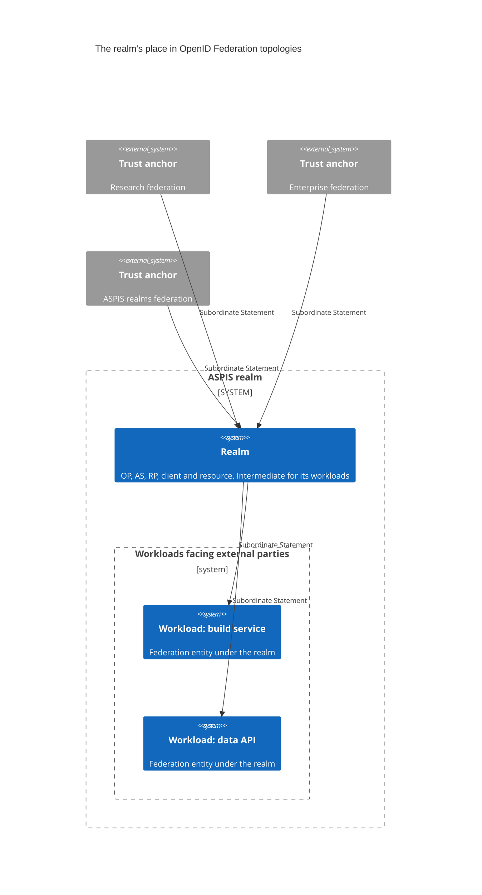

<!-- SPDX-FileCopyrightText: 2026 Nicole Roy -->

# Joining OpenID Federation topologies

*2026-11-24. Input to the design session. The decisions it led to are recorded in [ADR 0017](../decisions/0017-openid-federation-membership.md).*

1. [The tenet](#1-the-tenet)
2. [The specifications](#2-the-specifications)
3. [The realm's place in a topology](#3-the-realms-place-in-a-topology)
4. [Flows](#4-flows)
5. [Where federation meets the ASPIS model](#5-where-federation-meets-the-aspis-model)
6. [Open questions](#6-open-questions)

## 1. The tenet

The environment can be joined to one or more OpenID Federation topologies. It accepts and issues user and workload identities through the OpenID Federation mechanism.

## 2. The specifications

| Document | Status | Covers |
|---|---|---|
| OpenID Federation 1.1 | Final, 5 May 2026 [OIDF-1.1] | The protocol-independent core: Entity Statements, trust chains, metadata policy, trust marks, federation endpoints, resolution, key rollover. It defines only the `federation_entity` type and lets other protocols define more |
| OpenID Federation for OpenID Connect 1.1 | Final, 5 May 2026 [OIDF-CONNECT] | The OIDC and OAuth entity types, their metadata, and client registration (automatic and explicit) |
| OpenID Federation 1.0 | Final, 17 February 2026 [OIDF-1.0] | Both of the above in one document |

The two 1.1 documents together add no functionality to 1.0 and remove none. They keep 1.0's section numbering [OIDF-1.1], [OIDF-CONNECT], [SPLIT].

### Facts that shape the design

**Identifiers and statements**

- Entity identifiers are `https` URLs with a host. They may have a port and a path, but no query or fragment. Profiles may define other kinds (core §1.2).
- An Entity Configuration is published at the identifier plus `/.well-known/openid-federation`. Statements are JWS Compact, `typ` is `entity-statement+jwt`, `kid` is required, and `alg` must not be `none` (core §3, §9).
- Signing doesn't rely on Web PKI certificates. Keys travel as JWKs inside statements, and trust anchor keys are distributed out of band (core §2.1, §4).
- Federations should specify their mandatory signing algorithms (core §3). The OIDC profile says implementations should support RS256, because OpenID Connect Core requires it (connect §3).

**Superiors and policy**

- `authority_hints` lists one or more immediate superiors, so an entity can sit under several trust anchors (core §3.1.2).
- The issuer of a JWT should pick a trust anchor it shares with the audience (core §4.3).
- Different chains can produce different Resolved Metadata. Policies are evaluated per chain (core §17.1).
- Metadata policy operators are `value`, `add`, `default`, `one_of`, `subset_of`, `superset_of` and `essential`. Policies merge down the chain, subordinates can't loosen them, and a policy error invalidates the chain (core §6).

**Trust marks**

- Trust marks are signed attestations from trust-mark issuers that the trust anchor recognizes.
- A status endpoint reports whether a mark is active, expired, revoked or invalid (core §7, §8.4).

**Endpoints**

- Intermediates and trust anchors must publish fetch and list endpoints; leaves must not (core §5.1.1, §8.1–8.2).
- Any entity may publish resolve and historical-keys endpoints (core §8.3, §8.7).

**Registration**

- Automatic registration (connect §12.1): the client uses its entity identifier as `client_id`, uses asymmetric keys, and needs no prior registration.
- Explicit registration goes through a `federation_registration_endpoint` (connect §12.2).

**OAuth roles and gaps**

- The OIDC profile defines OAuth client, authorization server and protected-resource entity types (connect §5.1.3–5.1.5).
- Neither document has a section on workload identities as such.

**Lifetimes and revocation**

- Statements require `exp`, and a chain expires at its earliest `exp` (core §3.1.1, §10.4).
- Historical keys can be marked revoked, with a reason (core §8.7).
- The core defines no revocation process and leaves it to each federation (core §11.4).

## 3. The realm's place in a topology

Each arrow is a Subordinate Statement that the superior issues about the entity below it.

The realm is an intermediate in each topology it joins, not a leaf: it issues Subordinate Statements about its own externally visible workloads, so it publishes fetch and list endpoints, which leaves must not ([0017](../decisions/0017-openid-federation-membership.md), rule 3).

## 4. Flows

### 4.1 An external user logs in to dm

1. dm starts the device authorization grant against the realm's provider and shows a code and a QR code.
2. On another device, the user opens the realm's login page and chooses their home provider.
3. The realm's provider sends the user to the external provider with the authorization-code flow. If the realm has never registered there, it registers automatically.
4. The external provider authenticates the user and returns to the realm.
5. The realm then:
   - resolves the external provider's trust chain;
   - checks the trust marks it requires;
   - maps `iss` and `sub` to an ASPIS principal minted under that issuer's authority;
   - completes the device grant for dm.

### 4.2 An ASPIS user signs in to an external relying party

1. The relying party resolves the realm's provider through a shared trust anchor and registers automatically.
2. The user authenticates at the realm's HTML login page.
3. The realm issues an ID token signed with its key for that topology.

### 4.3 An ASPIS workload calls an external API

1. The workload has an entity identifier under the realm and a Subordinate Statement from it.
2. It registers automatically at the external authorization server, authenticating with `private_key_jwt`.
3. It obtains an access token from that server and calls the API.

### 4.4 An external workload calls an ASPIS object

1. The external client presents a token from its own authorization server.
2. The realm resolves that server's trust chain.
3. It maps the client to an ASPIS principal.
4. It exchanges the external token for a post-quantum ASPIS token (RFC 8693).
5. The client binds to the object, and the bind checks the grant in the authorization tree ([0016](../decisions/0016-authorization-sparse-merkle-tree.md)).

## 5. Where federation meets the ASPIS model

| Topic | What federation does | What ASPIS does |
|---|---|---|
| Algorithms | Each federation picks its own; RS256 is the OIDC baseline | Classical keys serve external topologies only; ASPIS-native topologies mandate the composite post-quantum algorithm ([0003](../decisions/0003-hybrid-post-quantum-cryptography.md)) |
| Identifiers | Entities are HTTPS URLs | Principals are 256-bit object IDs. The registry maps `iss` and `sub` to IDs, minted under one authority per external issuer |
| Revocation | Left to each federation | Revoking a branch of the principal or grant tree ([0016](../decisions/0016-authorization-sparse-merkle-tree.md)) is ASPIS's federation-level revocation |
| Login | OIDC assumes a browser | dm uses the device grant against its own realm, and the realm brokers to external providers in a browser on another device |
| Workloads | Not addressed | ASPIS profiles OAuth client and resource entities under the realm as an intermediate |
| Metadata policy | Superiors constrain metadata per chain | The realm uses a separate entity identifier where topologies' policies conflict |

## 6. Open questions

- **ASPIS entity types.** The metadata schema for the ASPIS-native entity types, and its ABNF ([0013](../decisions/0013-abnf-for-protocols-and-calls.md)). The metadata carries:
  - the realm's CA root certificate, and its intermediates' CSRs and certificates ([0020](../decisions/0020-realm-certificate-authority.md));
  - its RPC endpoints;
  - where it distributes its authorization-tree roots ([0017](../decisions/0017-openid-federation-membership.md), rule 8);
  - its catalog endpoint ([0028](../decisions/0028-discovery-and-realm-catalog.md), rule 11).
- **Identifier form.** Whether ASPIS-native federations keep HTTPS entity identifiers or define an `aspis:` identifier profile, which the core allows. Decided: [0017](../decisions/0017-openid-federation-membership.md), rules 1 and 8: they keep HTTPS entity identifiers.
- **Choosing a trust anchor.** How the realm chooses among several valid chains to the same counterparty.
- **Policy per topology.** Which trust marks the realm requires in each topology, and what external principals may do by default.
- **Workload identifiers.** How workload entity identifiers are laid out under the realm's domain, and how long their statements live.
- **Keys and rollover.** Trust anchor key distribution (out of band) and how the realm rolls over its keys in each topology.

## Sources

- [OIDF-1.1] OpenID Federation 1.1, Final, 5 May 2026: https://openid.net/specs/openid-federation-1_1.html
- [OIDF-CONNECT] OpenID Federation for OpenID Connect 1.1, Final, 5 May 2026: https://openid.net/specs/openid-federation-connect-1_1.html
- [OIDF-1.0] OpenID Federation 1.0, Final, 17 February 2026: https://openid.net/specs/openid-federation-1_0.html
- [SPLIT] Spec editor's blog on the 1.1 split: https://self-issued.info/?p=2849
