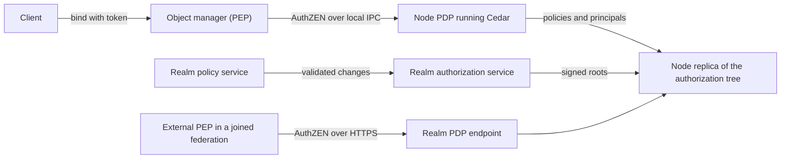

<!-- SPDX-FileCopyrightText: 2026 Nicole Roy -->
<!-- SPDX-License-Identifier: CC-BY-4.0 -->

# Policy and decisions: Cedar and AuthZEN

*2026-11-24, updated 2026-11-25. Input to the design session. The decisions it led to are recorded in [ADR 0018](../decisions/0018-cedar-policy-language.md) and [ADR 0019](../decisions/0019-authzen-decision-protocol.md).*

1. [The tenet](#1-the-tenet)
2. [Where things stand](#2-where-things-stand)
3. [The parts and where they live](#3-the-parts-and-where-they-live)
4. [Mapping ASPIS onto Cedar and AuthZEN](#4-mapping-aspis-onto-cedar-and-authzen)
5. [Flows](#5-flows)
6. [Conflicts and resolutions](#6-conflicts-and-resolutions)
7. [Open questions](#7-open-questions)

## 1. The tenet

Cedar is the realm's policy description language and engine. The AuthZEN wire protocol carries requests for authorization decisions and their answers.

## 2. Where things stand

### AuthZEN Authorization API 1.0

**Status:** OpenID Final Specification, approved 12 January 2026 [AZ-FINAL], [AZ-SPEC].

**Information model** (§5)

- A **subject** and a **resource** each have a required `type` and `id`, plus optional `properties`.
- An **action** has a required `name` and optional `properties`.
- A **context** is optional.
- A **decision** is `{"decision": true|false}`, with an optional `context`.

**APIs**

- Access evaluation, at `/access/v1/evaluation` (§6).
- Batch evaluations, at `/access/v1/evaluations` (§7). The `evaluations_semantic` option takes one of three values: `execute_all` (the default), `deny_on_first_deny` or `permit_on_first_permit`.
- Subject, resource and action search, with opaque-token pagination (§8).

**Metadata:** published at `/.well-known/authzen-configuration`, with optional signed metadata (§9).

**Transport**

- A compliant decision point must implement the HTTPS binding: `POST` with `application/json`, following I-JSON (RFC 7493).
- Other bindings, such as gRPC or CoAP, may be defined as profiles (§10).
- A deny is an HTTP 200 response carrying `{"decision": false}`; HTTP errors are kept separate from authorization outcomes.

**Left open by the spec**

- How an enforcement point authenticates. OAuth is recommended (§2, §11.2).
- Whether enforcement-point-supplied properties are verified (§11.4).
- The format of reasons, obligations and advice in a decision's context (§5.5.2).

### Cedar

- **What it is:** an open-source policy language and engine, accepted into the CNCF Sandbox in October 2025 [CEDAR-CNCF].
- **Implementation:** the SDK is written in Rust. It includes the authorization engine, validator, formatter and CLI [CEDAR-GH]. The project keeps a definitional implementation in Lean and runs differential random testing against it [CEDAR-GH]. The language and its analysis are described in [CEDAR-PAPER].
- **Model:**
  - principal, action, resource and context;
  - `permit` and `forbid` policies, default deny, and `forbid` overriding `permit`;
  - entity hierarchies through `in`;
  - templates with `?principal` and `?resource` slots;
  - schema validation;
  - diagnostics that name the policies that determined a decision.

## 3. The parts and where they live



| Role | Who plays it in ASPIS |
|---|---|
| Policy enforcement point (PEP) | Object managers, at bind time |
| Policy decision point (PDP) | A server on every node, plus a realm endpoint for outside callers |
| Policy information point | The principal tree (principals, groups: [0018](../decisions/0018-cedar-policy-language.md), rule 3; [0019](../decisions/0019-authzen-decision-protocol.md), rule 5); managers (resource attributes); verified tokens (context) |
| Policy administration point | The realm policy service, which validates changes and writes them into the authorization tree. The realm's authorization service applies them in batches and signs each root ([0016](../decisions/0016-authorization-sparse-merkle-tree.md), rule 4) |

## 4. Mapping ASPIS onto Cedar and AuthZEN

| ASPIS | Cedar | AuthZEN |
|---|---|---|
| Principal (object ID) | `Aspis::Principal::"<id>"`, member of groups | `subject` `{type: "aspis:principal", id}` |
| Object (object ID, type) | `Aspis::Object::"<id>"`, `in` its directory | `resource` `{type: <object type>, id}` |
| Interface method (interface, major, method) | `Aspis::Action::"<interface>/<major>/<method>"`, in IDL-declared action groups | `action` `{name}` |
| Token claims, epoch, channel | `context` record | `context` |
| Grant | Template-linked policy | (none) |
| Determining policies | Diagnostics | ASPIS context key in the decision |

Illustrative policies. The names and attributes are placeholders until the schema exists.

```cedar
// Grant template: read through version 1 of the io interface.
@id("aspis-io-v1-read")
permit (
    principal == ?principal,
    action in Aspis::Action::"aspis.io/1/read",
    resource == ?resource
);

// Realm rule: no decision exceeds the token's scopes.
@id("token-scope-ceiling")
forbid (principal, action, resource)
unless { context.token.scopes.contains(context.action_scope) };

// Realm rule: external principals need the realm's required trust mark.
@id("external-needs-trust-mark")
forbid (principal is Aspis::ExternalPrincipal, action, resource)
unless { principal.trust_marks.contains("https://federation.example/marks/incident-response") };
```

Illustrative AuthZEN exchange:

```json
{
  "subject":  { "type": "aspis:principal", "id": "<principal ID>" },
  "action":   { "name": "aspis.io/1/read" },
  "resource": { "type": "aspis.file", "id": "<object ID>" },
  "context":  { "token": { "iss": "https://realm.example", "scopes": ["aspis.io/1/read"] },
                "action_scope": "aspis.io/1/read", "epoch": 4127, "channel": "local" }
}
```

```json
{ "decision": true,
  "context": { "aspis_determining_policies": ["<tree key>"], "aspis_epoch": 4127 } }
```

## 5. Flows

### 5.1 Binding to an object

1. The manager verifies the client's token ([0015](../decisions/0015-jwt-tokens-and-oidc-identity.md)).
2. It sends one batch evaluation to the node's decision point, covering every method the bind asks for, with `deny_on_first_deny`.
3. The decision point loads the principal's entity from the principal tree. It takes the resource's attributes from the manager, after checking that this manager manages the object. It then runs Cedar against the policies in the node's replica.
4. On permit, the manager issues a capability or session tagged with the determining policies.

### 5.2 Revocation

1. A new signed root arrives with a revoked branch.
2. Each manager ends the sessions tagged with policies under that branch.
3. If the root added `forbid` policies touching branches a session depends on, the manager re-evaluates that session.

### 5.3 POSIX permissions

- `ls -l` and `access()` compute mode bits with one batch evaluation: owner, group and other, each for read, write and execute.
- `chmod` writes grant-template links.
- An object whose policies don't reduce to mode bits is shown with the extra ACL marker ([0012](../decisions/0012-posix-compatibility-layer.md)).

### 5.4 External enforcement points

A service in a joined federation ([0017](../decisions/0017-openid-federation-membership.md)) calls the realm's HTTPS decision point:

- it finds the endpoint through AuthZEN metadata;
- it authenticates with an OAuth token whose issuer the realm trusts through the federation.

### 5.5 Search

- **Who can read this object?** Answered by enumerating the object's branch in the grant tree.
- **What can I do here?** Answered by evaluating the actions in the object's interfaces.
- **What can I access?** Resource search, which needs a per-principal index. That comes later.

## 6. Conflicts and resolutions

1. **HTTPS and JSON versus ASPIS RPC.** AuthZEN permits other bindings as profiles. ASPIS defines an RPC binding that carries the same JSON over IPC and RPC. JSON's grammar is ABNF (RFC 8259), which satisfies [0013](../decisions/0013-abnf-for-protocols-and-calls.md). The HTTPS binding remains for callers outside ASPIS.
2. **Trusting enforcement-point attributes.** The spec leaves this open. ASPIS's decision point resolves principal attributes itself. Managers may supply attributes only for objects they manage.
3. **Reasons and obligations are unspecified.** The ASPIS profile defines context keys: the determining policies, the epoch and step-up hints.
4. **Templates can't take an action slot.** Each grant template fixes a set of actions, and the IDL declares the action groups templates use.
5. **Grant keys in tokens versus Cedar's own selection.** Cedar finds the applicable policies itself, so tokens no longer name grant keys ([0015](../decisions/0015-jwt-tokens-and-oidc-identity.md) rule 3). Sessions track the determining policies instead ([0016](../decisions/0016-authorization-sparse-merkle-tree.md) rule 6). Scopes become an upper bound enforced by a realm `forbid` rule.
6. **Revoking a permit isn't a deny.** If another `permit` still applies, access continues. A denial that must win uses `forbid`, or a revoked principal leaf.
7. **Bootstrap.** Before the first decision point runs, authority comes only from capabilities the root server hands out.
8. **Naming collision.** Cedar's policy analysis is built on SMT solvers (satisfiability modulo theories). In ASPIS documents, "the authorization tree" means the sparse Merkle tree; avoid the abbreviation SMT for the tree.

## 7. Open questions

- The Cedar schema generated from the IDL: entity types, attributes, and how action groups span major versions.
- The ASPIS AuthZEN profile: the RPC binding, the type and action naming in ABNF, and the context keys.
- When re-evaluation is triggered for new `forbid` policies, and what it costs.
- A per-principal index for resource search. Decided: [0028](../decisions/0028-discovery-and-realm-catalog.md), rule 8. The catalog's index of published objects is that index.
- Which realm invariants the policy service enforces at write time, and whether Cedar's analysis tools can check them automatically.
- Whether to sign every decision or only decisions sent across nodes.

## Sources

- [AZ-SPEC] OpenID AuthZEN, Authorization API 1.0 (Final, January 2026): https://openid.net/specs/authorization-api-1_0.html
- [AZ-FINAL] "Authorization API 1.0 Final Specification Approved": https://openid.net/authorization-api-1-0-final-specification-approved/
- [CEDAR-CNCF] AWS Open Source Blog, "Cedar joins CNCF as a Sandbox project": https://aws.amazon.com/blogs/opensource/cedar-joins-cncf-as-a-sandbox-project
- [CEDAR-GH] Cedar on GitHub (engine, validator and Lean specification): https://github.com/cedar-policy
- [CEDAR-PAPER] "Cedar: A New Language for Expressing Fast, Safe, and Analyzable Authorization": https://arxiv.org/pdf/2403.04651
- RFC 8259 (JSON) and RFC 7493 (I-JSON): https://www.rfc-editor.org/
