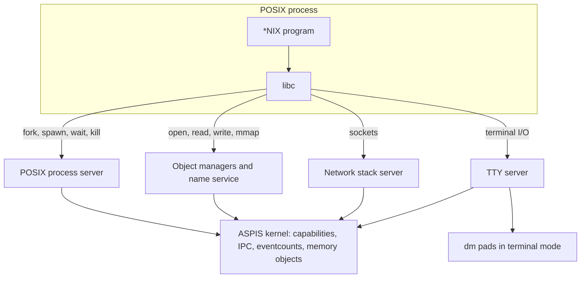

<!-- SPDX-FileCopyrightText: 2026 Nicole Roy -->

# POSIX compatibility on ASPIS

*2026-11-24, input to the design session. The decisions it led to are recorded in [ADR 0012](../decisions/0012-posix-compatibility-layer.md).*

1. [Goal](#1-goal)
2. [How other systems did it](#2-how-other-systems-did-it)
3. [Proposed architecture](#3-proposed-architecture)
4. [Conflicts and resolutions](#4-conflicts-and-resolutions)
5. [What the kernel must provide](#5-what-the-kernel-must-provide)
6. [Linux binary compatibility](#6-linux-binary-compatibility)
7. [C library and Rust](#7-c-library-and-rust)
8. [Open questions](#8-open-questions)

## 1. Goal

ASPIS should run *NIX software natively. "Natively" means three things:

- programs are compiled for ASPIS on AArch64;
- they run as ordinary ASPIS processes, with no virtual machine;
- the POSIX interfaces come from a compatibility layer built entirely on ASPIS APIs.

**Target.** Source compatibility with POSIX.1-2024 (The Open Group Base Specifications Issue 8) [OG-ISSUE8], covering system interfaces, shell and utilities. On top of that, the Linux and BSD extensions most software assumes. Issue 8 already standardized several of them, including `pipe2`, `dup3`, `accept4`, `ppoll` and `getentropy` [CYG-ISSUE8].

**Not goals.** POSIX semantics for native ASPIS programs, and kernel features that only POSIX needs.

## 2. How other systems did it

| System | How POSIX sits on a non-Unix core | Lesson for ASPIS |
|---|---|---|
| Domain/OS SR10 (1988) | BSD 4.3 and System V.3 environments layered on AEGIS, chosen per process through `SYSTYPE` and variant links. The manuals documented Unix permissions and ACLs side by side [W-DOS] | It worked, and ACLs coexisted with Unix modes, but the layering made the system larger and slower [W-AC]. Aegis-only nodes had no root account at all [FAQ, read via summary] |
| QNX Neutrino\* | POSIX on a message-passing microkernel. "Resource managers" serve file operations, and Qnet makes `/net/<node>/…` paths reach other nodes | POSIX and transparent networking can coexist on a microkernel |
| GNU Hurd\* | glibc runs over Mach; file systems are user-space servers; a signal thread inside each process delivers signals | Signals can live entirely in the C library |
| Fuchsia | `fdio` offers a deliberately small POSIX subset. Starnix runs unmodified Linux binaries by implementing the Linux UAPI in user space, with no VM, and containers provide the file-system layout they expect [STARNIX], [RFC-0082] | Keep a well-behaved POSIX layer separate from binary compatibility |
| Redox | relibc is a C library written in Rust. It runs either on Linux system calls or on redox-rt, which hides Redox's unstable syscall ABI the way a vDSO would. Signals are moving to user space, and namespaces and working directories are handled through capabilities [REDOX-FOSDEM], [RELIBC] | A Rust libc with a pluggable runtime layer fits a capability microkernel |
| Windows | WSL 1 translated Linux system calls on NT. WSL 2 replaced it with a real Linux kernel in a VM, to get full syscall compatibility and file-system performance [WSL] | Binary compatibility has a long tail, and file-system semantic gaps cost performance |

\* General background, not re-verified for this note.

## 3. Proposed architecture

- **libc** runs inside every POSIX process. It keeps the file-descriptor table, the signal state and the environment, and turns POSIX calls into ASPIS IPC.
- **POSIX process server.** Owns pids, process groups, sessions, parent/child relationships, `wait`, signal routing between processes, and credentials.
- **TTY server.** Provides pseudo-terminals and the line discipline. The other end of each terminal is a dm pad in terminal mode ([0011](../decisions/0011-dm-window-system.md)).
- **Network stack server.** Provides TCP/IP behind the sockets API.
- **Files need no POSIX file server.** libc talks to object managers and the name service directly. POSIX-only metadata (uid, gid) is stored as object attributes. Mode bits are not: they are a view onto the ACL ([0012](../decisions/0012-posix-compatibility-layer.md), rule 6), that is, onto the object's grant branch in the authorization tree ([0016](../decisions/0016-authorization-sparse-merkle-tree.md), Consequences).
- **POSIX instance.** One process server, with its pid space, uid/gid map and root directory. Each node runs one instance by default, and extra instances give container-style isolation.
- **Native ASPIS programs never pass through the layer.** Rust's standard library targets ASPIS APIs directly.

## 4. Conflicts and resolutions

Each entry gives what POSIX expects, what ASPIS does, and the proposed resolution.

### 4.1 Authority

- **POSIX:** ambient authority. A process can name any path and open it if its uid is permitted.
- **ASPIS:** authority only through capabilities ([0002](../decisions/0002-capability-security-model.md)).
- **Resolution:** a POSIX process starts holding capabilities for its instance's root directory, its working directory and its principal's credentials.
  - Inside that namespace, lookup plus ACL checks behave like Unix.
  - Nothing outside the namespace is reachable.
  - A Capsicum-style capability mode can narrow a process further.

### 4.2 Process creation

- **POSIX:** `fork()` duplicates the address space and the descriptors. `exec()` replaces the program image but keeps the pid and the descriptors.
- **ASPIS:** native process creation is spawn-only.
- **Resolution:**
  - `posix_spawn()` maps straight onto native spawn and is the fast path.
  - libc and the process server implement `fork()` using copy-on-write clones of the parent's memory objects and a copy of its capability table.
  - `exec()` starts a new image, and the process server rebinds the pid to it, passing on every descriptor not marked close-on-exec.
- **Kernel needs:**
  - copy-on-write clones of memory objects;
  - duplicating an address space;
  - copying a capability table.

### 4.3 File descriptors

- **POSIX:** small integers. `dup()` and `fork()` make descriptors share one open file description, which holds the offset and status flags.
- **ASPIS:** capabilities to sessions with object managers.
- **Resolution:** libc maps each descriptor to an open file description held server-side by the object's manager, offset included, as QNX, Hurd and Fuchsia do. Sharing a description means sharing the session capability.

### 4.4 Pathnames

- **POSIX:** one tree rooted at `/`, with `.` and `..`, symlinks, mounts and `chroot`. A pathname that starts with exactly two slashes may be interpreted in an implementation-defined way.
- **ASPIS:** `//` is the network root and `/` the node root. Names resolve to object IDs, and variant links give per-context views.
- **Resolution:**
  - `/` is the instance's root, which is the node root by default.
  - `//realm/node/…` passes through unchanged. POSIX allows this because of Apollo: Domain/OS used `//host/path` [TUHS-1990], and an Austin Group bug report notes that systems giving `//` a special meaning have used its first component to name a network resource [AUSTIN-83].
  - Mounts are name-service bindings, and `chroot` hands the process a different root capability.
  - Variant links can give the POSIX personality its own `/usr` or `/etc`.

### 4.5 File names

- **POSIX:** a name is any sequence of bytes except `/` and NUL.
- **ASPIS:** names show up in SVG text, cross realms and need to display well, which pushes toward UTF-8.
- **Resolution (proposed):** names are byte strings, UTF-8 by convention. Decided: [0012](../decisions/0012-posix-compatibility-layer.md), rule 5. Native APIs offer a checked UTF-8 view and display invalid sequences escaped.

### 4.6 File identity

- **POSIX:** `(st_dev, st_ino)` identifies a file, and `ino_t` is 64 bits.
- **ASPIS:** IDs are 256 bits ([0001](../decisions/0001-object-identifiers.md)).
- **Resolution:** `st_ino` is the ID's 64-bit sequence, and `st_dev` is a small number the instance assigns to each authority. An object keeps its authority when it moves, so both values stay stable across migration.
- **Edge case:** if a cloned node reissues sequence numbers, the resulting IDs differ only in their random bits, so they share an `st_ino`.

### 4.7 Users, groups and permissions

- **POSIX:** integer uids and gids, mode bits, setuid and setgid, and an all-powerful uid 0.
- **ASPIS:** principals with IDs and keys, ACLs in the realm's authorization tree ([0016](../decisions/0016-authorization-sparse-merkle-tree.md), rule 1), and capabilities.
- **Resolution:**
  - The realm registry assigns each principal a uid or gid.
  - Mode bits are a view onto the ACL: `chmod` edits the owner, group and other entries, and richer ACLs show up as an extra marker in listings.
  - A setuid program runs as the file owner's principal, subject to policy.
  - uid 0 maps to an administrative principal holding only the capabilities policy grants it. There is no all-powerful superuser.
- **Open:** uid and gid numbers can collide between federated realms, so an id-mapping scheme is needed (NFSv4-style).

### 4.8 Signals

- **POSIX:** signals arrive asynchronously and interrupt threads, a blocked call fails with `EINTR`, and faults raise `SIGSEGV`, `SIGBUS` or `SIGFPE`.
- **ASPIS:** no signals in the kernel; eventcounts, IPC and typed faults instead.
- **Resolution:**
  - The process server routes `kill()`.
  - libc runs a signal thread in each process, as Hurd does.
  - Kernel faults become fault signals. A remote page that misses its deadline ([0004](../decisions/0004-network-transparency-and-failure.md)) becomes `SIGBUS`, the signal POSIX already uses when a mapped file is truncated.
- **Kernel needs:**
  - canceling a thread's blocked IPC wait;
  - suspending a thread and reading or writing its registers, to build signal frames;
  - delivering faults to a user-level handler.

### 4.9 Process ids, groups and sessions

- **POSIX:** small integer pids, a parent/child tree, and orphans re-parented to init.
- **ASPIS:** processes are objects with IDs and may live on other nodes.
- **Resolution:** each instance's process server owns a pid space and maps pids to process object IDs. Processes on other nodes are reached through native APIs, not through POSIX pids.

### 4.10 Terminals and job control

- **POSIX:** terminals, `termios`, controlling terminals, `^C` and `^Z`, `SIGHUP`, and pseudo-terminals.
- **ASPIS:** pads are not terminals ([0011](../decisions/0011-dm-window-system.md)).
- **Resolution:** the TTY server provides pseudo-terminals with a pad in terminal mode at the other end. The line discipline and job control live in the TTY and process servers.

### 4.11 Memory mapping

- **POSIX:** `mmap` with `MAP_SHARED` or `MAP_PRIVATE`, `msync`, and `SIGBUS` when a mapped file is truncated.
- **ASPIS:** the single-level store ([0005](../decisions/0005-single-level-store.md)).
- **Resolution:** a natural fit.
  - `mmap` maps the object.
  - `MAP_PRIVATE` uses the same copy-on-write clone as `fork`.
  - `read` and `write` are built on mapping where possible, so they stay coherent with mapped views.
  - `fsync` means the data is durable at the object's home node.

### 4.12 I/O failure

- **POSIX:** a local call either succeeds or fails, and few programs handle `EIO` well. NFS "hard" mounts hang instead of failing.
- **ASPIS:** deadlines, plus *unreachable* and *indeterminate* outcomes ([0004](../decisions/0004-network-transparency-and-failure.md)).
- **Resolution:** a per-subtree policy.
  - **Default:** libc retries indeterminate requests until the deadline, then fails with `EIO` or `ETIMEDOUT`. Request IDs make those retries safe.
  - **"Hard" subtrees:** wait indefinitely, but signals can still interrupt them, like NFS's interruptible hard mounts.

### 4.13 Locks

- **POSIX:** advisory `fcntl` record locks, which are released when the process closes any descriptor for the file, and `flock`.
- **ASPIS:** leases and tokens. AEGIS's mandatory implicit locks broke Unix mail spools [FAQ 4.2].
- **Resolution:** advisory locks only, served by the object's manager with leases, so a crashed holder can't keep a lock forever. libc emulates POSIX's rule that closing any descriptor releases the process's locks.

### 4.14 Waiting on many descriptors

- **POSIX:** `select`, `poll` and `ppoll`, with `epoll` and `kqueue` as extensions.
- **ASPIS:** eventcounts.
- **Resolution:** every session exposes readiness through an eventcount, and libc builds `poll` on a kernel wait over many eventcounts.
- **Kernel needs:** waiting on a set of eventcounts.

### 4.15 Threads

- **POSIX:** pthreads, mutexes, condition variables and thread-local storage.
- **Resolution:** futex-style locks with a user-space fast path, entering the kernel only under contention. Thread-local storage uses `TPIDR_EL0`.
- **Kernel needs:** wait and wake on an eventcount word in user memory.

### 4.16 Unlink while open, links and rename

- **POSIX:** an unlinked file survives until its last close; files have link counts. `rename` is atomic within a file system and may fail with `EXDEV` across devices.
- **ASPIS:** objects are deleted explicitly, and directories can live on different nodes. AEGIS allowed hard links across volumes.
- **Resolution:**
  - A manager deletes an object only once its link count is zero and no sessions or mappings remain. Remote sessions hold leases.
  - `rename` is atomic between directories on one node. Across nodes it fails with `EXDEV`, which POSIX permits, until a two-phase protocol exists.

### 4.17 Typed objects

- **POSIX:** files are byte streams, and devices take `ioctl`.
- **ASPIS:** typed objects with traits.
- **Resolution:**
  - Objects with the `io` trait appear as files; objects with the directory trait appear as directories.
  - Devices appear as special files, and their `ioctl`s map onto typed calls.
  - Other types expose a serialized view through `io`; for example, an SVG document reads as XML. Domain/OS's `io_xoc` trait did the same for structured objects.

### 4.18 Time

- **POSIX:** `time_t`, `clock_gettime` and file timestamps.
- **Resolution:**
  - `time_t` is 64-bit only, and no 32-bit time exists anywhere (the AEGIS 1997 lesson).
  - `CLOCK_MONOTONIC` comes from the ARM generic timer.
  - The object's creation time supplies `st_birthtime`.

### 4.19 Errors

- **POSIX:** `errno`.
- **ASPIS:** typed errors, namespaced by interface ([0027](../decisions/0027-applications-extend-the-system.md), rule 2).
- **Resolution:** a mapping table. Distributed outcomes become `EIO`, `ETIMEDOUT` or `EHOSTUNREACH`, and ASPIS-aware tools can still retrieve the original typed error.

### 4.20 Sockets

- **Resolution:** a user-space TCP/IP stack serves sockets. `AF_UNIX` with `SCM_RIGHTS` carries capabilities. ASPIS RPC is not exposed as a socket family.
- **SPIFFE Workload Endpoint.** For unmodified software that expects SPIFFE, the personality also serves the SPIFFE Workload Endpoint on an `AF_UNIX` socket. Native interfaces back it ([0022](../decisions/0022-spiffe-and-wimse-workload-identity.md), rule 8).

### 4.21 Graphics

- Graphics are not part of POSIX, and GUI software expects X11 or Wayland.
- A later Wayland bridge could present client buffers as `<image>` elements in Display SVG.

### 4.22 Randomness

- **POSIX:** `getentropy` (Issue 8), plus Linux's `getrandom` and the `/dev/random` and `/dev/urandom` devices. Linux's `/dev/urandom` doesn't wait for its generator to be seeded [RANDOM4].
- **Resolution:** all four draw on the node's entropy service. They block until its gate opens, and never after that ([0021](../decisions/0021-entropy-before-keys.md), rule 10).

## 5. What the kernel must provide

Everything POSIX needs from the kernel is general-purpose and useful to native programs too:

- copy-on-write clones of memory objects and address spaces;
- copying a capability table;
- canceling a blocked IPC wait;
- suspending a thread and reading or writing its registers;
- delivering faults to a user-level handler;
- waiting on a set of eventcounts;
- waiting and waking on an eventcount word in user memory;
- a per-thread TLS register.

## 6. Linux binary compatibility

Source compatibility comes first. Running unmodified Linux AArch64 binaries would be a separate personality, built later and modeled on Starnix: a user-space implementation of the Linux system-call interface, with container file-system layouts. WSL's history argues against promising full binary compatibility early.

## 7. C library and Rust

- **libc:** port relibc by adding an ASPIS runtime layer beside its Linux and Redox backends. relibc is MIT-licensed [RELIBC-LIC], which fits [ADR 0008](../decisions/0008-mpl-2.0-license.md). The alternative is musl (also MIT), which is written in C and assumes Linux system calls.
- **Rust std:** implemented directly on ASPIS APIs, as a target such as `aarch64-unknown-aspis`, rather than through libc. That way native Rust programs don't inherit POSIX semantics.

## 8. Open questions

- **Executable format:** ELF for both native and POSIX programs, and where the dynamic linker lives.
- **`fork()` in multithreaded processes:** POSIX copies only the calling thread; do we go beyond that minimum?
- **Cross-node pids,** or native APIs only.
- **uid/gid mapping** between federated realms.
- **setuid policy.**
- **Conformance testing:** the Open POSIX Test Suite and parts of the Linux Test Project. Formal certification could come later.

## Sources

- [OG-ISSUE8] The Open Group Base Specifications Issue 8 (POSIX.1-2024): https://pubs.opengroup.org/onlinepubs/9799919799/
- [CYG-ISSUE8] Cygwin documentation patches listing interfaces new in Issue 8, 2025: https://sourceware.org/pipermail/cygwin-patches/2025q1/013155.html
- [TUHS-1990] comp.unix.questions, "`//` in pathnames — standard? & why?", March 1990: https://www.tuhs.org/Usenet/comp.unix.questions/1990-March/010543.html
- [AUSTIN-83] Austin Group bug 83, leading double slashes: https://www.austingroupbugs.net/view.php?id=83
- [STARNIX] Fuchsia, Starnix: https://fuchsia.dev/docs/concepts/components/v2/starnix
- [RFC-0082] Fuchsia RFC-0082, "Running unmodified Linux programs on Fuchsia": https://fuchsia.dev/docs/contribute/governance/rfcs/0082_starnix
- [REDOX-FOSDEM] Redox OS at FOSDEM 2025 (slides): https://fosdem.org/2025/events/attachments/fosdem-2025-5973-redox-os-a-microkernel-based-unix-like-os/slides/238806/redoxos-a_VThTapJ.pdf
- [RELIBC] relibc: https://github.com/redox-os/relibc
- [RELIBC-LIC] relibc license (MIT), per the ecosyste.ms index: https://awesome.ecosyste.ms/projects/github.com%2Fredox-os%2Frelibc
- [WSL] Microsoft, "Comparing WSL 1 and WSL 2": https://learn.microsoft.com/windows/wsl/compare-versions
- [RANDOM4] Linux `random(4)`: https://man7.org/linux/man-pages/man4/random.4.html
- [W-DOS], [W-AC], [FAQ]: see the [AEGIS research notes](../research/aegis-domain-os.md#sources).
