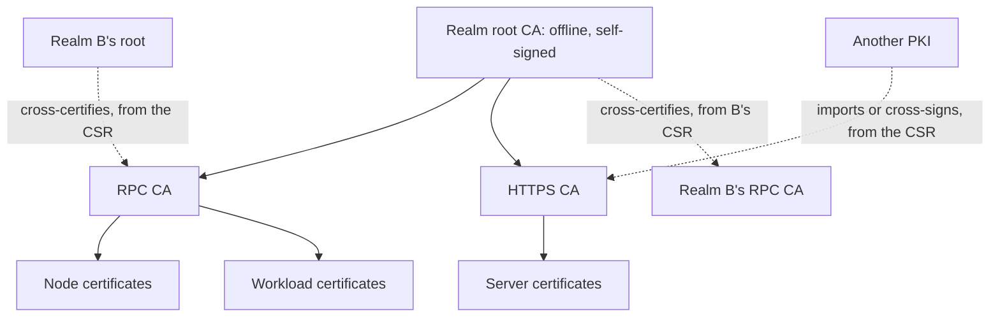
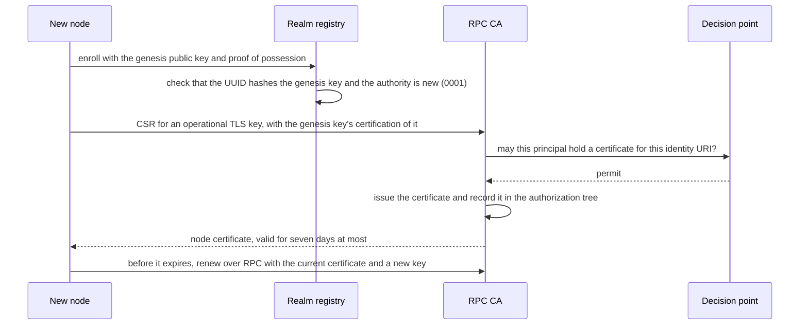

<!-- SPDX-FileCopyrightText: 2026 Nicole Roy -->

# The realm as its own certificate authority

*2026-11-24. Input to the design session. The decisions it led to are recorded in [ADR 0020](../decisions/0020-realm-certificate-authority.md).*

1. [The tenet](#1-the-tenet)
2. [Standards status](#2-standards-status-november-2026)
3. [The hierarchy](#3-the-hierarchy)
4. [Certificate profiles](#4-certificate-profiles)
5. [Intermediates as CSRs](#5-intermediates-as-csrs)
6. [Flows](#6-flows)
7. [Conflicts with the ASPIS model](#7-conflicts-with-the-aspis-model)
8. [Open questions](#8-open-questions)

## 1. The tenet

The realm is its own certificate authority (CA) for RPC and HTTPS across the realm. Its intermediate CAs are exposed as certificate signing requests (CSRs), which other PKIs can import or cross-sign. The certificates are hybrid post-quantum TLS certificates.

## 2. Standards status, November 2026

| Standard | Status | Role in ASPIS |
|---|---|---|
| TLS 1.3 (RFC 9846) | Proposed Standard, July 2026. Obsoletes RFC 8446 [RFC9846] | The handshake for RPC and HTTPS |
| QUIC (RFC 9000) and QUIC-TLS (RFC 9001) | Proposed Standards, 2021 | RPC transport over UDP |
| Hybrid key exchange in TLS 1.3 (RFC 9954) | Informational, July 2026 [RFC9954] | The framework for hybrid groups |
| ECDHE-MLKEM hybrid key agreement for TLS 1.3 (RFC 10024) | Proposed Standard, August 2026 [RFC10024] | `X25519MLKEM768` (0x11EC), matching [0003](../decisions/0003-hybrid-post-quantum-cryptography.md) rule 1 |
| ML-DSA in X.509 (RFC 9881) | Proposed Standard, October 2025 [RFC9881] | ML-DSA alone in certificates |
| Composite ML-DSA in X.509 (RFC 10073) | Proposed Standard, November 2026 [RFC10073] | `id-MLDSA65-Ed25519-SHA512` (OID 1.3.6.1.5.5.7.6.48) for every realm certificate, CSR and CRL, matching [0003](../decisions/0003-hybrid-post-quantum-cryptography.md) rule 2 |
| ML-DSA in TLS 1.3 (`draft-ietf-tls-mldsa`) | Revision -06. In the RFC Editor queue as Informational, on a stream hold [TLS-MLDSA] | Codepoints for ML-DSA alone: `mldsa65` is 0x0905 |
| Composite ML-DSA in TLS 1.3 (`draft-ietf-tls-composite-mldsa`) | Working-group draft, revision -00, October 2026. Codepoints still TBD [TLS-COMPOSITE] | `mldsa65_ed25519_sha512` for `CertificateVerify` |
| TLS Trust Anchor Identifiers (`draft-ietf-tls-trust-anchor-ids`) | Working-group draft, revision -07, November 2026 [TAI] | Choosing which chain to send when an intermediate has several issuers |
| TLS AuthKEM (`draft-celi-wiggers-tls-authkem`) | Individual draft, revision -08, October 2026; not adopted [AUTHKEM] | KEM-based authentication; a possible later suite |
| Merkle Tree Certificates (`draft-ietf-plants-merkle-tree-certs`) | PLANTS working-group draft, revision -08, November 2026 [MTC] | Public post-quantum certificates at the edge, later |
| Related Certificates (RFC 9763) | Proposed Standard, June 2025 [RFC9763] | The dual-certificate alternative, not chosen |
| PQ/T hybrid terminology (RFC 9794) | Informational, June 2025 [RFC9794] | Vocabulary: a "PQ/T hybrid certificate" holds keys for two or more component algorithms |
| PKCS #10 (RFC 2986) and PKCS #9 attributes (RFC 2985) | Informational | The CSR format, and the `extensionRequest` attribute |
| X.509 profile (RFC 5280), path building (RFC 4158), CP/CPS framework (RFC 3647) | Proposed Standard; Informational; Informational | Certificates, CRLs and name constraints; validation through cross-certificates; the realm's certificate policy |
| WIMSE Workload Identifier (`draft-ietf-wimse-identifier`) | Working-group draft, revision -04, October 2026 [WIMSE-ID] | The URI form for node and workload identities, with the `spiffe` scheme ([0022](../decisions/0022-spiffe-and-wimse-workload-identity.md)) |
| WIMSE Workload Authentication Using Mutual TLS (`draft-ietf-wimse-mutual-tls`) | Working-group draft, revision -03, October 2026 [WIMSE-MTLS] | The model for identity in mutual TLS |
| OAuth mutual-TLS client authentication (RFC 8705) | Proposed Standard | Workloads authenticating to external authorization servers |
| ACME (RFC 8555) | Proposed Standard | Web PKI certificates at the edge |
| Service identity in TLS (RFC 9525) | Proposed Standard, November 2023 | Host-name checks for HTTPS |

### Facts that shape the design

**Composite certificates**

- A composite public key is the ML-DSA key followed by the traditional key, with no length prefix. A composite signature is built the same way [RFC10073].
- For ML-DSA-65 with Ed25519, the key is 1,952 + 32 = 1,984 bytes and the signature 3,309 + 64 = 3,373 bytes.
- Composite algorithms drop into PKCS #10 unchanged [RFC10073 §5]. A CSR for a composite key is an ordinary CSR, signed with the composite algorithm.
- A composite's component keys must never be used anywhere else, whether alone or in another combination [RFC10073 §3.1, §5.3].
- RFC 10073 also defines `id-MLDSA87-Ed448-SHAKE256` (OID 1.3.6.1.5.5.7.6.51), a higher-strength pairing that pre-hashes with SHAKE256.

**TLS**

- RFC 10024 marks `X25519MLKEM768` as Recommended [RFC10024].
- The composite TLS signature schemes have names but no codepoints. In `draft-ietf-tls-composite-mldsa-00`, `mldsa65_ed25519_sha512` is "TBD7" [TLS-COMPOSITE]. TLS reserves 0xFE00–0xFFFF for private use [RFC9846].
- Trust Anchor Identifiers let a client say which trust anchors it holds, so that a server with several certification paths can send the right one [TAI].

**The Web PKI**

- Chrome has "no immediate plan" to add post-quantum X.509 certificates to its root store. Its plan is Merkle Tree Certificates [CHROME]:
  - a feasibility study with Cloudflare is under way;
  - public MTCs are to be bootstrapped from Q1 2027;
  - a root store that accepts only MTCs is to follow in Q3 2027.
- Chrome expects to support post-quantum X.509 certificates for private PKIs later in 2026. The announcement doesn't name the algorithms [CHROME].
- Under the CA/Browser Forum's rules, short-lived certificates need no CRL or OCSP pointer. From 15 March 2026, "short-lived" means seven days or less [SC063].

**Workload identity**

- A WIMSE workload identifier is an absolute URI with a non-empty authority, which is its trust domain. The trust domain should be a fully qualified domain name. The draft defines a `wimse` scheme and allows others, such as `spiffe` [WIMSE-ID].
- For mutual TLS, a workload certificate carries exactly one URI subjectAltName holding the identifier [WIMSE-MTLS].
- A relying party maps each trust domain to its trust anchors. It rejects a certificate that doesn't chain to an anchor for the trust domain in its identifier [WIMSE-MTLS].

**Paths and constraints**

- RFC 5280 defines URI name constraints over the URI's host only (§4.2.1.10). **Analysis.** A URI with no host, such as `urn:uuid:…`, therefore can't be confined by a name constraint. Implementations either reject it or let it through.
- A CA's AIA `caIssuers` URL may point to a certs-only CMS bundle of every certificate issued to that CA (RFC 5280 §4.2.2.1). That is how path builders find cross-certificates (RFC 4158).
- A QUIC server must not send more than three times the bytes it has received until it validates the client's address (RFC 9000 §8.1).

## 3. The hierarchy



Dotted arrows are cross-certificates.

**The root**

- It signs only:
  - intermediate certificates;
  - cross-certificates for other realms' intermediates;
  - its CRL.
- It signs in a ceremony and is otherwise offline.
- Its key is used for nothing else. It is separate from the key that signs authorization-tree roots ([0016](../decisions/0016-authorization-sparse-merkle-tree.md)) and from the federation keys ([0017](../decisions/0017-openid-federation-membership.md)).

**One intermediate per purpose**

- The **RPC CA** certifies nodes and workloads, named by URI.
- The **HTTPS CA** certifies servers in the realm's DNS domain, named by DNS name.
- Each has its own key, path length 0, and name constraints that the root itself imposes.

**Why intermediates, not the root, are what others sign**

- A partner trusts one purpose and one namespace, not everything the root signs.
- Trust can't pass through an intermediate, because it has path length 0. A PKI that cross-signs the realm's RPC CA doesn't thereby trust realm B, even though the realm's root cross-certifies B.
- The root stays offline, and its key never leaves the ceremony.

## 4. Certificate profiles

| Certificate | Issuer | Names | Key use | Lifetime | Revocation |
|---|---|---|---|---|---|
| Root | Itself | The realm root's distinguished name | `keyCertSign`, `cRLSign` | Long; set in the design session | Relying parties remove the anchor |
| RPC CA | The root, plus any cross-signers | URI subjectAltName: `spiffe://<realm-domain>` ([0022](../decisions/0022-spiffe-and-wimse-workload-identity.md), rule 3). Name constraints: URIs whose host is the realm's trust domain | `keyCertSign`, `cRLSign`; path length 0 | Years, overlapping its successor | The root's CRL and the tree |
| HTTPS CA | The root, plus any cross-signers | Name constraints: DNS names in the realm's domain | `keyCertSign`, `cRLSign`; path length 0 | Years, overlapping its successor | The root's CRL and the tree |
| Node | RPC CA | One URI subjectAltName: the node's identity URI | `digitalSignature`; `serverAuth` and `clientAuth` | Seven days at most | The tree; expiry outside ASPIS |
| Workload | RPC CA | One URI subjectAltName: the workload's identity URI | `digitalSignature`; `clientAuth`, plus `serverAuth` if it serves | Seven days at most | The tree; expiry outside ASPIS |
| HTTPS server | HTTPS CA | DNS names in the realm's domain | `digitalSignature`; `serverAuth` | Seven days at most | The tree; expiry outside ASPIS |

Every certificate:

- uses `id-MLDSA65-Ed25519-SHA512`;
- carries the realm's certificate policy OID;
- has a serial number with at least 64 random bits, within RFC 5280's 20 octets;
- has an AIA `caIssuers` URL that points to its issuer's bundle (see [§5.4](#54-every-path-is-discoverable)).

Only CA certificates carry CRL distribution points.

**Identity URIs.** A node's or workload's identity URI is a SPIFFE ID, which is also a WIMSE identifier ([0022](../decisions/0022-spiffe-and-wimse-workload-identity.md)). Its trust domain is the realm's DNS name, and its path carries the principal's object ID ([0001](../decisions/0001-object-identifiers.md)) in the text form that [0013](../decisions/0013-abnf-for-protocols-and-calls.md) defines in ABNF. The path layout below was a placeholder for the design session to settle. Decided: [0022](../decisions/0022-spiffe-and-wimse-workload-identity.md), rule 2:

```
spiffe://realm.example.org/<object-id-text>
```

**Sizes. Analysis.**

- A certificate is about 6 KB: a 1,984-byte key, a 3,373-byte signature, and roughly 600 bytes of names and extensions.
- A side that authenticates sends about 15 KB: its certificate, the intermediate's certificate and a 3,373-byte `CertificateVerify`. The root certificate is never sent.
- A classical ECDSA P-256 chain with its signature is about 2 KB.

## 5. Intermediates as CSRs

### 5.1 What a CSR carries

Each intermediate's CSR is a PKCS #10 request (RFC 2986). It carries:

- **Subject:** the intermediate's distinguished name, stable for the life of its key.
- **Public key:** the intermediate's composite key.
- **Signature:** a composite signature by that key, proving that the requester holds it.
- **An `extensionRequest` attribute** (RFC 2985) proposing the constraints a signer should apply:
  - `basicConstraints`: CA, path length 0;
  - `keyUsage`: `keyCertSign` and `cRLSign`;
  - `nameConstraints`: permitted DNS names in the realm's domain (HTTPS CA), or URIs whose host is the realm's trust domain (RPC CA);
  - `certificatePolicies`: the realm's policy OID.

A signer may apply tighter constraints, map its own policies onto the realm's, or require an explicit policy. The realm publishes its certificate policy in RFC 3647's framework so that signers can do that mapping.

### 5.2 Where CSRs are published

- **Over HTTPS**, under the realm's entity identifier ([0017](../decisions/0017-openid-federation-membership.md)).
- **In the realm's ASPIS-native federation metadata** (0017, rule 8), signed with the realm's federation key.

A CSR's own signature proves that the requester holds the key. It doesn't prove that the key belongs to the realm. The federation statement provides that proof for anyone who trusts the realm through a trust chain. Other PKIs use their own vetting.

### 5.3 Import or cross-signing

The same CSR serves both.

- **Import (subordination).** Another PKI's CA issues a subordinate CA certificate for the intermediate, which joins that PKI's hierarchy.
- **Cross-signing.** Another PKI's root, or a bridge CA, issues a cross-certificate for the intermediate as a peer.

Either way, the result is a CA certificate for the intermediate's name and key, signed by someone else. The difference lies in the signer's policy, constraints and audit.

### 5.4 Every path is discoverable

- The realm publishes every CA certificate for an intermediate:
  - the one its own root issued;
  - each import or cross-certificate.
- The intermediate's AIA `caIssuers` URL serves them all as one certs-only CMS bundle, so path builders find every path.
- A TLS endpoint chooses which chain to send:
  - inside the realm, always the path to the realm's root;
  - to a peer whose trust anchors it knows, the matching path. It learns them from the peer's Trust Anchor Identifiers, or from the peer's realm.
  - otherwise, by configuration.

### 5.5 Re-keying

- A cross-certificate binds a name to a key. A new intermediate key therefore needs a new CSR and new cross-certificates.
- Each intermediate overlaps its successor:
  - the new key is published and cross-signed before the old one stops issuing;
  - the old certificates stay valid until the last certificate the old key issued has expired, at most seven days later.

## 6. Flows

### 6.1 Enrolling a node and renewing its certificate

The node mints every key in this flow after its entropy service has opened its gate. The genesis key also needs a physical entropy source and a fresh reseed ([0021](../decisions/0021-entropy-before-keys.md), rules 2 and 5).



### 6.2 RPC between two nodes of a realm

1. Network server A opens a QUIC connection to network server B, offering `X25519MLKEM768` and the composite signature scheme.
2. B sends its node certificate and the RPC CA's certificate. A then:
   - validates the chain to the realm's root;
   - checks that the identity URI's trust domain is its own realm;
   - checks B's principal and the certificate's serial number against its replica of the authorization tree.
3. A sends its own node certificate, and B makes the same checks.
4. Calls flow over QUIC streams. Principals present tokens when they bind ([0015](../decisions/0015-jwt-tokens-and-oidc-identity.md)).
5. When a new tree root revokes either principal or either certificate, the connection closes.

### 6.3 RPC between realms

1. Realm A's policy accepts realm B for RPC through an ASPIS-native federation ([0017](../decisions/0017-openid-federation-membership.md)).
2. In a ceremony, A's root issues a cross-certificate for B's RPC CA from the CSR in B's federation metadata. The cross-certificate is limited to B's trust domain, with path length 0. B does the same for A.
3. When a node in A connects to a node in B, each sends the chain through the cross-certificate that the other's root issued.
4. Each checks the other's status against the other realm's signed tree roots ([0016](../decisions/0016-authorization-sparse-merkle-tree.md), rule 8).
5. When A stops trusting B, A revokes the cross-certificate in its tree and in its root's CRL.

### 6.4 Another PKI cross-signs the HTTPS CA

1. The other PKI's operator obtains the HTTPS CA's CSR and vets the realm.
2. It issues a cross-certificate, applying the proposed constraints or tighter ones.
3. The realm adds the cross-certificate to the HTTPS CA's `caIssuers` bundle.
4. That PKI's relying parties can now validate the realm's HTTPS servers, provided they can verify composite signatures.

### 6.5 A browser reaches the login page

1. A user's browser on another device opens the realm's login page ([0017](../decisions/0017-openid-federation-membership.md), rule 10).
2. The browser can't verify composite signatures, so it doesn't offer the composite scheme. The server sends its Web PKI chain.
3. An ASPIS client reaching the same host offers the composite scheme and trusts only the realm's root, so the server sends the realm's chain.

## 7. Conflicts with the ASPIS model

1. **0003 expected key-exchange authentication.**
   - [0003](../decisions/0003-hybrid-post-quantum-cryptography.md)'s consequences said RPC should authenticate with key exchange (KEMTLS or PQ-Noise style) rather than sign every handshake. Certificates mean signatures.
   - **Resolution:** sign once per connection, and spread the cost:
     - connections between nodes are long-lived;
     - QUIC session resumption skips certificates and signatures, and still runs the `X25519MLKEM768` exchange for forward secrecy (`psk_dhe_ke`).
     - AuthKEM is still an individual draft. ASPIS can add it later through crypto agility (0003, rule 5).
2. **Handshake size and QUIC's amplification limit. Analysis.**
   - A client's first flight carries the 1,216-byte hybrid key share, so it fills two 1,200-byte Initial packets. That lets the server send only about 7 KB before it validates the client's address.
   - The server's first flight is about 17 KB, so a cold connection costs one extra round trip.
   - **Resolution:** address-validation tokens (`NEW_TOKEN`) from earlier connections, long-lived connections, and resumption. All three apply between a realm's nodes.
3. **SHA-3 versus the hashes standards fix.**
   - 0003 rule 3 chooses SHA-3. TLS 1.3's key schedule uses SHA-256 or SHA-384, depending on the cipher suite. `id-MLDSA65-Ed25519-SHA512` pre-hashes with SHA-512, and Ed25519 uses SHA-512 internally.
   - **Resolution:** amend 0003 rule 3. SHA-3 is the rule for constructs ASPIS defines; standard protocols keep their own hashes. The JOSE composite in [0015](../decisions/0015-jwt-tokens-and-oidc-identity.md) already relies on SHA-512 through Ed25519. Decided: [0020](../decisions/0020-realm-certificate-authority.md), rule 12.
4. **ABNF versus ASN.1 and TLS's presentation language.**
   - [0013](../decisions/0013-abnf-for-protocols-and-calls.md) rule 2 puts every network protocol message in ABNF, including the secure transport's handshake.
   - **Resolution:** amend 0013 rule 2. TLS, QUIC, X.509, PKCS #10 and CMS keep their own normative notations. ABNF covers what ASPIS defines within them: identity URIs, the ALPN identifier, and every RPC message. Decided: [0020](../decisions/0020-realm-certificate-authority.md), rule 12.
5. **Composite signatures in TLS have no codepoint yet.**
   - A composite key can't sign with the `mldsa65` scheme, because its components must never be used alone. ML-DSA alone is therefore no fallback while certificates hold composite keys.
   - **Resolution:**
     - Inside the realm both ends run ASPIS, so a private-use codepoint, pinned to the draft revision, works for as long as needed.
     - Peers outside ASPIS need the codepoint IANA assigns.
6. **The tree versus CRLs.**
   - Revocation inside ASPIS is the authorization tree ([0016](../decisions/0016-authorization-sparse-merkle-tree.md); 0017, rule 11). Relying parties outside ASPIS can't read the tree.
   - **Resolution:**
     - The tree is authoritative inside ASPIS.
     - The root's CRL, generated from the tree, covers intermediates and cross-certificates for everyone else.
     - End-entity certificates live seven days at most, and outside ASPIS they rely on expiry.
     - No OCSP.
7. **Public browsers can't use hybrid certificates.**
   - **Resolution:**
     - Endpoints facing the public in the realm's domain hold two chains, one hybrid and one from the Web PKI. App routes on custom domains outside it hold Web PKI certificates only ([0026](../decisions/0026-realm-as-cloud-provider.md), rule 14).
     - ASPIS clients accept only the realm's root, or a cross-certified path, for names in the realm's domain ([0020](../decisions/0020-realm-certificate-authority.md), rule 11).
     - The edge moves to Merkle Tree Certificates when they arrive.
8. **Self-certifying node names versus names asserted by a CA.**
   - Anyone can check that a node's UUID is a hash of its genesis key ([0001](../decisions/0001-object-identifiers.md)). A certificate's identity URI, by contrast, is the CA's assertion.
   - **Resolution:**
     - The registry checks the genesis key at enrollment.
     - The CA certifies only an operational key that the genesis key has certified, and never the genesis key itself.
     - Whether node certificates should also carry that proof, so that a peer can check the name without trusting the CA, is an open question. The proof would add about 5 KB to each certificate.
9. **Clocks.**
   - Certificate validity depends on time, as token validity does ([0015](../decisions/0015-jwt-tokens-and-oidc-identity.md), rule 7).
   - Authenticated time protocols such as NTS (RFC 8915) themselves use TLS. A node whose clock is wrong may be unable to validate the certificates it needs to correct its clock.
   - **Resolution:** the time-synchronization design needs a bootstrap that doesn't depend on certificate validity.
10. **Composite support in other PKIs.**
    - A partner's CA software must accept a CSR with an RFC 10073 key, and its relying parties must verify composite signatures. RFC 10073 was published this month.
    - **Resolution:**
      - ASPIS-to-ASPIS cross-certification needs nothing more.
      - Other partners can cross-sign once their software supports composite keys.
      - If partners need classical certificates sooner, Related Certificates (RFC 9763) are the alternative to weigh. They pair a classical certificate with a post-quantum one.

## 8. Open questions

- **Lifetimes:** the root's, the intermediates', the actual end-entity lifetime under the seven-day ceiling, and when renewal starts.
- **The root's algorithm.** Either `id-MLDSA65-Ed25519-SHA512` everywhere, or `id-MLDSA87-Ed448-SHAKE256` for the root. The root's signature sits in every intermediate certificate, so the stronger option would add about 1.4 KB to every handshake. Decided: [0020](../decisions/0020-realm-certificate-authority.md), rule 2: `id-MLDSA65-Ed25519-SHA512` everywhere, the root included.
- **Key custody:** the root's ceremony and storage, and how intermediates' keys are protected on boards without a TPM.
- **Certificate records in the tree:** their layout, alongside [0016](../decisions/0016-authorization-sparse-merkle-tree.md)'s strawman.
- **Identity URIs:** the path layout, and which WIMSE revision to pin. [0022](../decisions/0022-spiffe-and-wimse-workload-identity.md) settled the scheme as `spiffe`. Decided for the path layout: [0022](../decisions/0022-spiffe-and-wimse-workload-identity.md), rule 2: `spiffe://<realm-domain>/<object-id-text>`. Which revision to pin is still open.
- **Hosts that aren't ASPIS nodes** but serve names in the realm's domain: how they obtain certificates, whether through ACME (RFC 8555) or EST (RFC 7030).
- **Cross-certifying other realms:** a root ceremony for each partner, or an online cross-certification CA. Decided: [0020](../decisions/0020-realm-certificate-authority.md), rules 1 and 10: the root issues each cross-certificate, in a ceremony.
- **Intermediate CRLs:** whether intermediates also publish CRLs for end-entity certificates, if a cross-signer's policy demands them.
- **The certificate policy:** its OIDs, assurance levels, and what partners may expect by way of audit.
- **The ALPN identifier** for ASPIS RPC.
- **A time-synchronization bootstrap** that doesn't depend on certificate validity.
- **When the edge adopts Merkle Tree Certificates.**

## Sources

- [RFC9846] TLS 1.3: https://www.rfc-editor.org/info/rfc9846 and https://datatracker.ietf.org/doc/draft-ietf-tls-rfc8446bis/
- [RFC9954] Hybrid Key Exchange in TLS 1.3: https://datatracker.ietf.org/doc/draft-ietf-tls-hybrid-design/
- [RFC10024] Post-Quantum Traditional (PQ/T) Hybrid Key Agreement Mechanisms for TLS 1.3: https://www.rfc-editor.org/info/rfc10024
- [RFC9881] ML-DSA in X.509: https://datatracker.ietf.org/doc/draft-ietf-lamps-dilithium-certificates/
- [RFC10073] Composite ML-DSA for use in X.509: https://www.rfc-editor.org/info/rfc10073 and https://www.rfc-editor.org/rfc/rfc10073.html
- [TLS-MLDSA] ML-DSA in TLS 1.3: https://datatracker.ietf.org/doc/draft-ietf-tls-mldsa/
- [TLS-COMPOSITE] Composite ML-DSA in TLS 1.3: https://datatracker.ietf.org/doc/draft-ietf-tls-composite-mldsa/
- [TAI] TLS Trust Anchor Identifiers: https://datatracker.ietf.org/doc/draft-ietf-tls-trust-anchor-ids/
- [AUTHKEM] KEM-based authentication for TLS 1.3: https://datatracker.ietf.org/doc/draft-celi-wiggers-tls-authkem/
- [MTC] Merkle Tree Certificates: https://datatracker.ietf.org/doc/draft-ietf-plants-merkle-tree-certs/
- [RFC9763] Related Certificates for Use in Multiple Authentications within a Protocol: https://www.rfc-editor.org/info/rfc9763
- [RFC9794] Terminology for Post-Quantum Traditional Hybrid Schemes: https://www.rfc-editor.org/info/rfc9794
- [CHROME] Chrome Security, "Cultivating a robust and efficient quantum-safe HTTPS", February 2026: https://blog.google/security/cultivating-a-robust-and-efficient-quantum-safe-https/
- [SC063] CA/Browser Forum Ballot SC-063: https://cabforum.org/2023/07/14/ballot-sc063v4-make-ocsp-optional-require-crls-and-incentivize-automation/
- [WIMSE-ID] Workload Identifier: https://datatracker.ietf.org/doc/draft-ietf-wimse-identifier/
- [WIMSE-MTLS] Workload Authentication Using Mutual TLS: https://datatracker.ietf.org/doc/draft-ietf-wimse-mutual-tls/
- RFC 2985, 2986, 3647, 4158, 5280, 8555, 8705, 8915, 9000, 9001, 9525, 7030: https://www.rfc-editor.org/
