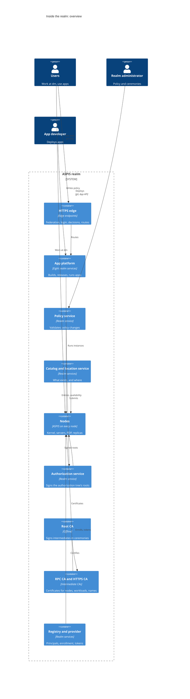
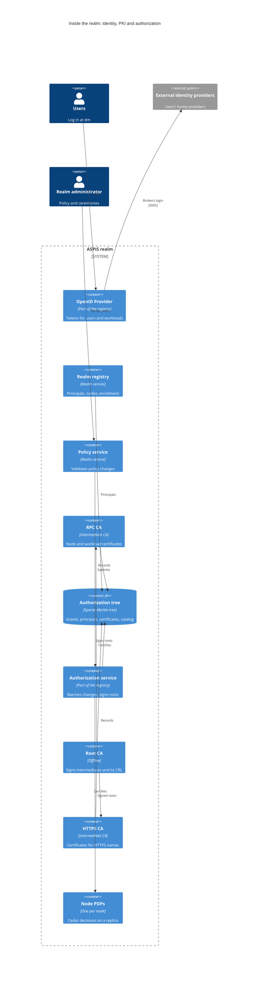
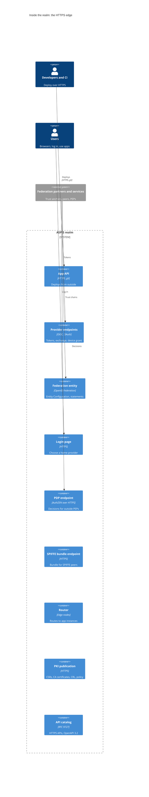

<!-- SPDX-FileCopyrightText: 2026 Nicole Roy -->

# Inside a realm

*2026-11-24. C4's second level: the containers that make up a realm, zooming in from [ASPIS in context](system-context.md). Drawn with the C4 model ([ADR 0024](../decisions/0024-diagrams-mermaid-and-c4.md)).*

A realm is the nodes that run ASPIS, together with the realm's own services. Each realm service is a set of processes on the realm's nodes. Like everything else, it has versioned interfaces ([0014](../decisions/0014-versioned-object-apis.md)), authenticates with a workload identity ([0022](../decisions/0022-spiffe-and-wimse-workload-identity.md)) and asks its node's decision point before it acts ([0019](../decisions/0019-authzen-decision-protocol.md)).

One container view of the whole realm would hold about 25 containers. This note draws it as four views of at most nine, one per concern, and links to a fifth, the app platform, which the twelve-factor design note already draws. The views show what each service does, not which nodes it runs on. The ADRs place only a few services: the router runs on edge nodes ([0026](../decisions/0026-realm-as-cloud-provider.md), rule 6); the provider and the authorization service are part of the realm registry ([0015](../decisions/0015-jwt-tokens-and-oidc-identity.md), rule 2; [the authorization tree note](authorization-tree.md)); and every node runs a decision point and holds a catalog replica ([0019](../decisions/0019-authzen-decision-protocol.md), rule 3; [0028](../decisions/0028-discovery-and-realm-catalog.md), rule 3). Where the others run isn't decided yet, and how the control plane's state is replicated is a design-session item ([0026](../decisions/0026-realm-as-cloud-provider.md), Consequences).

1. [Overview](#1-overview)
2. [Identity, PKI and authorization](#2-identity-pki-and-authorization)
3. [Discovery](#3-discovery)
4. [The HTTPS edge](#4-the-https-edge)
5. [The app platform](#5-the-app-platform)

## 1. Overview

This view shows the realm's containers at their coarsest, and the main paths between them. Some boxes stand for groups that later sections open: the registry and provider and the two intermediate CAs in [section 2](#2-identity-pki-and-authorization), the catalog and location service in [section 3](#3-discovery), the HTTPS edge in [section 4](#4-the-https-edge) and the app platform in [section 5](#5-the-app-platform). [Inside a node](node-components.md) opens the nodes.

| Container | What it does | Decisions |
|---|---|---|
| HTTPS edge | The realm's HTTPS endpoints, among them the Entity Configuration and federation endpoints, the provider's endpoints, the login page, the HTTPS PDP endpoint and app routes; [section 4](#4-the-https-edge) lists them all. The decisions name endpoints, not one container, so this box is a grouping | [0017](../decisions/0017-openid-federation-membership.md), rule 9; [0019](../decisions/0019-authzen-decision-protocol.md), rule 3; [0020](../decisions/0020-realm-certificate-authority.md), rule 11; [0026](../decisions/0026-realm-as-cloud-provider.md), rule 14 |
| App platform | The eight services that build, release, schedule and route twelve-factor apps, attach their backing services and collate their logs. The router is one of them: it runs on edge nodes and terminates TLS for each route. The scheduler places instances on nodes, and a process manager starts each one in a job. [The twelve-factor design note](twelve-factor-apps.md#52-containers) draws the platform | [0022](../decisions/0022-spiffe-and-wimse-workload-identity.md), rule 7; [0025](../decisions/0025-twelve-factor-app-contract.md), rule 8; [0026](../decisions/0026-realm-as-cloud-provider.md), rules 1, 5 and 6 |
| Policy service | Validates each policy change against the Cedar schema generated from the IDL, and can refuse changes that break realm invariants. The authorization service then applies the change to the tree | [0016](../decisions/0016-authorization-sparse-merkle-tree.md), rule 4; [0018](../decisions/0018-cedar-policy-language.md), rules 4 and 7 |
| Catalog and location service | The catalog lists every interface, type and published object. Its registrations are signed state in the authorization tree, and every node holds a replica of it. The location service tracks objects that move, and holds which instances serve an entry now, as leases that lapse on their own | [0004](../decisions/0004-network-transparency-and-failure.md), rule 5; [0028](../decisions/0028-discovery-and-realm-catalog.md), rules 2–5 |
| Nodes | Every machine or VM running ASPIS. Besides the kernel and core servers, each runs a node PDP, a replica of the authorization tree, a catalog replica, a network server and a process manager ([one per node](twelve-factor-apps.md#52-containers)). [Inside a node](node-components.md) opens this box | [0004](../decisions/0004-network-transparency-and-failure.md), rule 5; [0016](../decisions/0016-authorization-sparse-merkle-tree.md), rule 5; [0019](../decisions/0019-authzen-decision-protocol.md), rule 3; [0026](../decisions/0026-realm-as-cloud-provider.md), rule 1; [0028](../decisions/0028-discovery-and-realm-catalog.md), rule 3 |
| Authorization service | Part of the registry ([the authorization tree design note](authorization-tree.md#4-roots-epochs-and-replication)). Applies changes to the authorization tree in batches. Each batch gives a new root, numbered with a 64-bit epoch and signed with the tree-signing key, and every node follows the signed roots | [0016](../decisions/0016-authorization-sparse-merkle-tree.md), rules 4 and 5; [0020](../decisions/0020-realm-certificate-authority.md), rule 1 |
| Root CA | The realm's one trust anchor. It is offline, and in a ceremony it signs only intermediate certificates, cross-certificates and its CRL | [0020](../decisions/0020-realm-certificate-authority.md), rules 1 and 10; [0021](../decisions/0021-entropy-before-keys.md), rule 6 |
| RPC CA and HTTPS CA | One intermediate per purpose, each with its own key. The RPC CA certifies nodes and workloads, named by URI; the HTTPS CA certifies servers in the realm's DNS domain. Each is an object with a versioned interface, and enrollment and renewal are calls on it | [0020](../decisions/0020-realm-certificate-authority.md), rules 1, 4 and 6 |
| Registry and provider | The registry holds principals (people, groups, services and nodes), and enrolls each node once it proves it holds its genesis key. Its OpenID Provider and OAuth authorization server issues the tokens that users and workloads present when they bind | [0002](../decisions/0002-capability-security-model.md), rule 4; [0015](../decisions/0015-jwt-tokens-and-oidc-identity.md), rules 1 and 2; [0020](../decisions/0020-realm-certificate-authority.md), rule 4 |

**Open**

- **Placement and replication.** Apart from the router on edge nodes ([0026](../decisions/0026-realm-as-cloud-provider.md), rule 6) and the PDP and catalog replica on every node ([0019](../decisions/0019-authzen-decision-protocol.md), rule 3; [0028](../decisions/0028-discovery-and-realm-catalog.md), rule 3), no decision says which nodes run the realm services. The provider, the authorization service and root distribution must be replicated ([0015](../decisions/0015-jwt-tokens-and-oidc-identity.md) and [0016](../decisions/0016-authorization-sparse-merkle-tree.md), Consequences), and how the control plane's state is replicated is a design-session item ([0026](../decisions/0026-realm-as-cloud-provider.md), Consequences).
- **Time.** Authenticated time synchronization is a requirement, and its design is a design-session item ([0015](../decisions/0015-jwt-tokens-and-oidc-identity.md), rule 7). No realm service for it is decided, so the view draws none.
- **The audit log.** The realm's audit log records what each revocation removed, and every admin run ([0016](../decisions/0016-authorization-sparse-merkle-tree.md), rule 3; [0026](../decisions/0026-realm-as-cloud-provider.md), rule 10). No decision says which service keeps it.

## 2. Identity, PKI and authorization

This view shows the services that say who a principal is, what it may do, and which certificates the realm stands behind. They meet in the authorization tree, whose signed root commits to the realm's policies, principals, certificate records and catalog entries. The provider and the authorization service are both part of the registry, but the view draws them apart because their jobs differ.

| Container | What it does | Decisions |
|---|---|---|
| OpenID Provider | The realm's OpenID Provider and OAuth authorization server, part of the registry. Users authenticate to it at dm with a password, passkey or smart card, or through the device authorization grant when it brokers to their home provider. Inside ASPIS it issues composite-signed JWTs bound to their holder's key: access tokens, and WITs for workloads. A client binds with its token and a proof of possession in WPT form, and the manager checks them once | [0015](../decisions/0015-jwt-tokens-and-oidc-identity.md), rules 1–3; [0017](../decisions/0017-openid-federation-membership.md), rule 10; [0022](../decisions/0022-spiffe-and-wimse-workload-identity.md), rule 4 |
| Realm registry | Holds principals (people, groups, services and nodes) and their metadata. Enrolls a node once it proves it holds its genesis key, and refuses an authority it already knows. Principals from an external issuer are minted under an authority for that issuer, so distrusting the issuer is one branch revocation | [0001](../decisions/0001-object-identifiers.md), rule 6; [0002](../decisions/0002-capability-security-model.md), rule 4; [0017](../decisions/0017-openid-federation-membership.md), rule 5; [0020](../decisions/0020-realm-certificate-authority.md), rule 4; [0022](../decisions/0022-spiffe-and-wimse-workload-identity.md), rule 2 |
| Policy service | Validates each policy change against the Cedar schema that the IDL compiler generates, and can refuse changes that break realm invariants. Grants are template-linked policies at leaves under each object's branch; realm-wide policies sit under a reserved realm-policy branch | [0018](../decisions/0018-cedar-policy-language.md), rules 2, 4 and 7 |
| Authorization service | Part of the registry ([the authorization tree design note](authorization-tree.md#4-roots-epochs-and-replication)). Applies changes in batches; each batch gives a new root, numbered with a 64-bit epoch and signed with the tree-signing key. Revoking replaces a branch with a revoked marker, and the audit log records what it removed | [0016](../decisions/0016-authorization-sparse-merkle-tree.md), rules 3 and 4; [0020](../decisions/0020-realm-certificate-authority.md), rule 1 |
| Authorization tree | A sparse Merkle tree with 256-bit keys, hashed with SHA3-256. It holds the grant and principal trees, the realm-policy branch, a branch for each issuing CA and the catalog's branch; its key layout is still the strawman of [0016](../decisions/0016-authorization-sparse-merkle-tree.md) rule 2. Inside ASPIS it is the authority on revocation: peers check certificates against their replicas, and a root that revokes a branch ends the sessions and connections that rely on it | [0016](../decisions/0016-authorization-sparse-merkle-tree.md), rules 1 and 2; [0018](../decisions/0018-cedar-policy-language.md), rule 2; [0019](../decisions/0019-authzen-decision-protocol.md), rule 8; [0020](../decisions/0020-realm-certificate-authority.md), rule 7; [0028](../decisions/0028-discovery-and-realm-catalog.md), rule 4 |
| Node PDPs | One per node. Each runs Cedar against its node's replica of the tree, so decisions stay local and keep working during a partition, within the staleness bound. It resolves principal attributes and group memberships itself, and takes resource properties only from the object's manager. Managers, the CAs and the catalog ask it over AuthZEN | [0018](../decisions/0018-cedar-policy-language.md), rule 5; [0019](../decisions/0019-authzen-decision-protocol.md), rules 1, 3 and 5; [0020](../decisions/0020-realm-certificate-authority.md), rule 6; [0028](../decisions/0028-discovery-and-realm-catalog.md), rule 8 |
| Root CA | Offline, and the realm's one trust anchor. In a ceremony it signs only the intermediates' certificates, cross-certificates and its CRL. The CRL is generated from the tree and covers intermediates and cross-certificates, for relying parties outside ASPIS | [0020](../decisions/0020-realm-certificate-authority.md), rules 1, 7 and 10 |
| RPC CA | An intermediate CA under the realm root. Certifies nodes' operational TLS keys (never their genesis keys), and workloads that need mutual TLS with parties outside ASPIS. Each certificate is an X.509-SVID whose one URI is `spiffe://<realm-domain>/<object-id-text>`; it uses `id-MLDSA65-Ed25519-SHA512` and lives seven days at most. Before issuing, the CA asks its node's PDP, and it records every certificate under its own branch of the tree | [0020](../decisions/0020-realm-certificate-authority.md), rules 2 and 4–7; [0022](../decisions/0022-spiffe-and-wimse-workload-identity.md), rules 2 and 3 |
| HTTPS CA | An intermediate CA under the realm root. Certifies HTTPS servers in the realm's DNS domain, named by DNS name, on the same terms as the RPC CA. Endpoints that classical-only clients reach also hold a Web PKI certificate, which ASPIS clients never accept for the realm's names ([section 4](#4-the-https-edge)) | [0020](../decisions/0020-realm-certificate-authority.md), rules 2, 4–7 and 11; [0026](../decisions/0026-realm-as-cloud-provider.md), rule 14 |

**Open**

- **Placement and replication.** The provider and the authorization service are part of the registry ([0015](../decisions/0015-jwt-tokens-and-oidc-identity.md), rule 2; [the authorization tree design note](authorization-tree.md#4-roots-epochs-and-replication)), and every node runs a PDP ([0019](../decisions/0019-authzen-decision-protocol.md), rule 3). No decision says which nodes run the registry and the two intermediate CAs. The provider, the authorization service and root distribution must be replicated ([0015](../decisions/0015-jwt-tokens-and-oidc-identity.md) and [0016](../decisions/0016-authorization-sparse-merkle-tree.md), Consequences), but no decision says how.
- **Key custody.** The root signs only in a ceremony, and intermediate keys need hardware protection where the board has it ([0020](../decisions/0020-realm-certificate-authority.md), Consequences). How the root key is stored and how intermediates' keys are protected on boards without a TPM are open ([the CA design note](realm-certificate-authority.md#8-open-questions)), and no decision yet says where the tree-signing key and the provider's signing keys are held.
- **The write path.** The authorization service applies changes in batches ([0016](../decisions/0016-authorization-sparse-merkle-tree.md), rule 4), and the policy service validates policy changes ([0018](../decisions/0018-cedar-policy-language.md), rule 7). No decision defines how a change reaches the authorization service, whether from the policy service or from the CAs, the catalog and the registry.
- **The realm-creation ceremony.** Creating a realm is an explicit ceremony that mints the root, the intermediates, the federation keys and the tree-signing key ([0021](../decisions/0021-entropy-before-keys.md), rule 6). Its procedure, and what the tree holds at its first root, are still to be designed.
- **The token profile at bind.** A workload binds with its WIT and a proof of possession in WPT form, whose `aud` names the object, interface and version being bound ([0022](../decisions/0022-spiffe-and-wimse-workload-identity.md), rule 4; [0025](../decisions/0025-twelve-factor-app-contract.md), rule 5). ASPIS's RPC binding for proof tokens is new work ([0022](../decisions/0022-spiffe-and-wimse-workload-identity.md), Consequences), and the token profile is still to be specified: the claims, and how an access token travels with the proof.

## 3. Discovery

This view shows the realm's layer of discovery, which sits above each object's description of itself and each manager's enumeration of what it holds ([0028](../decisions/0028-discovery-and-realm-catalog.md), rule 1). Registrations reach the catalog and become signed state in the authorization tree, availability is held as leases in the location service, and every lookup is answered by the replica on the caller's node. [The discovery design note](extensibility-and-discovery.md#58-components) has a simpler view of the same system, with an application and its client.

```mermaid
---
config:
  c4:
    c4ShapeMargin: 100
---
C4Container
    title Inside the realm: discovery
    Person(dev, "App developer", "Publishes interfaces")
    Person(admin, "Realm administrator", "Mounts and defaults")
    Person(users, "Users", "Browse in dm or POSIX")
    System_Boundary(realm, "ASPIS realm") {
        Container(platform, "App platform", "Realm services", "Registers a release's exports")
        Container(pdp, "Node PDPs", "One per node", "Decide who sees entries")
        Container(pm, "Process managers", "One per node", "Register availability")
        Container(catalog, "Catalog", "aspis.catalog", "Interfaces, types, published objects")
        Container(replica, "Catalog replicas", "One per node", "Local lookups and watches")
        Container(location, "Location service", "Soft state", "Availability leases, moved objects")
        Container(policy, "Policy service", "Realm service", "Accepts schema fragments")
        Container(authz, "Authorization service", "Realm service", "Catalog branch, signed roots")
        Container(managers, "Object managers", "Every node", "Enumerate their collections")
    }
    Rel(users, replica, "Look up, watch")
    Rel(dev, platform, "Deploys", "git, App API")
    Rel(platform, catalog, "Registers")
    Rel(admin, catalog, "Mounts, defaults")
    Rel(catalog, policy, "Schema fragments")
    Rel(catalog, authz, "Records entries")
    Rel(authz, replica, "Signed roots")
    Rel(pm, location, "Leases")
    Rel(location, replica, "Availability")
    Rel(replica, pdp, "discover")
    Rel(replica, managers, "Delegates")
    UpdateRelStyle(users, replica, $offsetX="10")
    UpdateRelStyle(dev, platform, $offsetX="10")
    UpdateRelStyle(platform, catalog, $offsetX="8")
    UpdateRelStyle(admin, catalog, $offsetX="85", $offsetY="-65")
    UpdateRelStyle(catalog, policy, $offsetX="8")
    UpdateRelStyle(authz, replica, $offsetX="8")
    UpdateRelStyle(pm, location, $offsetX="8")
    UpdateRelStyle(location, replica, $offsetY="-16")
    UpdateRelStyle(replica, pdp, $offsetX="8")
    UpdateLayoutConfig($c4ShapeInRow="3", $c4BoundaryInRow="1")
```

| Container | What it does | Decisions |
|---|---|---|
| Catalog | An object with the versioned interface `aspis.catalog` and a well-known ID under the reserved authority; it lists itself. It lists every interface and version, every type and every published object, with the mounts at system names and the default providers that the realm administrator sets, and every entry names its publisher. Before an entry appears, the catalog runs the checks that ASPIS's own interfaces pass in CI, and passes the entry's Cedar schema fragment to the policy service. The service broker's service types and plans are part of it. People browse it as a POSIX directory or in dm's catalog browser, and tools outside ASPIS over HTTPS at the edge ([section 4](#4-the-https-edge)); other realms query it for the entries exported to them, each carrying its own realm's signed root | [0027](../decisions/0027-applications-extend-the-system.md), rules 2 and 8; [0028](../decisions/0028-discovery-and-realm-catalog.md), rules 2, 3, 9, 10 and 11 |
| Catalog replicas | Every node holds one, and lookups are answered from it, so they keep working during a partition. Each answer is marked with the epoch it reflects, and binds still fail closed when the node's tree is too stale. Every change to the catalog has a 64-bit sequence number, so a client lists at one and then watches from it, missing no change and seeing none twice: local watchers are woken through eventcounts, and remote ones receive a stream over RPC. Asked to enumerate a collection, the catalog delegates to the collection's manager | [0016](../decisions/0016-authorization-sparse-merkle-tree.md), rule 7; [0028](../decisions/0028-discovery-and-realm-catalog.md), rules 2, 3 and 6 |
| Location service | Holds availability, which instances serve an entry right now, as soft state outside the tree. Process managers register instances as they become ready, and a manager that shards its objects across instances can register finer-grained locations. Every registration is a lease, so a crashed server's entries lapse on their own. It resolves a deploy's minting authority to the deploy's ready instances, and tracks objects that move, since an ID's authority is only the first location hint | [0004](../decisions/0004-network-transparency-and-failure.md), rule 5; [0027](../decisions/0027-applications-extend-the-system.md), rule 5; [0028](../decisions/0028-discovery-and-realm-catalog.md), rule 5 |
| App platform | An app's manifest declares the interfaces, types and published objects it exports. When a release goes live, the platform registers them for the deploy, so the platform attests every registration; a native service that runs outside the platform registers through its own service principal. A binding that names an interface is resolved through the catalog when the release is created, and the release pins the object it resolved to | [0027](../decisions/0027-applications-extend-the-system.md), rules 6 and 9 |
| Policy service | Receives each Cedar schema fragment from the catalog before the entry appears. Policies are validated against the schema before they are written, so the fragment is what lets a policy name the new interface's actions | [0018](../decisions/0018-cedar-policy-language.md), rules 4 and 7; [0028](../decisions/0028-discovery-and-realm-catalog.md), rule 9 |
| Authorization service | Applies the catalog's entries to the authorization tree's catalog branch in its batches, and signs each root. Keys are laid out so that everything one publisher registered shares a prefix, and each entry holds the hashes of the definitions it registers, so a client can check a definition it fetched against a signed root. A registration gets its sequence number when its epoch is signed, and revoking a publisher's branch withdraws all its entries in one epoch, together with its grants | [0016](../decisions/0016-authorization-sparse-merkle-tree.md), rule 4; [0028](../decisions/0028-discovery-and-realm-catalog.md), rules 4 and 6 |
| Node PDPs | Seeing an entry is the Cedar action `discover`, and the catalog asks its node's PDP in batches. By default, interfaces and types are visible to every principal in the realm, published objects follow their publisher's and the realm's policy, and principals from outside the realm see only the entries exported to them. Registering is an authorized call too, and Cedar policy decides which publisher may register which name prefix. The catalog's index of published objects is the per-principal index that AuthZEN resource search was waiting for | [0019](../decisions/0019-authzen-decision-protocol.md), rule 9; [0027](../decisions/0027-applications-extend-the-system.md), rules 6 and 7; [0028](../decisions/0028-discovery-and-realm-catalog.md), rule 8 |
| Process managers | Register an instance with the location service when it becomes ready, and withdraw it when the instance stops. A lease starting or ending is a catalog change, with its own sequence number | [0028](../decisions/0028-discovery-and-realm-catalog.md), rules 5 and 6 |
| Object managers | Every manager, an application's included, implements an enumeration interface: it lists the objects it holds a page at a time, only to callers allowed to see them, and notifies watchers of changes. Every object's base discovery interface now also reports its publisher, and its catalog entry if it has one. The catalog deliberately holds no index of ordinary objects, so enumeration reaches them only through their managers | [0014](../decisions/0014-versioned-object-apis.md), rule 5; [0028](../decisions/0028-discovery-and-realm-catalog.md), rules 1 and 2, and Consequences |

**Open**

- **Which platform service registers.** [0027](../decisions/0027-applications-extend-the-system.md), rule 6, says only that the platform registers a release's exports when it goes live. Which of its services calls the catalog, and at which step of the rollout, is not decided, so the view draws the platform as one box. The interfaces for registering types are new work ([0027](../decisions/0027-applications-extend-the-system.md), Consequences).
- **What a publisher is.** Entries are keyed by publisher ([0028](../decisions/0028-discovery-and-realm-catalog.md), rule 4), and Cedar policy decides which publisher may register which name prefix ([0027](../decisions/0027-applications-extend-the-system.md), rule 7), but no decision defines a publisher. The design note reads it both as a deploy's minting authority ([§5.3](extensibility-and-discovery.md#53-signed-registrations-soft-availability)) and as an organization whose ownership of a prefix must be verified ([§8](extensibility-and-discovery.md#8-open-questions)), and the policy for name prefixes is new work ([0027](../decisions/0027-applications-extend-the-system.md), Consequences).
- **The location service.** It is new work, including its protocol for deploy authorities and how an authority moves to a successor deploy ([0027](../decisions/0027-applications-extend-the-system.md) and [0028](../decisions/0028-discovery-and-realm-catalog.md), Consequences). No decision says where it runs or how it is replicated, so the view gives it no placement.
- **Delay targets.** How quickly a change must reach the replicas and their watchers is for the design session to set ([0028](../decisions/0028-discovery-and-realm-catalog.md), rule 6).

## 4. The HTTPS edge

The realm's HTTPS edge is a grouping, not one container: the decisions name endpoints, each with its own clients ([0017](../decisions/0017-openid-federation-membership.md), rule 9; [0020](../decisions/0020-realm-certificate-authority.md), rule 11). The diagram shows the three kinds of outside client, each with one or more of the endpoints it uses, and the table names the clients of every endpoint. The certificates the endpoints hold follow the table.

| Container | What it does | Decisions |
|---|---|---|
| Federation entity | Publishes the realm's Entity Configuration, with one `authority_hints` entry for each topology it has joined; a topology whose policy conflicts gets a second entity identifier. The realm is an intermediate for its own workloads, so it also serves their Entity Configurations, its Subordinate Statements about them, and the fetch and list endpoints. Revoking a workload stops its Subordinate Statement and marks its keys revoked in the realm's historical-keys endpoint. ASPIS-native metadata names the root certificate, the intermediates' CSRs and certificates, the RPC endpoints, the authorization tree's root distribution and the catalog endpoint. Clients: trust anchors, other realms, and relying parties resolving trust chains | [0017](../decisions/0017-openid-federation-membership.md), rules 1, 3, 7, 8, 9 and 11; [0020](../decisions/0020-realm-certificate-authority.md), rule 12; [0028](../decisions/0028-discovery-and-realm-catalog.md), rule 11 |
| Provider endpoints | The OIDC and OAuth endpoints of the realm's OpenID Provider and OAuth authorization server. They issue identities to relying parties and resource servers in joined topologies. Tokens from outside are accepted only at the edge, and the realm issues post-quantum ASPIS tokens in their place. External OAuth clients, CI systems with their own OIDC tokens, and SPIFFE workloads with JWT-SVIDs, or WITs and proofs, exchange theirs under RFC 8693 ([the federation design note](openid-federation.md#44-an-external-workload-calls-an-aspis-object), [the workload identity design note](workload-identity.md#61-a-spiffe-workload-calls-an-aspis-object)). Tokens for audiences that can't verify post-quantum signatures are signed with a separate key, and never accepted back. For brokered dm login, the provider runs the device authorization grant and brokers to the user's home provider with the authorization-code flow, in the user's browser | [0015](../decisions/0015-jwt-tokens-and-oidc-identity.md), rule 6; [0017](../decisions/0017-openid-federation-membership.md), rules 2, 4 and 10; [0022](../decisions/0022-spiffe-and-wimse-workload-identity.md), rules 5 and 6; [0026](../decisions/0026-realm-as-cloud-provider.md), rule 12 |
| Login page | HTML that the realm serves, since ASPIS itself never renders HTML. A user logging in at dm through an external provider opens it in a browser on another device and chooses a home provider ([the federation design note](openid-federation.md#4-flows)); users arriving from external relying parties sign in here too. Browsers get its Web PKI chain | [0017](../decisions/0017-openid-federation-membership.md), rules 9 and 10; [0020](../decisions/0020-realm-certificate-authority.md), rule 11 |
| PDP endpoint | AuthZEN's HTTPS binding, for enforcement points outside ASPIS such as services in joined federations. The realm publishes signed AuthZEN metadata at `/.well-known/authzen-configuration`, and callers authenticate with OAuth tokens from issuers it trusts through federation ([the policy design note](policy-and-decisions.md#54-external-enforcement-points)) | [0019](../decisions/0019-authzen-decision-protocol.md), rules 2, 3 and 6 |
| SPIFFE bundle endpoint | Serves the realm's trust bundle to SPIFFE peers, with the `https_web` profile and an edge certificate. The bundle holds the root certificate (`x509-svid`) and the keys that sign tokens for outside peers (`jwt-svid`, `wit-svid`). ASPIS realms still trust one another through OpenID Federation and cross-certification | [0022](../decisions/0022-spiffe-and-wimse-workload-identity.md), rule 9 |
| PKI publication | No decision names a service for this; the box groups what the realm publishes for other PKIs and for path builders. That is each intermediate's PKCS #10 CSR, over HTTPS under the realm's entity identifier, which other PKIs use to import or cross-sign the intermediate; every CA certificate issued for each intermediate, as one certs-only CMS bundle at its `caIssuers` URL; the root's CRL, generated from the tree; and the certificate policy, in RFC 3647's framework | [0020](../decisions/0020-realm-certificate-authority.md), rules 7, 8 and 9 |
| API catalog | Serves `/.well-known/api-catalog` (RFC 9727): a Linkset of the realm's HTTPS APIs, each with a `service-desc` link to its OpenAPI description, which the IDL compiler generates in OpenAPI 3.2 alongside each HTTPS binding. The catalog's own interface is also offered over HTTPS, for tools outside ASPIS | [0027](../decisions/0027-applications-extend-the-system.md), rule 10; [0028](../decisions/0028-discovery-and-realm-catalog.md), rule 10 |
| App API | The App API's HTTPS binding, with JSON, and the place `git push` reaches. External clients use OAuth access tokens, and CI systems exchange their own OIDC tokens at the edge, so no pipeline needs a long-lived key. Requests carry IDs, so retries are safe | [0026](../decisions/0026-realm-as-cloud-provider.md), rule 12 |
| Router | Runs on edge nodes and terminates TLS for each route: a hostname, and optionally a path prefix, mapped to a deploy's `web` processes. It spreads requests across ready instances without session affinity, and carries each connection to its instance over the realm's RPC channel. Internal routes, which remain for POSIX apps, are reachable only by deploys bound to them, and the router is their enforcement point | [0026](../decisions/0026-realm-as-cloud-provider.md), rule 6; [0027](../decisions/0027-applications-extend-the-system.md), rule 9 |

**Certificates.** Every HTTPS endpoint in the realm's domain holds an HTTPS CA certificate ([0020](../decisions/0020-realm-certificate-authority.md), rule 4). The endpoints that clients able to verify only classical signatures must reach (the login page, and the endpoints that external relying parties and enforcement points use) also hold a Web PKI certificate from a public CA, obtained with ACME. Each picks the chain to send from the client's signature algorithms and trust anchors, so a browser gets the Web PKI chain and an ASPIS client the realm's ([0020](../decisions/0020-realm-certificate-authority.md), rules 11 and 12; [the CA design note](realm-certificate-authority.md#65-a-browser-reaches-the-login-page)). ASPIS clients never accept a Web PKI certificate for a name in the realm's domain. App routes follow the same rule, but a custom domain lies outside the HTTPS CA's name constraints, so its routes hold Web PKI certificates only ([0026](../decisions/0026-realm-as-cloud-provider.md), rule 14).

**Open**

- **Endpoints without a certificate rule.** The Web PKI rule covers the endpoints that [0017](../decisions/0017-openid-federation-membership.md) rule 9 lists, the provider's token exchange among them ([0020](../decisions/0020-realm-certificate-authority.md), rule 12), as well as app routes ([0026](../decisions/0026-realm-as-cloud-provider.md), rule 14) and the bundle endpoint ([0022](../decisions/0022-spiffe-and-wimse-workload-identity.md), rule 9). Only the App API's HTTPS binding and `git push`, the HTTPS bindings the IDL compiler generates ([0027](../decisions/0027-applications-extend-the-system.md), rule 10), and `/.well-known/api-catalog` have no explicit statement of whether they also hold Web PKI certificates.
- **The ACME client.** Web PKI certificates are obtained with ACME ([0020](../decisions/0020-realm-certificate-authority.md), rule 11; [0026](../decisions/0026-realm-as-cloud-provider.md), rule 14), but no decision says which service runs the ACME client.
- **Watching over HTTPS.** The catalog's interface is offered over HTTPS ([0028](../decisions/0028-discovery-and-realm-catalog.md), rule 10), but how HTTPS clients watch it for changes is new work ([0028](../decisions/0028-discovery-and-realm-catalog.md), Consequences).

## 5. The app platform

The app platform is the eight realm services that build, release, schedule and route twelve-factor apps, attach their backing services and collate their logs ([0026](../decisions/0026-realm-as-cloud-provider.md), rule 1), together with the process managers that start each instance and give it its identity ([0022](../decisions/0022-spiffe-and-wimse-workload-identity.md), rule 7). [The twelve-factor design note](twelve-factor-apps.md#52-containers) draws its containers, so this note doesn't redraw them; the router and the App API's HTTPS binding also appear at the edge, in [section 4](#4-the-https-edge). That view reflects two later decisions: the service broker's catalog of service types and plans is part of the realm's catalog ([0028](../decisions/0028-discovery-and-realm-catalog.md), rule 3), and native deploys bind directly to one another's published objects, so internal routes remain only for POSIX apps ([0027](../decisions/0027-applications-extend-the-system.md), rule 9).
