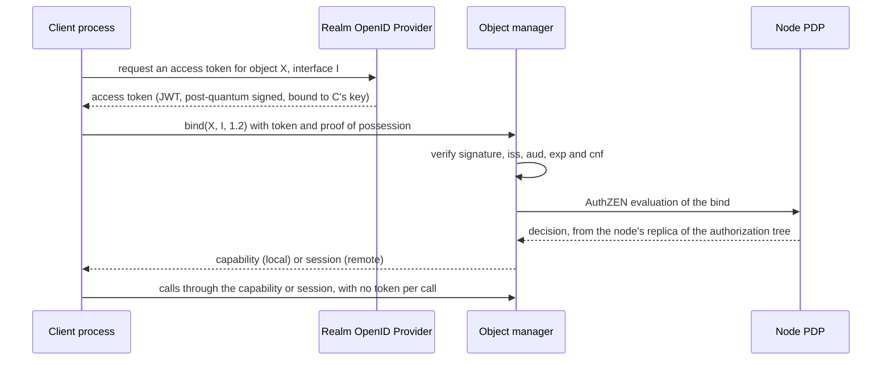

<!-- SPDX-FileCopyrightText: 2026 Nicole Roy -->
<!-- SPDX-License-Identifier: CC-BY-4.0 -->

# Security tokens and identity on ASPIS

*2026-11-24, updated 2026-11-25. Input to the design session; the decisions it led to are recorded in [ADR 0015](../decisions/0015-jwt-tokens-and-oidc-identity.md).*

1. [The tenet](#1-the-tenet)
2. [Standards status](#2-standards-status-november-2026)
3. [Conflicts with the ASPIS model](#3-conflicts-with-the-aspis-model)
4. [Flows](#4-flows)
5. [Open questions](#5-open-questions)

## 1. The tenet

Security constructs for interaction with APIs use JWTs. They build up to user and workload identities that use OpenID Connect for authentication and access management.

The JWTs sit at the level of the native object APIs ([0014](../decisions/0014-versioned-object-apis.md)), below the POSIX layer.

## 2. Standards status, November 2026

| Standard | Status | Role in ASPIS |
|---|---|---|
| JWT (RFC 7519), JWS (RFC 7515), JWK (RFC 7517) | Standards | Token format |
| JWT Best Current Practices (RFC 8725) | BCP | Hardening rules |
| JWT profile for OAuth access tokens (RFC 9068) | Standard | Access-token profile (`at+jwt`) |
| ML-DSA for JOSE and COSE (RFC 9964) | Proposed Standard, 2026 [RFC9964] | Post-quantum signatures |
| Composite ML-DSA for JOSE and COSE (`draft-ietf-jose-pq-composite-sigs`) | Working-group draft, revision -06 in October 2026 [COMPOSITE] | Hybrid signatures matching [0003](../decisions/0003-hybrid-post-quantum-cryptography.md); defines ML-DSA-65 with Ed25519 |
| OpenID Connect Core 1.0 | Final | User identity |
| OAuth Device Authorization Grant (RFC 8628) | Standard | Login without a browser, against the realm's own provider, for users whose identity comes from an external provider ([0017](../decisions/0017-openid-federation-membership.md), rule 10) |
| OpenID Connect CIBA Core 1.0 | Final | No longer needed: the realm's provider brokers to external providers instead ([0017](../decisions/0017-openid-federation-membership.md), rule 10) |
| OAuth Token Exchange (RFC 8693) | Standard | Delegation and attenuation |
| Proof-of-possession key semantics for JWTs (RFC 7800) | Standard | The `cnf` claim for sender-constrained tokens |
| OpenID Federation 1.1 (core) and OpenID Federation for OpenID Connect 1.1 | Both Final, 5 May 2026; together equivalent to 1.0 (Final, February 2026) [OIDF] | Trust between realms, and membership of external federations ([0017](../decisions/0017-openid-federation-membership.md)) |
| OAuth Transaction Tokens (`draft-ietf-oauth-transaction-tokens`) | Working-group draft, revision -11, waiting for write-up; IESG submission planned for December 2026 [TXN] | Carrying a user's context through a chain of calls |
| WIMSE workload credentials and proof tokens | Working-group drafts, 2026 [WIMSE] | The formats of workload tokens and proofs of possession ([0022](../decisions/0022-spiffe-and-wimse-workload-identity.md)) |

## 3. Conflicts with the ASPIS model

1. **Per-call tokens versus capabilities.**
   - Verifying a JWT on every IPC call would cost far more than the call itself, and the kernel can't parse JSON.
   - **Resolution:** tokens are checked once, at bind time. Calls then use a kernel capability (local) or a session on the secure channel (remote).
2. **Post-quantum signatures versus JOSE maturity.**
   - ML-DSA is standardized for JOSE (RFC 9964), but the composite with Ed25519 that [0003](../decisions/0003-hybrid-post-quantum-cryptography.md) calls for is still a draft.
   - **Resolution:** pin a draft revision, keep algorithm identifiers agile, and fall back to ML-DSA-65 alone if the composite stalls.
3. **Size.**
   - An ML-DSA-65 signature is 3,309 bytes and an Ed25519 signature 64. Base64url encoding brings a signed token to roughly 5 KB.
   - Tokens are therefore presented when binding, never per call.
4. **Login without a browser.**
   - The OIDC authorization-code flow assumes a web browser. ASPIS's display is Display SVG, not HTML.
   - **Resolution:**
     - dm authenticates the user natively against the realm's provider (password, passkey or smart card).
     - A user whose identity comes from an external provider logs in with the device authorization grant against the realm's own provider. The realm's provider brokers to the external provider with the standard authorization-code flow, in the user's browser on another device, so external providers need no device-grant or CIBA support ([0017](../decisions/0017-openid-federation-membership.md), rule 10).
5. **Classical-only external parties.**
   - External identity providers sign with classical algorithms, and external audiences (cloud workload-identity federation, for example) can't verify post-quantum signatures.
   - **Resolution:**
     - Classical tokens are accepted only at the realm's edge and re-issued as post-quantum tokens inside.
     - Tokens for external audiences use a separate key, classical or ML-DSA-65 ([0022](../decisions/0022-spiffe-and-wimse-workload-identity.md)), and are never accepted back.
6. **Clocks.**
   - `exp`, `nbf` and `iat` make security depend on time, so a wrong clock opens or closes access.
   - **Resolution:**
     - Authenticated time synchronization becomes a requirement.
     - Clock-skew tolerance is small.
     - Times are parsed as 64-bit integers. AEGIS's 1997 rollover is the cautionary tale.
7. **JSON in every trust boundary.**
   - Parsing JWTs is where the classic attacks live: algorithm confusion, `none`, and key URLs in headers.
   - **Resolution:** a single hardened verification library with a strict profile (RFC 8725). Algorithms are allow-listed per token type, and keys are fetched as realm objects over ASPIS RPC, never from URLs inside tokens.
8. **Revocation and partitions.**
   - Signed tokens stay valid until they expire.
   - **Resolution:** permissions live in the realm's sparse Merkle tree ([0016](../decisions/0016-authorization-sparse-merkle-tree.md)). Managers tag each session and capability with the policies that determined its decision, not with grant keys named in tokens, and a token's scopes are only an upper bound ([0019](../decisions/0019-authzen-decision-protocol.md), rule 8).
     - Managers end the session, or revoke the capability, as soon as a new signed root revokes any of those policies' branches.
     - Nodes keep replicas of the tree and cached realm keys, so checks keep working during a partition, up to a staleness bound.
9. **ID tokens versus access tokens.**
   - OIDC ID tokens tell a client who the user is. They aren't credentials for APIs.
   - **Resolution:** managers never accept ID tokens. They accept access tokens (`at+jwt`) and workload tokens, which take WIMSE's WIT form, `wit+jwt` ([0022](../decisions/0022-spiffe-and-wimse-workload-identity.md), rule 4; [0015](../decisions/0015-jwt-tokens-and-oidc-identity.md), rule 2).

## 4. Flows

### 4.1 User login

1. The dm login pad authenticates the user to the realm's OpenID Provider natively.
2. The provider returns an ID token to dm and a refresh token for the session.
3. dm and the programs it starts obtain access tokens for specific objects and interfaces as they need them.

### 4.2 Workload identity

1. A node authenticates to its realm's provider with a client assertion signed by an operational key that its genesis key has certified, never by the genesis key itself ([0001](../decisions/0001-object-identifiers.md), rule 3; [0020](../decisions/0020-realm-certificate-authority.md), rule 4).
2. The process manager requests a workload token for each service or process it starts, bound to a key that the process holds. The token is a WIMSE Workload Identity Token, and its `sub` is the process's `spiffe://` identity URI ([0022](../decisions/0022-spiffe-and-wimse-workload-identity.md)).
3. When the process binds to an object, it presents that token with a proof of possession in WIMSE's proof-token form.

### 4.3 Binding to an object interface

The manager is the enforcement point. Its node's policy decision point (PDP) decides, against the node's replica of the authorization tree ([0019](../decisions/0019-authzen-decision-protocol.md), rules 1 and 3).

### 4.4 Calls across nodes

The session lives on the post-quantum channel between the two nodes ([0003](../decisions/0003-hybrid-post-quantum-cryptography.md)). That channel is TLS 1.3 over QUIC, and both nodes authenticate with realm certificates ([0020](../decisions/0020-realm-certificate-authority.md)). The token is bound to the client's key, so a stolen token is useless without that key.

### 4.5 Delegation

When an object manager calls another object on a user's behalf, it exchanges the user's token for a narrower on-behalf-of token (RFC 8693). Transaction tokens are the model for passing that context down a longer chain of calls.

### 4.6 Federation

Realms establish trust through OpenID Federation trust chains:

- a trust anchor issues signed entity statements about realms;
- each realm's provider resolves the chain before accepting another realm's tokens.

External identity providers sit at the edge, as in conflict 5.

## 5. Open questions

- The schema for authorization claims (objects, interfaces, versions, methods) and its ABNF.
- Token lifetimes, clock-skew tolerance and refresh policy.
- How to authenticate time synchronization with post-quantum security, without depending on certificates a node can't validate before its clock is set ([0020](../decisions/0020-realm-certificate-authority.md)).
- How signed authorization-tree roots are distributed, and the staleness bound ([0016](../decisions/0016-authorization-sparse-merkle-tree.md)).
- Where workloads keep their keys (TPM, TrustZone, or memory only).
- How POSIX credentials ([0012](../decisions/0012-posix-compatibility-layer.md)'s uid mapping) derive from tokens.

## Sources

- [RFC9964] ML-DSA for JOSE and COSE: https://www.rfc-editor.org/subjects/ml-dsa/ and https://datatracker.ietf.org/doc/draft-ietf-cose-dilithium/
- [COMPOSITE] JOSE/COSE composite signatures draft: https://datatracker.ietf.org/doc/draft-ietf-jose-pq-composite-sigs/
- [OIDF] OpenID Federation 1.1: https://openid.net/specs/openid-federation-1_1.html; OpenID Federation for OpenID Connect 1.1: https://openid.net/specs/openid-federation-connect-1_1.html; 1.0: https://openid.net/specs/openid-federation-1_0.html
- [TXN] OAuth Transaction Tokens draft: https://datatracker.ietf.org/doc/html/draft-ietf-oauth-transaction-tokens
- [WIMSE] WIMSE working-group documents: https://datatracker.ietf.org/wg/wimse/documents/
- RFC 7519, 7515, 7517, 8725, 9068, 8628, 8693, 7800: https://www.rfc-editor.org/
- OpenID Connect Core 1.0 and CIBA Core 1.0: https://openid.net/developers/specs/
