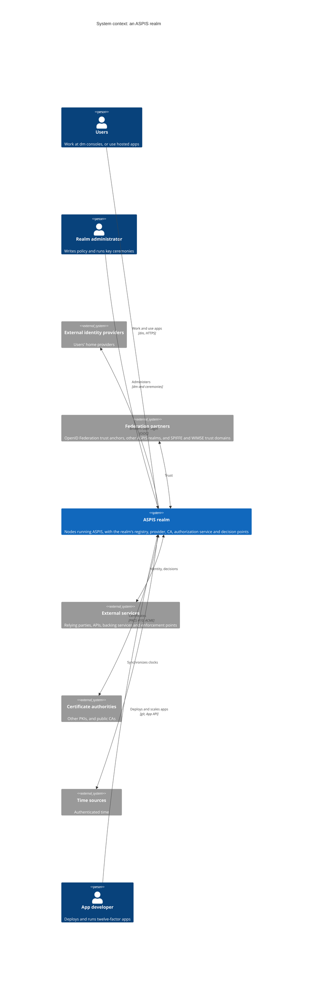

<!-- SPDX-FileCopyrightText: 2026 Nicole Roy -->
<!-- SPDX-License-Identifier: CC-BY-4.0 -->

# ASPIS in context

*2026-11-24. The system context for the design session, drawn with the C4 model ([ADR 0024](../decisions/0024-diagrams-mermaid-and-c4.md)).*

At C4's first level, the system is a realm. That means the nodes that run ASPIS, together with the realm's own services: the registry, OpenID Provider, CA, authorization service and decision points, the app platform that runs twelve-factor apps ([0025](../decisions/0025-twelve-factor-app-contract.md), [0026](../decisions/0026-realm-as-cloud-provider.md)), and the catalog through which everything is discovered ([0028](../decisions/0028-discovery-and-realm-catalog.md)). The diagram shows who uses a realm, and which external systems it depends on or serves.

**What each element covers**

| Element | Covers | Decisions |
|---|---|---|
| Users | Log in at a dm console, where external identities are brokered. Also people using apps the realm hosts, over HTTPS | [0015](../decisions/0015-jwt-tokens-and-oidc-identity.md), [0017](../decisions/0017-openid-federation-membership.md), [0026](../decisions/0026-realm-as-cloud-provider.md) |
| Realm administrator | Writes policy and runs the key ceremonies | [0018](../decisions/0018-cedar-policy-language.md), [0020](../decisions/0020-realm-certificate-authority.md), [0021](../decisions/0021-entropy-before-keys.md) |
| External identity providers | Users' home providers, reached through brokered login | [0017](../decisions/0017-openid-federation-membership.md) |
| Federation partners | OpenID Federation trust anchors; other ASPIS realms, cross-certified for RPC; SPIFFE and WIMSE trust domains | [0017](../decisions/0017-openid-federation-membership.md), [0020](../decisions/0020-realm-certificate-authority.md), [0022](../decisions/0022-spiffe-and-wimse-workload-identity.md) |
| External services | Relying parties and APIs that use ASPIS identities, enforcement points that ask the realm for decisions, and backing services that hosted apps attach | [0017](../decisions/0017-openid-federation-membership.md), [0019](../decisions/0019-authzen-decision-protocol.md), [0026](../decisions/0026-realm-as-cloud-provider.md) |
| Certificate authorities | Other PKIs that import or cross-sign the realm's intermediate CAs, and public CAs that issue its edge certificates | [0020](../decisions/0020-realm-certificate-authority.md) |
| Time sources | Authenticated time | [0015](../decisions/0015-jwt-tokens-and-oidc-identity.md), rule 7. The design is still open |
| App developer | Pushes code, sets config, attaches services and scales deploys of twelve-factor apps, by `git push` and through the App API | [0025](../decisions/0025-twelve-factor-app-contract.md), [0026](../decisions/0026-realm-as-cloud-provider.md) |

**The next levels.** The design session zooms in from here:

- into a realm: [Inside a realm](realm-containers.md) has `C4Container` views of the realm's services, and the [twelve-factor design note](twelve-factor-apps.md#52-containers) has one of the app platform;
- into a node: [Inside a node](node-components.md) has `C4Component` views of a node's servers, and [Inside the kernel](kernel-components.md) opens the kernel;
- across both: [Key flows](key-flows.md) has sequence diagrams of boot, enrollment, the realm-creation ceremony, binding, page faults, login, revocation, deploys and discovery.
