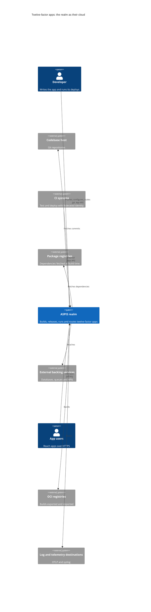
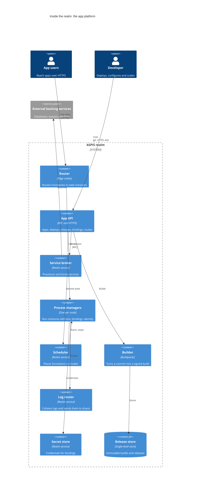
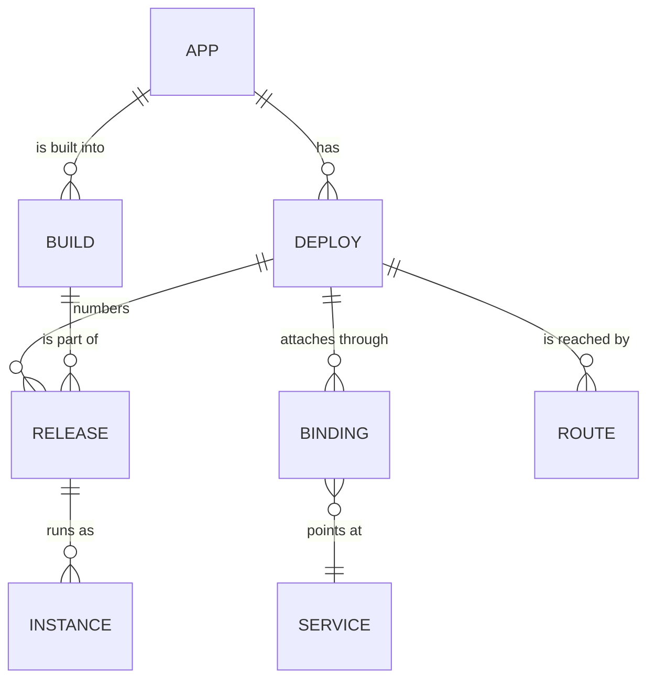
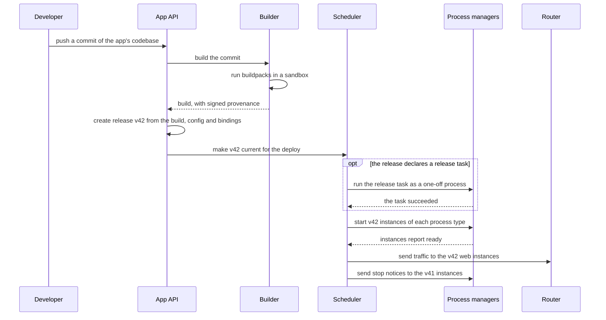
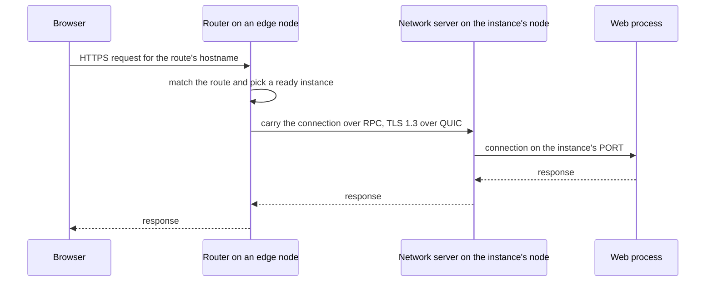
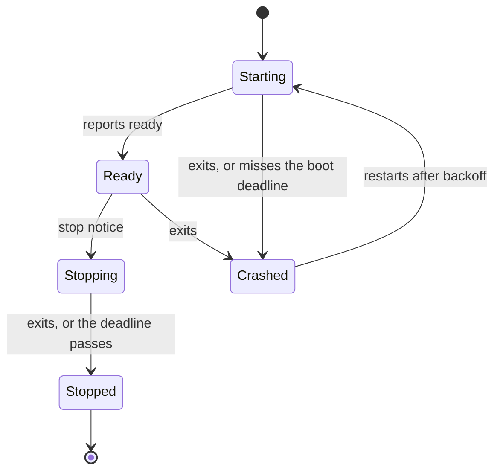

<!-- SPDX-FileCopyrightText: 2026 Nicole Roy -->

# Twelve-factor apps, and the realm as their cloud

*2026-11-24. Input to the design session. The decisions it led to are recorded in [ADR 0025](../decisions/0025-twelve-factor-app-contract.md) and [ADR 0026](../decisions/0026-realm-as-cloud-provider.md).*

1. [The tenet](#1-the-tenet)
2. [Twelve-factor today](#2-twelve-factor-today)
3. [What a cloud gives an app](#3-what-a-cloud-gives-an-app)
4. [The factors on ASPIS](#4-the-factors-on-aspis)
5. [The realm as a cloud provider](#5-the-realm-as-a-cloud-provider)
6. [Conflicts and resolutions](#6-conflicts-and-resolutions)
7. [Flows](#7-flows)
8. [What the kernel must provide](#8-what-the-kernel-must-provide)
9. [Open questions](#9-open-questions)

## 1. The tenet

ASPIS supports twelve-factor apps as a core concern, through its native APIs, and it supports the twelve-factor design principles. A realm acts as a virtual cloud provider for these apps.

Two consequences shape this note:

- **The contract is native.** What a twelve-factor app expects of its platform becomes a set of versioned ASPIS interfaces ([0014](../decisions/0014-versioned-object-apis.md)), below the POSIX layer. That covers its environment, its backing services, a port, a stop signal and standard output. The POSIX personality presents the same contract in its familiar form.
- **The realm is the platform.** A cloud provider or platform as a service builds, releases, schedules and routes apps, and supplies their backing services and logs. In ASPIS these become realm services, built on the identity, certificate and authorization machinery that already exists.

## 2. Twelve-factor today

### 2.1 The factors

Adam Wiggins wrote the Twelve-Factor App at Heroku in 2011 [12F]. 12factor.net still serves that text, last updated in 2017. In our words:

| # | Factor | What it asks of an app |
|---|---|---|
| I | Codebase | One codebase in revision control per app, and many deploys of it |
| II | Dependencies | Declare every dependency, isolate them, and rely on nothing installed system-wide |
| III | Config | Keep everything that varies between deploys in environment variables, managed per deploy |
| IV | Backing services | Treat databases, queues and other services as attached resources, swappable without code changes |
| V | Build, release, run | Keep the three stages strictly apart. Releases are immutable and uniquely numbered |
| VI | Processes | Run as stateless processes that share nothing. Persistent state lives in backing services |
| VII | Port binding | Be self-contained, and export HTTP or any other service by binding a port |
| VIII | Concurrency | Scale out by process type and count, and leave process management to the platform |
| IX | Disposability | Start fast, stop gracefully on `SIGTERM`, and survive sudden death |
| X | Dev/prod parity | Keep development, staging and production alike in time, people and tools |
| XI | Logs | Write logs as an unbuffered event stream to standard output, and let the platform route them |
| XII | Admin processes | Run one-off admin tasks as processes of the same release, in the same environment |

### 2.2 The revision under way

- **Open source.** Heroku opened the manifesto on 12 November 2024 [12F-OSS]. The text now lives in `twelve-factor/twelve-factor` under CC BY 4.0, and the revision happens on its `next` branch [12F-REPO].
- **What has changed.**
  - Between November 2024 and March 2025, each factor was restructured into concepts, examples and guidance. The titles and the substance are unchanged so far.
  - The maintainers intend to keep exactly twelve factors [12F-FAQ].
  - The last change to `next` was in July 2025, and nothing has been released from it.
- **The application–platform contract.** The maintainers describe the factors as a contract between an app's code and the platform that deploys it. They want a narrow one, covering how an app learns where it is reachable, how it connects securely to other systems, and how it receives configuration [12F-CONDUIT].
- **Open proposals.** None was merged as of November 2026.
  - **Identity** (pull request 34, March 2025) adds a factor for workload credentials. They are short-lived and narrowly scoped, the platform delivers them, and backing services validate them. Its examples include OIDC tokens with a JWKS endpoint, SPIFFE, WIMSE-style tokens and mutual TLS. To keep the count at twelve, it drops the admin-processes factor [12F-PR34].
  - **Combine processes factors** (pull request 32) folds admin processes into the processes factor [12F-PR32].
  - **Facets** (pull request 40) groups the factors into deployable, configurable, scalable and observable facets. Its review suggests that backing services expose telemetry by default [12F-PR40].
- **Earlier extensions.** *Beyond the Twelve-Factor App* (Hoffman, 2016) added API first, telemetry, and authentication and authorization [BEYOND]. ASPIS already has all three:
  - versioned interfaces ([0014](../decisions/0014-versioned-object-apis.md));
  - logs and telemetry (§4.11);
  - tokens and policy ([0015](../decisions/0015-jwt-tokens-and-oidc-identity.md) to [0019](../decisions/0019-authzen-decision-protocol.md)).

### 2.3 The standards a platform uses

| Standard | Status, November 2026 | Role in ASPIS |
|---|---|---|
| Cloud Native Buildpacks | Buildpack API 0.12 and Platform API 0.15, 11 December 2025 [CNB] | The build stage |
| OCI image and distribution specifications | Image 1.1.1 (March 2025); distribution 1.1.1 (January 2025) [OCI-IMG], [OCI-DIST] | Exchanging builds with registries |
| Service Binding Specification for Kubernetes | 1.1.0 [SB] | How bindings appear inside a POSIX process |
| Open Service Broker API | v2.17, now maintained under Cloud Foundry [OSB] | The model for the service broker |
| OpenTelemetry | CNCF graduated, May 2026 [OTEL-GRAD]. Its logging components have been stable since November 2023 [OTEL-LOGS] | Log and telemetry drains |
| Syslog | RFC 5424; TLS transport in RFC 5425, updated by RFC 9662 (October 2024) [SYSLOG] | Log drains |
| SLSA | 1.2, approved November 2025. It adds a source track to the build track [SLSA] | Build provenance |
| TOML | 1.1.0, December 2025. Its repository publishes an ABNF grammar (RFC 5234) [TOML] | The app manifest |
| Procfile | Heroku's convention: one `<type>: <command>` line per process type. Only `web` receives HTTP traffic, and `release` runs before a release goes live [PROCFILE] | The minimal manifest |

### 2.4 How platforms have done it

| Platform | What it shows |
|---|---|
| Heroku\* | The platform twelve-factor was written from. Buildpacks compile a slug. A release joins a slug with config vars. Dynos run process types from a Procfile. Add-ons attach services through config vars. A router sends HTTP to web dynos on `$PORT`. Logplex collates logs, and `heroku run` starts one-off dynos |
| Heroku Fir | Generally available since 14 April 2025. The same contract rebuilt on Kubernetes, Cloud Native Buildpacks and OCI images, with OpenTelemetry drains in place of the old logging [FIR] |
| Cloud Foundry\* | Buildpacks, and service brokers behind the Open Service Broker API |
| Kubernetes | Service bindings projected as files under `SERVICE_BINDING_ROOT` [SB] |
| systemd | Passes credentials as files in `$CREDENTIALS_DIRECTORY`, not as environment variables, because environment variables are inherited down the process tree [SYSTEMD-CREDS] |
| Fuchsia | A component reaches only the capabilities routed to it through `use`, `offer` and `expose` declarations. That is dependency isolation by capability [FUCHSIA-CAP] |
| Cloud instance metadata | VMs fetch credentials from a link-local HTTP endpoint that any code on the VM can reach. AWS added session tokens to it (IMDSv2, November 2019) to blunt server-side request forgery [IMDSV2] |

\* General background, not re-verified for this note.

## 3. What a cloud gives an app

| A cloud provider offers | Twelve-factor needs it for | In an ASPIS realm | Status |
|---|---|---|---|
| Accounts, projects and IAM | Deciding who may deploy, configure and scale | Principals, and Cedar policies in the authorization tree, decided by PDPs ([0016](../decisions/0016-authorization-sparse-merkle-tree.md), [0018](../decisions/0018-cedar-policy-language.md), [0019](../decisions/0019-authzen-decision-protocol.md)) | Exists |
| Instance metadata and workload credentials | Identity | Attestation by the process manager. WITs and X.509-SVIDs reach the process through its capabilities, not a network endpoint ([0022](../decisions/0022-spiffe-and-wimse-workload-identity.md)) | Exists |
| A private network | Backing services, port binding | Realm RPC: TLS 1.3 over QUIC, mutually authenticated between nodes ([0020](../decisions/0020-realm-certificate-authority.md)) | Exists |
| Compute: VMs, containers, regions, zones | Concurrency, disposability | Nodes pooled by a scheduler, with failure domains. A process manager on each node | New |
| Build service and image registry | Build, release, run | A builder, and a release store in the single-level store, with OCI import and export | New |
| Load balancers, DNS and certificates | Port binding | A router at the edge, with routes holding HTTPS CA and Web PKI certificates | New |
| Managed databases, queues, storage, marketplace | Backing services | A service broker and catalog, including storage on the single-level store | New |
| Secrets manager and KMS | Config (credentials) | A secret store, keyed by the key service | New |
| Logging and monitoring | Logs | A log router, dm pads, and OTLP and syslog drains | New |
| CI/CD | Build, release, run; dev/prod parity | The builder, with pipelines and promotion | New |
| Management API, CLI and infrastructure-as-code providers | All | The App API, over RPC and HTTPS, and an OpenTofu provider | New |

## 4. The factors on ASPIS

### At a glance

| Factor | What a native process sees | What a POSIX process sees | What the realm does |
|---|---|---|---|
| I Codebase | (nothing) | (nothing) | Each app names its codebase, and each build records its commit |
| II Dependencies | A namespace holding only its build, base, scratch area and bindings | The same, as a file tree | The builder vendors dependencies. Bases are versioned objects |
| III Config | An environment block at spawn | `environ` | Keeps config per deploy, versioned by release |
| IV Backing services | A binding interface. Native services are bound with the process's workload identity | `SERVICE_BINDING_ROOT`, with optional environment variables | Runs a service broker and a secret store, with grants in the authorization tree |
| V Build, release, run | A read-only, immutable build | The same | Runs the builder, the release store and the scheduler |
| VI Processes | A scratch area that ends with the instance | `/tmp`, `TMPDIR` and `HOME` in the scratch area | Routes without session affinity |
| VII Port binding | An exported listener endpoint | `PORT` | Runs the router, with public and internal routes |
| VIII Concurrency | Process types | A Procfile | Schedules the formation in jobs with budgets |
| IX Disposability | A lifecycle interface: ready, and stop with a deadline | `SIGTERM`. Listening on `PORT` counts as ready | Rolls deploys out, and restarts with backoff |
| X Dev/prod parity | (nothing) | (nothing) | Pipelines promote builds. Every realm offers the same services |
| XI Logs | Standard output and error | File descriptors 1 and 2 | Runs the log router, dm pads, and OTLP and syslog drains |
| XII Admin processes | A one-off process of the release | The same, on a dm pad | Runs one-off processes, with the operator recorded as actor |
| Identity (proposed) | The workload identity interface | The SPIFFE Workload API | Attests processes, and issues tokens and certificates that the tree can revoke |

An app written only to the POSIX column runs on ASPIS and on other twelve-factor platforms unchanged.

### 4.1 Codebase (I)

- **Twelve-factor:** one codebase per app, with many deploys of it. Shared code becomes libraries.
- **ASPIS today:** nothing.
- **Proposal:**
  - An **app** is an object that names its codebase: a repository, and optionally a directory within it, so a monorepo can hold several apps.
  - Code reaches the realm by `git push` to the realm's HTTPS edge, or the builder fetches a commit from the codebase's host.
  - Each build records its commit in its provenance, and a deploy runs only builds of its own app.
  - Revision control stays Git. ASPIS doesn't host revision control itself, though Apollo had DSEE ([research §2.8](../research/aegis-domain-os.md#28-networking-and-rpc)).

### 4.2 Dependencies (II)

- **Twelve-factor:** declare dependencies exactly, isolate them, and never assume system-wide packages or tools such as `curl`.
- **ASPIS today:** there is no ambient authority ([0002](../decisions/0002-capability-security-model.md)). A POSIX process reaches only its instance's namespace ([POSIX note §4.1](posix-compatibility.md#41-authority)).
- **Proposal:**
  - A process's namespace holds four things: its build, read-only; its **base**; its scratch area (§4.6); and its bindings (§4.4). Nothing else is reachable, so an undeclared dependency fails at once, in development as in production.
  - The **base** is the runtime and POSIX userland that a build runs on. It is an immutable, versioned object that the manifest names and each build pins, like a buildpack run image or a Heroku stack.
  - The build stage vendors everything else into the build.
  - Fuchsia applies the same principle to components [FUCHSIA-CAP]. On ASPIS, isolation is enforced by construction, not by a tool the app must remember to use.

### 4.3 Config (III)

- **Twelve-factor:** everything that varies between deploys lives in environment variables, set per deploy and never grouped into named environments. Credentials count as config.
- **ASPIS today:** the POSIX libc keeps the environment ([POSIX note §3](posix-compatibility.md#3-proposed-architecture)). There is no native environment.
- **Proposal:**
  - **A native environment.** Every process receives an environment block at spawn: an ordered list of name–value pairs of byte strings, UTF-8 by convention. Rust's standard library reads it directly ([0012](../decisions/0012-posix-compatibility-layer.md), rule 9), and the POSIX libc builds `environ` from it.
  - **Config is per deploy and versioned.**
    - A deploy's config vars are attributes of the deploy.
    - Changing one is an authorized call that creates a new release (§4.5), so a rollback restores the old config too.
  - **Config is data, never authority.** An object ID grants nothing ([0002](../decisions/0002-capability-security-model.md)), and neither does a config value. Credentials aren't config vars. They arrive through bindings (§4.4) and workload identity (§4.13).
  - **Why credentials leave the environment.**
    - Environment variables are inherited by every child process, and they leak easily into crash reports and diagnostics. systemd moved credentials into files for this reason [SYSTEMD-CREDS].
    - The twelve-factor Identity proposal also points an environment variable at platform-delivered credentials, rather than putting credentials in it [12F-PR34]. `SERVICE_BINDING_ROOT` and `SPIFFE_ENDPOINT_SOCKET` follow that pattern.
  - **Compatibility.** Many apps expect a database URL, password included, in `DATABASE_URL`. A deploy may map binding entries into environment variables for such apps, as the Service Binding specification allows [SB]. Cedar policy can forbid that, in production for example.
  - **Platform variables.** The platform sets only a few names:
    - `PORT`, `SERVICE_BINDING_ROOT` and `SPIFFE_ENDPOINT_SOCKET`;
    - variables prefixed `ASPIS_`, naming the process type, the instance and the release.

    Every other name belongs to the deploy.
  - **Names** follow POSIX's portable form: upper-case letters, digits and `_`, not starting with a digit. Their grammar is ABNF ([0013](../decisions/0013-abnf-for-protocols-and-calls.md)). Illustrative, not normative:

    ```abnf
    config-var   = config-name "=" config-value
    config-name  = ( %x41-5A / "_" ) *( %x41-5A / DIGIT / "_" )  ; A-Z, digits, "_"
    config-value = *%x01-FF                                    ; any octet but NUL
    ```

### 4.4 Backing services (IV)

- **Twelve-factor:** the app draws no distinction between local and third-party services. Each is a resource with a locator and credentials in config, attached and detached without code changes.
- **ASPIS today:** naming and invocation are the same for local and remote objects, and failure is visible ([0004](../decisions/0004-network-transparency-and-failure.md)). A client presents a token when it binds to an object ([0015](../decisions/0015-jwt-tokens-and-oidc-identity.md)).
- **Proposal:**
  - **A binding attaches a service to a deploy.**
    - It has a name such as `database`, a type and a provider, in the Service Binding specification's vocabulary.
    - It points either at an ASPIS object or at an external locator.
  - **ASPIS-native services need no secret.** A process binds to the service's object with its workload identity. The deploy's grant sits in the authorization tree ([0016](../decisions/0016-authorization-sparse-merkle-tree.md)).
  - **Detaching revokes.** Unbinding revokes the grant's branch, so access ends everywhere with the next signed root. Removing a URL from an environment variable revokes nothing.
  - **Inside a POSIX process**, each binding is a directory under `SERVICE_BINDING_ROOT` [SB]. It holds `type`, `provider` and entries such as `uri`, `host`, `port`, `username`, `password`, `certificates` and `private-key`.
  - **Native programs** read the same entries through a binding interface. An eventcount signals when credentials rotate.
  - **External services** with static credentials are bound through the realm's secret store. Credential values never enter a build or a release ([0021](../decisions/0021-entropy-before-keys.md), rule 11).
  - **Another app** can be a backing service. A native deploy binds directly to another application's published objects, with grants in the authorization tree. Internal routes (§4.7) remain for POSIX apps ([0027](../decisions/0027-applications-extend-the-system.md), rule 9).
  - **The realm's own store is a backing service.** A storage binding gives a process mapped access to persistent objects ([0005](../decisions/0005-single-level-store.md)). That is how stateless processes and the single-level store fit together (§4.6).

### 4.5 Build, release, run (V)

- **Twelve-factor:**
  - the build stage turns a commit into an executable bundle;
  - the release stage joins the bundle with the deploy's config;
  - the run stage launches processes.

  Code can't change at run time. Every release has a unique ID, such as a timestamp or an incrementing number, and releases are append-only.
- **ASPIS today:**
  - the single-level store can hold immutable objects; AEGIS had `ms_$mk_immutable` ([research §2.2](../research/aegis-domain-os.md#22-single-level-store));
  - IDs are unique and ordered without a clock ([0001](../decisions/0001-object-identifiers.md)).
- **Proposal:**
  - **Build.** The builder runs buildpacks in a sandbox under the POSIX personality. Its network grants reach only the package registries the app declares, or a realm mirror ([0026](../decisions/0026-realm-as-cloud-provider.md), rule 3). Its output is a **build**: an immutable object holding the file tree, the process types and an SBOM. It carries SLSA build provenance, signed with the builder's workload identity [SLSA].
  - **Release.** A **release** is an immutable object that joins a build, its base, the deploy's config and its bindings.
    - Each deploy numbers its releases `v1`, `v2` and so on, with a 64-bit counter. Each release also has an object ID.
    - Twelve-factor suggests timestamps as release IDs. ASPIS keeps clocks out of identity ([0001](../decisions/0001-object-identifiers.md), rule 1).
  - **Every change is a release.** A new build, a config change and a change of bindings each create a release. Rolling back creates a new release from an old one, so the history only grows.
  - **Run.** The run stage only starts processes from the current release.
    - A **release task** (Heroku's `release` process type) runs to completion as a one-off process before a release goes live.
    - If the task fails, the release doesn't go live.
  - **Builds are cheap to run anywhere.** An immutable object needs no coherence protocol ([0005](../decisions/0005-single-level-store.md), rule 4). A node can therefore cache a build's pages without limit, and a process starts by mapping its build, with no image to unpack.
  - **Trust.** A deploy runs a build only if its provenance verifies and satisfies the deploy's Cedar policy ([0018](../decisions/0018-cedar-policy-language.md)), which may require, for example, a particular builder or SLSA build level.
  - **Exchange.** Builds are exported to and imported from OCI registries as OCI artifacts [OCI-IMG], [OCI-DIST]. Signatures and attestations travel with them through the referrers API.

### 4.6 Processes (VI)

- **Twelve-factor:** processes are stateless and share nothing. Memory and local disk serve only as a brief cache within one transaction. There are no sticky sessions.
- **ASPIS today:** the single-level store makes persistence the default way to hold data ([0005](../decisions/0005-single-level-store.md)).
- **Proposal:**
  - **Scratch.** Each process instance gets a scratch area: anonymous memory objects, private to the instance and destroyed when it ends. In the POSIX personality, `/tmp`, `TMPDIR` and `HOME` point there.
  - **Code is read-only.** The build is mapped read-only, and it is immutable.
  - **Persistent state** lives only behind bindings. A storage binding is the way back to the single-level store, as an attached resource.
  - **No session affinity.** The router spreads requests across ready instances, and never pins a client to one.

### 4.7 Port binding (VII)

- **Twelve-factor:** the app is self-contained. It embeds its own server and exports HTTP by binding a port, and a routing layer sends a public hostname's traffic to it. An app can become another app's backing service the same way.
- **ASPIS today:** processes export endpoints with versioned interfaces ([0014](../decisions/0014-versioned-object-apis.md)). Traffic between nodes travels on mutually authenticated TLS 1.3 over QUIC ([0020](../decisions/0020-realm-certificate-authority.md), rule 3).
- **Proposal:**
  - **POSIX.** The process manager sets `PORT` for `web` processes. A socket bound on that port receives the connections the router delivers. Port numbers are local to the instance, so instances never collide.
  - **Native.** A process exports a listener endpoint, which accepts connections in the same way. The app still parses HTTP itself: the platform injects no web server.
  - **The router** terminates TLS at the edge and carries each connection to an instance over the realm's RPC channel. App code sees plain HTTP on its port, yet traffic between nodes stays encrypted and mutually authenticated.
  - **Internal routes** expose a deploy only to the deploys bound to it.
    - The router acts as the enforcement point ([0019](../decisions/0019-authzen-decision-protocol.md)).
    - The network server on the caller's node vouches for which process opened the connection. The router checks that the caller's deploy holds the binding's grant.
    - Unmodified apps thus make authenticated, authorized calls to each other without handling credentials.
  - **Certificates.**
    - Routes under the realm's domain hold an HTTPS CA certificate ([0020](../decisions/0020-realm-certificate-authority.md)), plus a Web PKI certificate for public clients.
    - Custom domains outside the realm's domain fall outside the HTTPS CA's name constraints, so they hold Web PKI certificates only.

### 4.8 Concurrency (VIII)

- **Twelve-factor:** process types such as `web` and `worker` scale out by count. The app never daemonizes or writes PID files. The platform's process manager handles output streams, crashes, restarts and shutdowns.
- **ASPIS today:** the process manager starts processes and attests their identity ([0022](../decisions/0022-spiffe-and-wimse-workload-identity.md), rule 7).
- **Proposal:**
  - **Process types** come from the app's manifest. A Procfile is a valid minimal manifest. Its grammar, illustrative and not normative:

    ```abnf
    procfile     = *( line EOL ) [ line ]
    line         = *WSP [ entry ]
    entry        = process-type ":" *WSP command
    process-type = 1*( ALPHA / DIGIT )   ; Heroku allows alphanumeric names
    command      = cmd-char *( cmd-char / WSP )
    cmd-char     = %x21-7E / %x80-FF      ; printable ASCII, or UTF-8 octets
    EOL          = CRLF / LF
    ```

  - **Formation.** A deploy's formation gives each process type a count and a size. The scheduler:
    - places instances across nodes and failure domains;
    - replaces crashed instances, with backoff;
    - moves instances off nodes that fail or drain.
  - **Sizes are budgets** that the kernel enforces on each instance (§8).
  - **No escape.** Each instance runs in its own job (§8). When the instance ends, everything it started ends with it, so a program that daemonizes can't outlive it. Each instance of a POSIX app runs in a POSIX instance of its own ([0012](../decisions/0012-posix-compatibility-layer.md), rule 3).
  - **Singletons.** A type declared singleton, such as a clock process, runs under a lease ([0005](../decisions/0005-single-level-store.md), rule 4), so a partition never leaves two instances running.

### 4.9 Disposability (IX)

- **Twelve-factor:** start in seconds, stop gracefully on `SIGTERM`, return unfinished jobs to their queue, and survive sudden death.
- **ASPIS today:**
  - requests carry IDs and execute at most once ([0004](../decisions/0004-network-transparency-and-failure.md), rule 3);
  - locks are leases, so a crashed holder's locks lapse ([POSIX note §4.13](posix-compatibility.md#413-locks)).
- **Proposal:**
  - **Lifecycle interface.**
    - The process manager delivers a stop notice with a deadline: 30 seconds by default, and settable per process type.
    - A POSIX process receives `SIGTERM`.
    - At the deadline, the instance's job is destroyed.
  - **Readiness.**
    - A native process reports when it is ready.
    - A POSIX `web` process counts as ready once it listens on `PORT`, and other types once they have started.
    - Rolling deploys wait for readiness.
  - **Fast start.** Builds are mapped, not unpacked (§4.5).

### 4.10 Dev/prod parity (X)

- **Twelve-factor:** close three gaps:
  - the time gap, by deploying hours after code is written;
  - the personnel gap, by letting developers deploy;
  - the tools gap, by using the same backing services everywhere.
- **Proposal:**
  - **Promotion moves builds.** A pipeline orders an app's deploys, such as staging and then production. Promotion creates a release in the next deploy from the same build, never from a rebuild. Config stays with each deploy.
  - **The same services everywhere.** Every realm offers the same service types; only their plans differ.
  - **A realm on a laptop.** A single-node realm on QEMU ([0007](../decisions/0007-initial-hardware-targets.md)) has the same APIs as a production realm. Creating it is still the ceremony of [0021](../decisions/0021-entropy-before-keys.md) rule 6, which a script can drive.
  - **Developers deploy.** Cedar policy, rather than a separate team, decides who may deploy where.
  - **Across realms.** A release can move from a development realm to a production realm when the target trusts the source realm's builder through ASPIS-native federation ([0017](../decisions/0017-openid-federation-membership.md); [0020](../decisions/0020-realm-certificate-authority.md), rule 10).

### 4.11 Logs (XI)

- **Twelve-factor:** the app writes an unbuffered stream of events to standard output, and never routes or stores logs. The platform collates every process's stream and routes it to its destinations.
- **ASPIS today:** dm pads keep a transcript from a process's birth, as Apollo's pads did ([0011](../decisions/0011-dm-window-system.md); [research §2.9](../research/aegis-domain-os.md#29-user-environment)).
- **Proposal:**
  - **Capture.** The process manager holds the other end of each instance's standard output and error.
  - **Collation.**
    - The log router merges every instance of a deploy into one stream.
    - Platform events join it: builds, releases, scaling, crashes and router access logs.
    - Each event carries the deploy, release, process type, instance and stream, a timestamp, and a sequence number per instance.
    - Sequence numbers order one instance's events exactly. Timestamps order events across instances only as well as the nodes' clocks agree ([0015](../decisions/0015-jwt-tokens-and-oidc-identity.md), rule 7).
  - **Destinations:**
    - live tails in dm pads;
    - bounded retention in the realm;
    - drains over OTLP [OTEL-LOGS] and syslog over TLS [SYSLOG].
  - **Access.** Reading a deploy's logs and adding a drain are both authorized calls.

### 4.12 Admin processes (XII)

- **Twelve-factor:** one-off tasks, such as migrations and consoles, run as processes of the same release, with the same config, against the same backing services.
- **Proposal:**
  - **One-off processes.** A `run` call starts a process from a deploy's release, with the deploy's config, bindings and identity. Either it attaches to a dm pad, through the TTY server in terminal mode ([0012](../decisions/0012-posix-compatibility-layer.md), rule 8), or it runs detached and its output joins the deploy's log stream.
  - **Accountable.**
    - The process runs as the deploy's principal, and its token names the operator who started it as the actor (RFC 8693's `act` claim) [RFC8693].
    - The realm's audit log records the run.
    - Cedar policy decides who may run what on which deploy.
  - **The release task** of §4.5 is an admin process that the platform starts itself.

### 4.13 Identity (the proposed factor)

- **The proposal:** short-lived, narrowly scoped workload credentials, delivered by the platform and validated by backing services [12F-PR34].
- **ASPIS today:** already decided.
  - The process manager attests each process and obtains its workload token ([0022](../decisions/0022-spiffe-and-wimse-workload-identity.md), rule 7).
  - Tokens are sender-constrained and live for minutes, and certificates for at most seven days ([0015](../decisions/0015-jwt-tokens-and-oidc-identity.md); [0020](../decisions/0020-realm-certificate-authority.md), rule 7).
  - Managers validate tokens at bind time ([0015](../decisions/0015-jwt-tokens-and-oidc-identity.md)).
  - The authorization tree revokes by branch ([0016](../decisions/0016-authorization-sparse-merkle-tree.md)). The proposal doesn't cover revocation.
- **Proposal:**
  - **Each deploy is a branch of principals.** A deploy gets its own minting authority, as each external issuer does ([0017](../decisions/0017-openid-federation-membership.md), rule 5). Its principals, one per process type, are minted under that authority. Destroying or quarantining a deploy is then a single branch revocation in the principal tree.
  - **Instances share an identity URI** and each hold their own key, as SPIFFE workloads do ([0022](../decisions/0022-spiffe-and-wimse-workload-identity.md)).
  - **No metadata endpoint.** Identity reaches a process through its capabilities, never through a link-local HTTP endpoint, so there is no metadata service for request forgery to reach [IMDSV2].

## 5. The realm as a cloud provider

A realm's nodes may be a cluster of Raspberry Pis or VMs rented from a cloud provider. To its apps, the realm is the cloud either way: apps never name nodes.

### 5.1 Context



### 5.2 Containers

The new realm services, at C4's container level. Each authenticates with its workload identity and asks its node's PDP for decisions. Two things are left out of the diagram for space: the identity and policy services, which [ASPIS in context](system-context.md) shows, and log destinations, which §5.1 shows.



| Container | What it does | Builds on |
|---|---|---|
| App API | The resource-oriented interface to everything below (§5.4) | Tokens and policy ([0015](../decisions/0015-jwt-tokens-and-oidc-identity.md), [0019](../decisions/0019-authzen-decision-protocol.md)) |
| Builder | Runs buildpacks in a sandbox. Produces builds with provenance | The POSIX personality ([0012](../decisions/0012-posix-compatibility-layer.md)) |
| Release store | Holds immutable builds, bases and releases | The single-level store ([0005](../decisions/0005-single-level-store.md)) |
| Scheduler | Turns each deploy's formation into instances on nodes, and keeps it that way | Node enrollment ([0020](../decisions/0020-realm-certificate-authority.md), rule 4) |
| Process managers | Start instances in jobs with budgets. Deliver the environment, bindings, scratch area, identity and lifecycle events | Workload attestation ([0022](../decisions/0022-spiffe-and-wimse-workload-identity.md), rule 7) |
| Router | Terminates TLS for routes, balances across ready instances, and enforces internal routes | The HTTPS CA and edge certificates ([0020](../decisions/0020-realm-certificate-authority.md)), AuthZEN ([0019](../decisions/0019-authzen-decision-protocol.md)) |
| Service broker | Provisions, binds, unbinds and deprovisions services. Its service types and plans are part of the realm catalog ([0028](../decisions/0028-discovery-and-realm-catalog.md), rule 3) | The authorization tree ([0016](../decisions/0016-authorization-sparse-merkle-tree.md)) |
| Secret store | Holds credentials for bindings, encrypted, and releases them only to bound deploys and to principals explicitly granted the right to read them ([0026](../decisions/0026-realm-as-cloud-provider.md), rule 8) | The key service ([0003](../decisions/0003-hybrid-post-quantum-cryptography.md), rule 6) |
| Log router | Collates each deploy's stream and sends it to its destinations | dm pads ([0011](../decisions/0011-dm-window-system.md)) |

### 5.3 Objects



| Object | Holds | Mutable? |
|---|---|---|
| App | Its codebase, manifest defaults and pipeline | Yes, through the App API |
| Deploy | Config vars, bindings, routes, formation, current release and minting authority | Yes. Every new build, config change or binding change creates a release ([0026](../decisions/0026-realm-as-cloud-provider.md), rule 2) |
| Build | File tree, process types, SBOM and provenance | No |
| Release | Build, base, config, bindings and release number | No |
| Binding | Name, type, provider, service and credential source | Created and deleted, each time creating a release |
| Route | Hostname, optional path prefix, public or internal, and certificates | Yes |
| Instance | Release, process type, node, job and state (§7.3) | Lifecycle only |

Each is an object with an ID ([0001](../decisions/0001-object-identifiers.md)), so each needs a class in the ID format's class registry.

### 5.4 The App API

- **One interface, two bindings.** The API is resource-oriented. It is served over ASPIS RPC, from the IDL, and over HTTPS with JSON at the edge, as AuthZEN is ([0019](../decisions/0019-authzen-decision-protocol.md), rule 2).
- **Safe retries.** Requests carry IDs, so a client can retry after an *indeterminate* outcome ([0004](../decisions/0004-network-transparency-and-failure.md), rule 3).
- **Authentication.**
  - External clients use OAuth access tokens.
  - CI systems exchange their own OIDC tokens at the edge (RFC 8693, [0017](../decisions/0017-openid-federation-membership.md)), so a pipeline deploys without a long-lived API key.
- **Infrastructure as code.** The API is declarative enough to back an OpenTofu provider, so realms and their apps can be managed as code.
- **First clients:** dm and a command-line tool.

### 5.5 Tenancy and quotas

- Apps live in the realm's namespace, for example `//<realm>/apps/<app>/<deploy>`. Cedar's entity hierarchy then grants access by app or by subtree ([0018](../decisions/0018-cedar-policy-language.md)).
- Each owner, a principal or a group, has quotas. The scheduler admits a formation only within its owner's quota.
- The realm meters instance time by size, per deploy.

## 6. Conflicts and resolutions

1. **Environment variables versus capabilities.**
   - Twelve-factor puts credentials in the environment, where children inherit them and diagnostics copy them. ASPIS grants authority only through capabilities and tokens.
   - **Resolution:** config is data, and credentials come through bindings and workload identity (§4.3, §4.4). Mapping a credential into an environment variable is an opt-in for compatibility, under policy.
2. **The single-level store versus stateless processes.**
   - The single-level store makes data persistent by default ([0005](../decisions/0005-single-level-store.md)). Twelve-factor wants processes to keep nothing.
   - **Resolution:** scratch areas end with their instance, and persistence is a storage binding (§4.6).
3. **Ports versus capabilities.**
   - Twelve-factor binds ports in a host-wide space. ASPIS has no ambient network authority.
   - **Resolution:** `PORT` names an endpoint that the process manager created for the instance, and the router reaches it over RPC (§4.7).
4. **Timestamp release IDs versus IDs without clocks.**
   - **Resolution:** release numbers per deploy, plus object IDs (§4.5). Neither contains a clock ([0001](../decisions/0001-object-identifiers.md)).
5. **Ordering logs across nodes.**
   - Twelve-factor treats logs as time-ordered, but nodes' clocks only roughly agree.
   - **Resolution:** sequence numbers order each instance's events exactly. Ordering across instances is only as good as clock synchronization, which is still to be designed ([0015](../decisions/0015-jwt-tokens-and-oidc-identity.md), rule 7).
6. **`fork` and daemons versus the process manager.**
   - The POSIX personality supports `fork` and daemonizing ([0012](../decisions/0012-posix-compatibility-layer.md)), so a process can try to leave its parent.
   - **Resolution:** jobs. An instance's job contains everything it starts (§4.8, §8).
7. **Admin power versus least privilege.**
   - One-off processes are how operators change production.
   - **Resolution:** they run as the deploy, with the operator named as actor, under Cedar policy and in the audit log (§4.12).
8. **Builds need the network.**
   - Fetching dependencies needs outbound access, which a sandbox would otherwise deny.
   - **Resolution:** builds get grants only to the registries the app declares, or to a realm mirror. Provenance records what was fetched.
9. **Classical certificates on public routes.**
   - Browsers verify only Web PKI certificates. The realm's own certificates are hybrid post-quantum ([0020](../decisions/0020-realm-certificate-authority.md), rule 2).
   - **Resolution:** public routes hold both, as the realm's other edge endpoints do. Custom domains hold Web PKI certificates only, until public post-quantum certificates arrive. That extends 0020 rule 11's list of edge endpoints.
10. **Partitions.**
    - The scheduler can't tell a dead node from an unreachable one ([0004](../decisions/0004-network-transparency-and-failure.md)).
    - **Resolution:**
      - Replica types tolerate a brief duplicate, and singleton types run under leases (§4.8).
      - Changes to deploys need the control plane, and fail visibly when it can't be reached.
      - Running instances keep running.
11. **Entropy.**
    - Every instance needs a key for its workload token.
    - **Resolution:** child generators ([0021](../decisions/0021-entropy-before-keys.md), rule 7) supply instance keys once the gate opens. Creating a deploy mints no long-lived key, so it needs no ceremony.

## 7. Flows

### 7.1 Deploying a change



### 7.2 A request reaches a web process



### 7.3 An instance's life



### 7.4 Attaching a backing service

1. A developer asks the App API to bind service instance S to deploy D under the name `database`.
2. The service broker binds S. For an ASPIS-native service, it asks the policy service to grant D's principals access to S's interfaces. For an external service, it stores the credentials in the secret store.
3. The App API creates a release with the new binding, and the scheduler rolls it out.
4. Each new instance finds the binding: under `SERVICE_BINDING_ROOT/database/` for a POSIX app, or through the binding interface natively.
5. Unbinding reverses this. The grant's branch is revoked, so even an instance that kept the old details loses access.

### 7.5 Running an admin process

1. An operator in a dm pad asks the App API to run `rake db:migrate` on deploy D, attached.
2. The App API asks the PDP whether the operator may run commands on D ([0019](../decisions/0019-authzen-decision-protocol.md)).
3. A process manager starts a one-off process from D's current release, with D's config, bindings and identity. Its token names the operator as the actor.
4. The process's terminal is the operator's pad. Its output also joins D's log stream, and the audit log records the run.

## 8. What the kernel must provide

Everything here is general-purpose, like what the POSIX personality needs ([POSIX note §5](posix-compatibility.md#5-what-the-kernel-must-provide)):

- **Jobs.** A job is a group of processes and child jobs that the process manager can stop as a unit, so nothing an instance starts outlives it. Fuchsia's jobs are the precedent: they group processes and child jobs, track their resource use and apply policy to them [FUCHSIA-JOB].
- **Budgets for each job.**
  - **Memory.** If ASPIS follows seL4, it already has this: kernel objects are made only from untyped memory a process holds a capability to, so a job's memory is what it is given [SEL4-UT].
  - **CPU.** seL4's MCS configuration gives each thread a scheduling context with a budget and a period [SEL4-MCS].
- **Immutable memory objects.** Builds are mapped read-only into many processes on many nodes, and are never written again.
- **Anonymous memory objects that end with their job**, for scratch areas.

## 9. Open questions

- **The manifest.** Its file name and schema. One option is a TOML superset of the buildpacks project descriptor.
- **Buildpacks.**
  - Whether to implement the full Platform API, or only the Buildpack API.
  - The `os` value ASPIS uses in buildpack targets and OCI platforms.
- **The first services.** Which services the realm offers first: storage on the single-level store, a queue, PostgreSQL run as an app?
- **Stateful services.** Whether databases run on the platform, through volume bindings and singleton process types. Decided: [0032](../decisions/0032-stateful-services-run-as-platform-deploys.md). They run as platform deploys, with their data behind storage bindings and a singleton process type where one instance must run.
- **Egress.** Whether a deploy's processes reach only their bound services by default.
- **The router.**
  - TCP and UDP routes.
  - HTTP/3 at the edge.
  - Whether the router starts traces and propagates trace context.
- **Autoscaling.**
- **Control-plane state.** Where desired state lives, how it is replicated, and how it behaves in a partition.
- **Identities per process type.** One principal per process type, or one per deploy. Decided: [0026](../decisions/0026-realm-as-cloud-provider.md), rule 11: one principal per process type.
- **Retention.** How long logs, releases and builds are kept, and how unreferenced builds are collected.
- **Review apps.** Short-lived deploys for each proposed change.
- **Dogfooding.** Which realm services above the bootstrap line could run as twelve-factor apps on the realm itself: the federation endpoints, the login page and the HTTPS PDP endpoint, for example. The services they depend on can't.
- **Users of hosted apps.** Whether the realm's OpenID Provider should offer login to the users of hosted apps, with automatic client registration for each deploy.

## Sources

- [12F] *The Twelve-Factor App*, Adam Wiggins: https://12factor.net/
- [12F-OSS] Yehuda Katz, "Twelve-Factor App Methodology is now Open Source", 12 November 2024: https://12factor.net/blog/open-source-announcement
- [12F-REPO] twelve-factor/twelve-factor, `next` branch, CC BY 4.0: https://github.com/twelve-factor/twelve-factor
- [12F-FAQ] Update FAQ: https://github.com/twelve-factor/twelve-factor/blob/next/UPDATE_FAQ.md
- [12F-CONDUIT] Vish Abrams, "Narrow Conduits and the Application-Platform Interface", 12 November 2024: https://12factor.net/blog/narrow-conduits
- [12F-PR34] Pull request 34, "Identity": https://github.com/twelve-factor/twelve-factor/pull/34
- [12F-PR32] Pull request 32, "Combine processes factors": https://github.com/twelve-factor/twelve-factor/pull/32
- [12F-PR40] Pull request 40, "Suggest aggregation of factors into larger facets": https://github.com/twelve-factor/twelve-factor/pull/40
- [BEYOND] Kevin Hoffman, *Beyond the Twelve-Factor App*, O'Reilly, 2016: https://www.oreilly.com/library/view/beyond-the-twelve-factor/9781492042631/
- [CNB] Cloud Native Buildpacks specification releases: https://github.com/buildpacks/spec/releases
- [OCI-IMG] OCI image specification releases: https://github.com/opencontainers/image-spec/releases
- [OCI-DIST] OCI distribution specification releases: https://github.com/opencontainers/distribution-spec/releases
- [SB] Service Binding Specification for Kubernetes 1.1.0: https://servicebinding.io/spec/core/1.1.0/
- [OSB] Open Service Broker API: https://github.com/cloudfoundry/servicebroker
- [OTEL-GRAD] CNCF, "Cloud Native Computing Foundation announces OpenTelemetry's graduation", 21 May 2026: https://www.cncf.io/announcements/2026/05/21/cloud-native-computing-foundation-announces-opentelemetrys-graduation/
- [OTEL-LOGS] InfoQ, "OpenTelemetry logging is stable", November 2023: https://www.infoq.com/news/2023/11/otel-logging-stable/
- [SYSLOG] RFC 5424, The Syslog Protocol: https://www.rfc-editor.org/info/rfc5424; RFC 5425, TLS Transport Mapping for Syslog: https://www.rfc-editor.org/info/rfc5425; RFC 9662, Updates to the Cipher Suites in Secure Syslog: https://www.rfc-editor.org/info/rfc9662
- [SLSA] SLSA 1.2: https://slsa.dev/spec/v1.2/; announcement: https://slsa.dev/blog/2025/11/announce-slsa-v1.2
- [TOML] TOML 1.1.0: https://toml.io/en/v1.1.0; ABNF grammar: https://github.com/toml-lang/toml/blob/1.1.0/toml.abnf
- [PROCFILE] Heroku Dev Center, "The Procfile", updated 12 February 2025: https://devcenter.heroku.com/articles/procfile
- [FIR] Heroku, "Fir: Heroku's next generation platform is now generally available": https://devcenter.heroku.com/changelog-items/3188
- [SYSTEMD-CREDS] systemd, "System and Service Credentials": https://systemd.io/CREDENTIALS/
- [FUCHSIA-CAP] Fuchsia, capabilities and capability routing: https://fuchsia.dev/fuchsia-src/concepts/components/v2/capabilities
- [FUCHSIA-JOB] Fuchsia, job kernel object: https://fuchsia.dev/fuchsia-src/reference/kernel_objects/job
- [IMDSV2] AWS Security Blog, "Add defense in depth against open firewalls, reverse proxies, and SSRF vulnerabilities with enhancements to the EC2 Instance Metadata Service": https://aws.amazon.com/blogs/security/defense-in-depth-open-firewalls-reverse-proxies-ssrf-vulnerabilities-ec2-instance-metadata-service/
- [SEL4-UT] seL4 tutorial, untyped memory: https://docs.sel4.systems/Tutorials/untyped.html
- [SEL4-MCS] seL4 tutorial, MCS extensions: https://docs.sel4.systems/Tutorials/mcs.html
- [RFC8693] RFC 8693, OAuth 2.0 Token Exchange: https://www.rfc-editor.org/info/rfc8693
