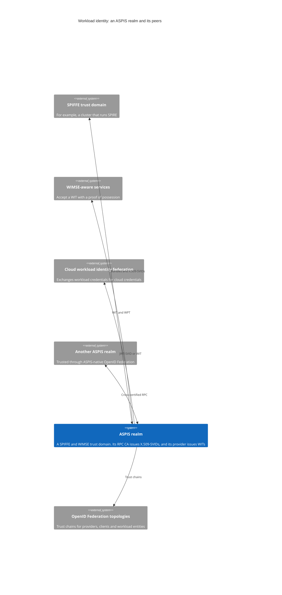

<!-- SPDX-FileCopyrightText: 2026 Nicole Roy -->

# Workload identity: SPIFFE and WIMSE

*2026-11-24. Input to the design session. The decisions it led to are recorded in [ADR 0022](../decisions/0022-spiffe-and-wimse-workload-identity.md).*

1. [The question](#1-the-question)
2. [The specifications](#2-the-specifications)
3. [How the concepts map onto ASPIS](#3-how-the-concepts-map-onto-aspis)
4. [Where they fit, and where they don't](#4-where-they-fit-and-where-they-dont)
5. [Context](#5-context)
6. [Flows](#6-flows)
7. [Open questions](#7-open-questions)

## 1. The question

[0015](../decisions/0015-jwt-tokens-and-oidc-identity.md) named SPIFFE and the IETF WIMSE drafts as the models for workload identity. Are they compatible with ASPIS as described so far?

**Short answer: yes.** At the level of trust domains and identity documents they fit, with four adjustments:

- **Identity URIs use the `spiffe` scheme**, which is valid in both SPIFFE and WIMSE.
- **Certificates keep their composite signatures.** Tokens for SPIFFE peers are signed with a separate ML-DSA-65 key, or a classical one.
- **JWT-SVIDs, which are bearer tokens, are used only at the edge.**
- **The POSIX personality serves the SPIFFE Workload API**, backed by ASPIS's native interfaces.

## 2. The specifications

| Specification | Status | Covers |
|---|---|---|
| SPIFFE ID | SPIFFE standard [SPIFFE-ID] | IDs of the form `spiffe://<trust-domain>/<path>`. Trust domains use `[a-z0-9.-_]` and path segments `[a-zA-Z0-9.-_]`, up to 2,048 bytes in all. Paths may be opaque identifiers, with their metadata in a registry |
| X.509-SVID | SPIFFE standard [X509-SVID] | Exactly one URI SAN, plus rules for leaf and signing certificates. It sets no requirements on algorithms |
| JWT-SVID | SPIFFE standard [JWT-SVID] | A bearer JWT. `alg` is RS, ES or PS, or ML-DSA-44, -65 or -87. `sub` is the SPIFFE ID, and `aud` and `exp` are required |
| WIT-SVID | SPIFFE, incubating [WIT-SVID] | A SPIFFE profile of WIMSE's Workload Identity Token, with the same `alg` list as JWT-SVID |
| Workload API and Workload Endpoint | SPIFFE standards [WL-API], [WL-EP] | gRPC over a Unix socket (or tightly restricted TCP), found through `SPIFFE_ENDPOINT_SOCKET`. Requests carry the `workload.spiffe.io` header. Callers are identified out of band, never by client authentication |
| Trust Domain and Bundle; Federation | SPIFFE standards [BUNDLE], [FED] | Bundles are JWK Sets whose keys have `use` set to `x509-svid`, `jwt-svid` or `wit-svid`, with a `spiffe_sequence`. Bundle endpoints use the `https_web` or `https_spiffe` profile. Each bundle is scoped to one trust domain, and bundles are never merged |
| WIMSE Architecture | Working-group draft -09, 17 November 2026 [WIMSE-ARCH] | Trust domains, identifiers, credentials, attestation (aligned with RATS), security context, token exchange across domains, and AI agents as delegated workloads |
| WIMSE Workload Identifier | Working-group draft -04, October 2026 [WIMSE-ID] | A URI whose authority is the trust domain. The draft defines a `wimse` scheme and allows others, such as `spiffe` |
| WIMSE Workload Credentials | Working-group draft -03, 30 October 2026 [WIMSE-CREDS] | The Workload Identity Token (WIT): `wit+jwt`, with `sub`, `exp` and `cnf.jwk`, and never a bearer token. Also the X.509 workload identity certificate, which the draft calls "fully compatible with the X509-SVID" |
| WIMSE Workload Proof Token | Working-group draft -02, August 2026 [WIMSE-WPT] | `wpt+jwt`, a proof bound to the WIT (`wth`) and to the request (`aud`). It defines an HTTP binding only, though its core is meant to be independent of protocol |
| WIMSE mutual TLS | Working-group draft -03, October 2026 [WIMSE-MTLS] | One URI SAN, and a mapping from each trust domain to its trust anchors |
| WIMSE HTTP Signatures; Workload Identity Practices | Revision -09 in AD evaluation; revision -09 awaiting AD go-ahead [WIMSE-WG] | Workload-to-workload HTTP message signatures; a survey of current practice |

SPIFFE is a CNCF graduated project, and SPIRE is its reference implementation. ASPIS needs SPIFFE's documents and APIs, not SPIRE itself.

## 3. How the concepts map onto ASPIS

| SPIFFE or WIMSE | ASPIS | Fit |
|---|---|---|
| Trust domain | The realm ([0004](../decisions/0004-network-transparency-and-failure.md)), named by its DNS name ([0017](../decisions/0017-openid-federation-membership.md), rule 9) | Exact |
| SPIFFE ID, or workload identifier | A principal's object ID ([0001](../decisions/0001-object-identifiers.md)), written `spiffe://<realm-domain>/<object-id-text>`, with its metadata in the realm registry | Exact, given the scheme and an ID text form that is safe in a path |
| Node attestation, as SPIRE does it | Enrollment at the registry with the genesis key ([0001](../decisions/0001-object-identifiers.md); [0020](../decisions/0020-realm-certificate-authority.md), rule 4) | Stronger: the node's name certifies itself |
| Workload attestation by inspecting the kernel | The process manager assigns identity when it starts a process, from the capabilities involved ([0002](../decisions/0002-capability-security-model.md)), never from process IDs | Stronger: no races when process IDs are reused |
| Registration entries, which map selectors to IDs | Cedar policies on which principal may hold which identity URI ([0018](../decisions/0018-cedar-policy-language.md); [0020](../decisions/0020-realm-certificate-authority.md), rule 6) | Equivalent |
| X.509-SVID, or WIMSE certificate | RPC CA certificates ([0020](../decisions/0020-realm-certificate-authority.md)): one URI SAN, `digitalSignature`, `serverAuth` and `clientAuth`, seven days at most | Already conformant. Composite keys are allowed, because X.509-SVID sets no algorithms |
| Signing certificate | The RPC CA, with path length 0 | Conformant once it carries `spiffe://<realm-domain>`, with no path, as its URI SAN |
| WIT | The workload token that [0015](../decisions/0015-jwt-tokens-and-oidc-identity.md), rule 2, binds to a key the process holds | The same model: sender-constrained through `cnf` |
| WPT | The proof of possession at bind time ([0015](../decisions/0015-jwt-tokens-and-oidc-identity.md), rule 3) | The same model. ASPIS needs an RPC binding |
| JWT-SVID | Nothing inside ASPIS, because ASPIS tokens are never bearer tokens | At the edge only |
| Trust bundle | The realm's root certificate and token keys, published as a JWK Set | Exact. `spiffe_sequence` can be the tree epoch at which the bundle last changed |
| Federation through bundle endpoints | OpenID Federation ([0017](../decisions/0017-openid-federation-membership.md)) and cross-certification ([0020](../decisions/0020-realm-certificate-authority.md)) | They coexist; see §4, item 6 |
| Revocation: none, only short lifetimes | The authorization tree ([0016](../decisions/0016-authorization-sparse-merkle-tree.md)), plus short lifetimes ([0020](../decisions/0020-realm-certificate-authority.md), rule 7) | ASPIS does more |
| AI agents as delegated workloads (WIMSE) | Each agent is a principal with its own object ID | Fits |

## 4. Where they fit, and where they don't

1. **The scheme.**
   - [0020](../decisions/0020-realm-certificate-authority.md) rule 5 puts a WIMSE identifier in certificates but leaves the scheme open. WIMSE allows `spiffe`, and SPIFFE requires it.
   - **Resolution:** use `spiffe://<realm-domain>/<object-id-text>`. One URI is then both a SPIFFE ID and a WIMSE identifier.
   - **Constraints that follow:**
     - the realm's DNS name is written in lower case;
     - the ID's text form ([0001](../decisions/0001-object-identifiers.md), [0013](../decisions/0013-abnf-for-protocols-and-calls.md)) uses only SPIFFE path characters, `[a-zA-Z0-9.-_]`.
2. **Hybrid signatures.**
   - X.509-SVID sets no algorithms, so 0020's composite certificates are valid SVIDs. A SPIFFE peer must still be able to verify composite signatures.
   - JWT-SVID and WIT-SVID allow ML-DSA-65, but not the composite. The parts of a composite key may not be used on their own (RFC 10073), so ML-DSA-65 tokens need a key of their own.
   - WIMSE's WIT allows any asymmetric algorithm in the IANA JOSE registry. The composite JOSE algorithms aren't registered until their draft is published.
   - **Resolution:**
     - WITs used inside ASPIS keep the composite signature ([0015](../decisions/0015-jwt-tokens-and-oidc-identity.md)).
     - Tokens for SPIFFE or WIMSE peers outside ASPIS are signed with a separate ML-DSA-65 key, or a classical key for peers that need one. ASPIS never accepts them back, as [0015](../decisions/0015-jwt-tokens-and-oidc-identity.md) rule 6 already provides for classical tokens.
3. **Bearer tokens.**
   - JWT-SVIDs are bearer tokens. [0015](../decisions/0015-jwt-tokens-and-oidc-identity.md) rule 3 makes every ASPIS token sender-constrained.
   - **Resolution:**
     - The realm issues JWT-SVIDs only to external audiences that require them, and never accepts one inside ASPIS.
     - A SPIFFE workload calling into ASPIS presents its JWT-SVID at the edge. The realm exchanges it there for an ASPIS token ([0017](../decisions/0017-openid-federation-membership.md), flow 4.4 of the [design note](openid-federation.md)).
4. **`sub`.**
   - [0015](../decisions/0015-jwt-tokens-and-oidc-identity.md) rule 2 makes an ASPIS token's `sub` the object ID's text form. WITs and SVIDs require the identity URI there.
   - **Resolution:** access tokens keep the object ID, and WITs and SVIDs use the URI. The URI renders the object ID, so each converts to the other without a lookup.
5. **The Workload API.**
   - SPIFFE serves the Workload API over gRPC on a Unix socket, and identifies callers out of band. ASPIS's native interfaces are IPC defined in the IDL, and callers are identified by capability.
   - **Resolution:**
     - Native programs use a native interface.
     - The POSIX personality ([0012](../decisions/0012-posix-compatibility-layer.md)) serves the SPIFFE Workload Endpoint for unmodified software such as Envoy. It identifies each caller through the POSIX process server.
6. **Federation.**
   - SPIFFE federates by exchanging bundles, each scoped to one trust domain. ASPIS realms cross-certify each other's RPC CAs ([0020](../decisions/0020-realm-certificate-authority.md), rule 10).
   - **Resolution: both.** The realm serves a SPIFFE bundle endpoint for SPIFFE peers, using the `https_web` profile and its edge certificate ([0020](../decisions/0020-realm-certificate-authority.md), rule 11).
   - **No transitive trust.** A SPIFFE validator uses only the bundle for an SVID's own trust domain. A peer that imports the realm's bundle therefore doesn't trust the realms that the realm cross-certifies.
7. **Proof of possession over RPC.**
   - The WPT draft defines an HTTP binding only.
   - **Resolution:** ASPIS defines an RPC binding, in which the WPT's `aud` names the object, interface and version being bound ([0014](../decisions/0014-versioned-object-apis.md)).

## 5. Context

## 6. Flows

### 6.1 A SPIFFE workload calls an ASPIS object

1. A workload in a SPIFFE trust domain that the realm federates with presents its JWT-SVID, or a WIT with a proof, at the realm's HTTPS edge.
2. The realm validates it against that trust domain's bundle, and only that bundle.
3. It maps the workload to an ASPIS principal and exchanges the token for an ASPIS token (RFC 8693).
4. The workload binds to the object, and the bind checks the grant in the authorization tree.

### 6.2 An ASPIS workload calls a SPIFFE service

1. The workload holds an X.509-SVID from the RPC CA.
2. If the peer can verify composite signatures, the two authenticate with mutual TLS. The peer validates the SVID against the realm's bundle, fetched from the realm's bundle endpoint.
3. Otherwise the workload presents a JWT-SVID or WIT for that one audience, signed with the realm's ML-DSA-65 key or its classical key.

### 6.3 Unmodified software inside ASPIS

1. A program such as Envoy, running under the POSIX personality, connects to the socket named in `SPIFFE_ENDPOINT_SOCKET`.
2. The personality's Workload Endpoint identifies the caller through the POSIX process server, and asks the native interface for that principal's SVIDs.
3. It streams the SVIDs and bundles to the program, and pushes each rotation.

## 7. Open questions

- **The path layout:** a bare object ID, or a typed prefix such as `/node/<id>`. Decided: [0022](../decisions/0022-spiffe-and-wimse-workload-identity.md), rule 2. The path is the bare object ID's text form.
- **Lifetimes.** SPIFFE practice is hours; [0020](../decisions/0020-realm-certificate-authority.md) sets a ceiling of seven days. How long should workload certificates and WITs live?
- **Bundle endpoint profiles:** `https_web` only, or `https_spiffe` as well.
- **The native Workload API:** whether native programs should also be offered SPIFFE's API itself, alongside the native interface.
- **Composite JOSE algorithms:** whether to propose adding them to JWT-SVID and WIT-SVID once they are registered.
- **Pinning:** which WIMSE draft revisions to pin.

## Sources

- [SPIFFE-ID] SPIFFE ID: https://github.com/spiffe/spiffe/blob/main/standards/SPIFFE-ID.md
- [X509-SVID] X.509-SVID: https://github.com/spiffe/spiffe/blob/main/standards/X509-SVID.md
- [JWT-SVID] JWT-SVID: https://github.com/spiffe/spiffe/blob/main/standards/JWT-SVID.md
- [WIT-SVID] WIT-SVID (incubating): https://github.com/spiffe/spiffe/blob/main/standards/WIT-SVID.md
- [WL-API] SPIFFE Workload API: https://github.com/spiffe/spiffe/blob/main/standards/SPIFFE_Workload_API.md
- [WL-EP] SPIFFE Workload Endpoint: https://github.com/spiffe/spiffe/blob/main/standards/SPIFFE_Workload_Endpoint.md
- [BUNDLE] SPIFFE Trust Domain and Bundle: https://github.com/spiffe/spiffe/blob/main/standards/SPIFFE_Trust_Domain_and_Bundle.md
- [FED] SPIFFE Federation: https://github.com/spiffe/spiffe/blob/main/standards/SPIFFE_Federation.md
- [WIMSE-ARCH] WIMSE Architecture: https://datatracker.ietf.org/doc/draft-ietf-wimse-arch/
- [WIMSE-ID] WIMSE Workload Identifier: https://datatracker.ietf.org/doc/draft-ietf-wimse-identifier/
- [WIMSE-CREDS] WIMSE Workload Credentials: https://datatracker.ietf.org/doc/draft-ietf-wimse-workload-creds/
- [WIMSE-WPT] WIMSE Workload Proof Token: https://datatracker.ietf.org/doc/draft-ietf-wimse-wpt/
- [WIMSE-MTLS] WIMSE Workload Authentication Using Mutual TLS: https://datatracker.ietf.org/doc/draft-ietf-wimse-mutual-tls/
- [WIMSE-WG] WIMSE working-group documents: https://datatracker.ietf.org/wg/wimse/documents/
